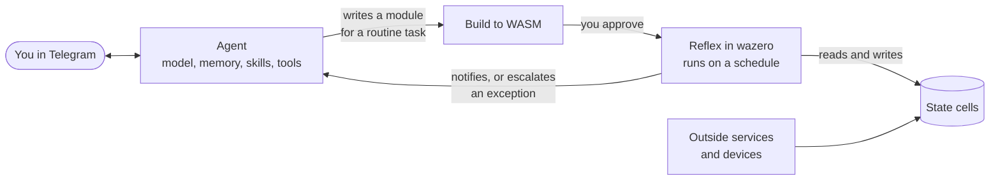

<!--
This README is the project's front page. Keep the order of sections:
pitch and badges, how it works, status, what works, install, documentation,
contributing, license. Install has fixed subsections: when a step lands,
fill its subsection in place instead of adding a new section:
- "Configure" and "First conversation" link into the user guide (#177)
  once it is on the site.
The documentation site is https://igorrius.github.io/ganglion/: the user
guide in docs/guide/ (ADR-0085); the repository's "About" box links to it.
Install steps here stay short and link to the guide's pages.
-->

<h1 align="center">ganglion</h1>

<p align="center">
  <strong>A self-hosted agent that talks to you in Telegram, remembers,
  and builds its own automations.</strong>
</p>

<p align="center">
  <a href="https://github.com/igorrius/ganglion/actions/workflows/ci.yml"></a>
  <a href="https://igorrius.github.io/ganglion/"></a>
  <a href="go.mod"></a>
  <a href="LICENSE"></a>
  
</p>

<p align="center">
  <a href="https://igorrius.github.io/ganglion/">Documentation</a> ·
  <a href="#install">Install</a> ·
  <a href="https://igorrius.github.io/ganglion/getting-started/install/">Install guide</a> ·
  <a href="https://github.com/igorrius/ganglion/issues">Report a bug</a>
</p>

---

ganglion is an agent written in Go. You talk to it in Telegram; it
remembers, searches, runs commands in a sandbox, and when a task repeats it
writes a small program for it. That program, a **reflex**, is compiled to
WebAssembly and then runs on a schedule **without the model**: the model is
called for conversation and for exceptions, not for every tick.

The long-term shape is a network of nodes: a core that holds conversations
and memory, edge runners next to devices, and workers where the model
runtimes are. Today it is one process that carries all three roles.

## How it works



A reflex gets only the capabilities its manifest asks for, every build is
versioned, and a bad version rolls back. State-changing actions of the
agent are confirmed with a button.

## Status

**Early, 0.x, no guarantees.** One person builds it on weekends, with
Claude writing most of the code. The repository is open so that people can
read it, try it and report bugs; it is not a released product. Formats,
commands and the configuration file change without notice, and an issue may
wait for an answer. The public release is planned for a later phase
([ADR-0082](docs/adr/0082-open-the-repository-now-and-keep-the-announced-release-in-p3.md)).

One node has been running the author's family bot since November 2026.
The [ganglion project](https://github.com/users/igorrius/projects/13)
shows the current state and plan.

## What works today

| | |
|---|---|
| **Telegram agent** | Private chats and groups (in a group it answers only when addressed), an access list: strangers get no reply. |
| **Models by purpose** | The `claude` CLI on your own subscription, or any OpenAI-compatible API, chosen per purpose in one file. |
| **Memory** | Kept by topic in plain files; sessions, reminders and scheduled tasks. |
| **Tools under policies** | Web search and reading; host commands in a sandbox (Landlock, no new privileges, a clean environment); every state-changing action confirmed by a button. |
| **Reflex modules** | The agent writes a module in Rust, the node builds it to `wasm32-wasip1` and, after you approve, runs it in [wazero](https://wazero.io). Versioned, with rollback. |
| **Skills** | Procedures in Markdown the agent reads before it acts. |
| **Operations** | An encrypted secret store, one configuration file with a JSON schema, logs, a tool-call journal, `/status`, read-only diagnostics over MCP (`ganglion mcp`). |

Not built yet: nodes talking to each other (the network of the name),
prebuilt binaries, updating a node from a release in the chat.

## Install

ganglion runs on **Linux**. Host commands and module builds need kernel 6.2
or later (Landlock). You need a Telegram bot token from
[@BotFather](https://t.me/BotFather), your Telegram user id, and access to
at least one model (the `claude` CLI or an OpenAI-compatible API key).
The [Getting started](https://igorrius.github.io/ganglion/getting-started/requirements/)
guide has every step in full; below is the short version.

### From a container image

Each release tag publishes an image for `linux/amd64` and `linux/arm64`
(a Raspberry Pi): the node, Rust and the `claude` CLI, run as an
unprivileged user, with its data on a volume at `/data`. Pin a version
(`0.1.0`) or a line (`0.1`) instead of `latest` once you rely on it.

```sh
docker run -d --name ganglion --restart on-failure \
  -v ganglion-data:/data \
  -e TELEGRAM_BOT_TOKEN=... -e CLAUDE_CODE_OAUTH_TOKEN=... \
  ghcr.io/igorrius/ganglion:latest
```

The settings file goes to `/data/ganglion.yaml` (see Configure below);
[Install](https://igorrius.github.io/ganglion/getting-started/install/)
has the details, and how to build the image yourself.

### From source

Needs Go 1.27; building modules also needs Rust with the `wasm32-wasip1`
target.

```sh
git clone https://github.com/igorrius/ganglion.git
cd ganglion
make build                      # ./bin/ganglion
./bin/ganglion version
```

### Configure

One file holds every setting and no secret. A secret is named there as
`env:NAME` (an environment variable) or `store:NAME` (the node's encrypted
store, filled with `ganglion secret set NAME`). The node keeps its database
beside the file.

```sh
cp ganglion.example.yaml ganglion.yaml
# In ganglion.yaml: set telegram.admin to telegram:user:<your Telegram id>
# and choose the providers and models you have.
```

### First conversation

```sh
export TELEGRAM_BOT_TOKEN=...   # plus the provider keys the file names
./bin/ganglion run
```

Write to your bot in Telegram. To have it build something, describe a
routine task; it starts a module from one of two templates in
[examples/modules](examples/modules): a reader that brings an outside
service's numbers into cells, and a reflex that reacts to cells and writes
to you.

Running on a hosting platform:
[Deploying on Railway](https://igorrius.github.io/ganglion/running/railway/);
most of it applies to any.

## Documentation

**User guide: <https://igorrius.github.io/ganglion/>**: install,
configure, commands, modules, operations, troubleshooting.

| You want to | Read |
|---|---|
| Install and run a node | [Getting started](https://igorrius.github.io/ganglion/getting-started/requirements/) |
| Know every command and setting | [Commands](https://igorrius.github.io/ganglion/using/commands/), [Configuration reference](https://igorrius.github.io/ganglion/running/configuration/) |
| Fix something | [Troubleshooting](https://igorrius.github.io/ganglion/troubleshooting/) |

The engineering record lives in the repository, beside the code:
[docs index](docs/README.md), the [specification](docs/spec.md),
[architecture](docs/architecture/README.md),
[decision records](docs/adr/README.md) and
[conventions](docs/conventions.md).

## Contributing and security

Bugs and ideas go to [GitHub Issues](https://github.com/igorrius/ganglion/issues);
what is in work and what comes next is on the
[project board](https://github.com/users/igorrius/projects/13).
Before a pull request, read [CONTRIBUTING.md](CONTRIBUTING.md).
A vulnerability is reported privately: see [SECURITY.md](SECURITY.md).

## License

[Apache License 2.0](LICENSE).
