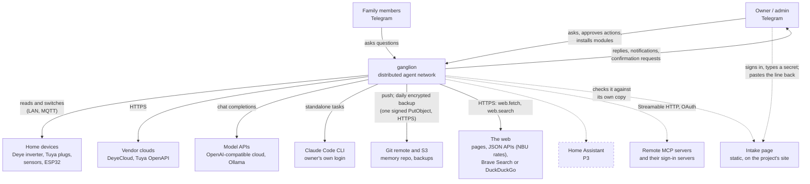

# Level 1 — System context

ganglion as one box: the people who use it and the external systems it
depends on.

| Actor or system | Relationship | Notes |
|---|---|---|
| Owner / admin | Talks to the bot, approves dangerous actions and module installs, toggles kill switches | Role `admin` in the `allowed` table |
| Family members | Ask questions | Cannot install modules or approve physical-safety actions |
| Home devices | Read state, switch loads | Via a runner at home (LAN) or MQTT; microcontrollers never run a runner |
| Vendor clouds | DeyeCloud for battery data, Tuya OpenAPI for plugs | Home internet outlasts the inverter during outages (task 0.7) |
| Model APIs | Routine turns on a cheap model; local models for `privacy: local-only` | [ADR-0007](../adr/0007-openai-compatible-first-provider.md) |
| Claude Code CLI | Heavy standalone tasks on the owner's subscription | Unmodified binary, the project never touches tokens; [ADR-0009](../adr/0009-claude-subscription-only-via-cli-worker.md) |
| Git remote and S3 | Memory history and backups | Memory is Markdown in git; rollback with `git revert`. The daily backup is sealed on the node under a key from the master key and put into an S3-compatible bucket the node's key cannot delete from or read; [ADR-0095](../adr/0095-daily-encrypted-backups-to-an-s3-compatible-bucket.md) |
| The web | Pages and JSON APIs the owner asks about or a task's grant names; search | Untrusted content; [ADR-0035](../adr/0035-web-reading.md) |
| Home Assistant | Planned second automation backend | P3 |
| Remote MCP servers | Tools the admin connects in the chat; their results are outside content | Connected from the chat with the node's own client (the sign-in and the rules are `mcpadmin`'s); [ADR-0097](../adr/0097-connect-remote-mcp-servers-from-the-chat-with-an-own-client.md) |
| Intake page | Returns an OAuth code, or encrypts a secret in the browser, as a line the admin pastes into the chat | The node checks it against the copy in its release; [ADR-0098](../adr/0098-hand-values-over-from-the-chat-through-a-pinned-static-page.md) |

Trust boundaries at this level:

- Everything arriving from Telegram, web pages, emails and vendor clouds is
  **data, not instructions** (prompt injection, R-POL-4).
- Physical actions on devices pass the policy layer on the node that acts
  (R-POL-1).
- Secrets for vendor clouds are given to modules by manifest; the model
  never sees them.
