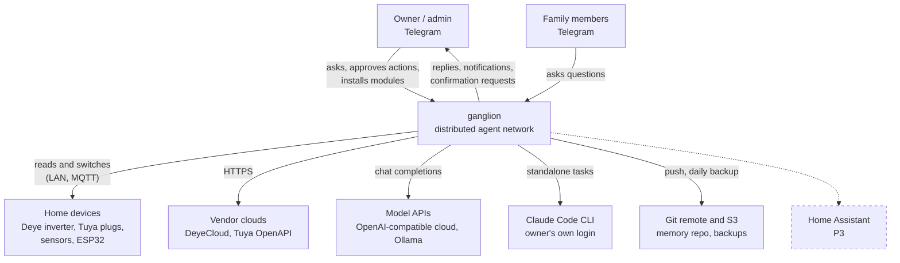

# Level 1 — System context

ganglion as one box: the people who use it and the external systems it
depends on.

| Actor or system | Relationship | Notes |
|---|---|---|
| Owner / admin | Talks to the bot, approves dangerous actions and module installs, toggles kill switches | Role `admin` in the `allowed` table |
| Family members | Ask questions | Cannot install modules or approve physical-safety actions |
| Home devices | Read state, switch loads | Via a runner at home (LAN) or MQTT; microcontrollers never run a runner |
| Vendor clouds | DeyeCloud for battery data, Tuya OpenAPI for plugs | Cloud path works only while home internet has power (spec 8.3) |
| Model APIs | Routine turns on a cheap model; local models for `privacy: local-only` | [ADR-0007](../adr/0007-openai-compatible-first-provider.md) |
| Claude Code CLI | Heavy standalone tasks on the owner's subscription | Unmodified binary, the project never touches tokens; [ADR-0009](../adr/0009-claude-subscription-only-via-cli-worker.md) |
| Git remote and S3 | Memory history and backups | Memory is Markdown in git; rollback with `git revert` |
| Home Assistant | Planned second automation backend | P3 |

Trust boundaries at this level:

- Everything arriving from Telegram, web pages, emails and vendor clouds is
  **data, not instructions** (prompt injection, R-POL-4).
- Physical actions on devices pass the policy layer on the node that acts
  (R-POL-1).
- Secrets for vendor clouds are given to modules by manifest; the model
  never sees them.
