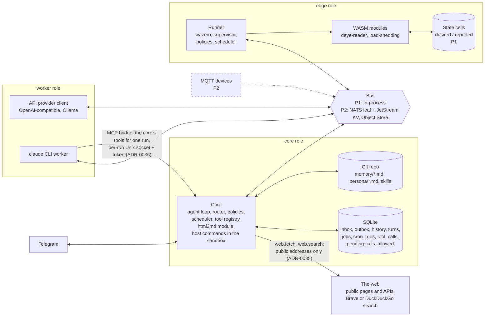
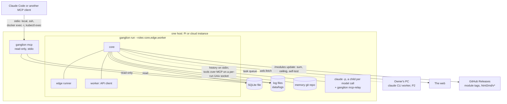
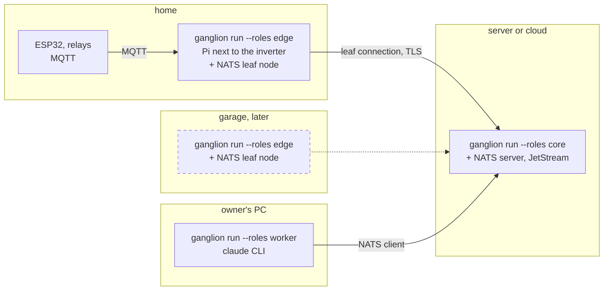

# Level 2 — Containers and deployment

ganglion is one binary; `ganglion run --roles` decides which roles a process hosts
([ADR-0004](../adr/0004-one-binary-with-roles.md)). A "container" here is a
role or a data store, not a Docker container.

## Roles and stores

| Container | Holds | Technology | Phase |
|---|---|---|---|
| Core | Agent loop, router, policies, scheduler, tool registry, Telegram transport; host commands (`host.exec`, `host.stats`) run by the node's own helper process in a Landlock and seccomp sandbox (ADR-0039); the `html2md` module that turns fetched HTML into Markdown | Go; the module in Rust on wazero, embedded in the binary (ADR-0035) | P1 |
| SQLite | Inbox/outbox, conversation history, `turns`, scheduled jobs and `cron_runs`, the tool-call journal `tool_calls`, calls awaiting confirmation and their buttons, `allowed` | modernc.org/sqlite, WAL | P1 |
| Memory repo | `memory/*.md` (facts; held-back ones under `memory/quarantine/`), `persona/*.md`, skills; later embeddings | git, the `git` binary (ADR-0033) | P1 (files), P2 (embeddings) |
| Runner | Module runtime, local policies, offline scheduler | wazero, embedded NATS in P2 | P0 (spike), P1 |
| WASM modules | Compiled reflexes with manifests | TinyGo / Rust / AssemblyScript | P0 (Deye by hand), P3 (by the model) |
| State cells | Desired and reported state of loads, sensors, kill switches, confirmations; backends and observers (ADR-0014) | KV: memory or SQLite in P1, NATS KV in P2 | P1 |
| API provider client | Chat completions | net/http | P1 |
| claude CLI worker | A conversation provider (ADR-0021); standalone heavy tasks later | unmodified `claude -p` | P1 provider; P2 worker (ADR-0015) |
| MCP bridge | The agent's tools for one `claude -p` run, under the core's policies, taint, journal and call keys | own MCP server in the core on a per-run Unix socket `0600` with a token; the hidden `ganglion mcp-relay` as the CLI's stdio server (ADR-0036, ADR-0037) | P1 (M3b) |
| The web (outside) | Pages and APIs `web.fetch` reads, search results of `web.search`; everything read is data, and it taints the session | HTTP(S) to public addresses only, checked on every connection | P1 (M3b) |
| Bus | Messages between roles; across nodes buffering, KV, object store | in-process (P1), NATS (P2) | P1 / P2 |

## Deployment: P1, all-in-one

One process on a Raspberry Pi or a small cloud instance. The bus is
in-process; there is no NATS yet.

`ganglion mcp` is a separate process started by the MCP client
([ADR-0044](../adr/0044-ganglion-mcp-diagnostics-over-stdio.md)): it
needs no running node and no model, opens the database read-only beside
a running core, and opens no port.

## Deployment: P2, core + edges

The core runs a NATS server with JetStream. Each edge runs a leaf node that
dials out to the core, so no inbound ports or NAT forwarding are needed.
While the link is down, edges keep running on their modules and local
policies; events queue up in JetStream and are delivered later.

An edge needs three files: the binary, a NATS credentials file and the
owner's public key for verifying modules.
