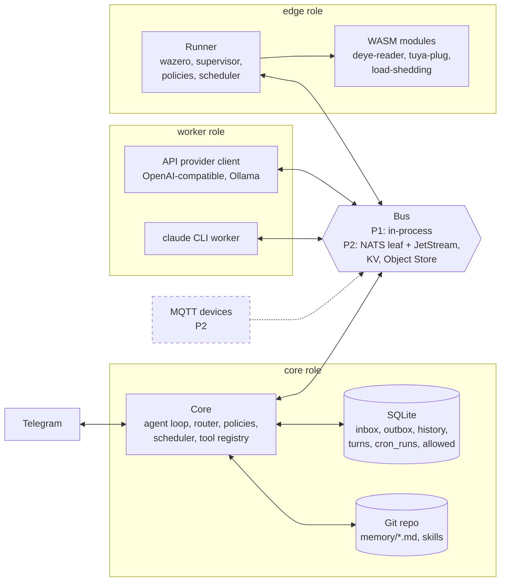
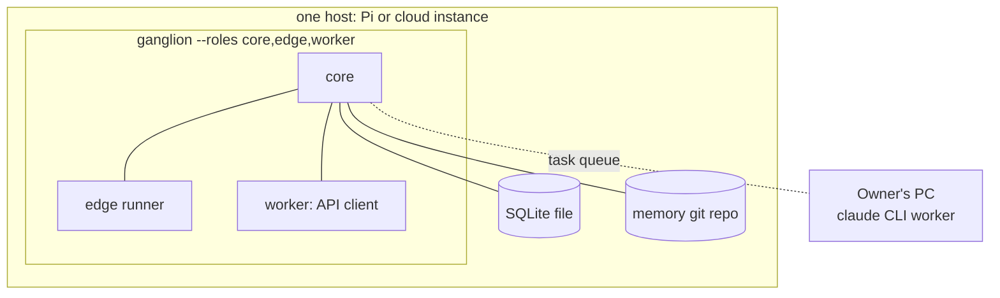
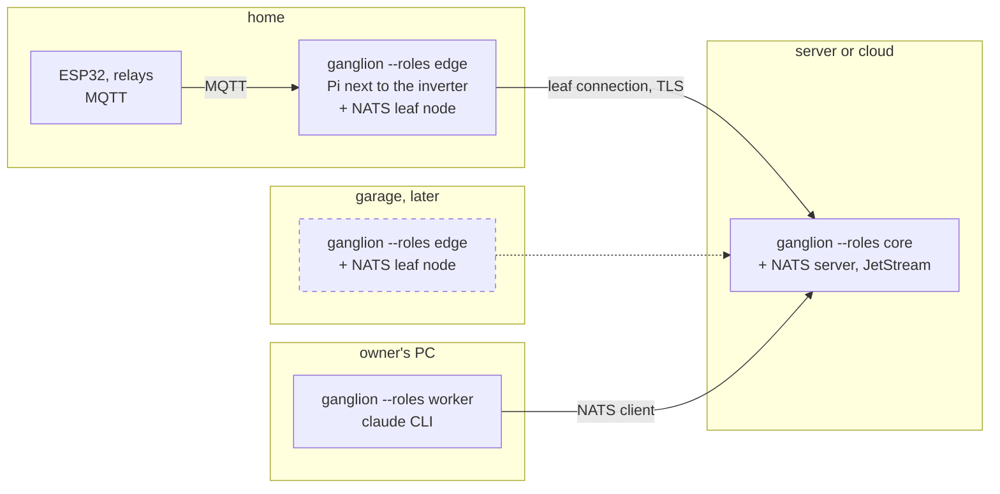

# Level 2 — Containers and deployment

ganglion is one binary; `--roles` decides which roles a process hosts
([ADR-0004](../adr/0004-one-binary-with-roles.md)). A "container" here is a
role or a data store, not a Docker container.

## Roles and stores

| Container | Holds | Technology | Phase |
|---|---|---|---|
| Core | Agent loop, router, policies, scheduler, tool registry, Telegram transport | Go | P1 |
| SQLite | Inbox/outbox, conversation history, `turns`, `cron_runs`, `allowed` | modernc.org/sqlite, WAL | P1 |
| Memory repo | `memory/*.md`, skills; later embeddings | git | P1 (files), P2 (embeddings) |
| Runner | Module runtime, local policies, offline scheduler | wazero, embedded NATS in P2 | P0 (spike), P1 |
| WASM modules | Compiled reflexes with manifests | TinyGo / Rust / AssemblyScript | P0 (Deye by hand), P3 (by the model) |
| API provider client | Chat completions | net/http | P1 |
| claude CLI worker | Standalone heavy tasks | unmodified `claude -p` | P1 |
| Bus | Messages between roles; across nodes buffering, KV, object store | in-process (P1), NATS (P2) | P1 / P2 |

## Deployment: P1, all-in-one

One process on a Raspberry Pi or a small cloud instance. The bus is
in-process; there is no NATS yet.

## Deployment: P2, core + edges

The core runs a NATS server with JetStream. Each edge runs a leaf node that
dials out to the core, so no inbound ports or NAT forwarding are needed.
While the link is down, edges keep running on their modules and local
policies; events queue up in JetStream and are delivered later.

An edge needs three files: the binary, a NATS credentials file and the
owner's public key for verifying modules.
