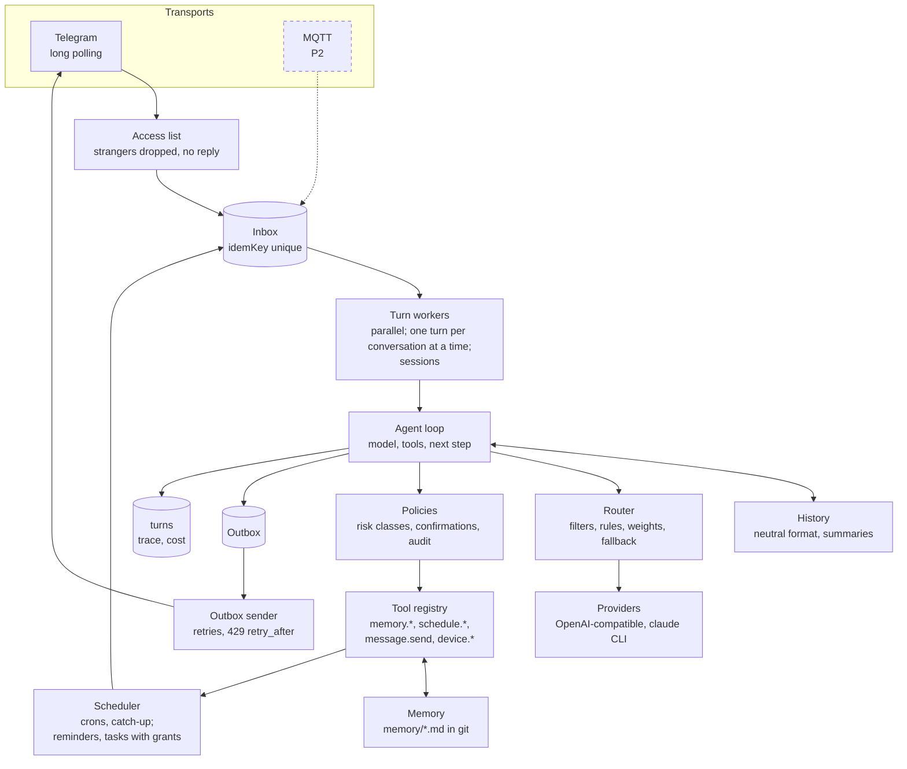
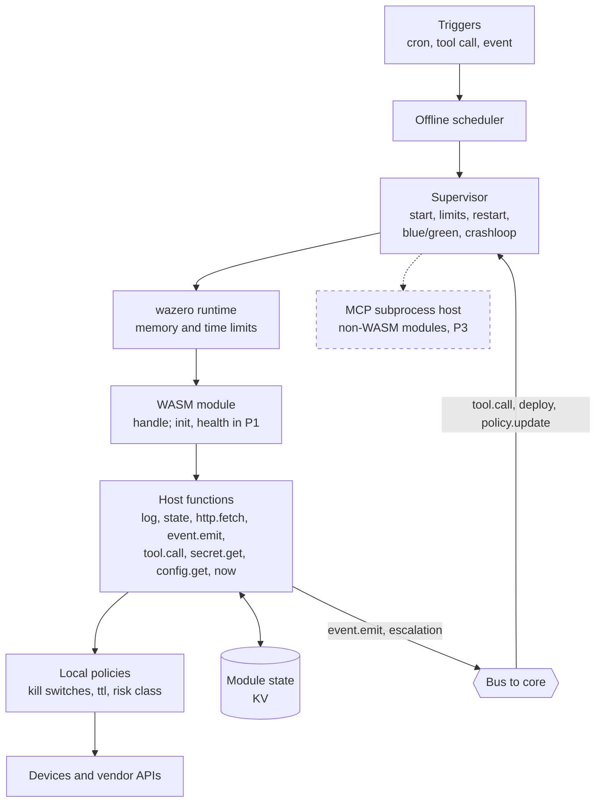
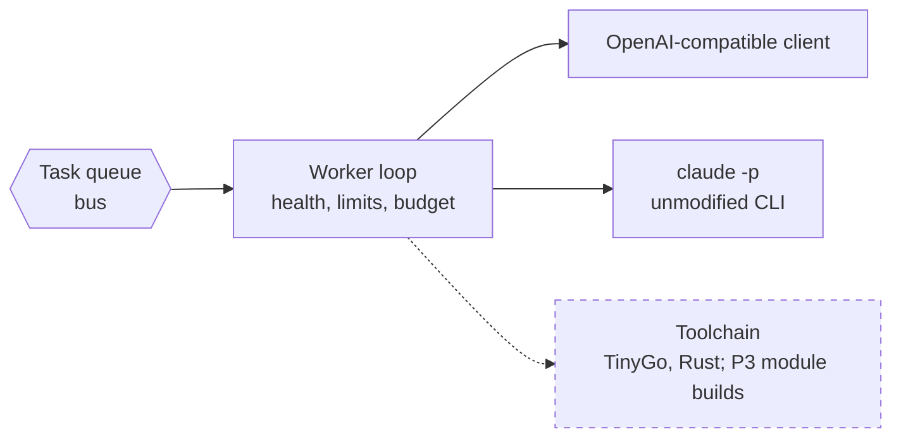

# Level 3 — Components

What is inside each role. Package names are in
[05-code-map.md](05-code-map.md).

## Core

| Component | Responsibility | Requirements |
|---|---|---|
| Transports | Turn channel input into `Event`s; send `Outgoing` | R-DLV-2, R-DLV-8 |
| Inbox / outbox | Durable at-least-once delivery, deduplication by `idemKey`, transactional replies | R-DLV-1…7 |
| Conversation actors | One turn at a time per conversation, leases, timeouts | R-AGT-1, R-DLV-3 |
| Agent loop | Model call → tool calls → next step, step limit, depth limit | R-AGT-3, R-AGT-4 |
| History | Provider-neutral transcript, compaction | R-AGT-2 |
| Router | Ordered candidates by skill requirements, budget, health | R-RTR-1…3 |
| Providers | Talk to model backends, translate MCP tools | R-PRV-1…4 |
| Policies | Decide autonomous / confirm / forbid; audit | R-POL-1…5 |
| Tool registry | Tools available to the model, local and on edges | — |
| Memory | Facts and skills in git, nightly consolidation | R-MEM-1…4 |
| Scheduler | Crons in the node's zone with catch-up after downtime; reminders and agent tasks with grants, each task in its own conversation | R-SCH-1, R-SCH-2, R-POL-8 |
| turns | Trace and cost of every turn | R-AGT-5 |

## Edge runner

A module sees only the host functions its manifest grants; by default it
gets nothing (R-RUN-1). Every host call that changes the world passes the
local policy check (R-POL-1).

## Worker

Workers report health and exhausted limits so the router can skip them
(router layer 2).
