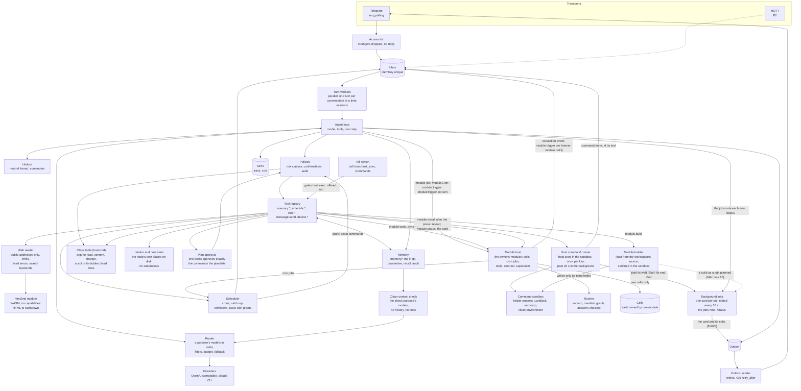
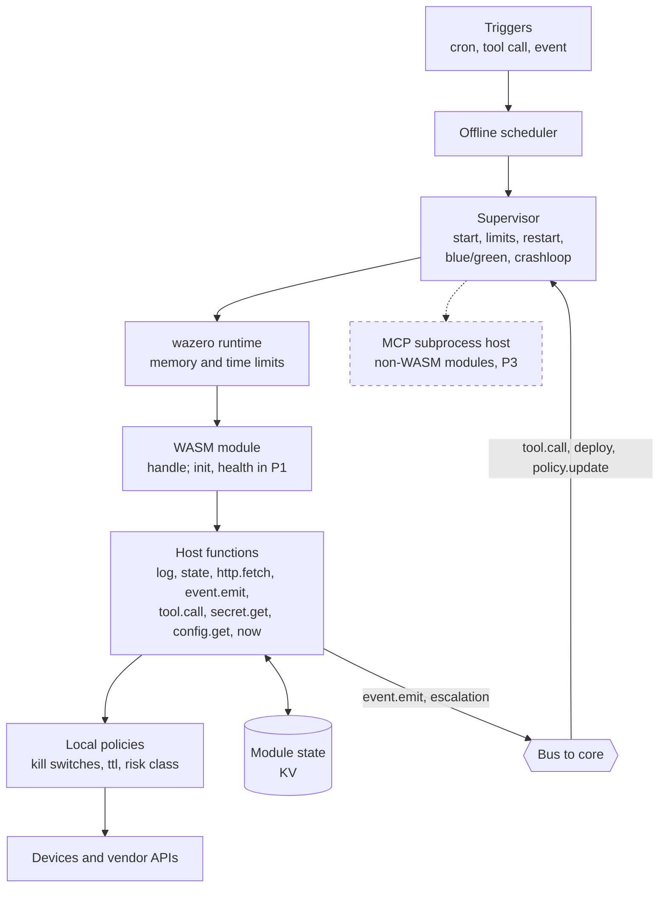
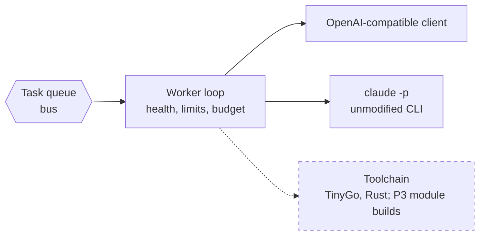

# Level 3 — Components

What is inside each role. Package names are in
[05-code-map.md](05-code-map.md).

## Core

| Component | Responsibility | Requirements |
|---|---|---|
| Transports | Turn channel input into `Event`s; send `Outgoing` | R-DLV-2, R-DLV-8 |
| Inbox / outbox | Durable at-least-once delivery, deduplication by `idemKey`, transactional replies | R-DLV-1…7 |
| Conversation actors | One turn at a time per conversation, leases, timeouts | R-AGT-1, R-DLV-3 |
| Plan | The steps of the work as one message edited in place, shown during the turn; approves nothing | R-LIVE-8 |
| Status reactions | Work that takes long shows on the person's message; a hint, outside the outbox | R-LIVE-7 |
| Agent loop | Model call → tool calls → next step, step limit, depth limit; a message written during the turn joins it between calls | R-AGT-3, R-AGT-4, R-LIVE-1..6 |
| History | Provider-neutral transcript, compaction | R-AGT-2 |
| Router | Ordered candidates: the purpose's list from `ganglion.yaml` in order, filtered by skill requirements, budget and health; skills (`skills`): built-in and the owner's, a script per skill with an effect class, the rest of a turn routed by the skill read | R-RTR-1…6 |
| Providers | Talk to model backends, translate MCP tools | R-PRV-1…4 |
| Policies | Decide autonomous / confirm / forbid; audit | R-POL-1…5 |
| Tool registry | Tools available to the model, local and on edges | — |
| Memory | Facts in git with where they came from; the index in an admin's system prompt; recall over facts and archived sessions; nightly consolidation (M7) later | R-MEM-1…5 |
| Clean-context check | Checks every memory write, and on schedule stored facts and the persona, with a model of the `check` purpose that sees only the text; fails closed into quarantine | R-POL-7 |
| Scheduler | Crons in the node's zone with catch-up after downtime; reminders and agent tasks with grants, each task in its own conversation | R-SCH-1, R-SCH-2, R-POL-8 |
| Host command runner | Runs `host.exec` commands in the sandbox once per call key; one still running after 20 s goes on as a background job with a card, and its end comes back at once as a `command.done` event that resumes its conversation (a task's under its grant) | R-CMD-1, R-CMD-4 |
| Background jobs (`jobs`) | Work the node runs outside a turn (a host command past its wait; a module build from M4c task 10): a row each, one card in its conversation (none for a scheduled task's) sent at the start and edited through the outbox every 10 s with the node's words, the title and counts, ending as done, failed or interrupted by a restart; a note of the conversation's running jobs in every turn, not stored; a "Background jobs" section in `/status` | R-LIVE-9, R-CMD-4, R-OBS-11 |
| Class table | `hostcmd.Classify(argv)` gives a class and a fixed consequence line in three languages from code, never from the model; the policy, the tool, a plan and the agent's question all ask it, and what it cannot read moves a command up | R-CMD-2, R-CMD-6 |
| Command sandbox | Starts each command as the node's own helper with Landlock, seccomp and a clean environment; off (and no `host.exec`) when a check fails. A module's build runs confined: it writes only its temporary folder, and the helper kills whatever it left running (ADR-0064) | R-CMD-3, R-RUN-9 |
| Janitor and `host.stats` | Measure the node's places on disk without a subprocess and remove what is past its age; the kill switch `tools.host_exec` is a cell only an admin's `/commands` sets | R-CMD-5, R-CMD-8 |
| Plan approval | A plan whose steps carry commands is one question; one press approves exactly those commands, in its conversation, for an hour; a task's grant lists exact commands the same way | R-CMD-7, R-POL-9 |
| Web reader | `web.fetch` on public addresses only (checked on every connection, redirects included, a task kept to its granted hosts) within size and time limits; `web.search` through Brave or DuckDuckGo; remote text only as outside content | R-WEB-1…3 |
| html2md module | Turns a page into Markdown in the WASM sandbox, granted nothing; replaced without a core release | R-WEB-1 |
| Module host (`modhost`) | Runs the owner's local modules in the node: loads the active versions, defines the cells they own under their prefix, keeps a `module` cron job each (owned by the installing admin), offers their tools to the registry as they come and go, checks every answer against the manifest's contract, counts runs and failures, turns a module off after five failures within an hour, and puts one escalation of a kind per episode (until a successful run) of a run nobody watched (cron, `init`) as a turn in the admin's private chat; a failed tool call is the calling turn's to tell, in the node's words with a hint per kind; a run that wrote cells puts one `module.trigger` event per running listener into the inbox, and runs the listener when the agent hands the event back, with no model (chains stop past depth 4) | R-RUN-11…15 |
| Module builder and the module tools | `module.import` copies an example the node ships into the workspace and commits it after a press; `module.write` writes one file of `modules/<name>` from a clean session and `module.read` reads it back, and the node keeps a per-file provenance record of what its own tools left (it decides whether a build answer taints); `module.build` builds `modules/<name>` from the workspace in the sandbox and keeps the build as a file with the rights its manifest asks for; `module.install` shows the owner those rights (the install window) and, after the press, installs exactly the build the window showed, re-planned at the press, then writes its settings line and reloads it in the module host | R-RUN-9, R-RUN-17 |
| turns | Trace and cost of every turn | R-AGT-5 |

## Edge runner

A module sees only the host functions its manifest grants; by default it
gets nothing (R-RUN-1). Every host call that changes the world passes the
local policy check (R-POL-1).

## Worker

Workers report health and exhausted limits so the router can skip them
(router layer 2).
