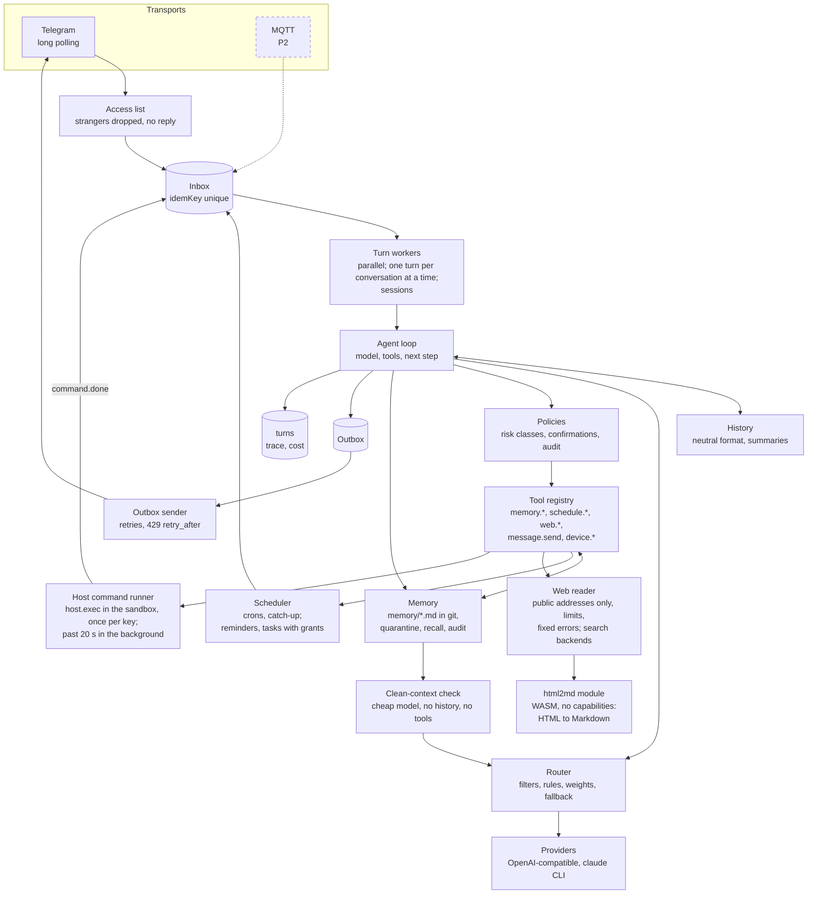
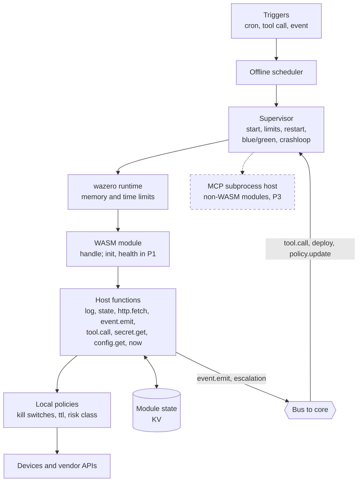
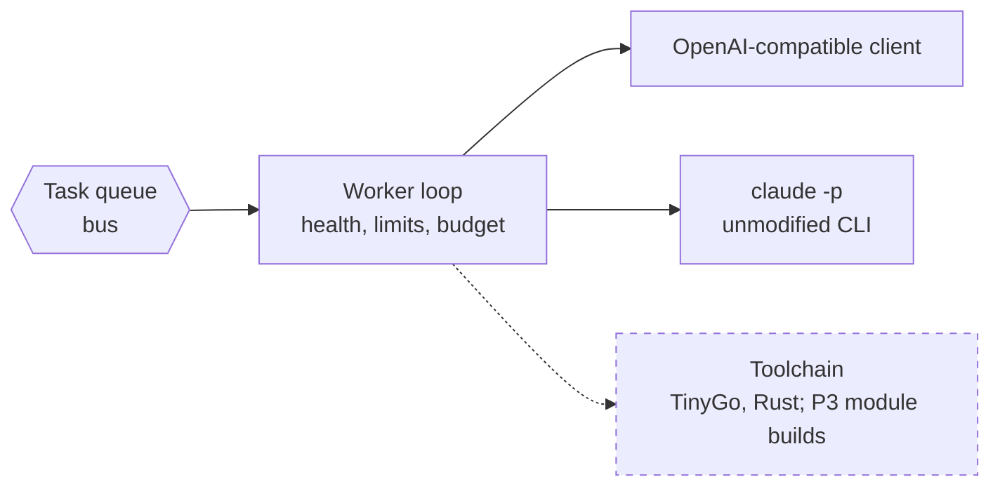

# Level 3 — Components

What is inside each role. Package names are in
[05-code-map.md](05-code-map.md).

## Core

| Component | Responsibility | Requirements |
|---|---|---|
| Transports | Turn channel input into `Event`s; send `Outgoing` | R-DLV-2, R-DLV-8 |
| Inbox / outbox | Durable at-least-once delivery, deduplication by `idemKey`, transactional replies | R-DLV-1…7 |
| Conversation actors | One turn at a time per conversation, leases, timeouts | R-AGT-1, R-DLV-3 |
| Plan | The steps of the work as one message edited in place, shown during the turn; approves nothing | R-LIVE-8 |
| Status reactions | Work that takes long shows on the person's message; a hint, outside the outbox | R-LIVE-7 |
| Agent loop | Model call → tool calls → next step, step limit, depth limit; a message written during the turn joins it between calls | R-AGT-3, R-AGT-4, R-LIVE-1..6 |
| History | Provider-neutral transcript, compaction | R-AGT-2 |
| Router | Ordered candidates by skill requirements, budget, health; skills (`skills`): built-in and the owner's, a script per skill with an effect class, the rest of a turn routed by the skill read | R-RTR-1…5 |
| Providers | Talk to model backends, translate MCP tools | R-PRV-1…4 |
| Policies | Decide autonomous / confirm / forbid; audit | R-POL-1…5 |
| Tool registry | Tools available to the model, local and on edges | — |
| Memory | Facts in git with where they came from; the index in an admin's system prompt; recall over facts and archived sessions; nightly consolidation (M7) later | R-MEM-1…5 |
| Clean-context check | Checks every memory write, and on schedule stored facts and the persona, with a cheap model that sees only the text; fails closed into quarantine | R-POL-7 |
| Scheduler | Crons in the node's zone with catch-up after downtime; reminders and agent tasks with grants, each task in its own conversation | R-SCH-1, R-SCH-2, R-POL-8 |
| Host command runner | Runs `host.exec` commands in the sandbox once per call key; one still running after 20 s goes on, and its end comes back as a `command.done` event that resumes its conversation (a task's under its grant) | R-CMD-1, R-CMD-4 |
| Web reader | `web.fetch` on public addresses only (checked on every connection, redirects included, a task kept to its granted hosts) within size and time limits; `web.search` through Brave or DuckDuckGo; remote text only as outside content | R-WEB-1…3 |
| html2md module | Turns a page into Markdown in the WASM sandbox, granted nothing; replaced without a core release | R-WEB-1 |
| turns | Trace and cost of every turn | R-AGT-5 |

## Edge runner

A module sees only the host functions its manifest grants; by default it
gets nothing (R-RUN-1). Every host call that changes the world passes the
local policy check (R-POL-1).

## Worker

Workers report health and exhausted limits so the router can skip them
(router layer 2).
