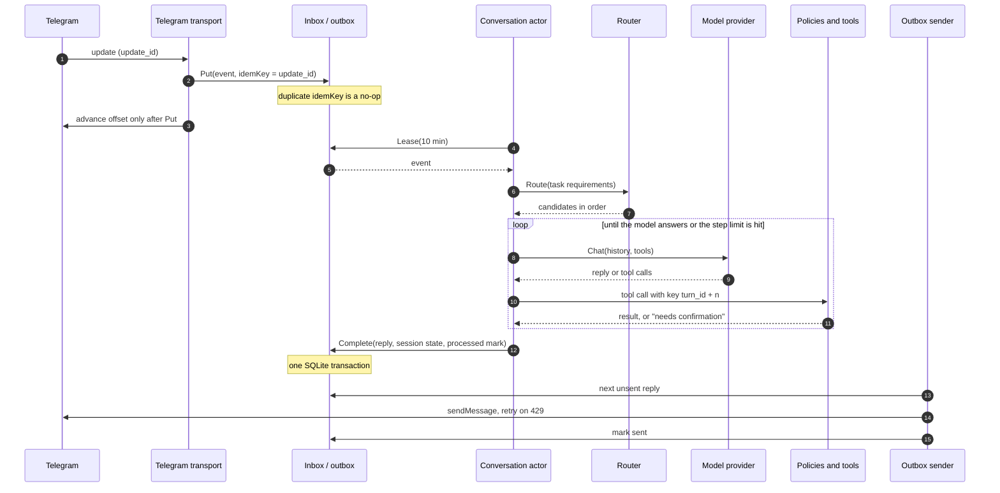
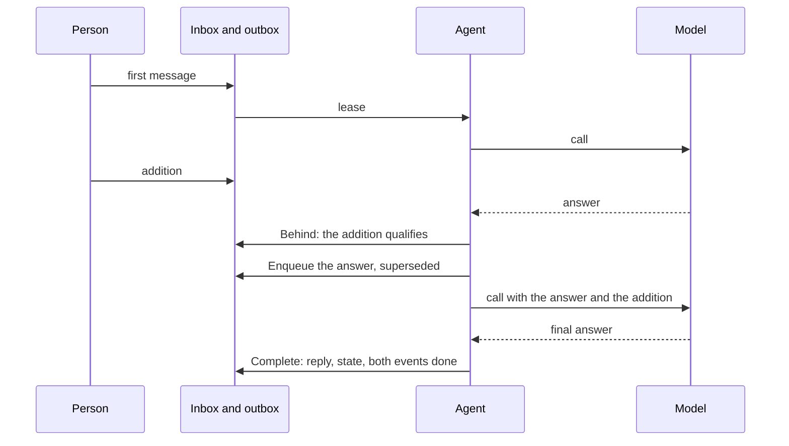
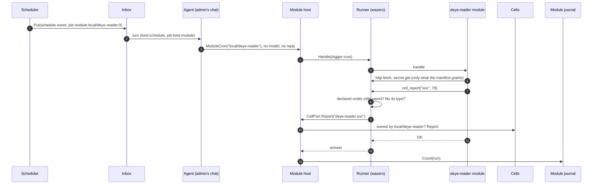
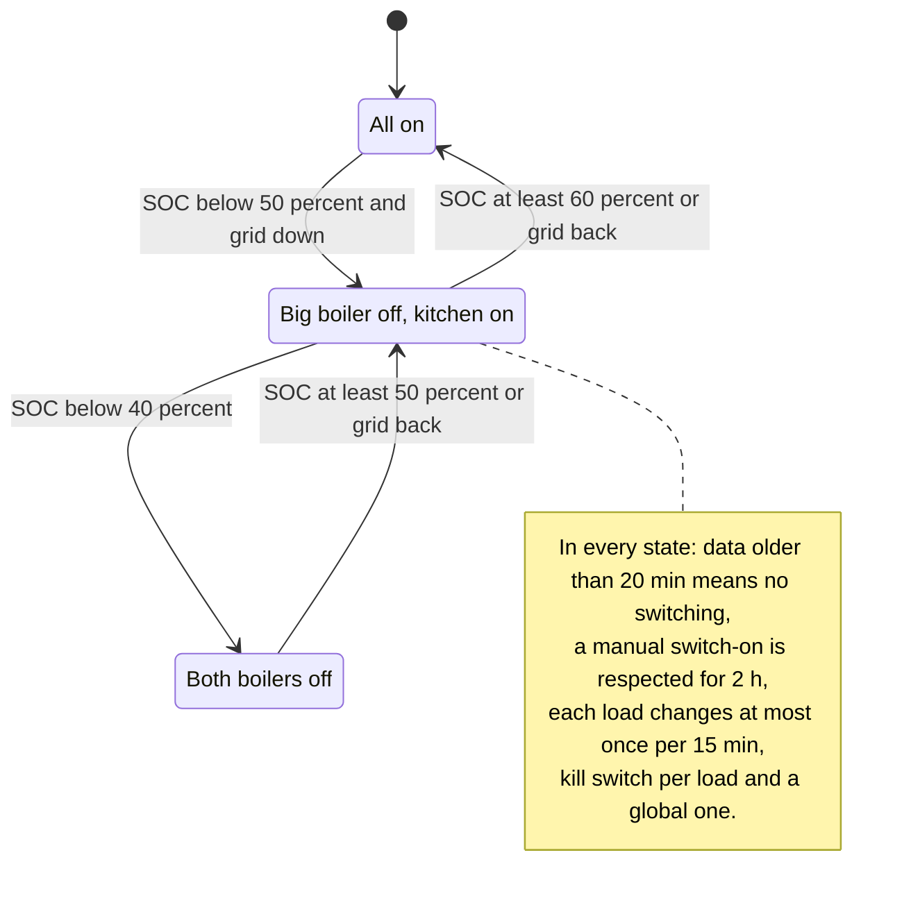
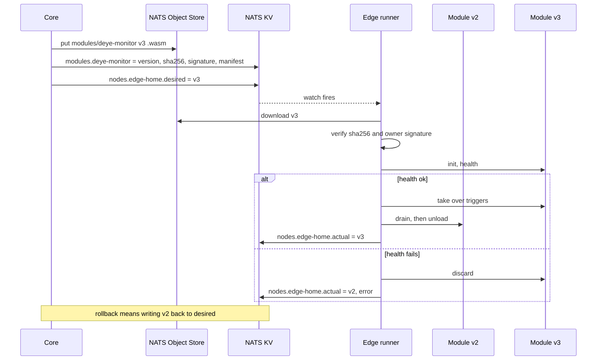
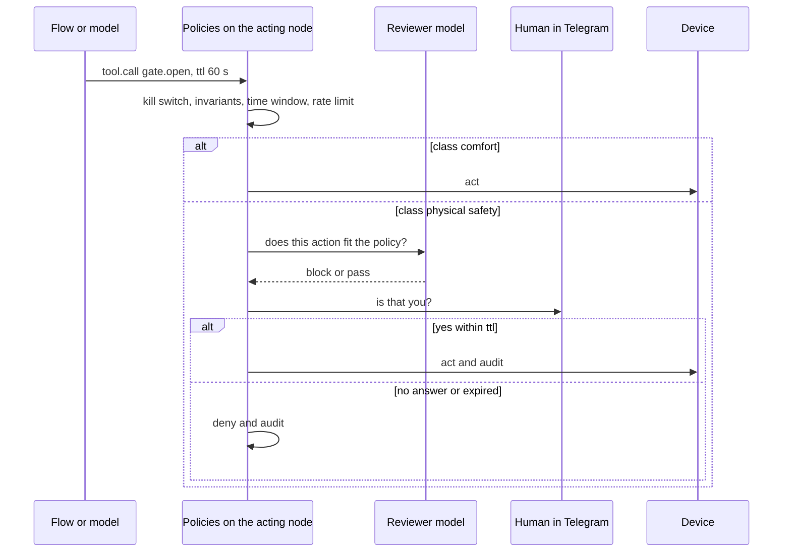

# Level 4 — Runtime flows

How the components cooperate in the scenarios that matter most.

## Chat turn with guaranteed delivery (P1)



If the process dies before `Complete` commits, the restarted core releases
the lease and the turn runs again from its start, under the same call keys
(R-DLV-6). That run does not count as a failed attempt; an event that more
than 10 restarts cut short is given up on
([ADR-0046](../adr/0046-a-restart-is-not-a-failed-attempt.md)). If it dies
between sending and marking, one duplicate reply is possible (R-DLV-5).

## Confirmation on a button (P1)

A message written during a turn joins it at the next boundary
([ADR-0050](../adr/0050-additions-join-a-running-turn.md)): before each model call and each
tool call the agent reads what waits behind the turn's event. No tool call starts while one
waits. An answer it overtook goes out at once, marked as superseded, and `Complete` marks
what the turn took as done in its one transaction.

On the CLI route a call that returns with an addition waiting ends the run: the core cancels it
with a cause of its own and starts a new one with the whole history. That is not a failure,
a fallback or a retry.



A call that needs the owner's confirmation does not hold its turn open:
the turn ends with the call parked, and the press is a new event that
resumes the conversation ([ADR-0032](../adr/0032-buttons-and-resume.md)).
The press is acknowledged before its action runs (ruling R40); a press
that becomes no event, or that the access list drops, the transport
answers itself.

```mermaid
sequenceDiagram
    autonumber
    participant TG as Telegram
    participant T as Telegram transport
    participant Q as Inbox / outbox
    participant A as Agent
    participant P as Policy
    participant D as Pending store
    participant X as Tool

    A->>P: tool call (key turn_id + n)
    P->>D: Ask: store call, request cell, two buttons
    P-->>A: "awaiting confirmation" + question with buttons
    A->>Q: Complete(question, reply, Pending += id)
    Q-->>TG: question with buttons c:<id>
    TG->>T: callback_query
    T->>Q: Put(decision, idemKey = update_id, query id)
    A->>Q: Lease
    A->>D: Press (one-time, principal, chat, expiry)
    A->>Q: Enqueue(toast "Approved", edit "⏳ Approved, running…")
    Q-->>TG: answerCallbackQuery(text), editMessageText (no buttons)
    alt approve
        A->>X: stored call, same key, journal "approved", no policy
        X-->>A: result
    else deny
        Note over A: journal "denied", result "the owner declined"
    end
    A->>D: Decide(done, result)
    A->>A: model on "[confirmation] tool: result"
    A->>Q: Complete(the call's messages, edit "Approved, 21:09" with the question folded, answer)
    Note over D,Q: unanswered: the expirer puts tool.result every 30 s, same resume with "expired"; the question closes itself, found by its outbox ref
```

## A long host command (P1)

A host command still running after the short wait (20 s) does not hold its
turn open either (R-CMD-4). The call answers "still running" and the turn
ends with the command's key in the state, which keeps the plan open. The
command goes on under the runner. Its end is put into the conversation's
inbox once as a `command.done` event, by the runner's announce pass every
30 s (not at the moment it ends), and that event resumes the
conversation as a press does: the outcome is outside data, the model has
its tools, and its calls run one level deeper. A command of a scheduled
task resumes as a turn of that task, under its grant (ruling 7 of the M3d
plan). The session may have moved on by then (`/new`, or the idle cut).
Then the conversation gets one fixed line, without a model, and the output
stays out of the new session. A call whose context ends while it waits
(the turn's clock) leaves its command in the background the same way.

```mermaid
sequenceDiagram
    autonumber
    participant P as Person
    participant Q as Inbox / outbox
    participant A as Agent
    participant M as Model
    participant X as host.exec
    participant R as Runner

    P->>Q: "how big is ~/project?"
    Q->>A: lease
    A->>M: call
    M-->>A: host.exec du -sh ~/project
    A->>X: call (key turn_id + n)
    X->>R: Exec: row "running", command in the sandbox
    Note over X,R: 20 s pass, or the call's context ends
    R-->>X: not done: background
    X-->>A: "still running", Job = key
    A->>M: call with the result
    M-->>A: "it runs; I'll tell you"
    A->>Q: Complete(answer, Commands += key)
    Note over R: the command ends; its row is "done", not announced yet
    Note over R: the announce pass, every 30 s
    R->>Q: Put(command.done, idemKey command:<key>:done)
    Q->>A: lease
    A->>R: Get(key): argv, outcome, principal, depth
    alt the session lists the key
        A->>M: "[command finished] du -sh ~/project: <external>…</external>", with tools
        M-->>A: "~/project is 2.1 GiB"
        A->>Q: Complete(answer, Commands -= key, tainted)
    else the session moved on
        A->>Q: Complete("The command … finished after this conversation moved on.")
    end
```

## A module run on cron (P1)

The Deye reader as a reflex: no model in the normal path (R-RUN-12). The
module's cron line is a `module` job of the admin who installed it; its
event reaches the agent only to be handed to the module host.



## A module started by another module's cells (P1)

A run that wrote cells starts every running module that listens to any of
them, through the node's inbox, with no model and no turn (R-RUN-15,
[ADR-0065](../adr/0065-cell-triggers-through-the-inbox.md)). The run is
identified by the slot of a cron run, the key of a tool call or the id of
a trigger event, so a run delivered again puts no second event; a chain
stops past depth 4. The listener's run is unattended, like cron: counted,
escalated, towards the crash loop.

```mermaid
sequenceDiagram
    autonumber
    participant P as deye-reader run
    participant H as Module host
    participant Q as Inbox
    participant A as Agent.Handle
    participant L as deye-alerts module

    P->>H: cell_report soc, grid (noted in the run's context)
    Note over H: the run ends: settle (count, escalate, crash loop)
    H->>H: running listeners of the cells written, not the producer
    alt depth + 1 at most 4
        H->>Q: Put(module.trigger, conv module:deye-alerts, key trigger:local/deye-alerts:local/deye-reader:RUN, cells sorted, depth)
    else deeper
        H->>H: no event; a log line once per build
    end
    Q->>A: kind module.trigger, before begin: no state, no turn, no model
    A->>H: RunTrigger(payload, event id)
    H->>L: Handle(trigger cell, cells and producer)
    L->>H: cell_get(deye-reader.soc), ...
    H->>H: settle as unattended; fan out its own cells, depth + 1
    H-->>A: nil (a failure is the supervisor's); an error only when the run could not start
    A-->>Q: acknowledged, or retried after the lease on an error
```

## A module tool call (P1)

The agent calls `deye-reader.status` like any read tool; the answer is
the data its manifest promised, checked, and outside content only when it
holds a string (R-RUN-13). A failure reaches the model in the node's words
(R-RUN-14).


## A module's escalation (P1)

A failure of a run nobody watched (a cron run, `init` at load) whose kind
the manifest escalates, a contract break or a crash loop becomes one turn
in the installing admin's private chat, at most one of a kind for a module
until it recovers (design section 8.4, owner rulings of 2026-11-10). A tool
call that fails inside a turn is not escalated: that turn has the node's
words and hint for it already.

```mermaid
sequenceDiagram
    autonumber
    participant H as Module host
    participant St as Settings file
    participant S as Scheduler jobs
    participant Q as Inbox
    participant A as Agent
    participant LLM as Model
    participant O as Owner

    H->>H: count the failure in the last hour
    opt a cron run or init, kind escalates, no episode of it open (escalate list, module.format)
        H->>Q: Put(module event, key module:NAME:KIND:SHA:OPENED, once per episode)
    end
    opt fifth failure within an hour
        H->>H: unload; its tools leave the registry
        H->>St: off: true, comment crashloop
        H->>S: delete its jobs
        H->>Q: Put(module event, kind module.crashloop)
    end
    Q->>A: turn in the admin's private chat
    A->>A: note "[module] deye-reader: auth_failed (version 3, 14:30). (the node's detail and hint)"
    A->>LLM: chat purpose, with tools
    LLM-->>A: explanation and a proposal
    A->>O: reply
```

## Load-shedding flow (planned, after P1)

Moved out of P1 by [ADR-0058](../adr/0058-load-shedding-leaves-p1.md); kept
as the first flow for the flow engine (spec 9.6): staged shedding of loads by battery
state of charge during a power cut. The flow sets the desired state of load
cells; their backend (`virtual` in P1, Tuya plugs later) makes it real, and a
Telegram notifier observes the changes ([ADR-0014](../adr/0014-state-cells.md)).



Escalation to the model: Deye or backend auth error, a backend not
converging desired and reported state, no data for over an hour. Shadow mode
is simply the `virtual` backend.

## Module rollout via desired state (P2)



## Escalating a dangerous action (P2–P3)


