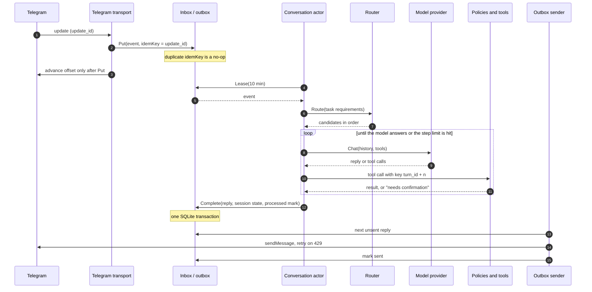
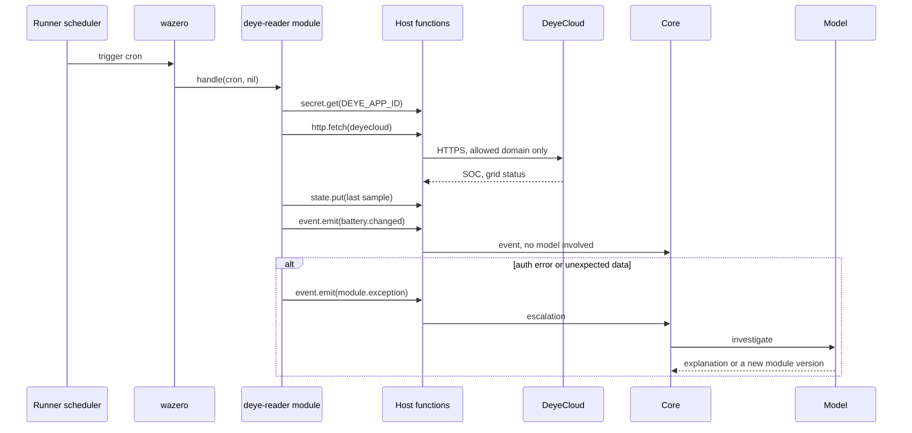
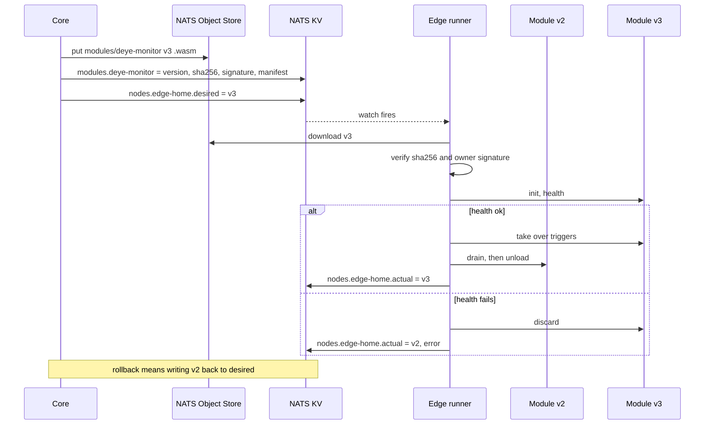
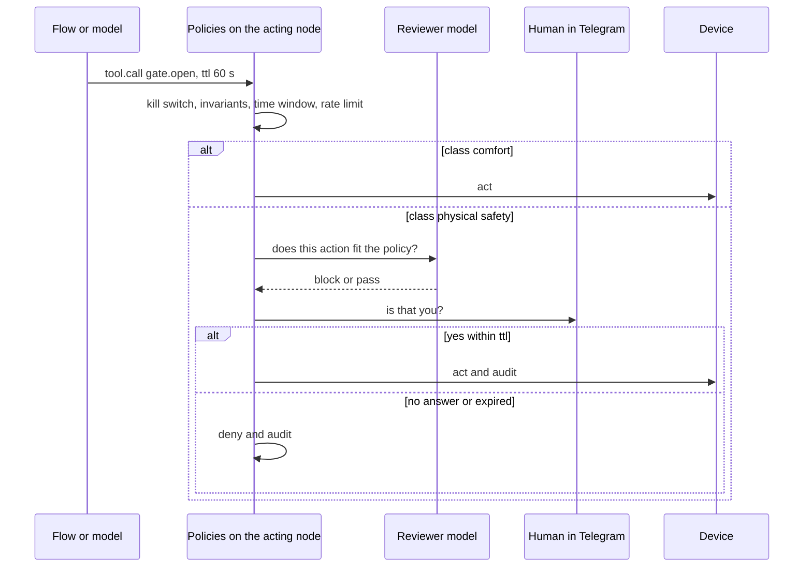

# Level 4 — Runtime flows

How the components cooperate in the scenarios that matter most.

## Chat turn with guaranteed delivery (P1)

If the process dies before `Complete` commits, the lease expires and the event is
processed again. If it dies between sending and marking, one duplicate
reply is possible (R-DLV-5).

## Module tick and escalation (P0–P1)

The Deye monitor as a reflex: no model in the normal path.

## Load-shedding flow (P1)

The first real flow (spec section 8): staged switching of Tuya plugs by
battery state of charge during a power cut.

Escalation to the model: Tuya or Deye auth error, a plug not responding, no
data for over an hour. The first week runs in shadow mode.

## Module rollout via desired state (P2)

## Escalating a dangerous action (P2–P3)

