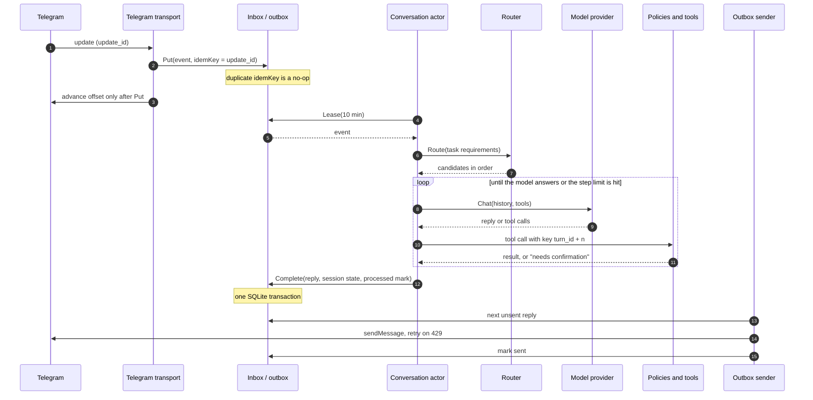
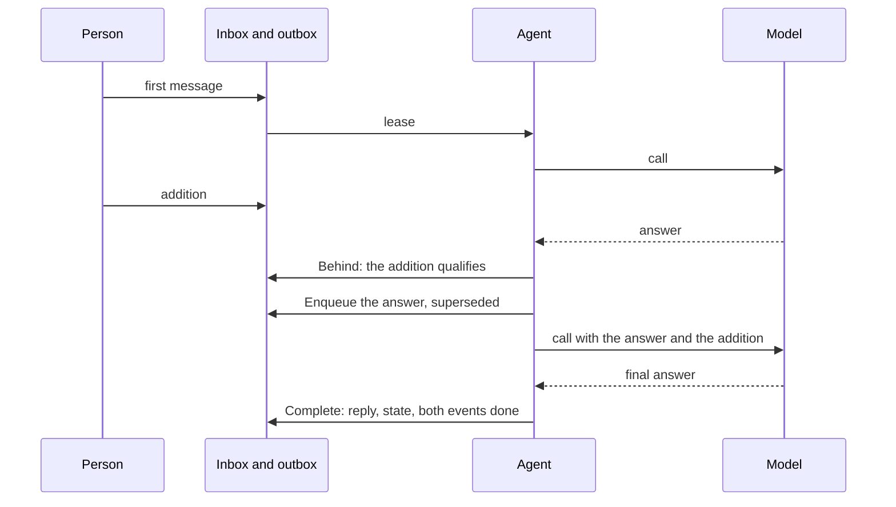
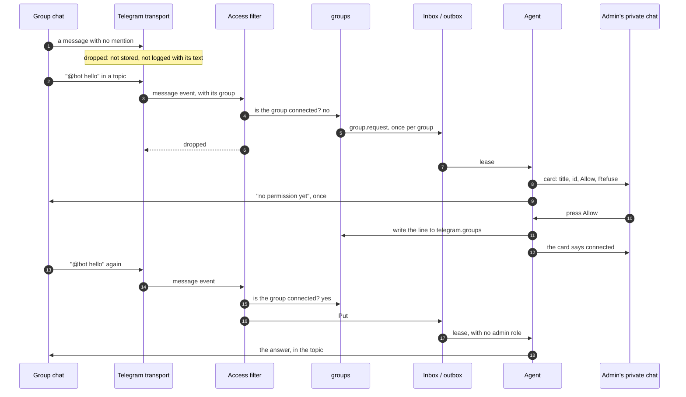
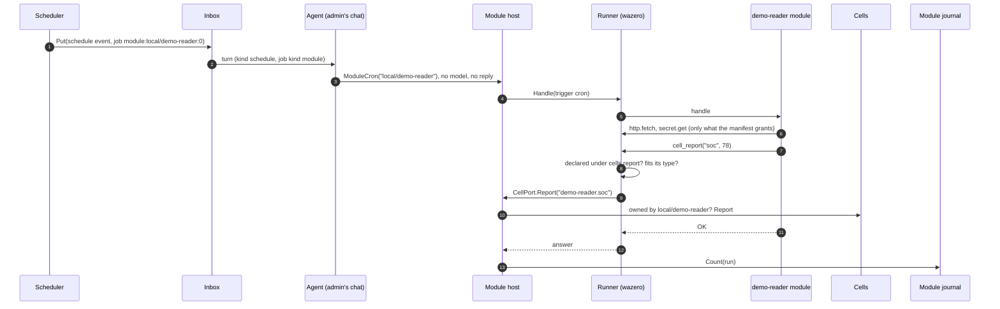
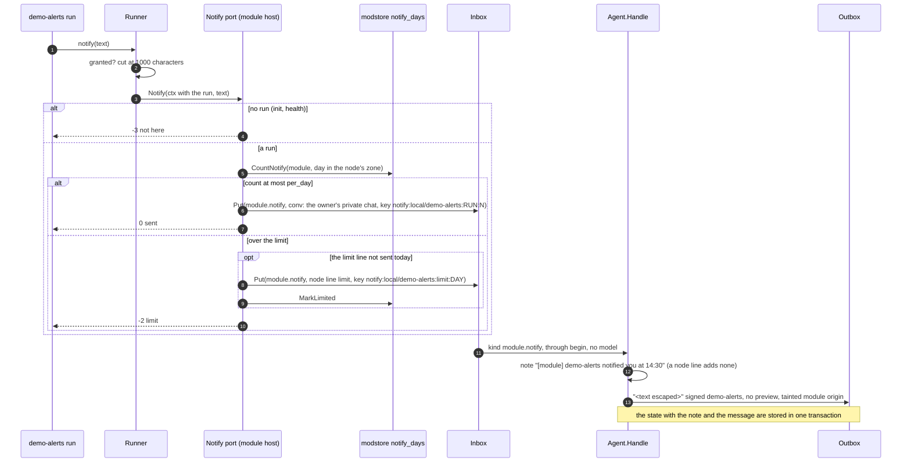
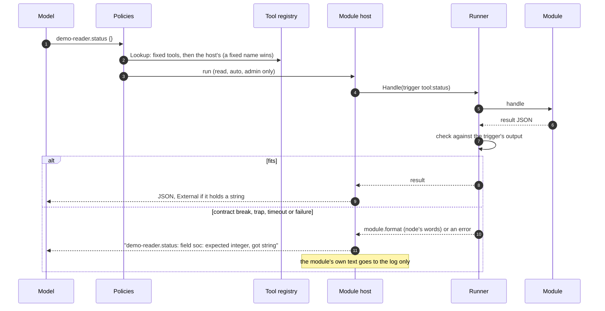
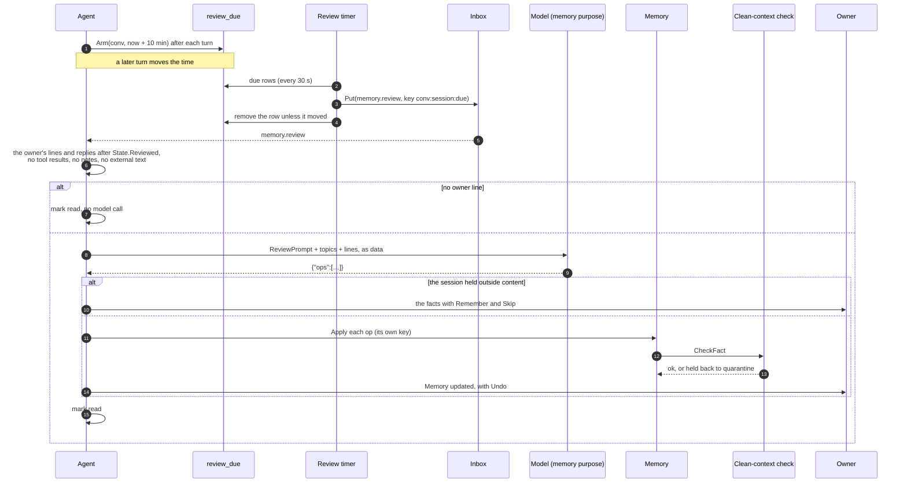
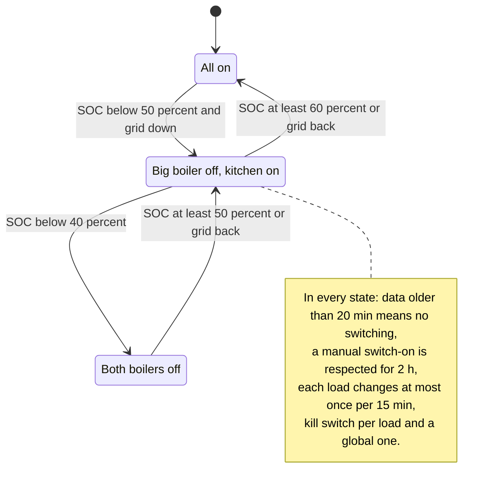
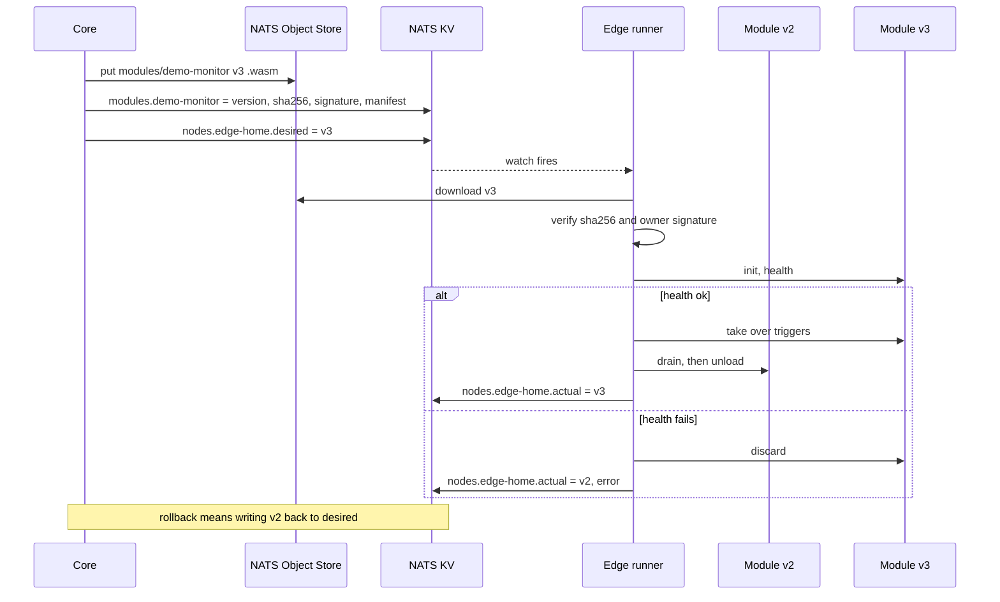
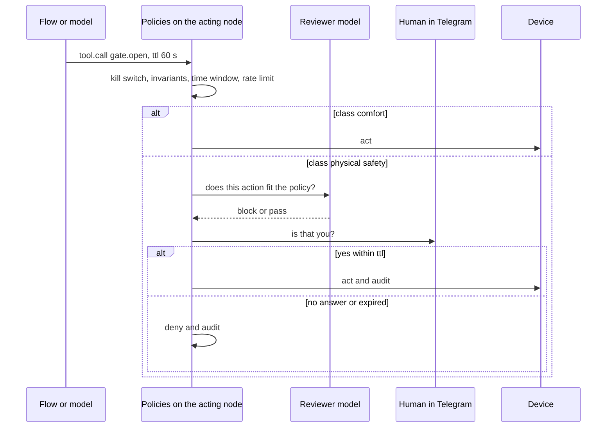

# Level 4 — Runtime flows

How the components cooperate in the scenarios that matter most.

## Chat turn with guaranteed delivery (P1)



In webhook mode (`telegram.updates: webhook`, R-DLV-18) only the first
three steps differ: Telegram posts the update to the node's public listener,
and the answer `200` takes the place of the offset.

```mermaid
sequenceDiagram
    autonumber
    participant TG as Telegram
    participant L as Public listener
    participant T as Telegram transport
    participant Q as Inbox

    Note over T,TG: at start: the public address is checked, waiting updates<br/>are taken by getUpdates, then setWebhook
    TG->>L: POST /telegram/webhook, secret header
    L->>T: request, body capped
    Note over T: no secret: 403, nothing parsed
    T->>Q: Put(event, idemKey = update_id)
    Note over Q: duplicate idemKey is a no-op
    T->>TG: 200 only after Put; 500 when Put failed
    Note over TG: no 2xx: the same update again
```

If the process dies before `Complete` commits, the restarted core releases
the lease and the turn runs again from its start, under the same call keys
(R-DLV-6). That run does not count as a failed attempt; an event that more
than 10 restarts cut short is given up on
([ADR-0046](../adr/0046-a-restart-is-not-a-failed-attempt.md)). If it dies
between sending and marking, one duplicate reply is possible (R-DLV-5).

## Confirmation on a button (P1)

A message written during a turn joins it at the next boundary
([ADR-0050](../adr/0050-additions-join-a-running-turn.md)): before each model call and each
tool call the agent reads what waits behind the turn's event. No tool call starts while one
waits. An answer it overtook goes out at once, marked as superseded, and `Complete` marks
what the turn took as done in its one transaction.

On the CLI route a call that returns with an addition waiting ends the run: the core cancels it
with a cause of its own and starts a new one with the whole history. That is not a failure,
a fallback or a retry.



A call that needs the owner's confirmation does not hold its turn open:
the turn ends with the call parked, and the press is a new event that
resumes the conversation ([ADR-0032](../adr/0032-buttons-and-resume.md)).
The press is acknowledged before its action runs (ruling R40); a press
that becomes no event, or that the access list drops, the transport
answers itself.

A group chat reaches the agent only when the admin connected it and only
with a message that addresses the bot (R-DLV-16, R-DLV-17,
[ADR-0076](../adr/0076-telegram-groups-and-the-addressing-rule.md)). The
first message from a group that is not connected becomes a card in the
admin's private chat; Allow writes the group's line to the node's file,
which the filter reads on every message, so the group works with no
restart.



```mermaid
sequenceDiagram
    autonumber
    participant TG as Telegram
    participant T as Telegram transport
    participant Q as Inbox / outbox
    participant A as Agent
    participant P as Policy
    participant D as Pending store
    participant X as Tool

    A->>P: tool call (key turn_id + n)
    P->>D: Ask: store call, request cell, two buttons
    P-->>A: "awaiting confirmation" + question with buttons
    A->>Q: Complete(question, reply, Pending += id)
    Q-->>TG: question with buttons c:<id>
    TG->>T: callback_query
    T->>Q: Put(decision, idemKey = update_id, query id)
    A->>Q: Lease
    A->>D: Press (one-time, principal, chat, expiry)
    A->>Q: Enqueue(toast "Approved", edit "⏳ Approved, running…")
    Q-->>TG: answerCallbackQuery(text), editMessageText (no buttons)
    alt approve
        A->>X: stored call, same key, journal "approved", no policy
        X-->>A: result
    else deny
        Note over A: journal "denied", result "the owner declined"
    end
    A->>D: Decide(done, result)
    A->>A: model on "[confirmation] tool: result"
    A->>Q: Complete(the call's messages, edit "Approved, 21:09" with the question folded, answer)
    Note over D,Q: unanswered: the expirer puts tool.result every 30 s, same resume with "expired"; the question closes itself, found by its outbox ref
```

## A long host command (P1)

A host command still running after the short wait (20 s) does not hold its
turn open either (R-CMD-4). The call answers "still running" and the turn
ends with the command's key in the state, which keeps the plan open. The
command goes on under the runner as a background job (R-LIVE-9,
ADR-0069): the moment it goes to the background the job registry sends
its card, a message with the node's words, the approved argv and the
time, and edits it in place through the outbox every 10 s while it runs.
Every turn of the conversation meanwhile carries a note of its running
jobs that the history does not keep, and `/status` lists them. Its end
edits the card once more (done, failed, or interrupted by a restart) and
is put into the conversation's inbox at once as a `command.done` event;
the runner's announce pass every 30 s stays as the fallback for an end
whose announcement failed. That event resumes the conversation as a press
does: the outcome is outside data, the model has its tools, and its calls
run one level deeper. A command of a scheduled task resumes as a turn of
that task, under its grant (ruling 7 of the M3d plan). The session may
have moved on by then (`/new`, or the idle cut). Then the conversation
gets one fixed line, without a model, and the output stays out of the new
session. A call whose context ends while it waits (the turn's clock)
leaves its command in the background the same way. A restart ends the
jobs it found open as interrupted and edits their cards once.

```mermaid
sequenceDiagram
    autonumber
    participant P as Person
    participant Q as Inbox / outbox
    participant A as Agent
    participant M as Model
    participant X as host.exec
    participant R as Runner
    participant J as Jobs

    P->>Q: "how big is ~/project?"
    Q->>A: lease
    A->>M: call
    M-->>A: host.exec du -sh ~/project
    A->>X: call (key turn_id + n)
    X->>R: Exec: row "running", command in the sandbox
    Note over X,R: 20 s pass, or the call's context ends
    R->>J: Start(command, key, argv)
    J->>Q: Enqueue(card, idemKey job:<key>:card)
    R-->>X: not done: background
    X-->>A: "still running", Job = key
    A->>M: call with the result
    M-->>A: "it runs; I'll tell you"
    A->>Q: Complete(answer, Commands += key)
    loop every 10 s while it runs
        J->>Q: Enqueue(edit job:<key>:card:v<N>, EditOf job:<key>:card, "⚙️ du -sh ~/project · command · 0:40")
    end
    opt another message meanwhile
        Q->>A: lease
        A->>J: Running(conv)
        A->>M: call with "[jobs] running: command du -sh ~/project 0:50", not stored
    end
    Note over R: the command ends; its row is "done"
    R->>J: End(key, done)
    J->>Q: Enqueue(last edit: "✅ … done in 1:05")
    R->>Q: Put(command.done, idemKey command:<key>:done), at once
    Note over R: the announce pass every 30 s puts it if this failed
    Q->>A: lease
    A->>R: Get(key): argv, outcome, principal, depth
    alt the session lists the key
        A->>M: "[command finished] du -sh ~/project: <external>…</external>", with tools
        M-->>A: "~/project is 2.1 GiB"
        A->>Q: Complete(answer, Commands -= key, tainted)
    else the session moved on
        A->>Q: Complete("The command … finished after this conversation moved on.")
    end
```

## A module build (P1)

A module build takes a minute or more, longer than a model call may wait,
so `module.build` never builds inside its turn (R-RUN-9, ADR-0069). The
call checks the module, refuses one whose build runs or waits ("`<name>` is
being built; wait for its result", and `module.write` refuses the same),
stores a record of the build under `<data>/modules/build-jobs`, starts its
card and answers at once with the job's key, which the session keeps. The
build queue, a node component, runs one build at a time in the order they
were asked for; a build that waits has a card that says so, and the card
starts counting when it runs. The build runs under the queue's context
within the builder's own 10 min limit, and cargo's "Compiling" lines move
the card's count. Its end stores the answer `module.build` gave before
builds ran in the background (the same JSON; outside content unless the
folder was the node's own before and after the build, ADR-0068), ends the
card and puts `module.built` into the conversation's inbox at once. That
event resumes the conversation as `command.done` does, but at the build
call's own depth (the build is the node's work; owner, 2026-11-10):
the note `[build finished] <module>: <answer>` taints only when the answer
is outside content, and the agent fixes the source and builds again, or
calls `module.install` with the digest. Since the depth does not grow, a
loop that does not converge is ended by a count instead: a conversation may
build one module at most 5 times in a row (in memory per conversation and
module); the next build is refused until a person writes there. A
`module.built` whose put failed is put again by the queue's pass every
30 s. A session that moved on gets one fixed line. A restart ends a build it finds open as interrupted, in the
node's words, and puts `module.built` so the agent is told; the job
registry edits its card once.

```mermaid
sequenceDiagram
    autonumber
    participant Q as Inbox / outbox
    participant A as Agent
    participant M as Model
    participant T as module.build
    participant B as Build queue
    participant R as Builder
    participant J as Jobs

    Q->>A: lease (a message, or a note that resumed the conversation)
    A->>M: call
    M-->>A: module.build battery-alerts
    A->>T: call (key turn_id + n)
    T->>B: submit: refused while battery-alerts builds or waits
    B->>B: record build:battery-alerts:<hash> "queued"
    B->>J: Start(build, running or queued)
    J->>Q: Enqueue(card)
    T-->>A: {"building", "job", "next"}, Job = key
    A->>M: call with the answer
    M-->>A: "it builds; I'll tell you"
    A->>Q: Complete(answer, Commands += key)
    B->>J: Start(running): the card counts from now
    B->>R: Build(source, Progress)
    loop every 10 s while it runs
        R-->>J: Progress(crates built)
        J->>Q: Enqueue(edit: "🔨 battery-alerts · build · 0:45 · crates built: 14")
    end
    R-->>B: wasm + manifest, or the log
    B->>B: save the build, plan it, record the answer and whether it is outside content
    B->>J: End(done or failed)
    J->>Q: Enqueue(last edit: "✅ … built in 1:32")
    B->>Q: Put(module.built, idemKey <key>:built), at once
    Q->>A: lease
    A->>B: Outcome(key): conversation, principal, depth, answer
    alt the session lists the key
        A->>M: "[build finished] battery-alerts: {…}", with tools
        M-->>A: module.install <digest>, or a fix and module.build again
        A->>Q: Complete(Commands -= key)
    else the session moved on
        A->>Q: Complete("The build of battery-alerts finished after this conversation moved on.")
    end
```

## A module run on cron (P1)

A reader module as a reflex: no model in the normal path (R-RUN-12). The
module's cron line is a `module` job of the admin who installed it; its
event reaches the agent only to be handed to the module host.



## A module started by another module's cells (P1)

A run that wrote cells starts every running module that listens to any of
them, over the bus, with no model and no turn (R-RUN-15,
[ADR-0065](../adr/0065-cell-triggers-through-the-inbox.md), transport
superseded by [ADR-0108](../adr/0108-ports-in-the-manifest-links-in-the-nodes-file.md)).
The run is identified by the slot of a cron run, the key of a tool call or
the id of a bus delivery, so a run published again starts nobody twice; a
chain stops past depth 4. The listener's run is unattended, like cron: counted,
escalated, towards the crash loop.

```mermaid
sequenceDiagram
    autonumber
    participant P as demo-reader run
    participant H as Module host
    participant J as Journal
    participant B as Bus (EVENTS)
    participant C as cells_demo-alerts consumer
    participant L as demo-alerts module

    P->>H: cell_report soc, grid (noted in the run's context)
    Note over H: the run ends: settle (count, escalate, crash loop)
    H->>J: RecordRun (the producer's row first)
    H->>B: publish g.ev.core.demo-reader.cells {cells}, id cells:MODULE:RUN, headers From, Run, Depth
    B->>C: the message (the consumer reads the owners of the cells it listens to)
    C->>C: cells it listens to among those written; none: ack
    alt depth header 4 or more
        C->>H: no run; a log line once per build and the node line chain
        C-->>B: ack
    else
        C->>H: call(demo-alerts, trigger cell, cells and producer, depth + 1)
        H->>L: Handle(trigger cell, cells and producer)
        L->>H: cell_get(demo-reader.soc), ...
        H->>H: settle as unattended; publish its own cells, depth + 1
        C-->>B: ack, whatever the run's outcome (unacked only when the node is shutting down)
    end
```

## A module writes to its owner (P1)

A module granted `notify: {per_day: N}` writes plain text to the private
chat of the admin who installed it, with no model (R-RUN-16,
[ADR-0066](../adr/0066-notify-capability.md)), or to the destinations its
line in the node's file names (R-RUN-18,
[ADR-0079](../adr/0079-a-modules-messages-go-where-the-nodes-file-says.md)):
the module host puts one event per destination, each resolved from the
file when the message is sent, and the module does not know the list. A
copy for another conversation than the owner's chat leaves no note in that
conversation's history. The admin changes the list in words
(`module.notify_to`), names places with `destination.set`, and the node
knows a forum's topics by the titles the transport reports to `groups`. The port counts the message
for the day in the node's time zone before it puts the event; the agent
writes the node's note into the history and the message into the outbox,
which the queue stores together. The model never sees the text (R-RUN-13);
the message carries a tainted origin, so a reply that quotes it brings it
in as outside content. `init` and `health` carry no run: notify there
answers "not here" and sends nothing. When the node cannot count or put the
message (its store or inbox fails), notify answers "limit" too: nothing was
sent. The note does not move the session's last activity, so a module
writing all day never keeps a session (or its taint) alive.



## A module tool call (P1)

The agent calls `demo-reader.status` like any read tool; the answer is
the data its manifest promised, checked, and outside content only when it
holds a string (R-RUN-13). A failure reaches the model in the node's words
(R-RUN-14).



## A module's escalation (P1)

A failure of a run nobody watched (a cron run, `init` at load) whose kind
the manifest escalates, a contract break or a crash loop becomes one turn
in the installing admin's private chat, at most one of a kind for a module
until it recovers (design section 8.4, owner rulings of 2026-11-10). A tool
call that fails inside a turn is not escalated: that turn has the node's
words and hint for it already.

```mermaid
sequenceDiagram
    autonumber
    participant H as Module host
    participant St as Settings file
    participant S as Scheduler jobs
    participant Q as Inbox
    participant A as Agent
    participant LLM as Model
    participant O as Owner

    H->>H: count the failure in the last hour
    opt a cron run or init, kind escalates, no episode of it open (escalate list, module.format)
        H->>Q: Put(module event, key module:NAME:KIND:SHA:OPENED, once per episode)
    end
    opt fifth failure within an hour
        H->>H: unload; its tools leave the registry
        H->>St: off: true, comment crashloop
        H->>S: delete its jobs
        H->>Q: Put(module event, kind module.crashloop)
    end
    Q->>A: turn in the admin's private chat
    A->>A: note "[module] demo-reader: auth_failed (version 3, 14:30). (the node's detail and hint)"
    A->>LLM: chat purpose, with tools
    LLM-->>A: explanation and a proposal
    A->>O: reply
```

## The memory review (P1)

The agent stores a correction in the turn it hears it (`memory.write`);
the review is the net for what that turn missed (R-MEM-8,
[ADR-0072](../adr/0072-who-writes-memory.md)). It runs once per quiet
period of the owner's private chat, or at once when a session ends, and
never for a turn with nothing new from the owner.



A rerun of the event finds each op's commit by its key, so nothing is
stored twice and the note keeps its key. When no model answers, the
review is armed again a quiet period later and the mark stays.

## Load-shedding flow (planned, after P1)

Moved out of P1 by [ADR-0058](../adr/0058-load-shedding-leaves-p1.md); kept
as the first flow for the flow engine (spec 9.6): staged shedding of loads by battery
state of charge during a power cut. The flow sets the desired state of load
cells; their backend (`virtual` in P1, Tuya plugs later) makes it real, and a
Telegram notifier observes the changes ([ADR-0014](../adr/0014-state-cells.md)).



Escalation to the model: Deye or backend auth error, a backend not
converging desired and reported state, no data for over an hour. Shadow mode
is simply the `virtual` backend.

## Module rollout via desired state (P2)



## Escalating a dangerous action (P2–P3)


