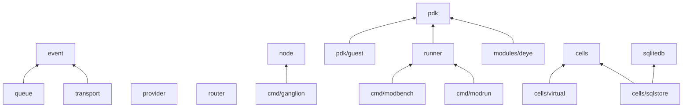

# Level 5 — Code map

Where each part of the architecture lives in the repository, and what
exists today. Update this table in the same commit that adds, moves or
implements a package.

Status: **done** — implemented and tested; **interface** — types and
interfaces only; **planned** — not in the repository yet.

| Concept | Package | Status | Spec | ADR |
|---|---|---|---|---|
| Binary, flags, signals | `cmd/ganglion` | done (P0) | 5.1 | [0004](../adr/0004-one-binary-with-roles.md) |
| Roles and node assembly | `node` | done: role parsing; `Run` is a stub until P1 | 5.1 | [0004](../adr/0004-one-binary-with-roles.md) |
| `Event`, `Outgoing`, TTL expiry, ULID ids, the neutral `Message` payload | `event` | done | 6, 9.1 | — |
| Transport interface, send errors (`ErrPermanent`, `RetryAfterError`), `Parter` | `transport` | interface | 6, 7.1 | [0017](../adr/0017-extension-points.md) |
| Inbox / outbox: `Queue`, `Outbox` | `queue` | interface | 7.1 | [0006](../adr/0006-sqlite-inside-nats-between-nodes.md) |
| Model providers | `provider` | interface | 7.4 | [0007](../adr/0007-openai-compatible-first-provider.md), [0009](../adr/0009-claude-subscription-only-via-cli-worker.md) |
| Model router | `router` | interface | 7.3 | — |
| Store (history, turns, cron_runs, allowed) | — | planned (P1) | 6 | — |
| SQLite queue | — | planned (P1) | 7.1 | [0006](../adr/0006-sqlite-inside-nats-between-nodes.md) |
| Telegram transport | — | planned (P1) | 7.1 | — |
| Agent loop and actors | — | planned (P1) | 7.2 | — |
| Policies | — | planned (P1) | 7.6 | — |
| Memory | — | planned (P1) | 7.7 | — |
| Runner: wazero host, manifest, limits | `runner` | done (P0 spike, own ABI); supervisor and scheduler planned (P1) | 7.5 | [0005](../adr/0005-wasm-on-wazero-for-modules.md), [0011](../adr/0011-module-abi.md), [0012](../adr/0012-yaml-manifests.md) |
| Module-side kit: `Host`, wire types | `pdk` | done (P0) | 7.5 | [0011](../adr/0011-module-abi.md) |
| Module-side ABI glue (Go, TinyGo) | `pdk/guest` | done (P0) | 7.5 | [0011](../adr/0011-module-abi.md) |
| Host conformance suite and probe module | `runner/runnertest`, `runner/runnertest/probe` | done | 7.5 | [0011](../adr/0011-module-abi.md) |
| Deye reader module | `modules/deye` (logic), `modules/deye/wasm` (main), `modules/deye/deye-reader.yaml` | done; matches `deye.py` on the live API | 8.3 |
| Deye reader in Rust (toolchain comparison) | `modules/deye-rs` (cargo; not built in CI) | done | 8.3 |
| Measure modules (size, load, latency, RSS) | `cmd/modbench` | done (P0) | 10.1 | [0005](../adr/0005-wasm-on-wazero-for-modules.md) |
| Run a module once (dev and acceptance tool) | `cmd/modrun` | done (P0) | 10.1 | — |
| State cells: switch, sensor, request; service, watch, reconcile | `cells` | done (P1 M1) | 8 | [0014](../adr/0014-state-cells.md) |
| Cell stores | `cells` (`MemStore`), `cells/sqlstore`; suite `cells/storetest` | done (P1 M1) | 8 | [0014](../adr/0014-state-cells.md) |
| Cell backends | `cells/virtual` (fault injection); suite `cells/cellstest` | done (P1 M1); `tuya` later | 8 | [0014](../adr/0014-state-cells.md) |
| SQLite: open, per-component migrations | `sqlitedb` | done (P1 M1) | 7.1 | [0016](../adr/0016-sqlite-migrations.md) |
| Load-shedding flow | — | planned (P1) | 8 | [0014](../adr/0014-state-cells.md) |
| Core ↔ edge protocol, NATS | — | planned (P2) | 9.1 | [0006](../adr/0006-sqlite-inside-nats-between-nodes.md) |

## Dependency rules

- `event` and `pdk` are leaves: they import nothing from the project.
- Module code (`modules/*`) depends only on `pdk`, never on `runner`, so it
  compiles to WASM.
- Interface packages (`transport`, `queue`, `provider`, `router`) depend only
  on `event` and the standard library, so a node can be embedded as a
  library (spec principle 5).
- Implementations go into their own packages and depend on the interfaces,
  never the other way round.
- Only `cmd/ganglion` and `node` wire concrete implementations together.
