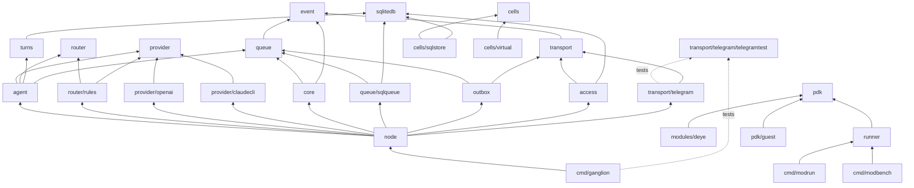

# Level 5 — Code map

Where each part of the architecture lives in the repository, and what
exists today. Update this table in the same commit that adds, moves or
implements a package.

Status: **done** — implemented and tested; **interface** — types and
interfaces only; **planned** — not in the repository yet.

| Concept | Package | Status | Spec | ADR |
|---|---|---|---|---|
| Binary, flags, signals; the kill -9 crash harness | `cmd/ganglion` | done (P0); crash harness (P1 M2) | 5.1 | [0004](../adr/0004-one-binary-with-roles.md) |
| Roles and node assembly; config from the environment until D-3 | `node` | done: core role runs the M2 echo bot (database lock, queue, loop, sender, Telegram behind the access list, 409 alert, daily prune); edge and worker are stubs | 5.1 | [0004](../adr/0004-one-binary-with-roles.md) |
| `Event`, `Outgoing`, TTL expiry, ULID ids, the neutral `Message` payload | `event` | done | 6, 9.1 | — |
| Transport interface, send errors (`ErrPermanent`, `RetryAfterError`), `Parter` | `transport` | interface | 6, 7.1 | [0017](../adr/0017-extension-points.md) |
| Inbox / outbox: `Queue`, `Outbox` | `queue` | interface | 7.1 | [0006](../adr/0006-sqlite-inside-nats-between-nodes.md) |
| Model providers: neutral messages, MCP tools, error kinds | `provider` | interface | 7.4 | [0007](../adr/0007-openai-compatible-first-provider.md), [0020](../adr/0020-neutral-history-as-conversation-state.md) |
| OpenAI-compatible provider (OpenRouter, Ollama, …); fake API for tests | `provider/openai`, `provider/providertest` | done (P1 M3a) | 7.4 | [0007](../adr/0007-openai-compatible-first-provider.md) |
| claude CLI as a conversation provider (`claude -p`, history on stdin) | `provider/claudecli` | done (P1 M3a) | 7.4 | [0021](../adr/0021-providers-chosen-by-the-operator-claude-cli-included.md) |
| Model router: catalogue types, `Route`, `Report` | `router` | interface | 7.3 | — |
| Rules router and YAML model catalogue: filters, tiers, budget, cooldown | `router/rules` | done (P1 M3a) | 7.3 | [0021](../adr/0021-providers-chosen-by-the-operator-claude-cli-included.md), [0022](../adr/0022-haiku-first-during-development.md) |
| Turn trace: route, tools, tokens, cache, cost; daily totals | `turns` | done (P1 M3a) | 7.2 | — |
| History (as conversation state), cron_runs | history in `agent`; cron_runs planned (P1) | history done (P1 M3a) | 6 | [0020](../adr/0020-neutral-history-as-conversation-state.md) |
| Access list: `allowed` table with roles; sink filter that drops strangers | `access` | done (P1 M2) | 7.8 | — |
| SQLite queue: inbox (ordered leases, atomic `Complete`), outbox (heads per conversation, retries, parts), conversation state, prune | `queue/sqlqueue` | done (P1 M2) | 7.1 | [0006](../adr/0006-sqlite-inside-nats-between-nodes.md) |
| Outbox sender: order per conversation, backoff, `retry_after` pause, resumable parts | `outbox` | done (P1 M2) | 7.1 | — |
| Telegram transport: own Bot API client, long polling (offset after the sink), conversation keys, send, split; fake Bot API for tests | `transport/telegram`, `transport/telegram/telegramtest` | done (P1 M2) | 7.1 | [0018](../adr/0018-own-telegram-bot-api-client.md) |
| Turn loop: parallel workers, lease → handler → atomic complete, turn timeout, give up after max attempts; echo handler | `core` | done (P1 M2, workers M3a); the agent is the handler when a catalogue is set | 7.1, 7.2 | [0019](../adr/0019-release-leases-at-core-start.md) |
| Agent: turn loop with fallback, step and daily limits, compaction, sessions (`/new`, idle, `/sessions`, `/resume`) | `agent` | done (P1 M3a); tools, memory, depth limit in M3b | 7.2 | [0020](../adr/0020-neutral-history-as-conversation-state.md) |
| Compare models on scripted conversations (D-6 tool) | `cmd/modelcompare` | done (P1 M3a) | 7.4 | [0022](../adr/0022-haiku-first-during-development.md) |
| Policies | — | planned (P1) | 7.6 | — |
| Memory | — | planned (P1) | 7.7 | — |
| Runner: wazero host, manifest, limits | `runner` | done (P0 spike, own ABI); supervisor and scheduler planned (P1) | 7.5 | [0005](../adr/0005-wasm-on-wazero-for-modules.md), [0011](../adr/0011-module-abi.md), [0012](../adr/0012-yaml-manifests.md) |
| Module-side kit: `Host`, wire types | `pdk` | done (P0) | 7.5 | [0011](../adr/0011-module-abi.md) |
| Module-side ABI glue (Go, TinyGo) | `pdk/guest` | done (P0) | 7.5 | [0011](../adr/0011-module-abi.md) |
| Host conformance suite and probe module | `runner/runnertest`, `runner/runnertest/probe` | done | 7.5 | [0011](../adr/0011-module-abi.md) |
| Deye reader module | `modules/deye` (logic), `modules/deye/wasm` (main), `modules/deye/deye-reader.yaml` | done; matches `deye.py` on the live API | 8.3 |
| Deye reader in Rust (toolchain comparison) | `modules/deye-rs` (cargo; not built in CI) | done | 8.3 |
| Measure modules (size, load, latency, RSS) | `cmd/modbench` | done (P0) | 10.1 | [0005](../adr/0005-wasm-on-wazero-for-modules.md) |
| Run a module once (dev and acceptance tool) | `cmd/modrun` | done (P0) | 10.1 | — |
| State cells: switch, sensor, request; service, watch, reconcile | `cells` | done (P1 M1) | 8 | [0014](../adr/0014-state-cells.md) |
| Cell stores | `cells` (`MemStore`), `cells/sqlstore`; suite `cells/storetest` | done (P1 M1) | 8 | [0014](../adr/0014-state-cells.md) |
| Cell backends | `cells/virtual` (fault injection); suite `cells/cellstest` | done (P1 M1); `tuya` later | 8 | [0014](../adr/0014-state-cells.md) |
| SQLite: open, per-component migrations | `sqlitedb` | done (P1 M1) | 7.1 | [0016](../adr/0016-sqlite-migrations.md) |
| Load-shedding flow | — | planned (P1) | 8 | [0014](../adr/0014-state-cells.md) |
| Core ↔ edge protocol, NATS | — | planned (P2) | 9.1 | [0006](../adr/0006-sqlite-inside-nats-between-nodes.md) |

## Dependency rules

- `event` and `pdk` are leaves: they import nothing from the project.
- Module code (`modules/*`) depends only on `pdk`, never on `runner`, so it
  compiles to WASM.
- Interface packages (`transport`, `queue`, `provider`, `router`) depend only
  on `event` and the standard library, so a node can be embedded as a
  library (spec principle 5).
- Implementations go into their own packages and depend on the interfaces,
  never the other way round.
- Only `cmd/ganglion` and `node` wire concrete implementations together.
