# Level 5 — Code map

Where each part of the architecture lives in the repository, and what
exists today. Update this table in the same commit that adds, moves or
implements a package.

Status: **done** — implemented and tested; **interface** — types and
interfaces only; **planned** — not in the repository yet.

| Concept | Package | Status | Spec | ADR |
|---|---|---|---|---|
| Binary: `main.go` (signals) at the root; the command tree (`run`, `version`, `mcp`: the read-only diagnostics over stdio with the own MCP server, the database opened read-only, stdout for JSON-RPC only, `config.show`'s settings read the way `run` would read them with secrets as set or unset; and the hidden `mcp-relay` that the claude CLI starts for the MCP bridge: stdio ↔ the run's socket, the token from `GANGLION_MCP_TOKEN` first, usage errors never on its stdout) in `cmd`, the command line's own errors on stderr, the flags with their environment variables in `cmd/flags` (`--log-dir`, `LogDir`: logs beside the database by default, or off); the logger: text to stdout and JSON lines to the rotated files, the disk first, both with trace ids and the node's secrets and `redact.String`'s patterns hidden; the kill -9 crash harness and the memory test in `cmd` | `.` (main), `cmd`, `cmd/flags` | done (P0); crash harness (P1 M2); urfave/cli (P1 refactor); `mcp-relay` (P1 M3b task 11) | 5.1 | [0004](../adr/0004-one-binary-with-roles.md), [0029](../adr/0029-urfave-cli-for-commands-and-bootstrap-flags.md), [0036](../adr/0036-mcp-bridge-over-a-per-run-unix-socket.md) |
| Build information: version, commit, toolchain of this binary | `internal/buildinfo` | done (P1 refactor) | — | [0029](../adr/0029-urfave-cli-for-commands-and-bootstrap-flags.md) |
| Composition root, dependency logic only: one `samber/do` provider per component; extension points (handler, give-up, turn hook, transports, receivers, housekeeping, schedulers, command hints) as an interface provider that selects and one named provider per implementation, no-ops included; memory off (no tools, no facts) when `git` is missing; a `do.Package` per role, `Run`; `Bootstrap`, filled by the command line. Its tests also hold the scripted M3b acceptance (`make accept`: real models and web, the fake Bot API as the owner) and the node's peak RSS after a hostile 1 MiB page (`make memory`) | `config` | done (P1 refactor); acceptance and hostile-page measurement (P1 M3b task 12) | 5.1 | [0028](../adr/0028-samber-do-composition-root-in-config.md) |
| Role runner: `Component`, `RunAll`, `Run` by roles; the database lock; Telegram polling as a component with the 409 alert | `node` | done; edge and worker are stubs | 5.1 | [0004](../adr/0004-one-binary-with-roles.md), [0019](../adr/0019-release-leases-at-core-start.md) |
| `Event`, `Outgoing` (with `Buttons` and `Edit` in place, and `Ack`: a toast that answers a press; and `Attach`: one picture or document, at most `MaxAttachmentBytes` (4 MiB), its text the caption, R-DLV-9), TTL expiry, ULID and random ids, the neutral payloads: `Message` (with `Files`: files that came with it, kind, name, type and size, R-DLV-10), `Decision` (a button press, with the channel's `Query` id to answer), `ToolResult` (an expired pending call), `Schedule` (a job's time) | `event` | done; buttons, edits, decision and tool.result kinds (P1 M3b task 4); schedule kind (task 6); files noticed (P1 M3c task 2); attachments (task 3) | 6, 9.1 | [0032](../adr/0032-buttons-and-resume.md) |
| Transport interface, send errors (`ErrPermanent`, `RetryAfterError`), `ErrDropped` (a sink's event deliberately not kept), `Parter`, `Command` and `Lang` (commands listed for people, a description per language) | `transport` | interface | 6, 7.1 | [0017](../adr/0017-extension-points.md) |
| Inbox / outbox: `Queue`, `Outbox` | `queue` | interface | 7.1 | [0006](../adr/0006-sqlite-inside-nats-between-nodes.md) |
| Model providers: neutral messages, MCP tools, error kinds; `Exec`, the request's tool runner for a provider with its own tool loop | `provider` | interface; `Exec` (P1 M3b task 11) | 7.4 | [0007](../adr/0007-openai-compatible-first-provider.md), [0020](../adr/0020-neutral-history-as-conversation-state.md), [0036](../adr/0036-mcp-bridge-over-a-per-run-unix-socket.md) |
| OpenAI-compatible provider (OpenRouter, Ollama, …); fake API for tests (scripted answers, or a responder that answers by what each request holds) | `provider/openai`, `provider/providertest` | done (P1 M3a) | 7.4 | [0007](../adr/0007-openai-compatible-first-provider.md) |
| claude CLI as a conversation provider (`claude -p`, history on stdin, the system prompt in a `0600` file, never argv; a minimal environment without the node's secrets, `WithEnv` for more); with tools, the MCP bridge: a run dir `0700` under the work dir (under `os.TempDir()` when the socket path would pass 103 bytes), `mcp.sock` `0600`, `mcp.json` `0600` naming the relay with a 32-byte token in its environment, `--mcp-config`, `--strict-mcp-config`, `--allowedTools mcp__ganglion__*`, `--tools ""`; one authenticated connection per run (constant-time compare, 2 s for the first line, each connection in its own goroutine, at most 16 at once), every other closed; the run dir removed and the serve goroutine waited for on every path; `claude` in its own process group, killed whole on cancel (Linux, macOS); two shared slots and one reserved for runs without tools, so a guard check is never starved by runs with tools waiting on it | `provider/claudecli` | done (P1 M3a); tools over the bridge (P1 M3b task 11); the reserved slot (M3b final review) | 7.4 | [0021](../adr/0021-providers-chosen-by-the-operator-claude-cli-included.md), [0036](../adr/0036-mcp-bridge-over-a-per-run-unix-socket.md) |
| Minimal MCP server (also behind `ganglion mcp`): JSON-RPC 2.0, one message per line over an `io.ReadWriter`; `initialize`, `notifications/initialized`, `ping`, `tools/list`, `tools/call` (concurrent, at most 4); tool names `.` → `_` mapped back by lookup in the offered set, a name not offered handed to the core as it came (the policy refuses it, and in a task alerts as out of grant); arguments passed through raw; a tool error is `isError`; lines bounded at 8 MiB; the relay (`Relay`: token first, line copy both ways) | `mcp` | done (P1 M3b task 11); `ganglion mcp` (P1 M3c task 6) | 7.4 | [0036](../adr/0036-mcp-bridge-over-a-per-run-unix-socket.md), [0037](../adr/0037-own-minimal-mcp-server.md) |
| Model router: catalogue types and task kinds (message, compaction, guard), `Route`, `Report`; `Local`, the P1 tool placement (everything runs on this node) | `router` | interface; `Local` (P1 M3b task 5) | 7.3 | — |
| Rules router and YAML model catalogue: filters, tiers, budget, cooldown; `claude-cli` models may have `tools: true` | `router/rules` | done (P1 M3a); CLI tools (P1 M3b task 11) | 7.3 | [0021](../adr/0021-providers-chosen-by-the-operator-claude-cli-included.md), [0022](../adr/0022-haiku-first-during-development.md), [0047](../adr/0047-sonnet-answers-during-development.md) |
| Turn trace: route, tools, tokens, cache, cost; daily totals | `turns` | done (P1 M3a) | 7.2 | — |
| History (as conversation state), cron_runs | history in `agent`; `cron_runs` in `schedule` | history done (P1 M3a); cron_runs done (P1 M3b task 6) | 6 | [0020](../adr/0020-neutral-history-as-conversation-state.md) |
| Scheduler: an own five-field cron parser read in the node's zone (a wall time skipped in spring runs at the jump, one repeated in autumn runs once), jobs (reminders, agent tasks with a grant, and system jobs that run the node's code without a model; system jobs cannot be deleted; `EnsureSystem` replaces the node's own at every start), `cron_runs` with catch-up (one event per job per tick, for the latest missed slot; key `cron:<job>:<slot ms>`, run now `cron:<job>:now:<token>`, the token being the confirmed call's key or the press's event), the `Scheduler` component | `schedule` | done (P1 M3b task 6); system jobs (M3b final review); module triggers in M4 | 7.10 | [0031](../adr/0031-agent-security-baseline.md) |
| Access list: `allowed` table with roles and names (`Name`, for confirmation questions); sink filter that drops strangers' messages and button presses (`transport.ErrDropped`, so the transport answers a dropped press itself) | `access` | done (P1 M2); presses (P1 M3b task 4); names in questions (M3b final review) | 7.8 | [0032](../adr/0032-buttons-and-resume.md) |
| SQLite queue: inbox (ordered leases, atomic `Complete`), outbox (heads per conversation, retries, parts; an attachment kept in the row, one over 4 MiB refused before anything is stored, `transport.ErrPermanent`), conversation state, prune and the daily `Pruner` component | `queue/sqlqueue` | done (P1 M2) | 7.1 | [0006](../adr/0006-sqlite-inside-nats-between-nodes.md) |
| Outbox sender: order per conversation, backoff, `retry_after` pause, resumable parts; attachments counted by kind and result, their bytes in a histogram | `outbox` | done (P1 M2) | 7.1 | — |
| Telegram transport: own Bot API client, long polling (offset after the sink), conversation keys, Markdown rendered to entities (goldmark), block-aware split, replies (auto/always/off), typing; the command hints at start (`setMyCommands` once with no language and once per language the commands describe, best-effort, beside polling in a goroutine `Run` owns and waits for, under one 10 s deadline; rulings R43, R45); pictures and documents (`sendPhoto`, `sendDocument` as `multipart/form-data`; the text the caption when it renders within 1,024 units, otherwise the attachment first without one and the text as the next parts; with buttons, as an edit or a toast, an unknown kind or over the size a permanent error; R-DLV-9); inline keyboards (`c:<button id>`), callback queries as decision events carrying the press's id (`Query`), answered at once only when they become no event or the sink drops them (`transport.ErrDropped`), otherwise by the handler's `Ack` message with a toast (`answerCallbackQuery` text; a 400 for a press too old is done; ruling R40), `editMessageText` and, for an edit without text, `editMessageReplyMarkup` ("not modified" is success); files that come with a message described, never downloaded (photo, document, audio, voice, video, video note, animation, sticker: kind, name, type, size, never the file id), so a message with only a file is an event too (R-DLV-10); text the sender did not write marked on the event (`forward_origin`, `is_automatic_forward`, `external_reply`, `quote` → `Forwarded`, `ExternalReply`, `Quote`, ruling R35); fake Bot API with callbacks, toasts, command hints and edits for tests, the order of the calls it got, and what each bot message shows after its edits | `transport/telegram`, `transport/telegram/telegramtest` | done (P1 M2); buttons and edits (P1 M3b task 4); outside text marked (M3b final review); toasts and command hints (live-run fixes, R40, R43, R45); files noticed (P1 M3c task 2); attachments (task 3) | 7.1 | [0018](../adr/0018-own-telegram-bot-api-client.md), [0032](../adr/0032-buttons-and-resume.md) |
| Turn loop: parallel workers, lease → handler → atomic complete, turn timeout, give up after max attempts; echo handler | `core` | done (P1 M2, workers M3a); the agent is the handler when a catalogue is set | 7.1, 7.2 | [0019](../adr/0019-release-leases-at-core-start.md) |
| Agent: a turn is a pipeline of stages (idle session, commands, daily limits, answer, compaction); model calls with fallback; tools run through `tool.Middleware` (tracing, the journal, then the policy) with a numbered `tool.Call` per call, the same path for a CLI provider's calls through `provider.Exec` (under a lock on the turn, so parallel calls are numbered once and a later call sees the taint of an earlier one; at most `MaxSteps` a turn; a CLI attempt that ran tools and failed ends the turn with the give-up reply instead of falling back; the calls it ran join the history before its answer in the API path's form, so later turns and task runs see them); an external result taints the session and reaches the model wrapped as data, and so does a person's message with outside text (a forward whole, a quote after the sender's words; ruling R35); a message with only files is answered, each file a `[file came: …]` note after the words, its name cleaned, capped at 80 runes and wrapped as outside content that taints, never a known URL (R-DLV-10); the known-URL set for `web.fetch`; tools only for admins (`AdminFunc`); a command table (`/new`, `/sessions`, `/resume`, `/metrics` (runs `metrics.show` through the tool chain for an admin, without a model, ruling M2; says so when the picture cannot be drawn), `/modules` (an admin's list, update or rollback of a module through `Modules`, without a model, the outcome in plain words and a `[command]` note), and `/tasks`, which runs `schedule.list` through the tool chain as the turn's call, for an admin, without a model, and leaves a `[command]` note in the history, ruling R47; the one source of the transport's command hints too, with descriptions in English, Russian and Ukrainian: `Commands`, rulings R43, R45); sessions archive (`SessionStore`, `NoArchive`); the skills index in an admin's system prompt, and the rest of a turn routed by the `model` block of a skill the model read with `skill.read` (`Skills`); core rules (`CoreRules`, with the directives block: layer 2 of the security baseline, memory and persona rules, stable text) + persona from `workspace/persona/*.md`, then for admins only the introduction rules (`IntroductionRules`: while the session is untainted and `persona.propose` is on offer, so while `persona/` has no `*.md`; the tool is offered only then) and the memory's known facts (`Facts`); the archive's `Search` of given conversations for recall; conversation state v2 (adds `Tainted` and `Pending`, reads v1; compaction keeps the taint and stores the summary wrapped); a `resume` stage for button presses and expired calls: runs an approved call through the journal without the policy, with its original key (its stored arguments checked with `tool.CheckArgs` first; a bad one is journalled forbidden), and resumes the model with a `[confirmation]` note (capped like a tool result; the resumed turn passes the daily limit, its calls run one level deeper than the resumed call, and an expiry's turn is offered no tools, ruling R33); a valid press is acknowledged before its action runs: a toast and, for a question, a status line in place of its buttons, stored in the outbox at once (`Enqueuer`), the final edit with the outcome after the call's own messages; a refused press gets a toast saying why (ruling R40); quick actions by name (`QuickAction`), for an admin at press time; one that changed something (Delete, Run now) adds a `[button]` note to the history, capped like a confirmation note, so the next turn knows what the owner did (ruling R42); a second press of an answered question edits it to its real outcome (`Press.Answer`), a quick button tapped twice keeps the first tap's edit; stale pending ids dropped; the last user message gets `[now: ...]` in the node's location, for an admin a notice while the session is tainted, and in a task's run a line that its final answer reaches the owner (named from the access list, `NameFunc`) automatically, so no tool is needed to send it (ruling R41), for the model only (history keeps the plain message); a `scheduled` stage for a job's time (`Jobs`): a reminder is sent as it is, without a model, and leaves a `[reminder]` note in the history, a session silent past the idle time archived first (ruling R50), a task runs as its owner (admin checked at run time) in `task:<id>`, whose history is its earlier runs, with its grant on every call, offered only the grant's tools, never cut by silence, answering to the grant's reply target; a deleted job's event does nothing; a system job runs its code from `SystemJobs` by job id for an admin owner, without a model, and replies with its report; quick actions get the press (`pending.QuickPress`) and may put new buttons on the message; a question a quick action asked resumes no model turn | `agent` | done (P1 M3a); tool context, taint and state v2 (P1 M3b task 2); resume after a confirmation (P1 M3b task 4); the time and taint lines (task 5); scheduled jobs (task 6); the memory index and session search (task 7); first-run introduction (task 9); directives, no taint notice for family (task 10); `Exec` for CLI providers (task 11); the daily limit, the depth limit and a tool-less expiry for resumed turns (M3b final review); files noticed (P1 M3c task 2) | 7.2 | [0020](../adr/0020-neutral-history-as-conversation-state.md), [0024](../adr/0024-persona-as-workspace-files.md), [0031](../adr/0031-agent-security-baseline.md), [0032](../adr/0032-buttons-and-resume.md) |
| Tools: `Spec`, `Call`, `Result` (text, external flag, pending id, outgoing messages), `Handler`, `Registry` (admin-only tools hidden from others and refused at run; a `Gated` tool is listed only while it is `Offered`, as `Registry.Offered` says), `Middleware`, `Grant`, `TaskConvPrefix`, `WrapExternal`, `Placement` (the registry refuses a tool that is not placed `local`), `Questioner` (a tool that words its own confirmation question), `Registry.Spec`, `CheckArgs` (a call's arguments are exactly the declared parameters: an object, exact case, no duplicates; `ErrBadArgs`), `CanonicalArgs` (sorted keys, no insignificant whitespace, exact numbers: when two calls are the same) | `tool` | done (P1 M3b task 2); placement (task 5); questioner (task 6); `CheckArgs` (task 8); `Gated` (task 9); `CanonicalArgs` (M3b live-run fixes, ruling R38) | 7.6 | [0031](../adr/0031-agent-security-baseline.md) |
| Tools: `message.send` (to a known conversation or a listed principal's private chat, through `Result.Out` with key `<call key>:send`; in a task's turn its own conversation is the reply target; the question names the recipient by their listed name and shows the whole text, at most 2,500 characters), `cells.get`, `cells.set` ("on"/"off"; the question shows the cell and the value); every question that must show its whole action refuses one longer than `tool.MaxQuestionRunes` or with text `redact.String` would change (ruling R34); `schedule.create` (its description asks for a task's text as what to produce, not "send X a message", ruling R41; a reminder or a task with a grant checked against the registry and never naming `schedule.*`, `memory.write`, `memory.forget` or `persona.propose`, asked in plain words: instruction, schedule, tools, hosts, reply target; an exact duplicate of a live job is refused without a question, naming the job), `schedule.list` (one message per job with Details, Delete and Run now buttons), `schedule.delete`, `schedule.run_now`, and the quick actions of the list (Delete without a second press; Run now asks only when the grant holds a side effect; both note what the owner did, ruling R42; a crash rerun of the same Delete press gives the note back, since the job records the press that deleted it, `Job.DeletedBy`); `memory.write` (the fact with its turn and taint; a held-back one alerts the admins; the question shows the title and the whole body), `memory.forget` (the question shows the slug and the fact), `memory.read` (a fact, or the index), `memory.recall` (the calling chat and the caller's private chat; each hit says in plain words whether it is a stored fact or what was said in an earlier chat, ruling R49), `memory.audit`, and the scheduled audit (`EnsureAudit`: system job `system:memory-audit`, kind `system`, 04:00, replaced at every start; `AuditJob` runs `memory.Audit` in code and reports, without a model turn); `persona.propose` (the first-run introduction: the text, at most 2000 characters, is checked by the guard before the owner is asked and shown whole in the question; refused in a session with outside content, at the call and at the approval; written as `persona/10-identity.md` only while `persona/` has no `*.md`; gone from the listing after that); `web.fetch` (outside content; in a task's turn its fetch and every redirect stay on the grant's hosts; its question shows the normalised address it fetches whole, in a code span, a look-alike host in its punycode form, and refuses one it cannot show or with a user name or password, ruling R39) and `metrics.show` (a choice: `all`, a group of the dashboard's sections, `runtime` for Go's, or a text filter over the names; a photo of the node's metrics with up to five notable lines as its caption, labels and values only, and the notable summary for the model, capped at 4,000 runes; at most 8 globs); `skill.read` and one `skill.<name>` per script skill (`NewSkillTools`: a read script is outside content, a change script asks with the skill, its description and the whole input; its output is outside content either way); `logs.search`, `journal.search` and `turns.failed` (`NewDiagTools`: the searches of `diag`, outside content); `web.search` (one `URL:` line per hit, a hit dropped unless its address reads back exactly, titles and snippets defanged with `urlnorm.Defang`, so only hit addresses become known); all admin-only, the side effects confirmed by the policy | `tool/builtin` | done (P1 M3b task 5); schedule tools (task 6); memory tools (task 7); web tools (task 8); `persona.propose` (task 9) | 7.6, 8 | [0031](../adr/0031-agent-security-baseline.md) |
| Tool-call journal: one row per decision on a call, arguments and results redacted and capped, daily prune component | `tool/journal` | done (P1 M3b task 2) | 7.6 | [0031](../adr/0031-agent-security-baseline.md) |
| Pending calls and buttons: the `policy.Asker` (call stored with the session's taint, which an approved run keeps, and its depth (R-AGT-4), request cell `request.call.<id>`, Approve / Deny buttons, idempotent by call key; `Parked` finds a waiting, unexpired call identical to a new one — same conversation, person, tool and canonical arguments — so it is not asked twice, ruling R38), the question message, atomic one-time `Press` (principal, chat, expiry; a rerun of the same event gets the same press), the whole outcome stored (`Finish`: result, outside-content flag, whether the call failed, messages), quick-action buttons with `QuickAction`, `QuickPress` and `QuickEdit` (with a `Note` for the history), `ExpireDue` and the `Expirer` component that puts `tool.result` events | `tool/pending` | done (P1 M3b task 4); the parked taint (task 7) | 7.6 | [0032](../adr/0032-buttons-and-resume.md) |
| Web address normalisation for the known-URL check (an internationalised host in its ASCII, punycode form, one IDNA refuses rejected); the one URL pattern (`Find`), `Defang`, `Exact` | `internal/urlnorm` | done (P1 M3b task 2); finding addresses (task 8) | 7.6 | [0031](../adr/0031-agent-security-baseline.md) |
| Compare models on scripted conversations (D-6 tool) | `tools/modelcompare` | done (P1 M3a) | 7.4 | [0022](../adr/0022-haiku-first-during-development.md) |
| Telemetry: OpenTelemetry setup, Prometheus `/metrics` (with the Go runtime and process collectors, `go_*` and `process_*`), the promtop dashboard, OTLP traces, trace ids in logs, `RedactHandler` (the message and every string, error and Stringer attribute, groups included, through a hide function); the promtop dashboard runs even with `--metrics-addr off`, and `Renderer` draws its history as a PNG or the `promtop.summary/v1` document, in process, for a `Selection` (globs, sections, all) and lists its sections (promtop v0.5.0 `dash.Render`, ADR-0045); OpenTelemetry's own errors go to the node's logger, and `Shutdown` closes the dashboard before the server, so an open dashboard tab does not hold the stop; in-memory providers for tests (counters, histograms with their sums and bounds, gauges) | `telemetry`, `telemetry/telemetrytest` | done (P1); the test reads of observability task 4 | 7.9 | [0026](../adr/0026-opentelemetry-prometheus-and-promtop.md) |
| Logs on disk: `Rotator`, an `io.Writer` with one write per call under a mutex and no goroutine, rotated by size into `ganglion-<UTC stamp>.log`, rotated files pruned by count and age (only that name), `0700` directory and `0600` files; rotations and write errors counted | `logfile` | done (P1 M3c task 5) | 7.9 | [0043](../adr/0043-logs-on-disk-with-an-own-rotator.md) |
| Diagnostics: `logs.search` (the log files newest first, a bounded ring per file), `journal.search`, `turns.failed`, `turn.show` (one turn whole: the event's kind and time, never its text; the route; every call; the replies' status, never their text), `config.show` (secrets as set or unset), `queues.state`; strict arguments (one object, no unknown field), at most 200 rows and 16,000 characters a result, free text, settings and log lines redacted, a log line over 1 MiB skipped and counted; `turn.show` finds the answer by the event's idempotency key and a call's messages by the call key; calls counted by tool and result. The agent gets the three searches as admin-only outside content, only in the caller's private chat (`tool/builtin`) | `diag` | done (P1 M3c task 6) | 7.9 | [0044](../adr/0044-ganglion-mcp-diagnostics-over-stdio.md) |
| Skills: built-in skills embedded and reserved by name (`metrics`), the owner's in `workspace/skills/<name>/SKILL.md` with a YAML frontmatter (name as the directory, description, the `model` block, an optional `script`: `run`, `effects` read or change, `env`, `timeout` up to 120 s); a skill that breaks a rule is not loaded and is reported (a workspace skill with a built-in's name, a symlink or non-executable script, a secret-looking or provider-key variable); the index for the system prompt; `Runner`: no shell, a fresh working directory, an environment from scratch, its own process group killed whole, input and output capped (no confinement on disk until ADR-0039); `Runs`, the change scripts that have started by call key, so a crash cannot run one twice | `skills` | done (P1 M3c task 8); the sandbox in M3d | 7.3, 9.8 | [0042](../adr/0042-skills-and-scripts-before-the-sandbox.md) |
| JSON Schemas of the YAML files (model catalogue, module manifest), embedded | `schemas` | done (P1 M3a); node config schema with D-3 in M4 | 7.3, 7.5 | [0023](../adr/0023-json-schemas-for-yaml-files.md) |
| Alerts to every admin's private chat (daily limit, give-up, 409) | `alert` | done (P1 refactor) | 7.8 | — |
| Secret source: the environment and `*_FILE` files; an encrypted store later | `secrets` | done (P1 refactor) | D-3 | [0029](../adr/0029-urfave-cli-for-commands-and-bootstrap-flags.md) |
| Shared helpers, not library API: secrets removed from text (`redact.String`: the journal's patterns, moved from `tool/journal`; `redact.Values`: the exact secrets the node read), backoff with jitter, rune truncation, plain transcript (tool results and confirmation notes cut to 4,000 runes, outside content kept wrapped, every message's lines after its first indented whatever the line break, so neither a page nor a family member can fake a turn), start of day, URL normalisation, histogram buckets by unit | `internal/backoff`, `internal/text`, `internal/transcript`, `internal/clock`, `internal/urlnorm`, `internal/buckets`, `internal/redact` | done (P1 refactor); `internal/buckets` (observability task 4) | — | [0027](../adr/0027-written-go-conventions-and-lint-guardrails.md) |
| Policies: a pure `Decide` over the tool's spec and the call (depth limit, admin-only, grant (web.fetch on its hosts, message.send to its reply target only), forbidden, side effect, tainted memory write, `message.send` elsewhere, unknown `web.fetch` URL); the middleware first refuses arguments that are not exactly the tool's declared parameters (`tool.CheckArgs`, journalled forbidden), then parks a confirm with the `Asker` (a call identical to one already waiting gets that call's pending id and the fixed `AlreadyWaiting` text, no second question, ruling R38; otherwise the question in the tool's words when it is a `tool.Questioner`, which may refuse an invalid call first) and returns its question in `Result.Out`, and refuses a forbidden or out-of-grant call, with one alert per task per day; in a task, a tool that is not registered and a tool's own `tool.ErrOutOfGrant` (a `web.fetch` redirected off the granted hosts) are out-of-grant calls with the same alert | `policy` | done (P1 M3b task 3); the `Asker` is `tool/pending` (task 4); the argument check (task 8); no second question for a waiting call (live-run fixes, R38) | 7.6 | [0031](../adr/0031-agent-security-baseline.md), [0032](../adr/0032-buttons-and-resume.md) |
| Workspace repository: `Open` (git init when the directory itself is not a repository), `Commit` of the given paths only (no change → the current commit), `Revert`, `Dirty`, `Path` (refuses absolute, `..` and `.git` paths); the `git` binary with a fixed author, without the global, system or environment git settings, apart from the caller's cancellation under a 10 s timeout, a stale `index.lock` removed at `Open` (ruling R37); `ErrNoGit` | `gitrepo` | done (P1 M3b task 7); git never killed by a cancel (M3b final review) | 7.7 | [0033](../adr/0033-memory-in-the-workspace-git-with-the-git-binary.md) |
| Clean-context check: a cheap model, one fixed prompt, the text wrapped as data, no tools, no history; verdict `{"ok","reason"}`; fails closed (`guard unavailable`, unparseable → not OK); facts (`CheckFact`: what the owner likes, plans or wants to receive, people and devices are facts; commands, permissions, rule changes, procedures and hidden instructions are not, also when phrased as the owner's wish; in doubt, not ok) and persona files (`CheckPersona`); the shared case table the fact check is measured on, live in the acceptance | `guard`, `guard/guardtest` | done (P1 M3b task 7); fact prompt and case table (task 12, ruling R32) | 7.6 | [0034](../adr/0034-clean-context-guard.md) |
| Memory: facts in `memory/<slug>.md` with frontmatter (title, created, source turn, tainted, checked), one commit per change; every write checked by the guard, a held-back one in `memory/quarantine/` with an admin alert; slugs from titles (Cyrillic transliterated, a hash otherwise, `-2` on collision); the index for the system prompt (a fact written in a tainted session marked "(from outside content)"); a rerun of the same write commits a file a crash left uncommitted; `Read`, `Forget`, `Recall` over facts and the archived sessions of the caller's chats only (`Episodes`), `Audit` of facts and persona, `PersonaEmpty`, `CheckPersona` and `WriteIdentity` (`persona/10-identity.md` in one commit, only while `persona/` has no `*.md`) | `memory` | done (P1 M3b task 7); the persona write (task 9); nightly consolidation (R-MEM-1) in M7, embeddings P2 | 7.7 | [0033](../adr/0033-memory-in-the-workspace-git-with-the-git-binary.md), [0034](../adr/0034-clean-context-guard.md) |
| Runner: wazero host, manifest (with `abi`, missing read as 1; `ABIVersion` 1), limits; `SwapTool` (a tool module replaced while it runs: a call stays on the version it started on, the old one shut down after its calls end); tool modules (`LoadTool` refuses a manifest with any capability, `Call` with trigger `tool`, `ModuleError` for a failure the module reports; `LazyTool` compiles on the first call; a tool module gets no `log` host function; each instance's memory is one anonymous mapping of its limit on Linux and macOS, so growing never copies) | `runner` | done (P0 spike, own ABI); tool modules (P1 M3b task 8); `SwapTool` and the ABI (P1 M3c task 7); the rest of task 4.4, supervisor and scheduler in M4 | 7.5 | [0005](../adr/0005-wasm-on-wazero-for-modules.md), [0011](../adr/0011-module-abi.md), [0012](../adr/0012-yaml-manifests.md), [0035](../adr/0035-web-reading.md) |
| Module store: built-in modules (`Builtin`: the embedded build, its ceiling of ABI, memory and timeout, its self-test), versions in `module_versions` and `<data>/modules/<name>/<sha256>.{wasm,yaml}` (`0600`, written by rename); `Update` (the newest release; the sum of both files, the manifest's name, ABI and limits against the ceiling, no capability, the self-test, then one transaction: the old active becomes previous, the one before retired with its files), `Rollback` (previous back to active, the replaced one retired), `List`; at start the newest active row wins and a stored version whose files fail their sum is marked failed for the embedded build; one update at a time; `Admin` for /modules; updates, self-test time and the active source as metrics. The source: `release.GitHub` (the project's releases, tags `<module>/vX.Y.Z`, drafts and pre-releases skipped, the newest whose manifest speaks this ABI, `SHA256SUMS`; only GitHub's hosts, redirects included, at public addresses, 8 MiB a file, 60 s) | `modstore`, `modstore/release` | done (P1 M3c task 7) | 7.5 | [0041](../adr/0041-module-install-update-and-trust-boundary.md) |
| Module-side kit: `Host`, wire types | `pdk` | done (P0) | 7.5 | [0011](../adr/0011-module-abi.md) |
| Module-side ABI glue (Go, TinyGo) | `pdk/guest` | done (P0) | 7.5 | [0011](../adr/0011-module-abi.md) |
| Host conformance suite and probe module | `runner/runnertest`, `runner/runnertest/probe` | done | 7.5 | [0011](../adr/0011-module-abi.md) |
| Deye reader module | `modules/deye` (logic), `modules/deye/wasm` (main), `modules/deye/deye-reader.yaml` | done; matches `deye.py` on the live API | 8.3 |
| Deye reader in Rust (toolchain comparison) | `modules/deye-rs` (cargo; not built in CI) | done | 8.3 |
| html2md module: the main content of a page as Markdown (a byte pre-pass dropping scripts, styles and `data:` values; a depth gate that wraps `dom_query`'s sink, so one html5ever parse builds the tree and follows its shape, and stops a page whose tree would be deeper than 128 (`gate`, rulings R25, R26); a refused page is flattened by the pre-pass's model of the open-element stack (`nesting`) and gated again, else read as plain text by the tokenizer alone (`plain`); the content handed to `htmd` gated by a shape-only sink; a property test on random tag soups with an oracle sink and a regression corpus of reviewers' shapes); 32 MiB of memory, HTML up to 1 MiB; an own Readability-style extractor on `dom_query`; links made absolute, only http(s) and mailto; `htmd`), no capabilities; the build `html2md.wasm` committed and embedded with its manifest (`Wasm`, `Manifest`); fixtures with golden Markdown and a generated hostile page, run against the built module; the self-test every release must pass before it is installed (`SelfTest`: embedded samples and the lines their Markdown must hold) and its ceiling (`ABI`, `MaxMemory` 64 MiB, `MaxTimeout` 10 s); released on its own tags by `modules-release.yml` | `modules/html2md` (cargo crate; Go package that embeds the build; rebuilt and checked in CI) | done (P1 M3b task 8); self-test and release (P1 M3c task 7) | 7.11 | [0035](../adr/0035-web-reading.md) |
| Reading the web: `Fetcher` (the normalised address the policy checked, a dialer that resolves and checks every address with `PublicAddress` (documentation ranges and 6to4 included; numeric and short IPv4 hosts read as addresses) before connecting, each address with its own connect timeout, no proxy, no cookies, redirects re-checked and kept in a `Scope`, size (1 MiB of HTML after charset decoding, 2 MiB otherwise), time and character limits, charsets decoded, fixed error texts), `ModuleConverter` over html2md, `Searcher` with `Brave` and `DuckDuckGo` (bot check → `ErrBlocked`); a fake internet for tests; `PublicDial`, the same address check for other clients (module releases) | `web`, `web/webtest` | done (P1 M3b task 8) | 7.11 | [0035](../adr/0035-web-reading.md), [0031](../adr/0031-agent-security-baseline.md) |
| Measure modules (size, load, latency, RSS); a tool module with `-payload`, html2md with `-html` (`make bench-html2md`) | `tools/modbench` | done (P0); tool modules (P1 M3b task 8) | 10.1 | [0005](../adr/0005-wasm-on-wazero-for-modules.md), [0035](../adr/0035-web-reading.md) |
| Run a module once (dev and acceptance tool) | `tools/modrun` | done (P0) | 10.1 | — |
| State cells: switch, sensor, request (named by the caller with `AskAs`); service, watch, reconcile | `cells` | done (P1 M1); confirmations are request cells (P1 M3b task 4) | 8 | [0014](../adr/0014-state-cells.md) |
| Cell stores | `cells` (`MemStore`), `cells/sqlstore`; suite `cells/storetest` | done (P1 M1) | 8 | [0014](../adr/0014-state-cells.md) |
| Cell backends | `cells/virtual` (fault injection); suite `cells/cellstest` | done (P1 M1); `tuya` later | 8 | [0014](../adr/0014-state-cells.md) |
| SQLite: open, `OpenReadOnly` (mode=ro, query_only; for diagnostics), the path escaped in the URI, per-component migrations, immediate transactions, a row count as a gauge (`ObserveCount`; a closed database observes nothing, without an error) | `sqlitedb` | done (P1 M1); `ObserveCount` (observability task 4) | 7.1 | [0016](../adr/0016-sqlite-migrations.md) |
| Load-shedding flow | — | planned (P1) | 8 | [0014](../adr/0014-state-cells.md) |
| Core ↔ edge protocol, NATS | — | planned (P2) | 9.1 | [0006](../adr/0006-sqlite-inside-nats-between-nodes.md) |

## Dependency rules

```mermaid
flowchart BT
    event["event"]
    transport["transport"] --> event
    queue["queue"] --> event
    provider["provider"]
    router["router"]
    openaip["provider/openai"] --> provider
    claudecli["provider/claudecli"] --> provider
    mcpp["mcp"] --> provider
    claudecli --> mcpp
    cmd --> mcpp
    rulesp["router/rules"] --> router
    rulesp --> provider
    turnsp["turns"] --> sqlitedb
    agentp["agent"] --> provider
    agentp --> router
    agentp --> turnsp
    agentp --> toolp["tool"]
    toolp --> event
    journalp["tool/journal"] --> toolp
    builtinp["tool/builtin"] --> toolp
    builtinp --> alertp
    builtinp --> cellsp
    builtinp --> schedulep
    builtinp --> pendingp
    builtinp --> journalp
    builtinp --> memoryp["memory"]
    builtinp --> guardp
    memoryp --> gitrepop["gitrepo"]
    memoryp --> guardp["guard"]
    memoryp --> alertp
    guardp --> router
    guardp --> provider
    guardp --> toolp
    agentp --> memoryp
    configp --> memoryp
    configp --> guardp
    configp --> gitrepop
    agentp --> schedulep
    configp --> schedulep
    configp --> builtinp
    journalp --> sqlitedb
    configp --> journalp
    policyp["policy"] --> toolp
    policyp --> journalp
    policyp --> alertp
    policyp --> urlnormp["internal/urlnorm"]
    configp --> policyp
    schedulep["schedule"] --> toolp
    schedulep --> event
    schedulep --> sqlitedb
    pendingp["tool/pending"] --> toolp
    pendingp --> cellsp
    pendingp --> sqlitedb
    agentp --> pendingp
    agentp --> journalp
    policyp --> event
    configp --> pendingp
    configp --> sqlstore
    agentp --> queue
    agentp --> transport
    configp --> agentp
    configp --> rulesp
    configp --> openaip
    configp --> claudecli
    node["node"]
    configp["config"] --> node
    cmd["cmd"] --> configp
    mainp["main"] --> cmd
    cmd --> node
    cmd --> telemetryp["telemetry"]
    cmd --> logfilep["logfile"]
    cmd --> diagp["diag"]
    modstorep["modstore"] --> runner
    modstorep --> sqlitedb
    releasep["modstore/release"] --> modstorep
    releasep --> webp
    configp --> modstorep
    agentp --> modstorep
    skillsp["skills"] --> router
    agentp --> skillsp
    builtinp --> skillsp
    diagp --> sqlitedb
    builtinp --> provider
    corep["core"] --> queue
    corep --> event
    tgtest["transport/telegram/telegramtest"]
    tgp -. tests .-> tgtest
    cmd -. tests .-> tgtest
    configp --> corep
    configp --> sqlqueue
    configp --> outboxp
    configp --> accessp
    configp --> tgp["transport/telegram"]
    node --> tgp
    node --> alertp
    tgp --> transport
    pdk["pdk"]
    deye["modules/deye"] --> pdk
    runner["runner"] --> pdk
    modrun["tools/modrun"] --> runner
    modbench["tools/modbench"] --> runner
    webp["web"]
    webtestp["web/webtest"]
    webp -. tests .-> webtestp
    builtinp --> webp
    configp --> webp
    configp --> runner
    configp --> html2mdp["modules/html2md"]
    guest["pdk/guest"] --> pdk
    cellsp["cells"]
    sqlstore["cells/sqlstore"] --> cellsp
    sqlstore --> sqlitedb["sqlitedb"]
    virtualb["cells/virtual"] --> cellsp
    sqlqueue["queue/sqlqueue"] --> queue
    sqlqueue --> sqlitedb
    outboxp["outbox"] --> queue
    outboxp --> transport
    accessp["access"] --> transport
    accessp --> sqlitedb
    alertp["alert"] --> event
    agentp --> alertp
    configp --> alertp
    cmd --> secretsp["secrets"]
```

- `event` and `pdk` are leaves: they import nothing from the project.
- `internal/*` packages are helpers shared by several packages; they are
  not part of the library API and are left out of the diagram.
- Module code (`modules/*`) depends only on `pdk`, never on `runner`, so it
  compiles to WASM. `modules/html2md` is a Rust crate; its Go package
  only embeds the build, and `web` reaches it through its own
  `ToolCaller` interface, which `runner.ToolModule` satisfies.
- Interface packages (`transport`, `queue`, `provider`, `router`) depend only
  on `event` and the standard library, so a node can be embedded as a
  library (spec principle 5).
- Implementations go into their own packages and depend on the interfaces,
  never the other way round.
- Only `config` wires concrete implementations together (ADR-0028); it is
  the only package that imports `samber/do`.
