# Level 5 — Code map

Where each part of the architecture lives in the repository, and what
exists today. Update this table in the same commit that adds, moves or
implements a package.

Status: **done** — implemented and tested; **interface** — types and
interfaces only; **planned** — not in the repository yet.

| Concept | Package | Status | Spec | ADR |
|---|---|---|---|---|
| Binary: `main.go` (signals) at the root; the command tree (`run`, `version`, `secret`, `update` (`cmd/update.go`: `ganglion update` shows the running version and the newest release, `install vX.Y.Z` and `rollback` act on the releases folder beside `--db` with the same verification as the node, without stopping a running node; `--image-env` names the image's env file, default `/usr/local/share/ganglion/image-env`, read by `run` too; a refusal exits 1 with the node's English words), `mcp`: the read-only diagnostics over stdio with the own MCP server, the database opened read-only, stdout for JSON-RPC only, `secret set|rm|list` puts a secret into the node's store beside a running node, without the database lock: the value on standard input, never in argv, never printed; `run` reads the file's `store:` references from the secret store before the node starts; `config.show` lists `ganglion.yaml` the way `run` would read it, every key with its value, each secret as `env:NAME (set)` or `(unset)` (a `store:NAME` by whether its row exists, read without the store's key), the models by id and the purposes in order; and the hidden `mcp-relay` that the claude CLI starts for the MCP bridge: stdio ↔ the run's socket, the token from `GANGLION_MCP_TOKEN` first, usage errors never on its stdout) in `cmd`, the command line's own errors on stderr, the flags with their environment variables in `cmd/flags`: only `--config` (`GANGLION_CONFIG`, default `ganglion.yaml` beside the database, which may be missing; a named file must exist), `--db` and `--roles` (and `mcp`'s `--log-dir`); `run` reads every setting from `ganglion.yaml` through `settings`, fails on a retired variable first (R-CFG-5), and applies the soft memory limit (`internal/memlimit`, R-RUN-6); the logger: text to stdout and JSON lines to the rotated files, the disk first, both with trace ids and the node's secrets and `redact.String`'s patterns hidden; the kill -9 crash harness and the memory test in `cmd` | `.` (main), `cmd`, `cmd/flags` | done (P0); crash harness (P1 M2); urfave/cli (P1 refactor); `mcp-relay` (P1 M3b task 11); settings from `ganglion.yaml` (P1 M4a tasks 3–5) | 5.1 | [0004](../adr/0004-one-binary-with-roles.md), [0029](../adr/0029-urfave-cli-for-commands-and-bootstrap-flags.md), [0036](../adr/0036-mcp-bridge-over-a-per-run-unix-socket.md) |
| Build information: version, commit, toolchain of this binary | `internal/buildinfo` | done (P1 refactor) | — | [0029](../adr/0029-urfave-cli-for-commands-and-bootstrap-flags.md) |
| The GitHub download client (`ghfetch.Client`: `Get` and `Copy` with a size limit; GitHub's hosts only, https on 443, public addresses via `web.PublicDial`, redirects checked against the hosts, at most 5), shared by `modstore/release` and `update` (conventions §8) | `internal/ghfetch` | done (P1 M6 task 6.7) | 7.5, 7.15 | [0041](../adr/0041-module-install-update-and-trust-boundary.md) |
| Tests that start `go build` or `go list`: tell `go test` the sources the child reads, so a cached pass still means the code passes (test code, never in the binary) | `internal/testinputs` | done | — | — |
| Composition root, dependency logic only: one `samber/do` provider per component; extension points (handler, give-up, turn hook, transports, receivers, housekeeping, schedulers, command hints) as an interface provider that selects and one named provider per implementation, no-ops included; memory off (no tools, no facts) when `git` is missing; a `do.Package` per role, `Run`; `Bootstrap`, filled by the command line. Its tests also hold the scripted M3b acceptance (`make accept`: real models and web, the fake Bot API as the owner), the M3d check that a pressed `host.exec` under the real sandbox reaches none of the node's secrets (`hostexec_accept_test.go`) and the node's peak RSS after a hostile 1 MiB page (`make memory`) | `config` | done (P1 refactor); acceptance and hostile-page measurement (P1 M3b task 12) | 5.1 | [0028](../adr/0028-samber-do-composition-root-in-config.md) |
| Role runner: `Component`, `RunAll`, `Run` by roles; the database lock; Telegram polling as a component with the 409 alert; the webhook mode as a component (`Webhook`) that alerts the admins and polls for the run when the webhook is not registered or stops working, and alerts and stops receiving when somebody else takes the bot (R-DLV-19) | `node` | done; edge and worker are stubs | 5.1 | [0004](../adr/0004-one-binary-with-roles.md), [0019](../adr/0019-release-leases-at-core-start.md) |
| `Event`, `Outgoing` (with `Buttons` and `Edit` in place, and `Ack`: a toast that answers a press; and `Attach`: one picture or document, at most `MaxAttachmentBytes` (4 MiB), its text the caption, R-DLV-9), TTL expiry, ULID and random ids, the neutral payloads: `Message` (with `Files`: files that came with it, kind, name, type and size, R-DLV-10; and `Reply`: the message it answers, R-DLV-13), `Decision` (a button press, with the channel's `Query` id to answer), `ToolResult` (an expired pending call), `Schedule` (a job's time); `Origin` (session, taint, kind, and a reminder's job, ADR-0091) on an `Outgoing`, carried to the outbox by the context (`WithOrigin`, R-DLV-14, ADR-0055); the `module` kind (`SourceModule`, payload `Module`: a module's escalation in the node's words, for the admin it goes to); the `module.trigger` kind (payload `ModuleTrigger`: listener, producer, the producer's run, the listened cells it wrote, the chain's depth; R-RUN-15) and the `module.notify` kind (payload `ModuleNotify`: the module, its text cut to 1000 characters or a node line instead, `NotifyNode` `limit` or `chain`, its daily limit, the admin and the transport; R-RUN-16); the `module.built` kind (payload `ModuleBuilt`: the build's job key and the module's short name; the end of a module build in the background, R-RUN-9, ADR-0069); the `memory.review` kind (payload `MemoryReview`: the owner and the session, "" for the live one; R-MEM-8, ADR-0072); `Outgoing.NoPreview`: no link preview, never a rich message | `event` | done; buttons, edits, decision and tool.result kinds (P1 M3b task 4); schedule kind (task 6); files noticed (P1 M3c task 2); attachments (task 3); a message's origin (reply context task 3) and the message a reply answers (task 4); module kind (P1 M4b task 6); module.trigger and module.notify kinds (P1 M4c task 3); the notify payload and `NoPreview` (task 4); module.built kind (task 10); memory.review kind (P1 M5 task 6) | 6, 9.1 | [0032](../adr/0032-buttons-and-resume.md), [0055](../adr/0055-a-reply-carries-the-replied-messages-origin.md) |
| Transport interface, send errors (`ErrPermanent`, `RetryAfterError`), `ErrDropped` (a sink's event deliberately not kept), `Parter`, `Command` and `Lang` (commands listed for people, a description per language) | `transport` | interface | 6, 7.1 | [0017](../adr/0017-extension-points.md) |
| Inbox / outbox: `Queue`, `Outbox` (with `SentByRef`: what a reply needs of a delivered message, kept 90 days, R-DLV-13, R-DLV-14) | `queue` | interface; `SentByRef` (reply context task 2, final review) | 7.1 | [0006](../adr/0006-sqlite-inside-nats-between-nodes.md) |
| Model providers: neutral messages, MCP tools, error kinds; `Exec`, the request's tool runner for a provider with its own tool loop | `provider` | interface; `Exec` (P1 M3b task 11) | 7.4 | [0007](../adr/0007-openai-compatible-first-provider.md), [0020](../adr/0020-neutral-history-as-conversation-state.md), [0036](../adr/0036-mcp-bridge-over-a-per-run-unix-socket.md) |
| OpenAI-compatible provider (OpenRouter, Ollama, …); fake API for tests (scripted answers, or a responder that answers by what each request holds) | `provider/openai`, `provider/providertest` | done (P1 M3a) | 7.4 | [0007](../adr/0007-openai-compatible-first-provider.md) |
| claude CLI as a conversation provider (`claude -p`, history on stdin, the system prompt in a `0600` file, never argv; a minimal environment without the node's secrets, `WithEnv` for more); with tools, the MCP bridge: a run dir `0700` under the work dir (under `os.TempDir()` when the socket path would pass 103 bytes), `mcp.sock` `0600`, `mcp.json` `0600` naming the relay with a 32-byte token in its environment, `--mcp-config`, `--strict-mcp-config`, `--allowedTools mcp__ganglion__*`, `--tools ""`; one authenticated connection per run (constant-time compare, 2 s for the first line, each connection in its own goroutine, at most 16 at once), every other closed; the run dir removed and the serve goroutine waited for on every path; `claude` in its own process group, killed whole on cancel (Linux, macOS); two shared slots and one reserved for runs without tools, so a guard check is never starved by runs with tools waiting on it | `provider/claudecli` | done (P1 M3a); tools over the bridge (P1 M3b task 11); the reserved slot (M3b final review) | 7.4 | [0021](../adr/0021-providers-chosen-by-the-operator-claude-cli-included.md), [0036](../adr/0036-mcp-bridge-over-a-per-run-unix-socket.md) |
| Minimal MCP server (also behind `ganglion mcp`): JSON-RPC 2.0, one message per line over an `io.ReadWriter`; `initialize`, `notifications/initialized`, `ping`, `tools/list`, `tools/call` (concurrent, at most 4); tool names `.` → `_` mapped back by lookup in the offered set, a name not offered handed to the core as it came (the policy refuses it, and in a task alerts as out of grant); arguments passed through raw; a tool error is `isError`; lines bounded at 8 MiB; the relay (`Relay`: token first, line copy both ways) | `mcp` | done (P1 M3b task 11); `ganglion mcp` (P1 M3c task 6) | 7.4 | [0036](../adr/0036-mcp-bridge-over-a-per-run-unix-socket.md), [0037](../adr/0037-own-minimal-mcp-server.md) |
| Model router: the catalogue's model type, purposes (`chat`, `check`, `compact`, `translate`, `code`) and efforts (`low` to `max`), a purpose's ordered `Choice`s, `Route`, `Report`; `Local`, the P1 tool placement (everything runs on this node) | `router` | interface; `Local` (P1 M3b task 5); purposes and efforts (P1 M4a task 3) | 7.3 | [0060](../adr/0060-models-by-purpose.md) |
| Rules router: a purpose's list in the order the file gives it, hard filters (tools, vision, long context, local-only), the daily budget (over it a turn, `TaskReq.Turn`, keeps free and local models only, whatever purpose a skill moved it to), a rate-limited or unauthorised model cooling at the end of the list; the catalogue itself is read by `settings` | `router/rules` | done (P1 M3a); CLI tools (P1 M3b task 11); by purpose (P1 M4a task 3) | 7.3 | [0021](../adr/0021-providers-chosen-by-the-operator-claude-cli-included.md), [0047](../adr/0047-sonnet-answers-during-development.md), [0060](../adr/0060-models-by-purpose.md) |
| Turn trace: route, tools and how the owner's answer shaped each, messages that joined, tokens, cache, cost; daily totals; a conversation's last turn (`Last`); for `/status`, each model's last answer and failure in a week (`ModelsSeen`) and the failed turns of a day | `turns` | done (P1 M3a); `/status` lines (/status task 4) | 7.2 | — |
| History (as conversation state), cron_runs | history in `agent`; `cron_runs` in `schedule` | history done (P1 M3a); cron_runs done (P1 M3b task 6) | 6 | [0020](../adr/0020-neutral-history-as-conversation-state.md) |
| Scheduler: an own five-field cron parser read in the node's zone (a wall time skipped in spring runs at the jump, one repeated in autumn runs once), jobs (reminders, agent tasks with a grant (tools, hosts, and the exact host commands with their folders, which the owner approves once with their lines; any other command in a run is denied with one notice), and system jobs that run the node's code without a model; system jobs cannot be deleted; `EnsureSystem` replaces the node's own at every start), `cron_runs` with catch-up (one event per job per tick, for the latest missed slot; key `cron:<job>:<slot ms>`, run now `cron:<job>:now:<token>`, the token being the confirmed call's key or the press's event), the `Scheduler` component; module jobs (kind `module`, `Text` the module's full name, made only by the node with `EnsureModule`, which replaces or brings back a stored node job, and `DeleteModule`; listed in `/tasks` as a module job without Delete, refused by `Delete` as a system job) | `schedule` | done (P1 M3b task 6); system jobs (M3b final review); the jobs, the next run and a late, failing or stalled tick for `/status` (/status task 8); host commands in grants (M3d task 3.25); module jobs (P1 M4b task 6) | 7.10 | [0031](../adr/0031-agent-security-baseline.md) |
| Access list: `allowed` table with roles and names (`Name`, for confirmation questions); sink filter that drops strangers' messages and button presses (`transport.ErrDropped`, so the transport answers a dropped press itself) | `access` | done (P1 M2); presses (P1 M3b task 4); names in questions (M3b final review) | 7.8 | [0032](../adr/0032-buttons-and-resume.md) |
| Group chats: `Connected` reads `telegram.groups` from the node's file on every call (through `settings.TelegramFile`), so a group allowed a moment ago is connected at once; `Store` (table `group_requests`) keeps the requests of groups that are not connected, pending for 7 days or refused for good; `Requests.Seen` turns such a group into one `group.request` event in an admin's private chat, at most 10 waiting, counted in `ganglion.groups.requests` by outcome; `Actions` are the quick actions of the card's buttons: Allow checks the role again, writes the group's line with the role `family` and forgets the request, Refuse stores the refusal; the agent (`group_request.go`) turns the event into the card in the admin's private chat and one notice in the group, with no model, and gives nobody the admin role in a turn that a group's message or press started (R-POL-10); `Topics` stores the titles of a connected group's forum topics as the transport reports them (table `group_topics`, a rename over the root's title, 200 a group), and `Destinations.Resolve` turns a name of the file's `destinations:` into its transport and conversation at each call, for the module host's fan-out (`modhost/notify.go`: one `module.notify` event per name of a module's `notify_to`, the owner's under the old key), for `message.send` and for the routing tools in `tool/builtin/destinations.go` (`destination.list`, `destination.set`, `destination.remove`, `module.notify_to`, `group.disconnect`; a place is taken by its key or by a topic's link, `telegram.ParseLink`, and gets its destination from the node; the built-in skill `telegram-chats` tells the agent how; R-CFG-12, R-RUN-18, ADR-0079) | `groups` | done (MG tasks G.6, G.8, G.10) | 7.1 (R-DLV-17) | [0076](../adr/0076-telegram-groups-and-the-addressing-rule.md) |
| Fixed texts a person reads: a catalogue by stable key with per-key fallback, embedded `en`, `ru`, `uk`, the table of native names, and the checks a translation or operator's file must pass; reads only its embedded files | `texts` | done (P1 fixed texts, task 3.35) | [7.13](../spec.md#713-the-language-of-fixed-texts) | [0053](../adr/0053-fixed-texts-in-the-persons-language.md) |
| Each person's language: chosen, last seen from the channel, English (`people` table); one-time machine translation of fixed texts in a clean call, lazily when a person is written to, in the background (`packs` table, `Translator` component); an operator's language files | `language` | done (P1 fixed texts, task 3.35) | [7.13](../spec.md#713-the-language-of-fixed-texts) | [0053](../adr/0053-fixed-texts-in-the-persons-language.md) |
| SQLite queue: inbox (ordered leases, atomic `Complete`, `Behind` and the events a turn took, ADR-0050), outbox (heads per conversation, retries, parts; finds a delivered message by any part's ref, R-DLV-14, ADR-0055, from the copy of its text (cut at 2,000 characters) and origin the ref keeps for 90 days while the outbox keeps the message for 7, R-DLV-13; stamps a message with no origin with the one its context carries; an attachment kept in the row, one over 4 MiB refused before anything is stored, `transport.ErrPermanent`), conversation state, prune (finished rows after 7 days, refs after 90) and the daily `Pruner` component | `queue/sqlqueue` | done (P1 M2); refs and their copy for replies (reply context task 2, final review); origin stamped (task 3); `/status`: what waits, the oldest, the undelivered of a day (/status task 6) | 7.1 | [0006](../adr/0006-sqlite-inside-nats-between-nodes.md) |
| Outbox sender: order per conversation, backoff, `retry_after` pause, resumable parts; keeps the ref of the part holding a message's buttons and records every part's ref for a reply to find the message (R-DLV-14, ADR-0055), the last part with the message in one transaction, and a message resumed with every part recorded keeps the ref they recorded; attachments counted by kind and result, their bytes in a histogram | `outbox` | done (P1 M2); every part's ref recorded (reply context task 2, final review) | 7.1 | — |
| Plan: one message per conversation with the steps of the work, sent during the turn and edited in place, throttled, an edit naming the first message by key for the sender to find (`Outgoing.EditOf`); its table and the tools `plan.show`, `plan.step` (`tool/builtin/plan.go`) (ADR-0052). A step may carry its host command (`Step.Command`, shown under it as `hostcmd.Show` in a code span, with its folder through `cmd.in`). A plan with a command that needs a press is asked as one question (`ask.plan`, in `planShow.Question`, each command worded as `host.exec`'s question words it: folder, fixed line, git warning, the agent's reason apart); its approved run makes the pressed question the plan's message (`plans.message_key`, `Spec.KeepsQuestion`: the agent does not fold it) and approves exactly the commands that need a press (`approved`), in its conversation, until the plan closes or an hour after the press (`approved_ms`; `Store.Approved` checks the hour itself, however the plan moved since); a plan shown later without a press keeps only the approved commands it still lists, argv and folder alike ("" read as home, `WithHome`); a step's command is shown in its folder, home for one without dir, as its question shows it; `plan.show`'s question first runs the store's limits (`Store.Check`), so a plan past them is refused before it is asked; `plan.show` checks again what the policy decided (forbidden never, a command that needs a press only pressed or planned) (R-CMD-7, ADR-0040) | `plan` | done (P1 live turns); approval (P1 M3d task 8) | 7.2, 7.12 | [0052](../adr/0052-a-plan-is-delivered-during-its-turn.md), [0040](../adr/0040-plans-as-approvals.md) |
| Telegram transport: own Bot API client, long polling (offset after the sink), conversation keys, Markdown rendered to entities (goldmark), a symbol tree keeping its levels with no-break spaces, a message with a table or two headings as a rich message built from an allowlist of blocks, with the ordinary send on a refusal (`telegram.rich`, R-DLV-11, ADR-0054), block-aware split, a superseded answer as a collapsed quote, status reactions outside the outbox (`Reactor`, ADR-0051), replies (auto/always/off), typing; the command hints at start (`setMyCommands` once with no language and once per language the commands describe, best-effort, beside polling in a goroutine `Run` owns and waits for, under one 10 s deadline; rulings R43, R45); pictures and documents (`sendPhoto`, `sendDocument` as `multipart/form-data`; the text the caption when it renders within 1,024 units, otherwise the attachment first without one and the text as the next parts; with buttons, as an edit or a toast, an unknown kind or over the size a permanent error; R-DLV-9); inline keyboards (`c:<button id>`), callback queries as decision events carrying the press's id (`Query`), answered at once only when they become no event or the sink drops them (`transport.ErrDropped`), otherwise by the handler's `Ack` message with a toast (`answerCallbackQuery` text; a 400 for a press too old is done; ruling R40), `editMessageText` and, for an edit without text, `editMessageReplyMarkup` ("not modified" is success); files that come with a message described, never downloaded (photo, document, audio, voice, video, video note, animation, sticker: kind, name, type, size, never the file id), so a message with only a file is an event too (R-DLV-10); text the sender did not write marked on the event (`forward_origin`, `is_automatic_forward`, `external_reply`, `quote` → `Forwarded`, `ExternalReply`, `Quote`, ruling R35); the message a reply answers read into `Reply` (`reply_to_message`: ref, who wrote it, time, text cut at 4,096 runes, forward and file flags, R-DLV-13; in a forum topic the topic's root, which Telegram names as the replied message of every message that is no explicit reply, is none); a rich message that comes to the bot flattened to text as outside content (R-DLV-12); fake Bot API with callbacks, toasts, command hints, edits and a webhook it delivers to until each update is answered 2xx, for tests, the order of the calls it got, and what each bot message shows after its edits; the webhook mode (`Serve`, `WebhookHandler`): the public address checked first, waiting updates taken by polling, `setWebhook` with a secret derived from the bot token, `200` only after the sink, and the watch that ends in a fallback to polling or in "taken" (R-DLV-18, R-DLV-19); `hookrecord` keeps in table `telegram_webhook` that this node set a webhook | `transport/telegram`, `transport/telegram/hookrecord`, `transport/telegram/telegramtest` | done (P1 M2); the webhook mode (P1 M6 task 6.6); buttons and edits (P1 M3b task 4); outside text marked (M3b final review); toasts and command hints (live-run fixes, R40, R43, R45); files noticed (P1 M3c task 2); attachments (task 3); rich messages (ADR-0054); the message a reply answers, the topic's root not one (reply context task 4); `Health`, the last poll and a stop by 409 or 401 for `/status`, kept apart from the transport so the agent's sources do not wait for it (/status task 5); a `NoPreview` message goes the ordinary way with `link_preview_options.is_disabled` (P1 M4c task 4) | 7.1 | [0018](../adr/0018-own-telegram-bot-api-client.md), [0032](../adr/0032-buttons-and-resume.md), [0054](../adr/0054-structured-replies-as-rich-blocks-the-transport-builds.md), [0055](../adr/0055-a-reply-carries-the-replied-messages-origin.md), [0078](../adr/0078-telegram-updates-by-polling-or-webhook.md) |
| The node's public listener: only the routes components register and `GET /healthz`, `404` for anything else; a body cap, timeouts and a cap on requests in flight; `Reaches` asks the node's public address for a value made at this start; never the metrics listener | `publichttp` | done | 7.14 | [0078](../adr/0078-telegram-updates-by-polling-or-webhook.md) |
| Turn loop: parallel workers, lease → handler → atomic complete, turn timeout (`WithTurnTimeout`, a zero one keeping the default, read back by `TurnTimeout`; `config` passes `agent.turn_timeout` plus a minute, default 6 min, below the 10 min lease), give up after max attempts; a finished turn is stored even while the node stops (on a bounded context of its own, a failure a warning), so a `/restart` turn does not run again; echo handler | `core` | done (P1 M2, workers M3a); the agent is the handler when `ganglion.yaml` has a models section | 7.1, 7.2 | [0019](../adr/0019-release-leases-at-core-start.md) |
| Agent (fixed texts through `texts`, a person's language from `language`; a chosen language is one line in the turn's notes): a turn is a pipeline of stages (idle session, commands, daily limits, answer, compaction); a message written during a turn joins it at the next boundary, and an answer it overtakes goes out as superseded (`additions.go`, ADR-0050); model calls with fallback; tools run through `tool.Middleware` (tracing, the journal, then the policy) with a numbered `tool.Call` per call, the same path for a CLI provider's calls through `provider.Exec` (under a lock on the turn, so parallel calls are numbered once and a later call sees the taint of an earlier one; at most `MaxSteps` a turn; a CLI attempt that ran tools and failed ends the turn with the give-up reply instead of falling back; the calls it ran join the history before its answer in the API path's form, so later turns and task runs see them); an external result taints the session and reaches the model wrapped as data, and so does a person's message with outside text (a forward whole; ruling R35); a reply gets a note after the sender's words of the message it answers, the same for a turn's message and an addition (`reply.go`): the bot's message is read from the outbox by its ref in the conversation (`SentRefs.SentByRef`) and judged by the origin recorded there, never by the channel's copy: from this session a pointer with a 150-rune excerpt, from a clean earlier session, task report or reminder its text up to 2,000 runes (a reminder's note names its job, ADR-0091), from a tainted one or of no recorded origin its text wrapped as outside content that taints, the taint checked before the session (of this session a wrapped 150-rune excerpt); one the outbox does not hold, or cannot read (logged, the turn goes on), someone else's or a forward is the channel's copy wrapped and tainting; the sender's own message is their words from the channel's copy; a selected quote takes the excerpt's place and taints as its message does; a module's message is named by its origin (`moduleOf`): the module's short name and the time, none of its text or a quote, and no taint, and one the outbox does not hold is said to be of no record on this node (R-DLV-15, ADR-0073); counted in `ganglion.replies` by kind (a reply's note and taint by origin, R-DLV-13, R-DLV-14, ADR-0055); a message with only files is answered, each file a `[file came: …]` note after the words, its name cleaned, capped at 80 runes and wrapped as outside content that taints, never a known URL (R-DLV-10); the known-URL set for `web.fetch`; tools only for admins (`AdminFunc`); a command table (`/new`, `/sessions`, `/resume`, `/last` (an admin's plain summary of the conversation's last turn, from `turns`, without a model or a note in the history, tools named but never their arguments or results, R-OBS-10), `/metrics` (runs `metrics.show` through the tool chain for an admin, without a model, ruling M2; says so when the picture cannot be drawn), `/modules` (an admin's list, update or rollback of a module through `Modules`, without a model, the outcome in plain words and a `[command]` note), `/restart` (an admin ends the node through `RestartFunc`, which `config.Run` ties to a cancel cause `node.ErrRestart`; the reply is stored with the turn first, `core.Loop` completes a turn even while the node stops, `main` exits 75 for the supervisor to start it again, R-CFG-6), `/commands` (an admin turns host commands on or off through `Switch`, `NoSwitch` when unset, without a model, R-POL-5), and `/tasks`, which runs `schedule.list` through the tool chain as the turn's call, for an admin, without a model, and leaves a `[command]` note in the history, ruling R47; the one source of the transport's command hints too, with descriptions in English, Russian and Ukrainian: `Commands`, rulings R43, R45); sessions archive (`SessionStore`, `NoArchive`); the skills index in an admin's system prompt, and the rest of a turn routed by the `model` block of a skill the model read with `skill.read` (`Skills`); core rules (`CoreRules`, with the directives block: layer 2 of the security baseline, memory and persona rules, stable text) + persona from `workspace/persona/*.md`, then for admins only the introduction rules (`IntroductionRules`: while the session is untainted and `persona.propose` is on offer, so while `persona/` has no `*.md`; the tool is offered only then) and the memory's known facts (`Facts`, every topic whole within the budget) and the memory directive (a correction or a lasting fact the owner states is stored in the same turn, under its topic; M5); `/memory` (an admin's topics, or one topic with each fact's id and source; only in the private chat, no model, no note in the history); `/update` (`update_cmd.go`, over `Updater`, `NoUpdater` when unset: the running version and the newest stable release with its date and a link the node builds itself, `install vX.Y.Z`, which says it is installing through the outbox first and then installs, replies and calls `Restart`, and `rollback`; an admin's private chat only, no model; each sentinel error of `update` has its own `update.refused_*` text through `update.RefusalKey`, a build without a release version gets `update.dev_build` naming the image, and nothing a release page or the network says reaches a reply or a note, R-UPD-7) and `/secrets` (`secrets_cmd.go`, over `SecretsAdmin`: the stored secrets' names by owner with the day each was set, never a value; `rm <module|node> NAME`; `reset`, which only says how many it would drop, and `reset confirm`, which drops them and adopts the node's key; an admin's private chat only, no model, a `[command]` note for a removal and a reset; R-CFG-9, R-CFG-10); the memory review (`review.go`, `review_due.go`; R-MEM-8, ADR-0072): an admin's turn that answered a message in their private chat moves the conversation's row in `review_due` to a quiet period ahead (`Config.ReviewQuiet`), an ended session (`/new`, `/resume`, the idle reset) with unread messages is due at once; `ReviewTimer` (a core component, every 30 s) puts a `memory.review` event per due row, keyed by conversation, session and due time, and removes the row unless it moved meanwhile; the event's turn (outcome `review`) reads the live session or the archived one from `State.Reviewed` on: the owner's and the assistant's lines as text, never a tool's call or result, a node's note or text inside `<external>`, the newest within 12,000 runes (the rest counted as skipped); no owner line makes no model call; one call of the `memory` purpose with `memory.ReviewPrompt`, the known-facts block and the lines wrapped as data; `memory.ParseOps` reads at most five operations strictly; each is applied on its own key (the event's id and its index), an op that no longer fits memory dropped; a tainted session stores nothing and sends the facts with Remember and Skip (`Review.Proposal`); a stored change goes out as the note with Undo and a `[memory]` note for the model; no model answering arms it again a quiet period later; compaction lowers the mark by what it folds; `ganglion.memory.reviews` by result, `ganglion.memory.review.ops`, `ganglion.memory.review.unread_skipped`; `ReviewOff` is the `/status` line when the review is switched off; the archive's `Search` of given conversations for recall; conversation state v2 (adds `Tainted` and `Pending`, reads v1; compaction keeps the taint and stores the summary wrapped); a `resume` stage for button presses and expired calls: runs an approved call through the journal without the policy, with its original key (its stored arguments checked with `tool.CheckArgs` first; a bad one is journalled forbidden), and resumes the model with a `[confirmation]` note (capped like a tool result; the resumed turn passes the daily limit, its calls run one level deeper than the resumed call, and an expiry's turn is offered no tools, ruling R33); a valid press is acknowledged before its action runs: a toast and, for a question, a status line in place of its buttons, stored in the outbox at once (`Enqueuer`), the final edit with the outcome after the call's own messages; a refused press gets a toast saying why (ruling R40); quick actions by name (`QuickAction`), for an admin at press time; one that changed something (Delete, Run now) adds a `[button]` note to the history, capped like a confirmation note, so the next turn knows what the owner did (ruling R42); a second press of an answered question edits it to its real outcome (`Press.Answer`), a quick button tapped twice keeps the first tap's edit; stale pending ids dropped; the last user message gets `[now: ...]` in the node's location, for an admin a notice while the session is tainted, and in a task's run a line that its final answer reaches the owner (named from the access list, `NameFunc`) automatically, so no tool is needed to send it (ruling R41), for the model only (history keeps the plain message); a `scheduled` stage for a job's time (`Jobs`): a reminder is sent as it is, without a model, a recurring one with a Done button (`ReminderButtons`, ADR-0091), and leaves a `[reminder]` note in the history, a session silent past the idle time archived first (ruling R50), a task runs as its owner (admin checked at run time) in `task:<id>`, whose history is its earlier runs, with its grant on every call, offered only the grant's tools, told the grant's exact commands (argv in folder, home for one without dir) in its last user message, never cut by silence, answering to the grant's reply target; a deleted job's event does nothing; every message it sends records its origin (session, taint at that moment, kind: turn, task, reminder, system, module; R-DLV-14, ADR-0055); a system job runs its code from `SystemJobs` by job id for an admin owner, without a model, and replies with its report; quick actions get the press (`pending.QuickPress`) and may put new buttons on the message; a question a quick action asked resumes no model turn; an approved run sets `Call.Approved`; every call, an approved run too, gets `Call.Planned`, which asks `Plans.Approved` at the time of the call (a plan that cannot be read approves nothing; R-CMD-7), and an approved press on a tool that `KeepsQuestion` (a plan) gets its toast but no status line or fold, since its run edits the question into the plan (unless the run failed); and a call whose result names a background `Job` lists its key in `State.Commands` (`commands`), once, an approved press's too (its `pending.Outcome.Job`, so a rerun reads it), which keeps the plan open like a parked call (R-CMD-4); resumes on `command.done` (`commands_done.go`, R-CMD-4): the command's row from `Commands` (`host.Runner`, `NoCommands` when unset), its outcome a `[command finished]` note wrapped as outside data that taints, the model with its tools one level deeper, past the daily limit only the note; in a task's conversation as a turn of that task, under its grant (`asTask`, ruling 7 of the M3d plan), a deleted task's doing nothing; a command the session no longer lists gets the fixed `reply.command_late` line without a model, and one of another conversation does nothing; the stale stage (`dropStale`) drops pending ids that no longer wait and commands whose end is no longer to be told (the row gone, or told in its call), keeping those that ended in the background until their event; `/resume` keeps only the commands still running; a give-up in a task's conversation only alerts; resumes on `module.built` (`module_built.go`, R-RUN-9, ADR-0069) the same way: the build's record from `Builds` (`builtin.BuildQueue`, `NoBuilds` when unset), its answer a `[build finished] <module>: <answer>` note that is wrapped and taints only when the record says it is outside content, the model with its tools at the depth of the call that asked for the build (owner, 2026-11-10); a person's message (`ownerSpoke`, a stage) tells the queue, which starts its count of builds in a row afresh; a zero call or turn timeout keeps the default; a build the session no longer lists gets `reply.build_late`, one of another conversation or not yet ended does nothing; a listed build stays while the queue keeps its record, and `/resume` keeps the builds still running or waiting. `/modules` (`modules.go`) lists the built-in modules and the local ones with their state (running, off, off after a crash loop, not running), shows a local module's card (running since the first install, every version of its journal as `v3  14.11  "note"  1,340 runs, 0 failures  ← active`, the declared settings with their values, and for a reflex the cells it reacts to, the modules it feeds and `Messages today: n of limit`) and runs `config <name> key=value` (the key must be declared and the value of its type; a refusal is the node's words and the history notes neither the key nor the value), `off`, `on`, `remove` and `rollback` through `Deps.Local`; everything a journal's note or a manifest says is escaped and shown to the owner only, and the history notes that a command ran, never the module's words (R-RUN-13); `/cells` (`cells.go`) shows a message a cell (`demo-reader.soc  78  12 min ago` and its `about`, shown here and nowhere else) with a History button (the quick action `cells.history`, the last 20 changes in the same message); neither calls the model; `/why` (reply to a module's message: the chain of runs that led to it, `agent/runs.go`), `/modules runs <name>` and the card's Runs button (the quick action `modules.runs`) show the journal's runs with no model, names only through `modstore.PlainName`, and a reply to such a message brings the chain into the history in the node's words (R-RUN-20) | `agent` | done (P1 M3a); tool context, taint and state v2 (P1 M3b task 2); resume after a confirmation (P1 M3b task 4); the time and taint lines (task 5); scheduled jobs (task 6); the memory index and session search (task 7); first-run introduction (task 9); directives, no taint notice for family (task 10); `Exec` for CLI providers (task 11); the daily limit, the depth limit and a tool-less expiry for resumed turns (M3b final review); files noticed (P1 M3c task 2); a reply's note and taint by origin (reply context task 5); `/status`: the verdict, the sources' lines by section, the session's models and the day against the limits, rendered as fixed texts (`status.go`, R-OBS-11, /status task 2); resume on `command.done` (P1 M3d task 7); `Call.Planned` and an approved plan kept unfolded (task 8); a module job runs `Deps.ModuleCron` with no model and no message, as the run of the schedule event's idempotency key; a `module.trigger` event (`module_trigger.go`) is no turn at all: `Handle` hands it to `ModuleTrigger` before `begin`, with no state, no model and no turn row, acknowledges it whatever the run did and fails it only when the host could not start the run (one from another source or one it cannot read is logged and dropped; R-RUN-15, P1 M4c task 3); a `module` event (`module_event.go`) is a turn in the admin's private chat whose history note `[module] <name>: <kind> (version N, HH:MM). <detail>` is the node's text, not outside content (P1 M4b task 6); and a `module.notify` event (`module_notify.go`) calls no model: the history gets the note `[module] <name> notified you at HH:MM` without the module's text, the outbox the message `<text>` escaped, signed with the module's name (`Outgoing.Signature`, shown by the transport as a rich message's footer or an italic last line, ADR-0074), with no preview and a tainted origin of kind `module` that names the module, both stored together; a node line (`module.notify_limit`, `module.chain_stopped`) is the owner's fixed text and adds no note; the node's events (`SourceModule`) get no apology when the inbox gives up on them (R-RUN-16, P1 M4c task 4); resume on `module.built` and the timeouts from `ganglion.yaml` (`Config.CallTimeout` 3 min, `TurnTimeout` 5 min; P1 M4c task 10); the memory directive and `/memory` (P1 M5 task 5); the memory review (task 6) | 7.2 | [0020](../adr/0020-neutral-history-as-conversation-state.md), [0024](../adr/0024-persona-as-workspace-files.md), [0031](../adr/0031-agent-security-baseline.md), [0032](../adr/0032-buttons-and-resume.md), [0055](../adr/0055-a-reply-carries-the-replied-messages-origin.md); `/update` and its buttons (`update_buttons.go`: Install and Roll back on the status for 24 hours, registered as quick actions `update.install` and `update.rollback`; they share `installVersion` and `rollbackVersion` with the commands, check admin at the press, and a Roll back button whose target is no longer the store's does nothing) |
| Tools: `Spec`, `Call` (with `Planned`, whether the conversation's approved plan lists a host command, and `Approved`, set only by the agent's run of a pressed call), `Result` (text, external flag, pending id, outgoing messages, `Job`: a host command still running in the background), `Command` and `CommandFunc` (a host command as approved: argv and folder; `Command.SameAs` matches every approval and grant, argv exact and the folders equal once "" is read as the node user's home), `Handler`, `Registry` (admin-only tools hidden from others and refused at run; a `Gated` tool is listed only while it is `Offered`, as `Registry.Offered` says), `Middleware`, `Grant` (tools, hosts, reply target and `Commands`: the exact host commands a task's runs may execute that need a press), `TaskConvPrefix`, `WrapExternal`, `Placement` (the registry refuses a tool that is not placed `local`), `Questioner` (a tool that words its own confirmation question), `Registry.Spec`, `CheckArgs` (a call's arguments are exactly the declared parameters: an object, exact case, no duplicates; `ErrBadArgs`), `CanonicalArgs` (sorted keys, no insignificant whitespace, exact numbers: when two calls are the same); dynamic tools (`NewRegistryWith` with `WithDynamic`: a `DynamicFunc` the registry asks at every lookup, after the fixed tools; a dynamic name that is empty, a fixed tool's or taken twice is left out and logged once; `NewRegistry` keeps its positional handlers) | `tool` | done (P1 M3b task 2); placement (task 5); questioner (task 6); `CheckArgs` (task 8); `Gated` (task 9); `CanonicalArgs` (M3b live-run fixes, ruling R38); `Command`, `Planned`, `Approved`, `Job` (P1 M3d task 5); `Grant.Commands` (task 9); dynamic tools (P1 M4b task 6) | 7.6 | [0031](../adr/0031-agent-security-baseline.md) |
| Tools: `language.set` (a person's lasting choice of language, admins only; unlike other side effects it applies at once in a clean session, R-LANG-3); `message.send` (to a known conversation or a listed principal's private chat, through `Result.Out` with key `<call key>:send`; in a task's turn its own conversation is the reply target; the question names the recipient by their listed name and shows the whole text, at most 2,500 characters), `cells.get`, `cells.set` ("on"/"off"; the question shows the cell and the value); every question that must show its whole action refuses one longer than `tool.MaxQuestionRunes` or with text `redact.String` would change (ruling R34); `schedule.create` (its description asks for a task's text as what to produce, not "send X a message", ruling R41; a reminder or a task with a grant checked against the registry and never naming `schedule.*`, `memory.write`, `memory.forget` or `persona.propose`, asked in plain words: instruction, schedule, tools, hosts, reply target and, for a grant with `commands`, each command with its fixed line (`sched.summary_commands`, worded by the `*HostExec` as host.exec's own question is, so the creation question, the details, Run now and Delete show them; the commands need `host.exec` in tools, each an argv the node would run and not forbidden, at most 20, an absolute folder); an exact duplicate of a live job is refused without a question, naming the job), `schedule.list` (the jobs as text for the model; with `show` also one message per job with Details, Delete and Run now buttons, ADR-0091), `schedule.delete` (answered with one "🗑 Off" line for the model to give), `schedule.run_now`, and the quick actions of the list (Delete without a second press; Run now asks only when the grant holds a side effect; both note what the owner did, ruling R42; a crash rerun of the same Delete press gives the note back, since the job records the press that deleted it, `Job.DeletedBy`; Done on a recurring reminder's message deletes it and says it is off, `schedule.done`, ADR-0091); `memory.write` (a fact under a topic, a new topic with its summary, `replaces` for a correction; at most 300 characters, refused before any question; the turn, the call's key and the taint; a held-back one alerts the admins; the question shows the topic and the whole fact), `memory.forget` (a fact by topic and id, or a whole topic; the question shows what goes), `memory.read` (a topic with each fact's id and source, or the list of topics); a write or a forget that stored something sends the owner a "Memory updated" note (`MemoryNotes`) with an Undo button (quick action `memory.undo`: the note's commits reverted in one commit and the note folded under "Undone, 21:09"; a later change to the same facts reverts nothing and says so); `MemoryNotes.Proposal`, the memory review's facts from a session with outside content shown whole with Remember (`memory.remember`: stored with the taint mark, each still checked, the question becomes the note with Undo) and Skip (`memory.skip`: nothing stored, folded), `memory.recall` (the calling chat and the caller's private chat; each hit says in plain words whether it is a stored fact, with its topic and id, or what was said in an earlier chat, ruling R49), `memory.audit`, and the scheduled audit (`EnsureAudit`: system job `system:memory-audit`, kind `system`, 04:00, replaced at every start; `AuditJob` runs `memory.Audit` in code and reports, without a model turn); `persona.propose` (the first-run introduction: the text, at most 2000 characters, is checked by the guard before the owner is asked and shown whole in the question; refused in a session with outside content, at the call and at the approval; written as `persona/10-identity.md` only while `persona/` has no `*.md`; gone from the listing after that); `web.fetch` (outside content; in a task's turn its fetch and every redirect stay on the grant's hosts; its question shows the normalised address it fetches whole, in a code span, a look-alike host in its punycode form, and refuses one it cannot show or with a user name or password, ruling R39) and `metrics.show` (a choice: `all`, a group of the dashboard's sections, `runtime` for Go's, or a text filter over the names; a photo of the node's metrics with up to five notable lines as its caption, labels and values only, and the notable summary for the model, capped at 4,000 runes; at most 8 globs); `skill.read` and one `skill.<name>` per script skill (`NewSkillTools`: a read script is outside content, a change script asks with the skill, its description and the whole input; its output is outside content either way); `logs.search`, `journal.search` and `turns.failed` (`NewDiagTools`: the searches of `diag`, outside content); `web.search` (one `URL:` line per hit, a hit dropped unless its address reads back exactly, titles and snippets defanged with `urlnorm.Defang`, so only hit addresses become known); all admin-only, the side effects confirmed by the policy; `cells.list` (id, kind, owner, value, `age_s`; no `about`) and `cells.get` with `since` (a Go duration up to 7 days: the reported values since then, at most 48 points evenly picked, first and last kept, and `min`, `max`, `mean` over all of them when every value is a number), outside content when a module's or a sensor's cell holds a string (`runner.HasString`; the `on` and `off` of a node's own switch do not taint) | `tool/builtin` | done (P1 M3b task 5); schedule tools (task 6); memory tools (task 7); web tools (task 8); `persona.propose` (task 9); commands in a task's grant (P1 M3d task 9) | 7.6, 8 | [0031](../adr/0031-agent-security-baseline.md) |
| Tool-call journal: one row per decision on a call (`planned`: a host command an approved plan lists, ADR-0040), arguments and results redacted and capped, daily prune component | `tool/journal` | done (P1 M3b task 2) | 7.6 | [0031](../adr/0031-agent-security-baseline.md) |
| Pending calls and buttons: the `policy.Asker` (call stored with the session's taint, which an approved run keeps, and its depth (R-AGT-4), request cell `request.call.<id>`, Approve / Deny buttons, idempotent by call key; `Parked` finds a waiting, unexpired call identical to a new one — same conversation, person, tool and canonical arguments — so it is not asked twice, ruling R38), the question message, atomic one-time `Press` (principal, chat, expiry; a rerun of the same event gets the same press), the whole outcome stored (`Finish`: result, outside-content flag, whether the call failed, messages, the host command it left in the background, `Outcome.Job`), quick-action buttons with `QuickAction`, `QuickPress` and `QuickEdit` (with a `Note` for the history), `Replace`, which withdraws the waiting questions of the same tool, person and conversation from earlier turns when a newer one is parked (status `replaced`, buttons spent, request cell answered no), `ExpireDue` and the `Expirer` component that puts `tool.result` events | `tool/pending` | done (P1 M3b task 4); the parked taint (task 7); `Outcome.Job` (P1 M3d task 7); a newer question replaces an older one (#214) | 7.6 | [0032](../adr/0032-buttons-and-resume.md), [0088](../adr/0088-a-newer-question-replaces-an-older-one-of-the-same-tool.md) |
| Web address normalisation for the known-URL check (an internationalised host in its ASCII, punycode form, one IDNA refuses rejected); the one URL pattern (`Find`), `Defang`, `Exact` | `internal/urlnorm` | done (P1 M3b task 2); finding addresses (task 8) | 7.6 | [0031](../adr/0031-agent-security-baseline.md) |
| Chatlab: a channel-neutral `Peer` (say, send a file, press a button, reply to a bot message) and its Telegram connector over the fake Bot API; scenarios as YAML (`tools/chatlab/scenarios`, schema `schemas/chatlab-scenario.schema.json`); a lab node with temporary directories, moved clocks, a scripted model (`$BUILD` in its arguments stands for the digest the last `module.build` answered; the memory review answered by a model of its own from a scenario's `review:` list, then `{"ops":[]}`; the review's timer ticked with the scheduler's lab clock) and a runner of host commands that waits 5 s and announces every 250 ms, the reader template's placeholder secret and the settings the owner wrote for modules, the real builder, and modules installed from the start (the probe module under a scenario's manifest: `modules:` and `config:` in a scenario; `LabModule` in `config/lab.go`, tag `lab`); a step settles when the inbox and outbox are empty and no background command is left unannounced; facts (the journal, the history, paths that must not exist (`absent`), the session's taint, the open questions' text and more), a judge model, verdicts over repeats, a redacted report; a session from the shell on a Unix socket; seeded faults (`scripts/lab-faults.sh`); only what changed runs, by fingerprints in `tools/chatlab/passed.json`; language by letters | `internal/chatlab`, `tools/chatlab` | done (P1 M3c task 3.31); replies and the session's taint (reply context task 6); host commands' scenarios, the question fact, the wait for background commands (P1 M3d task 3.27); module scenarios (P1 M4b task 11); the scripted memory review and the memory scenarios (P1 M5 task 7) | 7.2 | [0048](../adr/0048-chatlab-over-the-fake-bot-api.md) |
| Compare models on scripted conversations (D-6 tool) | `tools/modelcompare` | done (P1 M3a) | 7.4 | [0022](../adr/0022-haiku-first-during-development.md) |
| Telemetry: OpenTelemetry setup, Prometheus `/metrics` (with the Go runtime and process collectors, `go_*` and `process_*`), the promtop dashboard, OTLP traces, trace ids in logs, `RedactHandler` (the message and every string, error and Stringer attribute, groups included, through a hide function); the promtop dashboard runs even with `--metrics-addr off`, and `Renderer` draws its history as a PNG or the `promtop.summary/v1` document, in process, for a `Selection` (globs, sections, all) and lists its sections (promtop v0.5.0 `dash.Render`, ADR-0045); OpenTelemetry's own errors go to the node's logger, and `Shutdown` closes the dashboard before the server, so an open dashboard tab does not hold the stop; in-memory providers for tests (counters, histograms with their sums and bounds, gauges) | `telemetry`, `telemetry/telemetrytest` | done (P1); the test reads of observability task 4 | 7.9 | [0026](../adr/0026-opentelemetry-prometheus-and-promtop.md) |
| Node status for `/status` (R-OBS-11): the `Check` entity (section, state ok, warn, off or fail, the line and its reason as fixed-text keys, their values, lengths of time as `Spans` written in the reader's units by `Duration`, since), the `Source` interface every component implements (its lines and an error), and `Collect`, which asks the sources at once under a timeout each, logs a failing, late or panicking one and turns it into a line; the sections node, models, delivery, background jobs (M4c task 9) and problems ([design](../plans/p1-status-design.md)) | `status` | done (P1 /status task 1); the background jobs section (P1 M4c task 9) | 7.9 | — |
| The node's own lines for `/status`: the version of ganglion as `ganglion version` has it, uptime, resident and peak memory from `/proc/self/status` against the soft limit (`GOMEMLIMIT`, ADR-0056; a warning above 90%), the database with its `-wal` and `-shm` files, the log directory | `status/proc` | done (P1 /status task 3) | 7.9 | [0056](../adr/0056-small-hosts-as-a-soft-target.md) |
| Command sandbox (R-CMD-3): the paths a command may neither read nor write (`DenyList`: the node's database with its journal files and its lock (the whole data folder unless it is the working folder, home or `/`, as in the image's `/data`), the settings file wherever it lies, logs, modules, the core releases folder `<data>/releases` (`NodeFiles.Releases`: a binary planted there would run as the node), workspace and language files, each `<NAME>_FILE` secret, the secret store's key file (`NodeFiles.MasterKey`), the owner's secret stores under home, `sandbox.deny`; `.env` files found to a depth at each command, `EnvFiles`), the Landlock grants that reach everything else (`Grants`: the denied paths' ancestors split into their other entries, never a symlink; a split folder may be listed (`READ_DIR`, ADR-0057) unless `sandbox.hide_names` is true); the helper, the node's own binary as `ganglion __sandbox` with a clean environment and its spec on fd 3, started from the process's own image (`/proc/self/exe`), which sets `no_new_privs`, confines itself with Landlock (abstract Unix sockets scoped from ABI 6), refuses Unix sockets and io_uring with seccomp (Landlock reaches socket files only from ABI 9) and execs the command (`Helper`); `Confined`, the mode for a module's build (ADR-0064): every grant outside the folders it is given carries only `EXECUTE`, `READ_FILE` and `READ_DIR` (`WriteGrants`: those folders split around the deny list, `Write` grants; `/dev/null` writable too), signals scoped from ABI 6, its seccomp filter refusing what Landlock does not govern: a file's owner and extended attributes by path or descriptor, its mode by path, `fchmod` granting a bit of `07022` (group and other read and execute stay open: cargo sets 0644 and 0755), chattr's `ioctl`s and `file_setattr`, refused below ABI 3 (`ErrCannotConfine`, truncation is not governed there), and its helper stays as the command's parent, a child subreaper that kills every process the command left, `setsid` ones too, when it ends or gets `SIGTERM` (its parent-death signal too); the deny list built again for each command, paths that do not exist yet kept, the node's binary, the files that run at login and shell histories in it; checks at start (Linux, not root, Landlock, the node not dumpable, a self-test that must fail to read a denied file and to open a Unix socket), off with a reason that `/status` shows; no PID namespace, so `ps` still sees the machine (owner, 2026-11-08); `Harden` (`SetDumpable`) is the one place the process is made not dumpable, used by `ganglion run`, chatlab and tests | `sandbox` | done (P1 M3d task 3.20); `host.exec` (3.22) and skill scripts (3.26) start through it; split folders listed (M3d commands task 11a); `Confined` for builds (P1 M4b task 5b) | 7.12 | [0039](../adr/0039-command-sandbox.md), [0057](../adr/0057-commands-may-list-split-folders.md), [0064](../adr/0064-builds-write-only-their-temp-folder.md) |
| Logs on disk: `Rotator`, an `io.Writer` with one write per call under a mutex and no goroutine, rotated by size into `ganglion-<UTC stamp>.log`, rotated files pruned by count and age (only that name), `0700` directory and `0600` files; rotations and write errors counted | `logfile` | done (P1 M3c task 5) | 7.9 | [0043](../adr/0043-logs-on-disk-with-an-own-rotator.md) |
| Diagnostics, a client outside the node getting results marked as data (`ExecForClient`, `ClientInstructions`): `logs.search` (the log files newest first, a bounded ring per file), `journal.search`, `turns.failed`, `turn.show` (one turn whole: the event's kind and time, never its text; the route; every call; the replies' status, never their text), `config.show` (secrets as set or unset), `queues.state`; strict arguments (one object, no unknown field), at most 200 rows and 16,000 characters a result, free text, settings and log lines redacted, a log line over 1 MiB skipped and counted; `turn.show` finds the answer by the event's idempotency key and a call's messages by the call key; calls counted by tool and result. The agent gets the three searches as admin-only outside content, only in the caller's private chat (`tool/builtin`) | `diag` | done (P1 M3c task 6) | 7.9 | [0044](../adr/0044-ganglion-mcp-diagnostics-over-stdio.md) |
| Skills: built-in skills embedded and reserved by name (`metrics`; `module-writing`, the procedure for writing, building and offering a module with the two mandatory instructions of spec 9.4 word for word, P1 M4c task 7), the owner's in `workspace/skills/<name>/SKILL.md` with a YAML frontmatter (name as the directory, description, the `model` block, whose `purpose: code` waits for P3, an optional `script`: `run`, `effects` read or change, `env`, `timeout` up to 120 s); a skill that breaks a rule is not loaded and is reported (a workspace skill with a built-in's name, a symlink or non-executable script, a secret-looking or provider-key variable); the index for the system prompt; `Runner`: scripts start through the command sandbox (`Starter`, ADR-0039), from a copy of the skill's folder in a fresh working directory (the sandbox denies the workspace; a folder over 4 MiB or 200 files is refused, symlinks are refused by the copy), with the sandbox's environment plus `HOME`, `TZ` and the names the skill lists, its own process group killed whole, input and output capped; with the sandbox off a script does not run (`ErrScriptsOff`); a change script is recorded as begun (`RunOnce`'s hook) only right before its process starts, so a run that fails earlier can be tried again, and one that started is never run again; and its tool is not on offer (`tool.Gated`, a gate of the sandbox alone: the kill switch stops `host.exec`, not skills); ADR-0042 and ADR-0039 stay as accepted, this row is where the move is recorded; `Runs`, the change scripts that have started by call key, so a crash cannot run one twice | `skills` | done (P1 M3c task 8); a problem's kind and `Refused`, the skills not loaded for `/status` (/status task 7); scripts on the sandbox (P1 M3d task 10) | 7.3, 9.8 | [0042](../adr/0042-skills-and-scripts-before-the-sandbox.md) |
| JSON Schemas of the YAML files (model catalogue, module manifest), embedded | `schemas` | done (P1 M3a); node config schema with D-3 in M4 | 7.3, 7.5 | [0023](../adr/0023-json-schemas-for-yaml-files.md) |
| Alerts to every admin's private chat (daily limit, give-up, 409) | `alert` | done (P1 refactor) | 7.8 | — |
| Secret source: the environment and `*_FILE` files; `None` for a node that reads none beyond its file; `First` reads several sources in order; the scopes of stored secrets (`ScopeNode`, `ModuleScope`) and the rule for a stored secret's name (`ValidName`) | `secrets` | done (P1 refactor); `None` (P1 M4b task 6); scopes and `First` (P1 M6 task 6.5) | D-3, R-CFG-9 | [0029](../adr/0029-urfave-cli-for-commands-and-bootstrap-flags.md), [0077](../adr/0077-encrypted-secret-store-on-the-nodes-key.md) |
| Secret store: the master key (`LoadKey`: the operator's `GANGLION_MASTER_KEY` or its `_FILE`, else `master.key` beside the database, made at the first start, mode `0600`, never rewritten); `Vault` over tables `secrets` and `secret_meta` (AES-256-GCM, a random nonce per value, the scope and the name as additional data, so a row moved in the database does not open; a value of at most 4096 bytes); `Source(scope)` for the code that takes a `secrets.Source`; `Has` without a key for the read-only diagnostics; a key that does not fit the check value opens the store locked (reads as not set, `Set` refused, one failing `/status` line) and `Reset` drops the rows and adopts the key; the counter `ganglion.secrets.ops` by operation and outcome, never a scope or a name | `secrets/vault` | done (P1 M6 task 6.5) | R-CFG-9, R-CFG-10 | [0077](../adr/0077-encrypted-secret-store-on-the-nodes-key.md), [0016](../adr/0016-sqlite-migrations.md) |
| Shared helpers, not library API: secrets removed from text (`redact.String`: the journal's patterns, moved from `tool/journal`; `redact.Values`: the exact secrets the node read), backoff with jitter, rune truncation, a Markdown code span that shows its text exactly (`text.CodeSpan`), plain transcript (tool results and confirmation notes cut to 4,000 runes, outside content kept wrapped, every message's lines after its first indented whatever the line break, so neither a page nor a family member can fake a turn), start of day, histogram buckets by unit (URL normalisation has its own row) | `internal/backoff`, `internal/text`, `internal/transcript`, `internal/clock`, `internal/buckets`, `internal/redact` | done (P1 refactor); `internal/buckets` (observability task 4) | — | [0027](../adr/0027-written-go-conventions-and-lint-guardrails.md) |
| A child in a process group of its own (`procgroup.Own`: a cancelled context kills the whole group; on Linux the child also gets `SIGKILL` when the node's thread that started it ends, so the helper and the program it execs die with the node, while their own children are reached only by the group kill; `procgroup.Kill`: what is left of the group after the child ended), shared by skill scripts, host commands and the claude CLI, moved from `skills` and `provider/claudecli` | `internal/procgroup` | done (P1 M3d task 4) | 7.12 | [0042](../adr/0042-skills-and-scripts-before-the-sandbox.md) |
| The node's config file `ganglion.yaml` (spec 7.14): typed sections with defaults, read strictly (an unknown key, a key twice, a key of the old models file (`key_env`, `tier`) or a bad value fails as `ganglion.yaml: <path>: <reason>`, never repeating a value; a section left empty keeps its defaults), secrets only as `env:NAME` (`settings.SecretRef`; `File.SecretNames` lists the variables, which skill scripts never get), no credentials in an address, `off` for durations, counts and money; a missing file is `Default()` at the default path (`LoadOptional`) and an error at a named one (`Load`); the `models:` section (providers with `key: env:NAME`, models with an `id` that defaults to the name, each purpose's ordered list with an optional effort the provider type must take; `check`, `compact` and `translate` fall back to `chat`'s list, `code` to none; `RouterModels`, `RouterPurposes`, `Keys`); the variables retired in M4 and the key that replaced each (`Retired`, R-CFG-5); the log directory beside the database (`File.LogDir`); `agent.call_timeout` (default 3m) and `agent.turn_timeout` (default 5m): above 0, the call not longer than the turn, and the turn plus `HandlerSlack` (1 min, `Agent.HandlerTimeout`) below `QueueLease` (10 min, `core.DefaultLease`, which a test holds equal), else the start fails naming the key (ruling 17 of M4c); `SetModule` and `RemoveModule` edit one `modules:` line through the YAML node tree (comments and order kept, an unchanged config keeps its own comments) and replace the file through a temporary file in the same directory and a rename, so a failed write leaves the old file (P1 M4b task 4); `ModulesFile` reads the modules: section as it is now and writes a module's `off: true` with the node's reason as its comment (`# crashloop`), for the module host (P1 M4b task 6), and its whole line (`SetModule`), for `module.install` (P1 M4b task 7) | `settings` | done (P1 M4a tasks 2–5); module lines written (P1 M4b task 4); `ModulesFile` (task 6); the turn's timeouts (P1 M4c task 10) | 7.14 | [0059](../adr/0059-node-config-file.md), [0060](../adr/0060-models-by-purpose.md) |
| Byte sizes such as `8MiB`, `64KiB`, `1GiB` or plain bytes, parsed for manifests and the node config (`size.Parse`) | `internal/size` | done (P1 M4a task 1) | — | — |
| The node's soft memory limit (R-RUN-6): the operator's own `GOMEMLIMIT` (passed in by `cmd`; the runtime keeps it), else the configured value, else 80 % of the container's cgroup limit, else none; applied to the Go runtime (`memlimit.Decide`, `memlimit.Apply`) | `internal/memlimit` | done (P1 M4a task 1) | — | [0056](../adr/0056-small-hosts-as-a-soft-target.md) |
| Policies: a pure `Decide` over the tool's spec and the call (depth limit, admin-only, a tool not `LocalSafe` in a local-only session, forbidden, a forbidden host command, in `host.exec` or in a step of `plan.show`, or `host.exec` arguments that do not parse (rule 5, before the grant, so no grant, plan or press runs one, R-CMD-2), grant (web.fetch on its hosts, message.send to its reply target only, host.exec a read command or one the grant lists with argv and folder exact, "" read as `Config.Home`; the alert for such a call names the command), `language.set` at once unless tainted, a host command by its class in `hostcmd` (read auto even in a tainted session, one the approved plan lists `planned`, any other confirm), a plan with a command that needs a press and that the conversation's approved plan does not list (rule 9: confirm, the plan is the question; steps that do not parse confirm), side effect (rule 10), tainted memory write, a reminder with no grant at once unless tainted (ADR-0089), `schedule.delete` at once unless tainted (ADR-0091), a read script's input in a tainted session, `message.send` elsewhere, unknown `web.fetch` URL); the middleware first refuses arguments that are not exactly the tool's declared parameters (`tool.CheckArgs`, journalled forbidden), then parks a confirm with the `Asker` (a call identical to one already waiting gets that call's pending id and the fixed `AlreadyWaiting` text, no second question, ruling R38; otherwise the question in the tool's words when it is a `tool.Questioner`, which may refuse an invalid call first) and returns its question in `Result.Out`, and refuses a forbidden or out-of-grant call, with one alert per task per day (the command it names redacted with the node's own secret values too, `WithRedact`); in a task, a tool that is not registered and a tool's own `tool.ErrOutOfGrant` (a `web.fetch` redirected off the granted hosts) are out-of-grant calls with the same alert | `policy` | done (P1 M3b task 3); the `Asker` is `tool/pending` (task 4); the argument check (task 8); no second question for a waiting call (live-run fixes, R38); host commands (P1 M3d task 5; a test holds the rule order); plans with commands (task 8); commands in a grant (task 9) | 7.6 | [0031](../adr/0031-agent-security-baseline.md), [0032](../adr/0032-buttons-and-resume.md) |
| Workspace repository: `Open` (git init when the directory itself is not a repository), `Commit` of the given paths only (no change → the current commit), `Head`, `Revert`, `RevertAll` (several commits in one, all or nothing: `ErrConflict` aborts), `Last` (the newest commit whose message holds a line), `Reverted` (an `Undo-Of:` line names it), `Dirty`, `Path` (refuses absolute, `..` and `.git` paths); the `git` binary with a fixed author, without the global, system or environment git settings, apart from the caller's cancellation under a 10 s timeout, a stale `index.lock` removed at `Open` (ruling R37); `ErrNoGit` | `gitrepo` | done (P1 M3b task 7); git never killed by a cancel (M3b final review); `RevertAll`, `Last`, `Reverted` (P1 M5 task 2) | 7.7 | [0033](../adr/0033-memory-in-the-workspace-git-with-the-git-binary.md) |
| Clean-context check: a cheap model, one fixed prompt, the text wrapped as data, no tools, no history; verdict `{"ok","reason"}`; fails closed (`guard unavailable`, unparseable → not OK); facts (`CheckFact`: what the owner likes, plans or wants to receive, people and devices, and how the devices work as the owner describes it (M5), are facts; commands, permissions, rule changes, procedures and hidden instructions are not, also when phrased as the owner's wish; in doubt, not ok) and persona files (`CheckPersona`); the shared case table the fact check is measured on, live in the acceptance | `guard`, `guard/guardtest` | done (P1 M3b task 7); fact prompt and case table (task 12, ruling R32) | 7.6 | [0034](../adr/0034-clean-context-guard.md) |
| Memory by topic (ADR-0071): one file per topic, `memory/<slug>.md` (title, one-line summary, `next`), one line per fact (`- [f3] text <!-- 2026-11-11 turn=<id> tainted -->`, ids never reused; a hand-written line is a fact with no source); `Apply` of up to five operations (add, replace, remove, drop) in one commit whose message holds the turn, the taint and a `Change-Key:` line, so a rerun finds its commit and a file a crash left uncommitted is committed; a held-back text to `memory/quarantine/<topic>-<hash>.md` with an admin alert (`Notice`), a topic only it would open is not opened; `Block`, the known-facts block: every topic whole within a budget, the one changed longest ago folding first to "title — summary (slug)"; `Undo` (one commit, nothing on a conflict); `Migrate` from the one-fact files of ADR-0033 at start; `ParseOps` and `ReviewPrompt` of the memory review (ADR-0072); `Recall` over facts (topic and id) and the archived sessions of the caller's chats only (`Episodes`), `Audit` of each topic as one text and of the persona, `PersonaEmpty`, `CheckPersona` and `WriteIdentity` (`persona/10-identity.md` in one commit, only while `persona/` has no `*.md`); counters `ganglion.memory.changes`, `ganglion.memory.undos` | `memory` | done (P1 M3b task 7); the persona write (task 9); topics (P1 M5 tasks 1–4); nightly consolidation (R-MEM-1) in M7, embeddings P2 | 7.7 | [0033](../adr/0033-memory-in-the-workspace-git-with-the-git-binary.md), [0034](../adr/0034-clean-context-guard.md), [0071](../adr/0071-memory-topics-whole-in-the-prompt.md) |
| Runner: wazero host, manifest (with `abi`, missing read as 1; `ABIVersion` 1; manifest v2: `cells` the module reports and reads, a tool's `about` and `output`, `config` keys; a tool named twice or a cron line given twice is refused; a `cell` trigger (one per manifest, full cell ids, each in `cells.read` and none of the module's own; `Manifest.Listens`) and the `notify` capability (`per_day` 1..`MaxNotifyPerDay`), whose host function `notify` (text cut at `MaxNotifyText` = 1000 characters, over the `NotifyPort` the node supplies in `Deps.Notify`; `NotifyCode`: 0 sent, -1 not granted or no port, -2 over the limit, -3 not in this run) is in the runner, the port itself comes later in M4c; `Trigger.Description` is the `about` on one line, cut at 300 runes, the one text the agent reads of a module's tool and the install window shows), limits; the host functions `cell_report` (only a cell declared under `cells.report`, which is the module's own: -1 for any other name, -2 and the call ends as `module.format` with the node's words when the value does not fit the cell's type) and `cell_get` (an own cell by name, another only by a full id listed under `cells.read`) over the `CellPort` the node supplies (`Deps.Cells`, `Deps.Prefix`; the runner never imports `cells`); a tool answer checked against its trigger's `output` in `handle` (a mismatch is `module.format`, never the module's text; the module's own error text, if any, goes in `Output.ModuleError` for the node's log); `Init` and `Health` run the `init` and `health` triggers (a module answering "unknown trigger" is fine); fetch responses carry their headers; `State` has `MemState` and `SQLState` (table `module_state`, created by the modstore migrations); `MemCells`, an in-memory `CellPort` for the development tools and tests; the contract language in `runner/contract.go` (`Shape`, `Check`, `HasString`: manifest outputs and cell types; a field name is `[a-z0-9_]{1,32}` or the manifest is refused, the error naming the line; errors name fields and types, never module values); `SwapTool` (a tool module replaced while it runs: a call stays on the version it started on, the old one shut down after its calls end); tool modules (`LoadTool` refuses a manifest with any capability, `Call` with trigger `tool`, `ModuleError` for a failure the module reports; `LazyTool` compiles on the first call; a tool module gets no `log` host function; each instance's memory is one anonymous mapping of its limit on Linux and macOS, so growing never copies); `Deps.OnCall` is told the kind of each host call (`CallHTTPFetch`, `CallCellGet`, `CallCellReport`, `CallNotify`, `CallStateGet`, `CallStatePut`, `CallSecretGet`, `CallConfigGet`; `CallKinds` lists them in order), denied calls included, with the call's context and no argument (R-RUN-20) | `runner` | done (P0 spike, own ABI); tool modules (P1 M3b task 8); `SwapTool` and the ABI (P1 M3c task 7); manifest v2 and contracts (P1 M4b task 1); cell host functions, answers checked against their contract, response headers, `init`/`health` and SQL state (P1 M4b task 3); a timeout is `ErrTimeout` (P1 M4b task 6); `Deps.Clock` is the time a module sees (`now_ms` and the WASI clocks) and `Deps.Quiet` turns off the runner's metrics, both for a trial run (#167); the supervisor and the module jobs are `modhost`'s | 7.5 | [0005](../adr/0005-wasm-on-wazero-for-modules.md), [0011](../adr/0011-module-abi.md), [0012](../adr/0012-yaml-manifests.md), [0035](../adr/0035-web-reading.md) |
| Module store: built-in modules (`Builtin`: the embedded build, its ceiling of ABI, memory and timeout, its self-test), versions in `module_versions` and `<data>/modules/<name>/<sha256>.{wasm,yaml}` (`0600`, written by rename); `Update` (the newest release; the sum of both files, the manifest's name, ABI and limits against the ceiling, no capability, the self-test, then one transaction: the old active becomes previous, the one before retired with its files), `Rollback` (previous back to active, the replaced one retired), `List`; at start the newest active row wins and a stored version whose files fail their sum is marked failed for the embedded build; one update at a time; `Admin` for /modules; the `module_state` table (migration 002, used by `runner.SQLState`); local modules (`local/<name>`, ADR-0061): `PlanLocal` checks a build without installing it (a build the journal does not hold has a manifest version above every version the node has had of the module, `checkVersion`, which the install checks again; the name is `local/…` and passes `CheckShortName`: the pattern, at most 64 characters, not in `Reserved`, a WebAssembly binary, a manifest that parses and names the module, ABI, no `event.emit`, every tool trigger has an `output`, no secret that is the node's own (`Secrets.Node`, `NodeSecret`: the settings' secret names and the providers' keys, and their `_FILE` variables), every secret set, every required config key given, no cell of another owner) and answers the `Plan` of the install window: the build `Digest` (sha256 over the sha256 of the wasm and of the manifest, so the shown rights and the running code cannot differ), the `Rights` (hosts, secrets, cells created, cells taken over, cells read, crons, tools, `Reacts` the cells its triggers listen to, memory, timeout, `NotifyPerDay`) and what widened against the active version; a refusal names the cause, never a value; a build whose cell triggers would close a loop with the active local modules is refused at plan and at install (`loopOf` in `chains.go`, `ErrLoop`; the detail is the loop, `a → b → a`); `InstallLocal` stores and activates exactly the build whose digest the plan showed (`ErrBuildMismatch` otherwise; stored files are verified against the digest at load and rollback) with the same transaction as `Update`, `ActiveLocal` lists the active versions after a check of their sums, `Rollback` works for them; the open escalation episodes (migration 004: `OpenEpisode`, `CloseEpisode`, `ClearEpisodes`, `HasEpisodes`); the messages a module sent each day in the node's zone (migration 005 `notify_days`: `CountNotify` counts one and says whether the limit line went, `MarkLimited`, `NotifiedOn` for the card; R-RUN-16); the journal (migration 003): `Journal` reads every version of a module newest first, retired ones too, with who asked, the note, the workspace commit, and `Count`ed runs, failures and exceptions; updates, self-test time and the active source as metrics. The source: `release.GitHub` over `internal/ghfetch` (the project's releases, tags `<module>/vX.Y.Z`, drafts and pre-releases skipped, the newest whose manifest speaks this ABI, `SHA256SUMS`; only GitHub's hosts, redirects included, at public addresses, 8 MiB a file, 60 s); `card.go` holds the views of `/modules` (`LocalModule`, `RunState`, `Card` with the cells it reacts to, the running modules it feeds and its messages today against its limit, `ConfigLine`, `ConfigError`); `RemoveLocal` retires a local module's versions and deletes their files, the journal stays; a rollback works from a version marked failed; the run journal (R-RUN-20, ADR-0092): `module_runs`, `RecordRun`, `Run`, `Runs`, `Hop` and `Run`, the last 200 runs of a module with a copy of the chain that led to a cell-triggered run, dropped with the module on `RemoveLocal`; `PlainName`, the one name pattern for what is shown | `modstore`, `modstore/release` | done (P1 M3c task 7); local builds, plans and the journal (P1 M4b task 4); a module fallen back at start, for `/status` (/status task 7); the notify count (P1 M4c task 4) | 7.5 | [0041](../adr/0041-module-install-update-and-trust-boundary.md) |
| Module builder (R-RUN-9, ADR-0061, ADR-0063): the `Builder` interface (`Can`: the languages this node builds with their toolchain's version line; `Build`: a source folder to an `Artifact` of the wasm, the manifest, the language and the build's identity, with a `Log` that comes back with a failed build too) and `Local`, which builds Rust only in M4: it detects the language (`Cargo.toml`, `go.mod`; Go and TinyGo are `ErrNoBuilder`, as is a node with no cargo), copies the folder to `ganglion-build-*` in its temp root (`CopySource`, which `module.import` uses too: no top-level `target/` or `.git/`, a symlink or a source over `MaxCopy` refused), runs `cargo build --release --locked --target wasm32-wasip1` there (and `cargo --version`, `rustc --print sysroot` for `Can`) through the command sandbox's `Starter` in its `Confined` mode, the temp folder the only one it may write (ADR-0064; `cargo-home`, `target` and `tmp` made in it first; build folders made in the node's own 0700 `LocalConfig.TempRoot`, `~/.cache/ganglion/builds` from `config` (none without a cache folder: no builds), whose every parent up to `/` must be a real folder of root's or the node user's that others cannot write; a `.cargo/config{,.toml}` or `rust-toolchain{,.toml}` in the build folder or any parent refuses the build, naming the path; the toolchain pinned with `RUSTUP_TOOLCHAIN` to `LocalConfig.Toolchain`, which `LocalFromEnv` asks rustc for at start from `/`), in its own process group under the build's time limit (a build the caller's deadline stopped says "the caller stopped it after `<d>`", and "ran past `<limit>`" is only for its own), its stderr's `Compiling` lines counted and told to `Source.Progress` for the job's card (nothing else of the output goes there), stopped with `SIGTERM` so the sandbox's helper kills what the build left, with an environment of its own (`PATH`, `CARGO_HOME`, `CARGO_TARGET_DIR`, `HOME` and `TMPDIR` inside the temp folder, `RUSTUP_HOME` and `RUSTUP_TOOLCHAIN` from the node; no node variable), reads the one `.wasm` through `os.Root` on the temp folder (a `target` or `release` swapped for a symlink out of it is refused) and `manifest.yaml`, and removes the folder before it returns (the janitor sweeps what a crash left, `config.tempPrefixes`); the log keeps the last 8 KiB; the artifact's `SHA256` is `modstore.Digest` (the construction is repeated here and a test holds the two together, so `builder` does not import `modstore`); the cargo lookup, `RUSTUP_HOME` and the toolchain are read from the environment by `rustenv.LocalFromEnv` (`internal/rustenv`, which takes `getenv`; the builder reads no environment; `cmd` and the lab node call it) and passed in `LocalConfig`; `SourceDigests` (`builder/digest.go`) digests a module folder file by file (path → sha256, `FileDigest`) as `CopySource` walks it (the shared `walkSource`; a symlink or a device refused), and `SourceFiles` lists the same files with their sizes (ruling 7 of M4c); `ParseCargoLock` (`builder/cargolock.go`) reads a Cargo.lock's `[[package]]` blocks (name, version, source, checksum, the dependencies list; any other line, key, repeated key or escaped value is an error) and `PackageName` the plain quoted `[package]` name of a Cargo.toml, with no TOML library; `OwnDiagnostics` (`builder/diagnostics.go`) keeps of a failed build's log only the blocks that start with `error` or `warning` and whose every place (`-->`, `:::`) is the module's `src/`, `Cargo.toml` or `manifest.yaml` (or the standard library's `/rustc/`), dropping a dependency's build-script line (`warning: <crate>@<version>:`), a block raised inside a macro and cargo's own lines; with nothing kept it answers `NoOwnDiagnostic` (ruling 8, R-RUN-17) | `builder`, `internal/rustenv` | done (P1 M4b task 5); writes only its temp folder (task 5b); the source digest and own diagnostics (P1 M4c task 6); progress and the caller's deadline (task 10) | 7.5 | [0061](../adr/0061-local-modules-built-from-source.md), [0063](../adr/0063-module-language.md), [0064](../adr/0064-builds-write-only-their-temp-folder.md), [0067](../adr/0067-agent-writes-module-source.md) |
| Module host (R-RUN-11…14, ADR-0061, ADR-0062): `Host` loads the active local modules (`modstore.ActiveLocal`) that the settings' `modules:` lines do not turn off (`Start`, from the core's startup, which never stops the node: a store or settings file it cannot read is logged and a `/status` line; `Reload` after an install, a rollback, a config change, off, on or a removal); for each: the manifest (every tool trigger declares its output), the admin it belongs to (who installed the active version while they are an admin with a private chat, else the first admin with one), its config values (the declared keys only: the settings' value, else the default), its cells defined under its own prefix and owned by it (`cells.DefineOwned`; another module's cell stops it), the runner with the node's secrets (never the node's own, `Deps.NodeSecrets`) and the SQL state, its `init`, a `module` cron job per cron trigger owned by that admin (`module:<name>:<n>`), and one tool per tool trigger named `<short>.<tool>` (read, auto, admin-only, no arguments) offered through `Handlers` to the registry's dynamic source; the `CellPort` writes a cell only under the module's prefix and only while the module owns it; a tool's answer is its JSON, outside content when it holds a string (`runner.HasString`); a failure reaches the model as the node's words (`<tool>: <contract break>` or `<tool>: the module failed (<kind>)`) followed by the node's hint for the kind (`hints.go`, the `hint.*` texts, in English; `Hint` gives one for `module.status`), the module's text only in the log, capped, on every failed run whatever the verdict, through a per-module logger that redacts every value of its granted secrets it was handed (`redact.go`, `given`: the values at load and each one `secret_get` hands out, so a rotated `NAME_FILE` or a value set in the store while the module runs is hidden from its first use; each module reads its own source (`Deps.Secrets`, a `SecretsFor`: its scope of the secret store, then the environment, ADR-0077) and `Remove` drops its stored secrets (`Deps.Forget`); at most 8 per name; a module may echo one into its log or error; the runner logs through it too), the text hidden before it is capped (a `module.format` verdict keeps it in `pdk.Output.ModuleError`); every run is `Count`ed; the supervisor turns a module off at its fifth failure within an hour (trap, timeout, failure, contract break): `off: true # crashloop` in the settings, no instance, no jobs; escalations (the manifest's `escalate` kinds, `module.format`, `module.crashloop`) of runs nobody watched (a cron run, `init` at load; a failed tool call is the calling turn's to tell, owner 2026-11-10, and still counts for the crash loop) are `module` events for the admin's private chat, the detail ending in the kind's hint, key `module:<name>:<kind>:<sha>:<opened ms>`, one of a kind per episode: until a successful run, a new version, a rollback or an "on" closes it (the open episodes are `modstore`'s, so a restart repeats none); a module may report only the kinds `module.exception`, `auth_failed` and `stale`, anything else reads as `module.exception`; `/status`: local modules running and off, a line for each that did not start (load, cells, init, no admin) or was turned off; metrics `ganglion.modhost.runs`, `.disables`, `.escalations`, `.triggers`; cell triggers (`run.go`, `trigger.go`, R-RUN-15, ADR-0065): every cron, tool or cell run carries a `run` in its context (its identity: the schedule event's idempotency key, the tool call's key, the trigger event's id; its trigger; its depth in a chain; the cells it reported, noted by the cell port), `init` and `health` none; when it is settled, the cells it wrote put one `module.trigger` event per running listener other than itself (`Listens` of the manifest), key `trigger:<listener>:<producer>:<run>`, conversation `module:<short>`, depth + 1; past depth 4 none, and a log line and the owner's `chain` node line once per build in memory (ruling 6); the notify port (`notify.go`, one per loaded module, R-RUN-16): no run answers "not here", else the message is counted for the day in the node's zone (`Deps.Location`) and put as a `module.notify` event in the owner's private chat, key `notify:<module>:<run>:<n>`; past `per_day` it answers "limit" and puts the `limit` node line once that day (key `notify:<module>:limit:<day>`); a failure of the node's answers "limit" and is logged; outcomes in `ganglion.modhost.notifies`; trigger and notify puts outlive a shutdown's cancel; `RunTrigger` runs the listener with `Input{Trigger: "cell", Payload: {cells, producer}}` as an unattended run like cron (escalated, towards the crash loop), a module not running being a no-op; `Check` (`check.go`) loads a build in a throwaway instance (its limits, the secrets and config it would run with, a dropped state, cells it reads but cannot report, a notify that is "not here") and runs its `health` before `module.install` installs it (`ErrCheckFailed`, in the node's words); `Trial` (`trial.go`) runs a build on its `examples.yaml` through `modtrial` with the node's settings under each example's own config and, for a module with a cell trigger and no `http.fetch`, one run on the node's current cells (read only); a refused file is a report, a load failure `ErrCheckFailed`; `module.build` calls it after the first plan and keeps the report as `<sha>.trial.json` beside the build, and a failed one makes the plan refuse with "the trial run failed"; `admin.go` is what `/modules` drives: `Local`, `Card` (with the running instance's `health`: ok or the kind, the cells the module reacts to, the running modules that listen to its cells, and its messages today in the node's zone, `Store.NotifiedOn`), `Configure` (the key declared by the manifest, the value a string, number or boolean as the key says, then the settings line and `Reload`), `SetOff`, `Rollback` and `Remove` (stops the module and deletes its jobs first, then retires the versions, drops the settings line; repeatable after a failure; `Start` clears the jobs of modules with no active version, cells disowned and kept), each ending in `Reload`; the run journal: each run is written when it ends (`record`, with the host calls counted by `OnCall` on the run's context, its duration, the cells it wrote and the messages it sent, and for a cell trigger the producer's chain copied in), a module's message carries its run id, `Card` has the last 10 runs and `Run` reads one; a failed write is logged and counted in `ganglion.modhost.journal.failures` and never fails the run | `modhost` | done (P1 M4b task 6); hints, unattended-only escalation (task 11b); cell triggers (P1 M4c task 3); notify (task 4); the card's reactions and messages (task 5) | 7.5 | [0061](../adr/0061-local-modules-built-from-source.md), [0062](../adr/0062-cells-owned-by-modules.md), [0065](../adr/0065-cell-triggers-through-the-inbox.md) |
| Module trial run (R-RUN-19): `Parse` reads and checks a module's `examples.yaml` against its manifest before anything runs (strict YAML; at most 10 examples, 20 steps, 32 KiB a file, 64 KiB a body; cells in `cells.read` or the module's own; triggers, tools, secrets, config keys and `http.fetch` hosts the manifest declares, a URL http or https as in the runner's fetch; a refusal wraps `ErrExamples` in the node's words); `Run` runs the built `.wasm` on each example in a fresh `runner.Module` with an empty state: cells seeded from the steps and checked against the manifest's shape, a recording notify port that applies `per_day` per virtual day, HTTP that answers only the example's canned URLs, fake secrets and a virtual clock (`runner.Deps.Clock`), with the runner's metrics off (`runner.Deps.Quiet`); an example may set its own virtual `start`; a step's `expect` is compared and worded by the node, the whole trial has a 60 s budget, and a run on the node's current cells is shown without expectations; the `Report` keeps message texts for the owner only and its `ModelLine` carries counts, names and kinds, never a text; the reflex and reader templates ship passing examples | `modtrial` | done (#167) | 7.5 | [0090](../adr/0090-a-module-is-tried-on-its-examples-before-install.md) |
| Module tools (R-RUN-9, ADR-0061; `tool/builtin/module*.go`, `NewModuleTools` over `Modules`): `module.import {from, name}` (side effect, confirm: `ask.module_import` shows the example's folder on this machine in a code span; `from` is an example's folder name, `examples/modules/<x>` or the examples folder's own path, the folder `config` gives (the binary's templates, written at each start to `templates/` in the modules folder, or `Bootstrap.Examples` in a test or the lab; a named folder that is missing: the tool is not offered); a symlinked example, a symlink inside it or more than 16 MiB refused, no top-level `target/`; an existing `modules/<name>` refused; only pressed (`Call.Approved`) it copies into a temporary folder beside the target, renames it into place and commits `module <name>: import from <folder>`, then records every copied file's digest with the origin `example:<example>`; under the module's lock); `module.write {name, path, content}` (`module_write.go`; read, auto, so no press (ruling 9 of M4c); in a tainted session the policy asks (`ruleModuleWrite`) with the tool's own question (the file, its lines and how many are new or changed, never the code), the pressed write takes the file out of the provenance record (`forgetFile`) so the folder answers as outside content until a clean session writes it again, and a tainted call without a press is refused in `Run` (R-POL-6, ADR-0067, ADR-0075); `module.status`'s answer is outside content only when it shows a setting's value as text (`showsText`, ADR-0075); one file in `<workspace>/modules/<name>/`, the folder made for a new module whose name passes `modstore.CheckShortName`; `cleanPath`: relative, no `..`, no segment starting with `.` (so no `.cargo/` or `.git/`), not under `target/`, no symlink on the way or as the file; at most 256 KB a file, 16 MB and 200 files a module after the write, counted as a build copies it; one write per module at a time (a lock per module name, shared with `module.import`); every step through an `os.Root` on the module's folder (opened from one on the modules folder and checked to be the folder that was checked), so a symlink made after the checks cannot lead out of it: the file goes through `.write.tmp` at the folder's top and a rename (a leftover one goes with the next write), and is committed `module <name>: write <path>`; the old content, no file, or no new folder put back when the commit fails; then the file's digest is recorded with the origin `agent`, the other entries kept (a new module starts with this file alone); answers `{written, commit}`); `module.read {name, path?}` (`module_read.go`; read, auto: a file of at most 256 KB of text with no symlink on the way, or without `path` the files as the digest walks them, `{files: [{path, size}]}`, outside content unless the folder is the node's own); provenance (`provenance.go`): `<data>/modules/provenance/<name>.json` `{files: {path: sha256}, origin, at}`, written atomically after an import or a write, outside the workspace and the command sandbox's reach (ruling 7 of M4c); a folder is the node's own (`ownSource`) only while `builder.SourceDigests` of it equals the record's files exactly and its dependencies are vetted: its `Cargo.lock` and `Cargo.toml`, as recorded, parse, the lock has one package without a source, named as the Cargo.toml's package, and every other package is a crates.io crate with a checksum that an example's `Cargo.lock` (`Examples/*/Cargo.lock`) lists with the same name, version and checksum (owner, 2026-11-10); a missing or unreadable record, lock or Cargo.toml, or a folder that cannot be digested, is not (fail closed); `module.build {name, note}` (read, auto: it installs nothing, ruling 6) runs in the background (`build_queue.go`, ADR-0069): the call checks the name and the folder, refuses a module whose build runs or waits (`<name> is being built; wait for its result`, as `module.write` does) and a sixth build of a module in a row in a conversation (`MaxBuildsInARow` 5, `<name> was built 5 times in a row; ask the owner before building again`; the count is in memory per conversation and module and `OwnerSpoke` starts it afresh; owner, 2026-11-10), reserving the module under the queue's lock and writing the record outside it, and answers at once `{building, job, next}` with `Result.Job` the key `build:<name>:<hash of the call's key>` (the same call asked again queues nothing); the `BuildQueue` (a node component) keeps a record per build in `<data>/modules/build-jobs/` (conversation, principal, depth, state, the answer and its outside-content flag, whether `module.built` was put; told records pruned after 7 days), starts the job's card (`BuildJobs`, `jobs.Registry`: running, or queued behind another build), runs one build at a time in order under its own context and the builder's limit (the card counting from its start, cargo's crates as its count), and at its end stores the answer below, frees the module, ends the card (done, or failed for a failed build or a node error, answered as `{error}`) and puts `module.built` (`<key>:built`) into the call's conversation at once (a failed put is tried again every 30 s, `RetellEvery`); at start it ends a build a stopped node left open as interrupted (`{error: "interrupted: …"}`, the node's words) and puts `module.built` for every ended build not yet told; `Outcome(key)` is what the agent reads (`ErrNoBuildJob`). The build itself: the source is exactly `<workspace>/modules/<name>` (`modstore.CheckShortName`; the modules folder and the source a folder, not a symlink, resolving to itself), built by the `builder.Builder`; the build kept as `<data>/modules/builds/<digest>.{wasm,yaml}` with a `.json` record of its module, language, workspace commit (`-dirty` when the folder differs) and note; planned against the node now; the answer `{build, module, language, size, version, rights, widening, refusal, refusal_detail, next}` is outside content (the rights' names are the manifest's words) unless the folder was the node's own both before and after the build; a failed build answers `{error, detail, log_tail}` as outside content, or, of the node's own folder, with only `builder.OwnDiagnostics` in `log_tail` and not outside content (R-RUN-17); no builder for the language is the node's error; `module.install {build, note}` (side effect, confirm): the question is the install window built from the plan of the build read back by its digest (`ask.module_install` and the `ask.module_*` lines: a `New:` line first for what widened, the build with version, size and digest, network, secrets, cells created, taken back and read, the cells it reacts to and how many messages a day it may write to the owner (each only when granted), crons and tools, each tool's description as the agent reads it, limits; a name with anything but letters, digits, dots and hyphens, and every cron line, in a code span (escaped as `host.exec` shows an argument), so Markdown cannot hide a character); a build the node refuses is not asked; the window is kept beside the build for the call, written once (`<digest>.window-<call>.json`: a rerun of the asking turn asks again but the owner presses on the first question); the press re-reads the files, checks their digest, plans again, has the module host `Check` the build (a throwaway instance: it loads and its `health` passes, or nothing changes) and installs (`InstallLocal`, the digest the call names) only when the window is the same, so a secret, a setting, a cell's owner or the active version that changed since the question refuses it; then the `modules:` line is written with the owner's values and the manifest's defaults (`off` kept) and the module host `Reload`s it; a new version that does not start is rolled back to the one it replaced (`Rollback`) and the answer says so; the answer is the journal line in the node's words; `module.status {name}` (read, auto; `module_status.go`) answers the module's card from the module host (`Card`): state, active version, health now (ok, `hint.module_not_running`, or the kind with the host's `Hint`), the active version's runs, failures and last failure from the journal, and each declared config key with a plain name (`[a-z][a-z0-9_]{0,31}`, others only counted) with its type, required flag and the owner's value (`<set>` for a key that looks like a secret or a value over 200 runes; a manifest default noted, not shown, and a value equal to it, which install writes into the line, counted as not the owner's), the cells it reacts to, the running modules it feeds (each shown only when it is a legal cell id or module name, `_` included) and the day's messages against its limit (a count, never a text), never the journal's note or other module text, as outside content. All admin-only and not local-safe; a task's grant may name `module.status` and `module.read` only (`ungrantable` refuses import, build, install and write, owner 2026-11-10); without git none is registered | `tool/builtin` | done (P1 M4b task 7); `module.status` (task 11b); `module.write`, `module.read`, provenance (P1 M4c task 6); builds in the background (task 10) | 7.5 | [0061](../adr/0061-local-modules-built-from-source.md), [0067](../adr/0067-agent-writes-module-source.md) |
| Module-side kit: `Host` (now with `CellReport`, `CellGet`, `Notify`: text for the owner, `ErrNotifyDenied`, `ErrNotifyLimit`, `ErrNotifyNotHere`), wire types (`Response.Headers`, `KindFormat`, `ErrUnknownTrigger`, `Output.ModuleError`: the module's own text behind a `module.format` verdict, never on the wire) | `pdk` | done (P0); cells and headers (P1 M4b task 3); notify (P1 M4c task 2) | 7.5 | [0011](../adr/0011-module-abi.md) |
| Module-side ABI glue (Go, TinyGo; imports `cell_report`, `cell_get`, `notify`) | `pdk/guest` | done (P0); cells (P1 M4b task 3); notify (P1 M4c task 2) | 7.5 | [0011](../adr/0011-module-abi.md) |
| Host conformance suite and probe module (cell, header, `init`/`health` and notify subtests: the text reaches the port, no grant is denied, a long text arrives cut, the guest maps each code; a recording fake `CellPort` and `NotifyPort`; a timeout is `runner.ErrTimeout`; a trigger with no payload runs the operation in the config key `op_<trigger>`, so a host can script a cron run or a tool call; a cell trigger notes its input in the state key `last_cell` and runs `op_cell`; `cell_reports` reports several cells in one run; the lifecycle mode `notify` fails unless notify answers "not here") | `runner/runnertest`, `runner/runnertest/probe` | done; cells, headers, lifecycle (P1 M4b task 3); scripted triggers (task 6); notify (P1 M4c task 2); cell triggers (task 3); notify in init and health (task 4) | 7.5 | [0011](../adr/0011-module-abi.md) |
| The module templates as a Go package: both template folders embedded file by file, so a local `target/` is never embedded (a test compares the embedded files with the folder's); `Write(dir)` replaces a folder with them, which `config` does at each start | `examples/modules` (`templates.go`) | done (2026-11-14, task 6.8) | 8 | [0083](../adr/0083-the-repository-holds-the-core-and-no-users-module.md) |
| The reader template (R-RDR-1..4): a Rust crate the agent copies into its workspace under a new name, changes, builds and installs; `manifest.yaml` (cron every 30 min, the tool `status`, the cells `value`, `online`, `sample`, config `station`); `src/logic.rs` what is read, as `Source` (settings, the request, the answer as a reading, its cells): the one file besides the manifest the agent changes; `src/engine.rs` the rules every reader shares, with tests that name no service (cron reads and reports the cells; `tool:status` reads fresh or answers the last reading from the `sample` cell with `age_s` and `fresh: false`, and with no reading it answers the read's own failure; HTTP 429 keeps `not_before` from Retry-After, seconds or an HTTP date, 60 s when absent, at most a day; a stale reading reports nothing and answers `stale` once per episode; HTTP 401 or 403 answers `auth_failed` and the same secrets are not tried again, by a 16-bit mark of them; `health` checks the settings and the secrets without network; `init` and any other trigger are unknown and make no request), `src/host.rs` the host as a trait, `src/guest.rs` the ABI glue; `cargo test` in CI; `make example-reader` builds it in a temporary target folder | `examples/modules/reader-template` | done (2026-11-14, task 6.8); replaces the `deye-reader` example of P1 M4b | 8 | [0083](../adr/0083-the-repository-holds-the-core-and-no-users-module.md), [0061](../adr/0061-local-modules-built-from-source.md) |
| The `reflex-template` example (R-RUN-15..17), the starting point of a reflex the agent writes: a Rust crate with `serde` and `serde_json` only (its `Cargo.lock` defines the crates a module's clean build may use, R-RUN-17); `manifest.yaml` (a `cell` trigger on `producer.value`, an hourly cron, `notify: {per_day: 24}`, config `threshold` and `stale_after`); `src/logic.rs` is the one file the agent rewrites with the manifest (`Settings` parsed from the config, `State`, `LISTENED`, `react` pure: input, readings, settings, state and time in, messages out) and the example rules say a crossing below `threshold` once until the value rises, and `no data for <n> min` once from the cron; `src/lib.rs` is generic glue naming no rule (reads the listened cells, loads the state under `state`, sends each message with `notify` and stores the state only when all went out, so a refusal keeps the previous state and the alert fires again later; `init` and `health` answer OK and send nothing); `src/host.rs` the host as a trait with `Notify::{Denied, Limit, NotHere}`, `src/guest.rs` the ABI glue, `src/fake.rs` the test host; `cargo test` in CI; a gated Go test (`modhost`, `GANGLION_NET_TESTS`) builds it with the node's builder and sees one `module.notify` on a probe producer's low value | `examples/modules/reflex-template` | done (P1 M4c task 7) | 8 | [0061](../adr/0061-local-modules-built-from-source.md), [0067](../adr/0067-agent-writes-module-source.md) |
| html2md module: the main content of a page as Markdown (a byte pre-pass dropping scripts, styles and `data:` values; a depth gate that wraps `dom_query`'s sink, so one html5ever parse builds the tree and follows its shape, and stops a page whose tree would be deeper than 128 (`gate`, rulings R25, R26); a refused page is flattened by the pre-pass's model of the open-element stack (`nesting`) and gated again, else read as plain text by the tokenizer alone (`plain`); the content handed to `htmd` gated by a shape-only sink; a property test on random tag soups with an oracle sink and a regression corpus of reviewers' shapes); 32 MiB of memory, HTML up to 1 MiB; an own Readability-style extractor on `dom_query`; links made absolute, only http(s) and mailto; `htmd`), no capabilities; the build `html2md.wasm` committed and embedded with its manifest (`Wasm`, `Manifest`); fixtures with golden Markdown and a generated hostile page, run against the built module; the self-test every release must pass before it is installed (`SelfTest`: embedded samples and the lines their Markdown must hold) and its ceiling (`ABI`, `MaxMemory` 64 MiB, `MaxTimeout` 10 s); released on its own tags by `modules-release.yml` | `modules/html2md` (cargo crate; Go package that embeds the build; rebuilt and checked in CI) | done (P1 M3b task 8); self-test and release (P1 M3c task 7) | 7.11 | [0035](../adr/0035-web-reading.md) |
| Reading the web: `Fetcher` (the normalised address the policy checked, a dialer that resolves and checks every address with `PublicAddress` (documentation ranges and 6to4 included; numeric and short IPv4 hosts read as addresses) before connecting, each address with its own connect timeout, no proxy, no cookies, redirects re-checked and kept in a `Scope`, size (1 MiB of HTML after charset decoding, 2 MiB otherwise), time and character limits, charsets decoded, fixed error texts), `ModuleConverter` over html2md, `Searcher` with `Brave` and `DuckDuckGo` (bot check → `ErrBlocked`); a fake internet for tests; `PublicDial`, the same address check for other clients (module releases) | `web`, `web/webtest` | done (P1 M3b task 8) | 7.11 | [0035](../adr/0035-web-reading.md), [0031](../adr/0031-agent-security-baseline.md) |
| Measure modules (size, load, latency, RSS, the cells reported); a tool module with `-payload`, html2md with `-html` (`make bench-html2md`); the replay file is a list of recorded answers `{path, status, headers, body}`; its tests build the reader template with the real builder and run it on the replay against the recorded sample, a 429 with Retry-After included | `tools/modbench` | done (P0); tool modules (P1 M3b task 8); replay status and headers (P1 M4b task 9); on the reader template since 2026-11-14 | 10.1 | [0005](../adr/0005-wasm-on-wazero-for-modules.md), [0035](../adr/0035-web-reading.md) |
| Core releases (R-UPD-1, ADR-0081): the release keys embedded from `update/keys/*.pem` (`Keys`, `ParseKey`: PKIX Ed25519 in PEM, as openssl writes it), `VerifySums` (a raw Ed25519 signature over `SHA256SUMS` by any embedded key, 16 KiB at most), `ParseSums` (strict `sha256sum` lines, plain file names, none twice) and `Sums.Check`, `ParseManifest` (`release.json`: `version`, `commit`, `env`; unknown fields ignored), `BinaryName`; core versions (`version.go`: `ParseVersion` strict `vX.Y.Z[-pre]` and safe as a folder name, `Compare` as semver 2.0, `Running`: only an exact core version, `ErrDevBuild` otherwise); the release source over `internal/ghfetch` (`github.go`: `Source.Latest` the newest stable release whose tag is a core version, `Get` one tag, a draft refused, `Fetch` the sums, signature, `release.json` and the platform's binary into a folder; `Release` keeps the version, date and a page link built from the tag, never the page's name or notes; `ErrFetch`, `ErrNotFound`, `ErrIncomplete`, `ErrNoPlatform`; `Fetcher`); the store (`store.go`, `lock_unix.go`: `Open` on `<data>/releases` with the clock, platform, image env, keys and `CopyDB` as options; `State` reads `state.json` strictly, every version in it checked with `ParseVersion`; written by a temporary file, fsync and rename; `Install` under a non-blocking `flock` takes a core version newer than the running one, stages it in a `.incoming-<random>` folder, verifies signature, sums and `release.json`, checks the image's env, copies the database to `before.db`, then moves the folder into place and writes the state, so every refusal leaves the state as it was; `Rollback` swaps active and previous; only those two folders are kept; `ErrNotNewer`, `ErrEnv`, `ErrBusy`, `ErrNoPrevious`, `ErrBadState`); the image's environment level is `update/image-env`, copied into the image; `tools/releasecheck` checks a release folder as a node will, for the release workflow (`.github/workflows/release.yml`) and by hand; the launcher (`launch.go`, run first by `cmd` from the folder beside `--db`, never creating it: `Decide` is pure and table-tested; `Launcher.Launch` under the store's lock, which when busy lets the process run on as it is; this process is the active release when its resolved `os.Executable` is the active binary; it verifies the active release again with the store's keys, counts an attempt of a pending one and executes it (`syscall.Exec`, `cmd/launch_unix.go`); a pending version with two attempts, a release that no longer verifies and an exec that fails, `EACCES` as `noexec`, fall back: `before.db` goes over the database, with `-wal` and `-shm` removed, only when the failed version applied migrations that copy lacks, read through the injected `MigrationsFunc` (`cmd` over `sqlitedb.OpenReadOnly`; `update` opens no database), then previous becomes active and `fallback` records from, to, reason and whether the database was restored; `Store.CleanStop` takes an attempt back when the pending version stops for `node.ErrRestart`); the watch (`watch.go`, a node component `update` that `config` provides when the node has a `state.json`: a `fallback` record goes to every admin, each in their language through `alert.Admins.Each`, `texts` keys `update.alert_*`, as one outbox row per admin keyed `update:fallback:<from>:<at>`, and is cleared once stored; a pending version that is the running one waits 2 minutes on the injected `after`, then `pending` is cleared, `confirmed` set and the admins told once, keyed `update:confirmed:<version>:<since>`; a context that ends first confirms nothing); metrics `ganglion.update.installs` by outcome, `.fallbacks` by reason and `.confirmations` (`telemetry.go`), log lines for an install, a refusal (the reason, never the network's text), a rollback, a fall back and a confirmation; the updater (`updater.go`: `Updater` over a `Releases` source and a lazily opened `StoreFunc`, so a node that never updated has no releases folder; `Status`, `Install` bounded by 5 minutes, `Rollback`; `refusal.go`: `RefusalKey`, `ImageRef`), which `config` provides to the agent for `/update` and `cmd` builds for `ganglion update`; the daily check is planned (#196) | `update`, `tools/releasecheck` | done: verification (M6 task 6.7, #192), versions, the source, the store (#193), the launcher and the watch (#194, #195), `/update` and `ganglion update` (#193), the daily check (#196: `update.Checker`, a node component that waits 10 minutes, then asks `Source.Latest` every 24 hours, tells each admin once per new version in their language and keeps the version told in `<data>/releases/notified.json`, written atomically and apart from `state.json`; a build without a release version checks nothing; `update.check: off` leaves it out of `config`'s `UpdateChecks`); the rest planned | 7.15 | [0081](../adr/0081-update-the-node-from-signed-releases-at-the-owners-command.md); the Install and Rollback buttons (`buttons.go`: the quick action names `update.install` and `update.rollback`, their arguments `InstallArgs` and `RollbackArgs` with strict parsers, the `Buttons` collaborator of the daily check with the no-op `NoButtons`; the notice stores an Install button per admin in their private chat for 7 days, through `alert.Admins.EachWith`); `Updater.RollbackTarget` reads `state.json` without making the folder and feeds `Status.CanRollback` and `RollbackTo` |
| Run a module once (dev and acceptance tool); cells live for the run and are logged | `tools/modrun` | done (P0); cells (P1 M4b task 9) | 10.1 | — |
| What a host offers the command sandbox: Landlock's version, `no_new_privs`, a not-dumpable process, seccomp, the container, the cost of finding `.env` files; a container image for Railway (M3d task 3.20 spike) | `tools/sandboxprobe` | done (P1 M3d task 3.20) | 7.12 | [0039](../adr/0039-command-sandbox.md) |
| The node's own places on disk (including `<data>/releases`, shown by `host.stats` as `releases` and never aged; `Place`, `Measure`: files and bytes of a folder or of the entries with a name prefix, symlinks not followed, capped at 200,000 files) and the janitor (`Janitor`: at start and hourly, removes the entries of a place past its age, 24 hours for the claude CLI work folder `<data>/claude`, the builds waiting in `<data>/modules/builds` (`module builds`) and the `ganglion-*` leftovers in the temp folder; a symlink goes as the link; `ganglion.host.cleaned` bytes by place); the places list is built in `config` (`Places`), and `CheckPlaces` stops the node at start when an aged place with no prefix is not a folder of its own (relative, the root, the temp folder, the home, or one that holds another place); `host.stats` (R-CMD-5, `Stats`, `Report`, `Render`: memory, load and uptime from `/proc`, free disk of `/` and the data folder with `statfs`, the node's resident and peak memory through `status/proc.Memory`, the places' sizes with the temp prefixes added into one line; read in Go with no subprocess, so it works with the sandbox off; the tool is in `tool/builtin/host.go`: read, auto, admin-only, local-safe, not outside content); `Ignored` (R-CMD-6: whether git ignores a regular file a content command names, the nearest folder with a `.git` entry its repository, git asked inside the sandbox with no system or user settings, `core.fsmonitor` and hooks off, no input, 5 s at most; any doubt is not ignored); the runner of host commands (R-CMD-1, R-CMD-4, `Runner`, a node component among the agent's housekeepers: `Exec` runs a command once per call key, a row in `host_jobs` across a rerun and a restart, through the sandbox's `Starter`, in its own process group with no input, under the hard time limit or the call's shorter one and a cap of commands at once (others wait for a slot), the output kept from its head and its tail, valid UTF-8 and redacted with the node's secret values, each side hidden with 256 bytes past its cut so a secret across a cut is hidden whole; a call waits `Limits.Wait`, past it the command goes on under the runner's context as a background job with a card (`WithJobs`, `jobs.Registry`: `Start` when it goes to the background, titled `hostcmd.Show(argv)`, `End` as done, failed or interrupted, ordered against its end by one lock so a card starts only for a command still running) and its end is put into its conversation's inbox once as a `command.done` event at once, the 30 s announce pass staying as the fallback, so each end is told once, in the call or by the event; a restart marks the rows left running as interrupted, never run again; `Run` returns once its commands ended; `ganglion.host.commands` by outcome, `ganglion.host.command.duration`, `ganglion.host.commands.running`); the kill switch (R-POL-5, `Switch`: the cell `tools.host_exec`, defined at start, on until an admin's `/commands off`; an unreadable cell is off; `host.exec` is offered only while it is on, commands already started or waiting for a slot finish; `cells.set` refuses every `tools.*` cell, at the question and at the run; `/status` has a line only while it is off); `host.exec` (R-CMD-1, R-CMD-2, R-CMD-6, in `tool/builtin/host.go` over `Commander`, `Ignorer` and `Gate`): argv and an optional absolute folder (home by default), a time limit and the model's reason; side effect, admin-only, not local-safe, offered only while the gate is open (the sandbox ready); it checks again what the policy decided (forbidden never, even pressed or planned; content, change and script only pressed (`Call.Approved`), planned, or, from task 9, granted; any class but read needs one, so an unknown class fails closed), runs through the runner with the call's key, and its output is outside content; a command still running is `Result.Job` with a fixed text; its question shows the exact command and folder in code spans fenced past any backtick, the class's fixed line, the git-ignored warning for a content command, and apart from them the agent's reason (`ask.host_exec`, `cmd.in`), refused when redaction would change it | `host` | done (P1 M3d task 3.21); host.stats (task 2); the runner (task 4); `host.exec` and `Ignored` (task 5); the kill switch (task 6); the 20 s wait, the agent resuming on `command.done` (task 7) | 7.12 | [0039](../adr/0039-command-sandbox.md) |
| Background jobs (R-LIVE-9, R-CMD-4, ADR-0069): `Registry` keeps work the node runs outside a turn (`KindCommand`, a host command past its wait; `KindBuild`, a module build, started by `tool/builtin`'s build queue) in `background_jobs` (key, kind, conversation, title, state queued, running, done, failed or interrupted, count, started, ended, the card's last version and text; ended rows pruned after 7 days); `Start` stores the row, then sends one card per key (`job:<key>:card`, silent) at once, a card the outbox refused going out at the next tick, a repeat as running of an open job runs an update (a queued job begins to run, its time counted from then), any other repeat does nothing; a scheduled task's job (conversation `tool.TaskConvPrefix`) is kept and listed but has no card; `Progress` sets the count; `Run` edits each running card every 10 s through the outbox (`job:<key>:card:v<N>`, `EditOf` the first, as the plan does, ADR-0052) only when its text changed, and at start ends the open rows a stopped node left as interrupted with one last edit; `End` makes the last edit and no edit follows, the job leaving the open list once its row is stored even when the outbox refuses the edit; a job's row writes and messages are ordered by its own lock, and the registry's lock is never held across I/O, so `Running` never waits for a tick; the card (`job.card_*`, the kind as `job.kind_*`) is the node's fixed words in the person's language (`language.Store.Resolve`), the title as written (escaped, cut at 200 characters) and the count, never anything the job printed; `Running(conv)` and `All` list the open jobs, oldest first; `Note` is the model's line, `[jobs] running: build battery-alerts 0:45; command du -sh /home 1:10`, which the agent adds to every turn's notes from `Running` at the turn's start and never stores; the registry is a node component and a `/status` source (the "Background jobs" section, `status.job_build`, `status.job_command`, `status.job_build_queued`, `status.job_command_queued`); `ganglion.jobs.ended` by kind and state, `ganglion.jobs.card.edits` by result, `ganglion.jobs.open` | `jobs` | done (P1 M4c task 9); builds use it (task 10) | 7.2, 7.12 | [0069](../adr/0069-background-jobs-with-a-live-card.md) |
| The class table of host commands (R-CMD-2, R-CMD-6): `Classify(argv)` gives a class (read, content, change, script, forbidden) and a fixed consequence line (`cmd.*` texts) from argv in code, never from the model; a program known by name gets its rule, a program given by a path or not known is change, and a flag or argument the table cannot read only moves a command up (flags are read whole, as `--name=value`, abbreviated, and letter by letter in a cluster; `--` ends nothing); `ps` and `top` are read only with name-only columns; `find` with `-delete`, `-exec` or `-fprint` moves up; interpreters run only inline (`bash -c`; a file, a module or an option that loads one is forbidden); `docker` only the listed subcommands and no option before them; `systemctl` only with `--user`; wrappers such as `timeout` and `nice` are forbidden, since they hide the program they run, while `env` and `find -exec` are a script or, when more severe, the class of the command they run (each stretch of argv classed once, so nesting stays cheap; `+` ends only `-exec` and `-execdir`, `-ok` and `-okdir` run to `;`); `xargs` is forbidden as a script from input, since its input or `-a` file picks what runs, unless the command in it is forbidden for its own reason; `Show` writes argv as one line, a character that cannot be seen as itself as `$'...'` escapes; `ParseExec` and `ParsePlan` read the arguments of `host.exec` and `plan.show` strictly (an absolute clean `dir`, at most 64 arguments); `tool.Command` is the approved argv with its folder; imports `texts` and `tool`; pure | `hostcmd` | done (P1 M3d task 3.22, table) | 7.12 | [0038](../adr/0038-host-commands-as-argv-with-classes-in-code.md), [0040](../adr/0040-plans-as-approvals.md) |
| State cells: switch, sensor, request (named by the caller with `AskAs`); service, watch, reconcile; ids may hold `-` (`demo-reader.soc`); a cell has an `Owner` (the module that reports it) and an `About`; `DefineOwned` (create, take an ownerless cell with its history, or check one of the same owner; another owner is `ErrOwned`), `Disown` (clears the owner, cells and history stay), `List`, `HistorySince` (oldest first); `Reconciler`, a component among the agent's housekeepers: `Reconcile` at start and every 5 minutes | `cells` | done (P1 M1); confirmations are request cells (P1 M3b task 4); owner, about, list, history since (P1 M4b task 2); the reconciler (task 6) | 8 | [0014](../adr/0014-state-cells.md) |
| Cell stores | `cells` (`MemStore`), `cells/sqlstore`; suite `cells/storetest` | done (P1 M1) | 8 | [0014](../adr/0014-state-cells.md) |
| Cell backends | `cells/virtual` (fault injection); suite `cells/cellstest` | done (P1 M1); `tuya` later | 8 | [0014](../adr/0014-state-cells.md) |
| SQLite: open, `OpenReadOnly` (mode=ro, query_only; for diagnostics), the path escaped in the URI, per-component migrations, immediate transactions, a row count as a gauge (`ObserveCount`; a closed database observes nothing, without an error) | `sqlitedb` | done (P1 M1); `ObserveCount` (observability task 4) | 7.1 | [0016](../adr/0016-sqlite-migrations.md) |
| Load-shedding flow | — | planned (P1) | 8 | [0014](../adr/0014-state-cells.md) |
| Core ↔ edge protocol, NATS | — | planned (P2) | 9.1 | [0006](../adr/0006-sqlite-inside-nats-between-nodes.md) |

## Dependency rules

```mermaid
flowchart BT
    event["event"]
    transport["transport"] --> event
    queue["queue"] --> event
    provider["provider"]
    router["router"]
    openaip["provider/openai"] --> provider
    claudecli["provider/claudecli"] --> provider
    mcpp["mcp"] --> provider
    claudecli --> mcpp
    cmd --> mcpp
    rulesp["router/rules"] --> router
    rulesp --> provider
    turnsp["turns"] --> sqlitedb
    agentp["agent"] --> provider
    agentp --> router
    agentp --> turnsp
    agentp --> toolp["tool"]
    toolp --> event
    journalp["tool/journal"] --> toolp
    builtinp["tool/builtin"] --> toolp
    builtinp --> alertp
    builtinp --> cellsp
    builtinp --> planp["plan"]
    planp --> toolp
    planp --> event
    planp --> hostcmdp
    planp --> pendingp
    planp --> textsp
    builtinp --> schedulep
    builtinp --> pendingp
    builtinp --> journalp
    builtinp --> memoryp["memory"]
    builtinp --> guardp
    builtinp --> builderp
    builtinp --> modstorep
    builtinp --> runner
    builtinp --> settingsp
    builtinp --> secretsp
    builtinp --> statusp
    memoryp --> gitrepop["gitrepo"]
    memoryp --> guardp["guard"]
    memoryp --> alertp
    guardp --> router
    guardp --> provider
    guardp --> toolp
    agentp --> memoryp
    configp --> memoryp
    configp --> guardp
    configp --> gitrepop
    agentp --> schedulep
    configp --> schedulep
    configp --> builtinp
    journalp --> sqlitedb
    configp --> journalp
    policyp["policy"] --> toolp
    policyp --> journalp
    policyp --> alertp
    policyp --> urlnormp["internal/urlnorm"]
    configp --> policyp
    schedulep["schedule"] --> toolp
    schedulep --> event
    schedulep --> sqlitedb
    pendingp["tool/pending"] --> toolp
    pendingp --> cellsp
    pendingp --> sqlitedb
    agentp --> pendingp
    agentp --> journalp
    policyp --> event
    configp --> pendingp
    configp --> sqlstore
    agentp --> queue
    agentp --> transport
    configp --> agentp
    configp --> rulesp
    configp --> openaip
    configp --> claudecli
    node["node"]
    configp["config"] --> node
    cmd["cmd"] --> configp
    mainp["main"] --> cmd
    cmd --> node
    cmd --> telemetryp["telemetry"]
    cmd --> logfilep["logfile"]
    cmd --> diagp["diag"]
    modstorep["modstore"] --> runner
    modstorep --> sqlitedb
    releasep["modstore/release"] --> modstorep
    releasep --> ghfetchp["internal/ghfetch"]
    updatep["update"] --> ghfetchp
    cmd --> updatep
    agentp --> updatep
    configp --> updatep
    updatep --> alertp
    updatep --> textsp
    updatep --> event
    updatep --> pendingp
    ghfetchp --> webp
    configp --> modstorep
    builderp["builder"] --> sandboxp
    builderp --> procgroupp["internal/procgroup"]
    configp --> builderp
    agentp --> modstorep
    agentp --> cellsp
    modhostp["modhost"] --> runner
    modhostp --> modstorep
    modhostp --> cellsp
    modhostp --> schedulep
    modhostp --> event
    modhostp --> toolp
    modhostp --> settingsp
    modhostp --> secretsp
    modhostp --> statusp
    modhostp --> alertp
    modhostp --> pdk
    modhostp --> textsp
    modhostp --> telemetryp
    configp --> modhostp
    skillsp["skills"] --> router
    agentp --> skillsp
    builtinp --> skillsp
    diagp --> sqlitedb
    diagp --> toolp
    builtinp --> provider
    corep["core"] --> queue
    corep --> event
    tgtest["transport/telegram/telegramtest"]
    tgp -. tests .-> tgtest
    cmd -. tests .-> tgtest
    configp --> corep
    configp --> sqlqueue
    configp --> outboxp
    configp --> accessp
    configp --> tgp["transport/telegram"]
    configp --> pubhttp["publichttp"]
    configp --> hookrec["transport/telegram/hookrecord"]
    hookrec --> sqlitedb
    node --> tgp
    node --> alertp
    tgp --> transport
    pdk["pdk"]
    runner["runner"] --> pdk
    modrun["tools/modrun"] --> runner
    modbench["tools/modbench"] --> runner
    releasecheck["tools/releasecheck"] --> updatep["update"]
    modbench -. tests .-> builderp
    webp["web"]
    webtestp["web/webtest"]
    webp -. tests .-> webtestp
    builtinp --> webp
    configp --> webp
    configp --> runner
    configp --> html2mdp["modules/html2md"]
    guest["pdk/guest"] --> pdk
    cellsp["cells"]
    sqlstore["cells/sqlstore"] --> cellsp
    sqlstore --> sqlitedb["sqlitedb"]
    virtualb["cells/virtual"] --> cellsp
    sqlqueue["queue/sqlqueue"] --> queue
    sqlqueue --> sqlitedb
    outboxp["outbox"] --> queue
    outboxp --> transport
    accessp["access"] --> transport
    languagep["language"] --> textsp["texts"]
    languagep --> sqlitedb
    languagep --> provider
    languagep --> router
    toolp --> textsp
    agentp --> textsp
    statusp["status"] --> textsp
    agentp --> statusp
    procp["status/proc"] --> statusp
    turnsp --> statusp
    tgp --> statusp
    sqlqueue --> statusp
    skillsp --> statusp
    skillsp --> sandboxp
    modstorep --> statusp
    schedulep --> statusp
    configp --> statusp
    sandboxp["sandbox"] --> statusp
    sandboxp --> textsp
    configp --> sandboxp
    hostp["host"]
    configp --> hostp
    hostp --> sandboxp
    hostp --> event
    hostp --> sqlitedb
    hostp --> statusp
    hostp --> procp
    jobsp["jobs"] --> event
    jobsp --> sqlitedb
    jobsp --> statusp
    jobsp --> textsp
    jobsp --> toolp
    hostp --> jobsp
    builtinp --> jobsp
    agentp --> builtinp
    hostp --> hostcmdp
    agentp --> jobsp
    configp --> jobsp
    hostcmdp["hostcmd"] --> textsp
    hostcmdp --> toolp
    builtinp --> hostp
    builtinp --> hostcmdp
    agentp --> hostp
    agentp --> hostcmdp
    policyp --> hostcmdp
    configp --> procp
    accessp --> sqlitedb
    groupsp["groups"] --> event
    groupsp --> settingsp
    groupsp --> alertp
    groupsp --> sqlitedb
    groupsp --> textsp
    groupsp --> pendingp
    agentp --> groupsp
    configp --> groupsp
    builtinp --> groupsp
    alertp["alert"] --> event
    agentp --> alertp
    configp --> alertp
    cmd --> secretsp["secrets"]
    settingsp["settings"] --> secretsp
    settingsp --> sizep["internal/size"]
    settingsp --> router
    provider --> router
    cmd --> settingsp
    configp --> settingsp
```

- `host` imports `sandbox`, `event`, `sqlitedb`, `status`, `texts`, `cells`,
  `jobs` and `hostcmd`, never `agent` or `policy` (today `status` and
  `status/proc` for `host.stats`' numbers, `sandbox`, `event` and `sqlitedb`
  for the runner, `jobs` for a background command's card and `hostcmd` for
  its title, and the standard library, `golang.org/x/sys` and OpenTelemetry).
- `jobs` imports `event`, `sqlitedb`, `status`, `texts`, `tool` (for
  `TaskConvPrefix`) and `internal/text` only, never `host`, `builder` or `agent`: `host` and
  `tool/builtin` (the build queue) start and end its jobs, `agent` reads them for the
  note, and `config` builds the registry and hands it to all three and to
  `/status`. `tool/builtin` imports
  `host` for `host.stats` and `host.exec`; `agent` imports it for the
  outcome of a command that ended in the background, and `tool/builtin` for
  a build's (`BuildOutcome`, from the build queue) and the tools' names.
- `builder` imports `sandbox` (for `ErrOff`, `ErrCannotConfine` and `Release`) and `internal/procgroup`
  only, never `modstore`, `host` or `runner`; its tests import `modstore` and
  `runner`. `config` builds it, `cmd` fills its `LocalConfig`; `tool/builtin`
  calls it for `module.build` and copies examples with its `CopySource`.
- `examples/modules` (the embedded templates) imports the standard library
  only; `config` imports it and writes the templates out at start.
- `tools/modbench`'s tests build the reader template with `builder` in the real
  sandbox and run it on recorded answers.
- `hostcmd` imports `texts` and `tool` only, never `host` or `sandbox`;
  `policy`, `tool/builtin` and `plan` import it to class a command the same
  way, and `agent` to show one.
- `secrets/vault` imports `secrets`, `sqlitedb`, `status` and `texts`;
  `settings` never imports it, so reading the file pulls in no SQLite.
- `settings` imports `router`, `secrets` and `internal/size` only, never
  `agent` or `config`; nothing imports `settings` but `cmd`, `config`,
  `modhost` (the modules: lines it reads and turns off), `internal/chatlab`
  and the tools. `config` hands its values to the components.
- `modhost` imports `runner`, `modstore`, `cells`, `schedule`, `event`,
  `tool`, `settings`, `secrets`, `status`, `alert`, `pdk`, `texts`,
  `telemetry` (`RedactHandler`, for the per-module logger that hides the
  module's granted secrets), `internal/text` and `internal/redact`, never
  `agent`, `policy` or `config`; nothing imports `modhost` but `config`,
  which hands `Handlers` to the registry (`tool.WithDynamic`), `RunCron` to
  the agent (`agent.Deps.ModuleCron`) and the host to `/status`. `runner`
  never imports `cells`: the host's `CellPort` adapter stands between them.
- `event` and `pdk` are leaves: they import nothing from the project.
- `internal/*` packages are helpers shared by several packages; they are
  not part of the library API and are left out of the diagram.
- Module code (`modules/*`) depends only on `pdk`, never on `runner`, so it
  compiles to WASM. `modules/html2md` is a Rust crate; its Go package
  only embeds the build, and `web` reaches it through its own
  `ToolCaller` interface, which `runner.ToolModule` satisfies.
- Interface packages (`transport`, `queue`, `provider`, `router`) depend only
  on `event`, the standard library and each other (`provider` names
  `router.Effort`), so a node can be embedded as a library (spec principle 5).
- Implementations go into their own packages and depend on the interfaces,
  never the other way round.
- Only `config` wires concrete implementations together (ADR-0028); it is
  the only package that imports `samber/do`.
