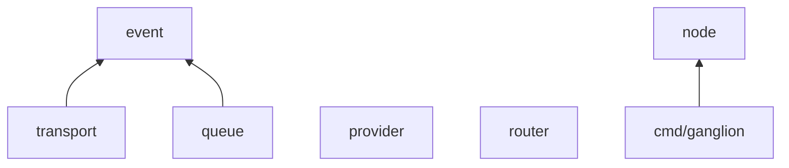

# Level 5 — Code map

Where each part of the architecture lives in the repository, and what
exists today. Update this table in the same commit that adds, moves or
implements a package.

Status: **done** — implemented and tested; **interface** — types and
interfaces only; **planned** — not in the repository yet.

| Concept | Package | Status | Spec | ADR |
|---|---|---|---|---|
| Binary, flags, signals | `cmd/ganglion` | done (P0) | 5.1 | [0004](../adr/0004-one-binary-with-roles.md) |
| Roles and node assembly | `node` | done: role parsing; `Run` is a stub until P1 | 5.1 | [0004](../adr/0004-one-binary-with-roles.md) |
| `Event`, `Outgoing`, TTL expiry | `event` | done | 6, 9.1 | — |
| Transport interface | `transport` | interface | 6, 7.1 | — |
| Inbox / outbox | `queue` | interface | 7.1 | [0006](../adr/0006-sqlite-inside-nats-between-nodes.md) |
| Model providers | `provider` | interface | 7.4 | [0007](../adr/0007-openai-compatible-first-provider.md), [0009](../adr/0009-claude-subscription-only-via-cli-worker.md) |
| Model router | `router` | interface | 7.3 | — |
| Store (history, turns, cron_runs, allowed) | — | planned (P1) | 6 | — |
| SQLite queue | — | planned (P1) | 7.1 | [0006](../adr/0006-sqlite-inside-nats-between-nodes.md) |
| Telegram transport | — | planned (P1) | 7.1 | — |
| Agent loop and actors | — | planned (P1) | 7.2 | — |
| Policies | — | planned (P1) | 7.6 | — |
| Memory | — | planned (P1) | 7.7 | — |
| Runner (wazero, supervisor) | — | planned (P0 spike, P1) | 7.5 | [0005](../adr/0005-wasm-on-wazero-for-modules.md), [0011](../adr/0011-module-abi.md) |
| Deye monitor module | — | planned (P0, task 0.2) | 8 | — |
| Load-shedding flow | — | planned (P1) | 8 | — |
| Core ↔ edge protocol, NATS | — | planned (P2) | 9.1 | [0006](../adr/0006-sqlite-inside-nats-between-nodes.md) |

## Dependency rules

- `event` is the leaf: it imports nothing from the project.
- Interface packages (`transport`, `queue`, `provider`, `router`) depend only
  on `event` and the standard library, so a node can be embedded as a
  library (spec principle 5).
- Implementations go into their own packages and depend on the interfaces,
  never the other way round.
- Only `cmd/ganglion` and `node` wire concrete implementations together.
