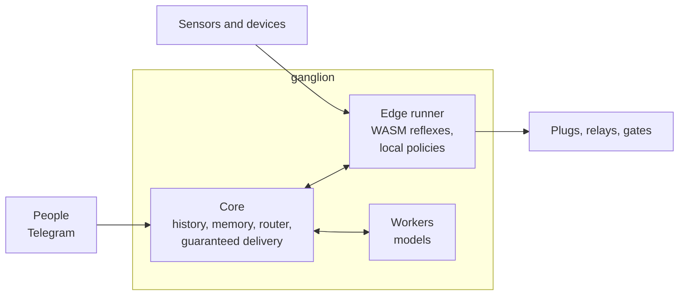

# Architecture

The system at increasing levels of detail, following the C4 model. Start at
the top and stop at the level you need.

| Level | Page | Answers |
|---|---|---|
| 1. Context | [01-context.md](01-context.md) | Who and what ganglion talks to |
| 2. Containers | [02-containers.md](02-containers.md) | Roles, processes, stores, and how they are deployed |
| 3. Components | [03-components.md](03-components.md) | What is inside the core, the edge runner and a worker |
| 4. Runtime | [04-runtime.md](04-runtime.md) | How a chat turn, a module tick, load shedding and a module rollout actually flow |
| 5. Code map | [05-code-map.md](05-code-map.md) | Which Go package implements what, and what exists today |

Related: [the spec](../spec.md) says what we build and in which phase;
[the ADRs](../adr/README.md) say why.

## The idea in one picture

- **Reflexes run without the model.** A regular task is a small WASM module
  on the edge; it reads sensors, applies rules and acts on its own.
- **The model is called only on exceptions.** A module escalates an event;
  the core routes it to a model on a worker; the model fixes the situation
  or ships a new module version.
- **Nothing gets lost.** Events go through an inbox/outbox inside a node and
  through NATS JetStream between nodes.
- **Dangerous actions are gated** by kill switches, invariants, a reviewer
  model and a human, depending on the risk class, enforced on the node that
  acts.

## Diagram conventions

- Solid boxes exist or are in the current phase plan; **dashed boxes are
  planned for later phases** (the phase is written in the box).
- Diagrams are Mermaid, so they render on GitHub and in Obsidian, and are
  edited as text together with the code (ADR-0002).
