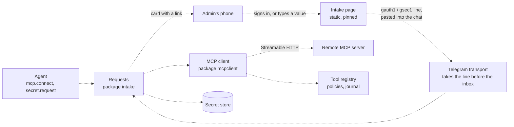

# Design note: remote MCP servers and handing values over from the chat

Notes from the owner's design session of 2026-11-18. The decisions are
recorded in
[ADR-0097](../adr/0097-connect-remote-mcp-servers-from-the-chat-with-an-own-client.md)
(the MCP client) and
[ADR-0098](../adr/0098-hand-values-over-from-the-chat-through-a-pinned-static-page.md)
(handing a code or a secret over from the chat); the requirements are
R-MCP-* and R-INT-* in [spec 7.16 and 7.17](../spec.md#716-remote-mcp-servers).
The plan and its status are in GitHub Issues
([ADR-0094](../adr/0094-the-github-project-holds-the-plan-and-the-repository-holds-decisions.md)).

Marks: **owner** means the owner decided it in the session; **call** means
the author's default, open to the owner's correction.

## 1. Intent

The owner talks to the agent every day and wants to say "connect this MCP
server" and have it work: the first case is a retailer's public MCP server
that signs a person in with OAuth. A node that runs from a template on a
platform has no shell for its admin, and may have no public address either:
it reads Telegram by polling.

Three ways were possible and two are closed (owner):

- **The provider's own MCP connectors** (the claude CLI's). They belong to
  one provider and vanish when the node changes provider. Besides, the
  node runs the CLI with `--strict-mcp-config` and `--tools ""`
  ([ADR-0036](../adr/0036-mcp-bridge-over-a-per-run-unix-socket.md)), so it
  never sees them.
- **A WASM module per server.** A module can give the agent tools
  (`triggers: tool:`) and reach a host with `http.fetch`, but its tools are
  fixed in its manifest while a server lists its own, it cannot run an
  OAuth flow, and what it does crosses a trust boundary that
  [ADR-0017](../adr/0017-extension-points.md) keeps in the core.
- **A client in the core, servers in the node's file.** Chosen: it works
  the same for every provider.

The same session took in the open half of
[#172](https://github.com/igorrius/ganglion/issues/172): handing a secret
to the node from the chat, past the agent, so that a server that wants a
key, and a module that wants one, need no `ganglion secret set` on the
host (owner).

## 2. Goals and non-goals

Goals:

- A remote MCP server (Streamable HTTP) is connected from the chat with
  three steps of the admin: open the sign-in link, paste one line, press
  Connect.
- OAuth 2.1 with PKCE and dynamic client registration, as the MCP
  authorization specification asks; a server with no sign-in; a server
  that takes a key in a header.
- A secret reaches the node's store from the chat without passing the
  model's context, the inbox, the history, the journal, the logs, or the
  chat's history in clear.
- Every tool of a server goes through the node's policies, journal and
  call keys, like a built-in tool.
- No public address needed.

Non-goals (this work):

- Local MCP servers started as processes (`npx …`, Python): level 3 of
  [spec 9.8](../spec.md#98-self-modification-levels), P3.
- Accounts per person: one account per server per node (owner).
- The node serving the page itself (section 8.3).
- A server's resources, prompts, sampling, elicitation and roots.
- `/login` for the claude CLI
  ([#174](https://github.com/igorrius/ganglion/issues/174)): it will use
  the same requests, in its own work.

## 3. Decisions of the session

| Question | Decision | Mark |
|---|---|---|
| Whose account | One per node; the admin connects and signs in; the tools are admin-only, like the agent's other tools today | owner |
| Where the OAuth code comes back | A static page that shows a line to copy; the admin pastes it into the chat | owner |
| Where that page lives | GitHub Pages of the project by default, the address a setting; the node checks the page against its own copy before every use | owner |
| A tool's rule on connecting | The card proposes: a tool the server marks read-only runs by itself, the rest asks; the admin approves or changes | owner |
| Client code | Own MCP client over HTTP, OAuth with `golang.org/x/oauth2`; registration and discovery our own | owner |
| A key or a secret from the chat | In this work, through the same page in a second mode that encrypts in the browser | owner |
| Telegram widgets for the cards | Not now: plain buttons first; a widget version belongs to [#216](https://github.com/igorrius/ganglion/issues/216) | call |
| Curve for the page's encryption | P-256, which every browser's WebCrypto has had for years; X25519 is newer | call |

## 4. Parts



Everything is planned, so everything is dashed.

1. **`mcpclient`.** One client per configured server: `initialize`,
   `tools/list`, `tools/call`; the session header; a response as JSON or as
   an event stream; bounded reads. It adds the server's tools to the
   registry's dynamic source, as `modhost` does for modules.
2. **OAuth, inside `mcpclient`.** Discovery (the protected resource's
   metadata, then the authorization server's), dynamic client
   registration, PKCE, the code exchange and refresh through `x/oauth2`,
   the `resource` parameter. The registration and the tokens live in the
   secret store under the scope `mcp:<server>`.
3. **`intake`.** Open requests of two kinds, an OAuth code and a secret:
   who may answer (the admin), the lifetime (10 minutes), for a secret a
   one-time key pair. Memory only: a restart closes them. A line that
   answers one is checked here and handed to its owner (the client, the
   store).
4. **The transport's part.** Telegram recognises a private text message
   from an admin that is one `gauth1.` or `gsec1.` line, takes it before the
   access check's inbox, hands it to `intake`, and deletes the message.
5. **The page.** One static HTML file with inline script, two modes,
   versioned and pinned (section 8).
6. **The file and the tools.** `mcp:` in `ganglion.yaml`; `mcp.connect`,
   `mcp.rule`, `mcp.tools`, `mcp.use` and `secret.request` for the agent;
   `/mcp` for the admin.

## 5. Connecting a server with OAuth

```mermaid
sequenceDiagram
    participant A as Admin
    participant T as Telegram
    participant N as Node
    participant S as MCP server
    participant L as Sign-in server
    participant P as Intake page
    A-->>T: "connect the shop's MCP server"
    T-->>N: message → agent → mcp.connect(shop, url)
    N-->>S: initialize
    S-->>N: 401, resource metadata
    N-->>L: metadata, then POST /register (redirect = page)
    N-->>T: card: sign in at the sign-in host [Sign in]
    A-->>L: signs in on the phone
    L-->>P: redirect with code and state
    P-->>A: gauth1.<state>.<code>.<iss> [Copy]
    A-->>T: pastes the line
    T-->>N: taken before the inbox; message deleted
    N-->>L: code + PKCE verifier → tokens
    N-->>S: initialize, tools/list
    N-->>T: card: the tools and their rules [Connect] [Ask for all] [Cancel]
    A-->>T: Connect
    N-->>N: the file's change recorded; tools in the registry
```

1. The admin asks. The agent finds the address if it was not given and
   calls `mcp.connect(name, url)`.
2. The node, not the model, checks the address: `https`, a public host,
   the same checks as `web.fetch`. In a tainted session the call is
   confirmed first: its URL could carry the session's data out.
3. The node sends `initialize`. A `200` means no sign-in: on to step 7. A
   `401` with the resource's metadata means OAuth.
4. Discovery and registration. Every address the metadata names is checked
   like the server's. The node registers itself with the page as its only
   redirect address and keeps the `client_id` in `mcp:<name>`.
5. The card, written by the node: the server's host, the sign-in host, a
   **Sign in** link in its text (plain Telegram buttons in this release
   cannot open a page; a link button belongs with #216's widgets). The link
   carries the PKCE challenge, the
   `resource` and `state`, which is the request's id; the verifier stays in
   the node's memory. The request lives 10 minutes.
6. The admin signs in on the phone. The sign-in server sends the browser
   to the page, which shows `gauth1.<state>.<code>[.<iss>]` (code and
   issuer base64url-encoded) and a Copy button. The
   admin pastes it into the chat; the transport takes it before the inbox
   and deletes it; the node exchanges the code and stores the tokens.
7. The node lists the tools and sends the second card:

   > MCP server `shop`, 9 tools
   > By itself: `search_products`, `get_cart`, …
   > Asks first: `add_to_cart`, `place_order`, …
   > [Connect] [Ask for all] [Cancel]

   A tool the server marks `readOnlyHint` is proposed as `auto`, every
   other one as `confirm`. Each tool shows its name and the first line of
   its description, as data.
8. **Connect** is the confirmation of the file's change: the server's entry
   with its rules and the fingerprint of the tool list is written and
   recorded in the history (R-CFG-13). The tools join the registry at once,
   with no restart, and the agent gets a node note "shop connected, 9
   tools". **Cancel** deletes the registration and the tokens.

Later the admin changes a rule in words ("let it read the cart without
asking"): the agent calls `mcp.rule`, which asks with a card of its own.

### The file

```yaml
mcp:
  page: https://igorrius.github.io/ganglion/intake/v1/   # the default
  servers:
    shop:
      url: https://mcp.example.com/mcp
      auth: oauth            # none | oauth | header
      timeout: 30s
      tools:
        search_products: auto
        get_cart: auto
        add_to_cart: confirm
        place_order: confirm
      fingerprint: sha256:…  # of the approved tool list
    other:
      url: https://other.example.com/mcp
      auth: header
      header: X-API-Key      # the value is in the store, scope mcp:other
```

`mcp` applies at once, like `modules` (R-CFG-6), and is changed only by its
own tools, never by `config.propose` (R-CFG-14).

### Names

A server's name is `[a-z0-9_]{1,24}` and may not be the short name of a
module or a prefix the core uses (`memory`, `web`, `cells`, …). A tool is
named `<server>.<tool>`; the tool's own name loses a leading `<server>_`,
is lower-cased, and every character outside `[a-z0-9_]` becomes `_`. A
name that then collides, or is longer than 64 characters, is skipped and
named on the card. At most 128 tools per server, a description of 8,000
characters, a schema of 32 KB, a list of 512 KB.

### Tools on demand

The spike's server listed 42 tools in 115 KB, about 30,000 tokens on every
turn ([research](../research/2026-11-18-remote-mcp-and-intake-spike.md)).
So a server's tools reach the model on demand (owner, 2026-11-18):

- The agent always has `mcp.tools([server])`: without a server, the
  connected servers and their states; with one, each approved tool's name,
  policy and the first line of its description.
- `mcp.use(server, tools)` turns tools on for the session. From the next
  step their full definitions are in the session's tool list, until the
  session ends. At most 16 tools and 48 KB of definitions at once.
- Both read only the node's approved copy and send nothing off the node.
  A `forbidden` tool is never turned on. The text they show is the
  approved, fingerprinted list, the same standing as a tool definition; a
  tool's result taints the session as before.

## 6. A key, and a module's secret

**A server that wants a key.** `initialize` answers `401` without OAuth
metadata. The node tells the agent that the server wants a key; the agent
reads the server's documentation and calls `mcp.connect(name, url,
header: "X-API-Key")`. The node opens a secret request and sends the card:
"Server `other` wants a key for `X-API-Key`; the value goes only to
`other.example.com`" with an **Enter** link to the page in its secret mode.
The admin types the value, copies the `gsec1.` line the page shows, and
pastes it; the node decrypts it into `mcp:other`, destroys the key pair,
and goes on from step 7.

**A module's secret** (#172). `secret.request(name, why, module)` opens the
same request for the module's scope. The card names the module and the
hosts its manifest lets it reach; the agent's reason is quoted as data.
Whether the module may read the secret is still decided by its manifest at
install.

The agent never sees a value, then or later; no tool reads one back.

## 7. After connecting

- **A token expires.** The client refreshes it; the admin notices nothing.
- **The refresh fails** (revoked, expired). The server goes to "needs
  sign-in": its tools answer the agent "`shop` needs a new sign-in", and
  the admin gets one card with **Sign in**, not repeated until they sign
  in or disconnect.
- **The tool list changes** (`notifications/tools/list_changed`, or a
  fingerprint that no longer matches at the next connect). The server's
  tools are off until the admin presses **Connect** on a card that shows
  what changed.
- **`/mcp`** (admin, private chat, no model): each server with its state
  (connected, needs sign-in, tools changed, unreachable, store locked), the
  time of the last sign-in, the number of tools, and a **Disconnect**
  button that removes the entry, the registration and the tokens.
- **`/status`** gets one line per server that is not connected.

## 8. The intake page

### 8.1 Two modes

- **OAuth return.** The sign-in server's redirect brings `code` and
  `state` (and `iss`) in the query. The page shows
  `gauth1.<state>.<base64url(code)>[.<base64url(iss)>]` and a Copy button;
  the node requires `iss` when the metadata says the server sends it. It needs no script beyond reading the address and copying.
- **A secret.** The node's link carries, after `#` (which a browser never
  sends to the server): the format version, the request id, the secret's
  name, the host it goes to, and the request's public key. The page shows
  one field and a button; it encrypts in the browser and shows
  `gsec1.<id>.<ciphertext>` and Copy.

The page sends nothing over the network: a Content-Security-Policy with
`default-src 'none'` and `connect-src 'none'`, inline script and style by
hash, no outside fonts, scripts or images.

### 8.2 The cipher

HPKE (RFC 9180), base mode: DHKEM(P-256, HKDF-SHA256), HKDF-SHA256,
AES-128-GCM. The node opens it with the standard library's `crypto/hpke`;
the page builds it from WebCrypto (ECDH P-256, HKDF, AES-GCM), about 150
lines with no library. The `info` is `ganglion-intake-v1`, the request id
and the secret's name, so a ciphertext answers only its own request. A
value through the page is at most 2 KB, so the line fits one Telegram
message (4096 characters); the store's own limit of 4 KB stays for `ganglion
secret set`.

### 8.3 Where it lives and why it can be trusted

In the OAuth mode the page learns nothing useful: a code without the
verifier, which never leaves the node, is worthless. In the secret mode
the page sees the value before it encrypts it, so whoever serves the page
could take the value. The owner's concern was a maintainer's mistake: a
merged change that replaces the page on the project's site.

- **Versioned and immutable.** The page is `intake/v1/index.html` on the
  project's site. A published version never changes: CI compares each
  published version with its SHA-256 in `intake/published.sha256` and fails
  on a difference. A new format is `v2`, and `v1` stays for older nodes.
- **Pinned by the release.** The binary embeds its own copy of the page.
  Before every secret request the node fetches the configured page (a
  public address, a size limit) and compares it with its copy; on a
  mismatch it refuses the request and tells the admin "the intake page has
  changed; handing secrets over is stopped". So a replaced page on the
  site stops every node at once instead of reaching them. A replacement
  that also reaches a release the node runs is a compromised node, which
  the page does not make worse.
- **What is left.** The host serving the node the right page and the phone
  a different one. That is an attack by the host itself (GitHub), not a
  person's mistake, and moving the page to another host (a Cloudflare
  account of the owner's, for one) puts another party in the same place;
  the owner's account would also become every other user's dependency.
- **The address is a setting** (`mcp.page`). An operator who wants another
  host puts the same file there; the check is the same.
- **Later, the node itself.** A node with a public listener (`http.addr`
  and `public_url`, R-CFG-11) can serve its own copy and remove the third
  party. That is a new route on a public entry, so it is its own step
  ("Not now").

In the OAuth mode a mismatch does not stop the sign-in (a code without the
verifier is safe); the card carries a warning instead.

## 9. Security

Spec principle 9: every link is hostile, every input untrusted.

**A hostile or broken server**

- *Instructions in a tool's result.* Results are outside content: wrapped
  as data, the session becomes tainted (R-POL-6), and from then on every
  way out asks.
- *Instructions in a tool's description*, which sits in the model's
  context on every turn. The admin sees the list when connecting, a
  description is capped, and the fingerprint switches the tools off when
  the text changes.
- *A sign-in server that is not the server's.* The card names the sign-in
  host; the token is bound to the server with `resource` (RFC 8707); every
  metadata address passes the public `https` check. The resource's own
  metadata is read only from the server's origin (a challenge that names
  another host is refused, though RFC 9728 allows it), and its `resource`
  must be the server's address or a path above it; the authorization
  server may be another host, as identity providers are, and its metadata
  must name the issuer that was asked for (RFC 8414, 3.3). No sign-in
  request follows a redirect.
- *Asking the node for more than tools.* The client declares no
  capability; a request for sampling, elicitation or roots gets an error.

**The model, steered to take the access**

- No tool returns a token or a key; they never enter a context, the
  journal or a log, and every value is registered with the redactor.
- The authorization header is added by the client only to requests to the
  server's origin; a redirect to another origin goes without it.
- `mcp.connect` to a hostile server does nothing without the admin's
  **Connect**, and the card is the node's text.
- An MCP tool is a way out: confirmed in a tainted session when it has
  input (`AskTaintedInput`), refused in a `local-only` session (not
  `LocalSafe`).

**The pasted lines**

- Taken only from an admin in a private chat with the bot. From anyone
  else, or in a group, the message is deleted when the bot can and goes
  nowhere.
- `state` or the request id must match an open request; each line works
  once; an expired request answers "the request expired, press again".
- A message the bot cannot delete is logged by request id and left. A code
  without the verifier and a ciphertext whose key is destroyed are useless.

**The page:** section 8.3.

## 10. Failures

| What | What happens |
|---|---|
| Server unreachable, or slower than `timeout` (30 s) | The tool answers "`shop` is unreachable"; the next calls back off |
| A call that is not read-only gets no answer | Never retried by the node: an order may have gone through. The journal records "outcome unknown" and the agent says so |
| A result over 1 MB | Cut, with a note the agent sees |
| The secret store is locked (R-CFG-10) | Servers that sign in are "store locked" in `/mcp` and `/status` |
| The node restarts | Open requests are gone (press again); registrations and tokens stay |
| The page's check fails | Secret requests refused, the admin told; OAuth goes on with a warning |

## 11. How it is checked

**A spike first** (done on 2026-11-18, [research](../research/2026-11-18-remote-mcp-and-intake-spike.md);
Telegram on iOS not checked, the ADRs accepted without it):

1. Does the owner's first server accept a redirect address on the
   project's site at registration?
2. Does the page's WebCrypto work in Telegram's in-app browsers on iOS
   and Android?

**Unit tests on fake servers (`httptest`):** the client (JSON and stream
answers, the session header, limits and timeouts, `list_changed`, no
header after a cross-origin redirect); OAuth (401 → metadata →
registration → exchange → refresh, PKCE and `resource`, a foreign metadata
host refused); `intake` (expired, repeated, wrong sender, unknown request,
the page's check).

**The cipher across languages:** CI encrypts a value with the page's own
script under Node.js's WebCrypto, Go opens it; a fixed line in `testdata`
too.

**The leak test** (the "done when" of #172): after a full run with a
secret and with OAuth, the value, the code and the token are searched for
in the model's context, the inbox, the history, the journal and the logs,
and found nowhere.

**A chatlab scenario:** "connect a server" against a fake server with
OAuth: both cards, the line taken and deleted, the model never shown it,
and after Connect a read tool running by itself and a side-effect tool
asking.

**The live check** on the owner's node, with the first real server: connect
from the chat, search, read the cart; adding to the cart asks; no order is
placed. Recorded by what was done and seen, without addresses or accounts.

## 12. Not in this work

- Local MCP servers as processes (level 3, P3).
- The node serving the page from its public listener.
- Accounts per person.
- Telegram's `sendData` as a return channel: pasting works in every chat
  and needs no keyboard button.
- `/login` for the claude CLI (#174), which builds on `intake`.
- Telegram widgets for the cards (#216).
