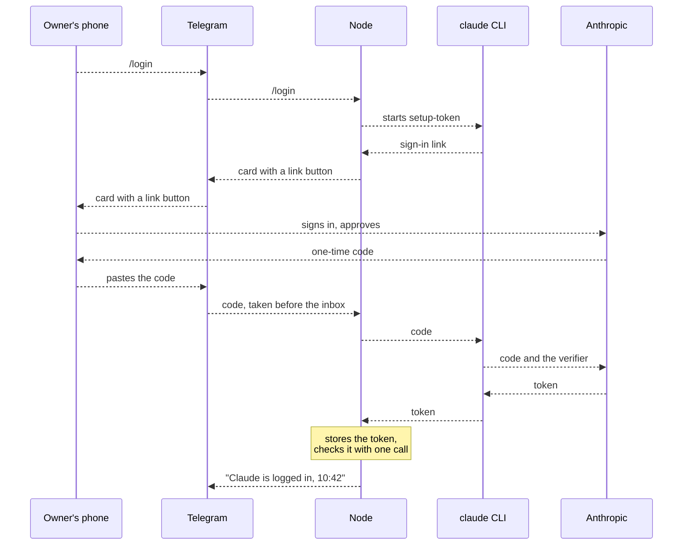

# Design note: logging the model provider in from the chat

Notes from a conversation with the owner on 2026-11-13 (board card G-151).
Nothing here is built or decided as a requirement. It is the input for an ADR
and a plan when the work is taken into a phase; until then the spec lists it
under [Open decisions](../spec.md#11-open-decisions) and
[Not now](../spec.md#14-not-now).

Marks: **owner** means the owner said it; **call** means the author's
default, open to the owner's correction.

## 1. Intent

The claude CLI provider logs in with `CLAUDE_CODE_OAUTH_TOKEN`
([deploy runbook](../deploy-railway.md)). Getting that token today means
running `claude setup-token` on a machine with a terminal, or inside the
container, copying a link out of it, and pasting the result into a Railway
variable.

What went wrong on 2026-11-13: the owner lost the token, logged in again,
and pasted the browser's confirmation code into the variable instead of the
token. The node answered "no model is available" until the logs showed
`401 Invalid bearer`.

The owner wants the login to run through the chat, safely, because not
every operator has a shell in the container, and some never will (owner).
The node is meant to be installed from a Railway template (owner), so the
first login is part of the install.

## 2. Goals, non-goals

Goals:

- The owner logs the provider in, and logs it in again after a lost or
  expired token, from the chat, with no shell and no redeploy.
- The token never enters the chat, the model's context, the inbox, the
  history, the journal or the logs.
- The flow works when no model is available, since that is when it is
  needed.
- A failed login says why in the chat, in plain words.

Non-goals:

- A general secret intake. That is
  [the secret store note](secrets-intake-design.md) (G-149); an OpenRouter
  key is an ordinary secret and goes that way.
- Protection from a compromised host or a compromised phone.

## 3. A core command, not a module

The owner asked for a module (owner). It should be a command of the core
(call):

- Without a login no model answers, so the agent can build, install or run
  nothing. The flow must not need a model.
- A module would have to hold the provider's token. The node refuses that
  on purpose: card G-132 closes the gap through which a manifest can still
  ask for `CLAUDE_*` and `ANTHROPIC_*`.
- The flow takes a message before the inbox. Only the transport and the
  core can do that.

So `/login` joins the commands that the node answers itself, like
`/status`, and only the owner may send it.

## 4. The process

Everything is planned, so everything is dashed.

1. **Command.** `/login` from the owner. Anyone else gets the usual
   refusal. One login is open at a time and lives 10 minutes (call).
2. **Link.** The node runs the bundled CLI's `setup-token` and reads the
   sign-in link from it. The card is the node's text, not a model's.
3. **Code.** The owner signs in on the phone and gets a one-time code. The
   next message from the owner in that chat is the code: the transport
   takes it before the inbox, the journal and the model, and asks Telegram
   to delete the message.
4. **Token.** The CLI exchanges the code and prints the token. The node
   reads it from the CLI's output, which is never logged.
5. **Check.** One cheap model call. A failure is reported with its reason,
   and the old token, if there was one, stays in use.
6. **Store and use.** The token goes to the secret store and the provider
   takes it for the next call. No restart.

## 5. Why a code in the chat is acceptable

A token in the chat would not be: it works for a year, from anywhere. The
code is different (call, to be confirmed by the spike in section 8):

- it is used once, and the node uses it within seconds;
- it lives for minutes;
- it is useless without the verifier of the same login, which stays in the
  CLI's memory inside the node.

Someone who reads the chat, at Telegram or on a stolen phone later, gets a
spent code. Deleting the message is tidiness, not the defence.

What the owner approves on Anthropic's page is the real grant: the node
gets a long-lived token for the owner's subscription. The card says so
before the link is opened.

## 6. Where the token lives

In the secret store of [the secret store note](secrets-intake-design.md),
section 4, part 1: encrypted in SQLite on the volume, under the node's
master key. This note depends on that part of G-149 and on nothing else in
it: no intake page, no `sendData`, no inbound HTTP.

The variable keeps working. `CLAUDE_CODE_OAUTH_TOKEN` in the environment
is read when the store has no token, so nothing changes for a node set up
by hand. Which of the two wins when both are set is open (section 8).

## 7. The first run, from a template

A Railway template asks for variables when it is deployed. With this flow
it asks for two that the operator already has (call): the bot's token from
BotFather and the owner's Telegram id. The master key of the store is
generated by the template.

Then the owner opens the bot and sends `/login`. The pairing code of the
spec's "Not now" (the first person to send the code becomes the admin)
would remove the id as well, but it needs the deploy log, which is the
access this note tries not to need. It stays a separate item.

Until the first login the node answers any message with a fixed text that
names `/login`, instead of today's "no model is available".

## 8. Open before an ADR

- **A spike on driving `setup-token`.** Not checked: that the CLI of the
  image prints the link and waits for the code on its input when it has no
  browser and no terminal, what it prints on a wrong or expired code, and
  whether it needs a pseudo-terminal. On 2026-11-13 the help text of
  `claude setup-token` listed no options, so there is no flag for this.
  The CLI's prompts are not a stable interface: the spike also decides how
  a changed prompt is noticed (a version pin, a start-up check).
- **The alternative: the node does the OAuth exchange itself.** No CLI to
  drive, but it copies a client id and endpoints that Anthropic does not
  publish for third parties. The ADR compares the two; the default here is
  to drive the CLI (call).
- **Which message is the code.** "The next message from the owner" is
  simple and can swallow an unrelated message. A format check on the code
  or a reply to the card would narrow it.
- **Environment or store first** when both hold a token.
- **Expiry.** The token lasts about a year. Whether the node warns the
  owner ahead of time, and how it knows the date.
- **The phase.** With the store of G-149 (M6 or P2), or earlier with a
  plain file on the volume. Not decided.
- **Other providers.** A provider with a pasted key (OpenRouter) is an
  ordinary secret. Whether `/login` names a provider or the command belongs
  to the claude CLI alone.
