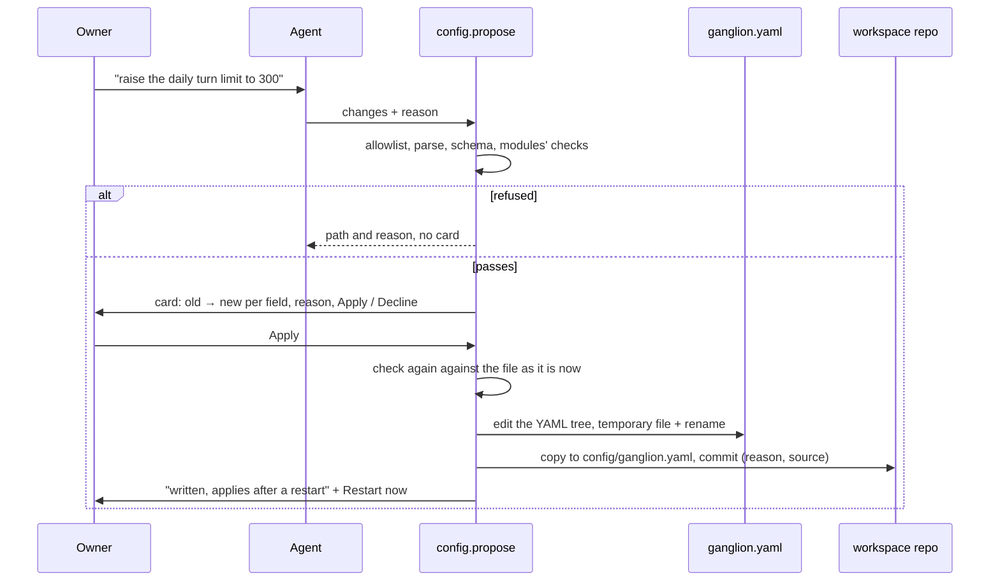

# Design note: changing the node's file through the agent (M6 tasks 6.1–6.3)

Notes from a conversation with the owner on 2026-11-16. Nothing here is
built. The decision is
[ADR-0093](../adr/0093-config-changes-through-the-agent-with-history-in-the-workspace.md);
the requirements are R-CFG-13 – R-CFG-16 in the
[spec](../spec.md#714-node-configuration); the work is tasks 6.1–6.3 of the
[phase plan](https://github.com/igorrius/ganglion/blob/e6b25054290c0a0e460edf0639b5e8dfa761f251/docs/plans/p1-all-in-one.md).

Marks: **owner** means the owner said it; **call** means the author's
default, open to the owner's correction.

## 1. Intent

M6's acceptance: the agent applies a configuration change the owner
approved, refuses one that fails the config's checks, and rolls back on
request.

The node already writes parts of `ganglion.yaml` (module lines,
destinations, `notify_to`, groups), each through its own confirmed tool.
What is missing:

- a history of every change to the file, with a reason and a source (6.1);
- one tool for the routine settings that have no tool of their own (6.2);
- checks before a change and a rollback (6.3).

Out of scope:

- the access list beyond `telegram.admin`: it is in the database, and
  changing it from the chat is its own task (owner,
  [#235](https://github.com/igorrius/ganglion/issues/235));
- changing a field without a restart ("Not now", owner);
- task 6.4, risk classes on cell backends (left P1, ADR-0058).

## 2. What the agent may change

`config.propose` takes only these fields (owner, 2026-11-16):

| Section | Fields |
|---|---|
| `node` | `tz`, `memory_limit` |
| `log` | `level` |
| `telegram` | `reply`, `rich`, `reactions.after`, `reactions.dwell` |
| `agent` | `languages`, `session_idle`, `call_timeout`, `turn_timeout`, `limits.daily_budget_usd`, `limits.daily_turns`, `limits.daily_tokens`, `search.mode` |
| `memory` | `prompt_budget`, `review.enabled`, `review.quiet` |
| `update` | `check` |
| `models` | `purposes`: which of the defined models serves a purpose, and with what effort |

Refused, with the reason named:

| Field | Why | Changed by |
|---|---|---|
| `telegram.token`, a provider's `key`, `agent.search.brave_key` | secret references | the host (`ganglion secret`, the file) |
| `telegram.api_url` | the bot token is sent there | the host |
| `telegram.admin` | who owns the node; the person approving may be the one deceived | the host |
| `models.providers`, `models.models` | `base_url` is where a key goes, `command` is what the node runs | the host |
| `sandbox`, `http`, `metrics`, `log.dir`, `agent.workspace` | they widen the node or move its data | the host |
| `telegram.updates`, `http` with it | opens a public entry | its own card (R-CFG-11) |
| `telegram.groups` | | the group's card and `group.disconnect` |
| `destinations`, `modules`, `notify_to` | | their own tools |

The allowlist is one table in code; a test keeps it in step with
`schemas/node.schema.json`, so a field that leaves the schema leaves the
list, and a new field is off the list until it is added on purpose (call).

## 3. A change, step by step

- The card expires as any question does (R-POL-9); an expired or declined
  card writes nothing.
- A proposal from a tainted session is allowed; its card carries a line
  that it was proposed after outside content (R-POL-6), as `module.write`
  does (call).
- Several changes may be applied before one restart (owner).

## 4. History

- **Where.** A copy of the file at `config/ganglion.yaml` in the
  workspace repository; the live file stays at its path (R-CFG-1) (owner).
- **Who writes it.** One recorder wraps every writer of the file
  (`ModulesFile`, `DestinationsFile`, `TelegramFile` and the new
  `SetPath`). It writes the file, copies it and commits, under one lock.
- **Commit message.** The reason on the first line; trailers name the
  source (`propose`, `rollback`, `module`, `destination`, `group`, `host`)
  and, for a proposal, the turn.
- **At start.** The node compares the live file with the last copy. A
  difference is committed with the source `host`: an edit made by hand, or
  a crash between the write and the commit.
- **Reserved.** Tools that write the workspace refuse `config/`; an edited
  copy is overwritten at the next start.
- **No git.** With no git binary (`gitrepo.ErrNoGit`) `config.propose`
  still works; `config.history` and `config.rollback` say there is no
  history.

## 5. Rollback

- `config.history` lists the latest changes: date, source, reason, diff.
- `config.rollback` takes the latest change, or one named from the
  history. It is a new proposal: each allowlisted field the change touched
  goes back to its value before that change. It goes through the same
  checks and the same card (owner).
- The parts of a change outside the allowlist (a module line, a route, a
  host edit of `sandbox`) are listed on the card as not rolled back here,
  with the tool or the place that changes them (owner).
- Since it is not a `git revert`, a rollback never conflicts with later
  changes to other lines; it may set a field a later change also set, and
  the card shows that field's current value as "old".

## 6. Errors

| Case | What happens |
|---|---|
| A field off the allowlist | refused with "changed on the host" or "has its own tool"; no card |
| The file after the change fails parsing, the schema or a module's check | refused with the path and the reason; the file is untouched |
| The file changed while the card waited | on Apply the node checks again against the file as it is now: a change that no longer passes is refused with the reason; one that passes is written, and the answer names each field's value just before the write, so a value that moved is seen |
| The commit fails after the write | the file is changed; the error is logged and said; the check at start commits it |
| No git | proposals work; history and rollback say there is none |

## 7. Pieces

| Piece | Where (call) |
|---|---|
| `SetPath(path, changes)`: set values by dotted path in the YAML tree | `settings` |
| `Allowed(path)`: the allowlist | `settings` |
| The recorder and the check at start | a new package, `confighist` |
| `config.propose`, `config.history`, `config.rollback` | `tool/builtin/config.go`, admin only, private chat |
| Restart now | the `/restart` path |

## 8. Tests

- `settings`: `SetPath` keeps comments and the rest of the file; a bad
  value names its path; the allowlist matches the schema.
- `confighist`: a write and its commit; the check at start; two writers at
  once lose no change; no git.
- Tools: a field off the list is refused; a bad value is refused; an
  expired card writes nothing; a rollback sets back only allowlisted
  fields; a change under a waiting card shows a new card.
- chatlab: "raise the daily turn limit to 300" → card → apply → the file
  and a commit; "roll it back" → the old value; "turn the sandbox off" →
  refused with no card.
- Live on Railway: a change, a restart from the button, the history, a
  rollback.

## 9. Documents in the same work

ADR-0093; R-CFG-13 – R-CFG-16 in the spec; the implementation plan;
`docs/architecture/05-code-map.md` for `confighist`; a page in
`docs/guide/` on changing settings from the chat.
