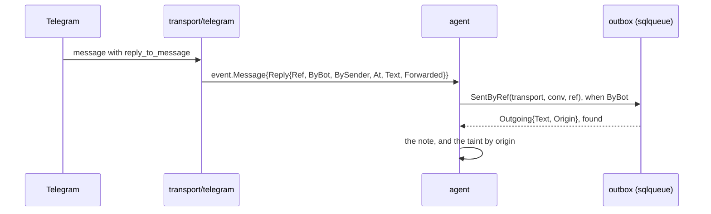

# Knowing which message a reply answers: design

Status: approved by the owner on 2026-11-07. It feeds the spec changes, the ADR and the
step-by-step plan. It is not itself a plan.

Marks, as in the [M3d design](p1-m3d-host-commands-design.md): **(owner)** the owner decided it;
**(call)** the author's call, open to correction; **(builder)** left to whoever implements it.

## 1. Why

A session can hold several topics, and the owner answers one of them with Telegram's reply. Today the
transport reads only a selected quote, so a reply with nothing selected reaches the agent as a bare
message, and the agent guesses which topic it belongs to (owner, 2026-11-06). A reply to yesterday's
task report ("do it") is worse: the report was never in the chat's history, since a task runs in a
conversation of its own (`task:<id>`), so the agent has nothing to go on.

The opposite problem sits beside it: any selected quote taints the session today
(`agent/stages.go`), even a quote of the bot's own answer from two minutes ago, so a clean session
starts asking for confirmations for no reason.

**What success looks like:** a reply to any of the bot's messages or the owner's own, up to 90 days old,
tells the agent what it answers; a reply to something clean taints nothing; a reply to something that
came from outside content taints the session exactly as that content would have.

## 2. Goals, non-goals, anti-goals

**Goals:**

1. The agent knows which message a reply answers, for the bot's messages and the sender's own, in the
   current session and older ones, task reports and reminders included **(owner)**.
2. Taint follows the replied message's origin: a reply to a message a clean session wrote does not
   taint, a reply to one a tainted session wrote does **(owner)**.
3. A selected quote of a clean message stops tainting the session **(call)**.

**Non-goals:**

- Other people's messages in groups: they stay outside content, as today **(owner)**. Scope is one
  operator, one agent, one bot (spec 14).
- Resuming the replied message's session, or pulling its history: the reply brings the one message
  **(call)**.
- Replies in other transports: the event field is channel-neutral, only Telegram fills it **(call)**.
- Reading a file the replied message carried: as with any file, after M3d (R-DLV-10).

**Anti-goals, which make it a failure even if it works:**

- Text a tainted session wrote comes back into a clean session as the agent's own words.
- Telegram's copy of a message decides that the bot wrote it cleanly: the node's own store decides.
- A message is lost or delayed because the lookup failed.
- A token is spent on a message already in the history beyond a short pointer to it.

## 3. What the agent sees

The person's line in the history gets a note of what they answered, after their own words, as a
selected quote does today. What the note holds depends on the replied message:

| The reply answers | The note | Taints |
|---|---|---|
| The bot's message from the **current session**, written clean | `[in reply to your message of 14:02: "<first ~150 characters>…"]`: the whole text is already in the history | no |
| The bot's message from **elsewhere**, written by a clean session | the time, where it came from (an earlier session, a task's report, a reminder) and its text up to ~2,000 characters | no |
| The bot's message written by a **tainted** session, or of no known origin | its text wrapped as outside content: up to ~2,000 characters, or a ~150-character excerpt when it is of the current session | yes |
| The node's **answer to a command** (added by ADR-0103) | `/status`: its text up to ~2,000 characters; any other command: its name and time, no text | no |
| The **sender's own** message, not a forward | the time and its text from Telegram's copy | no |
| A forward, another person's, a message not found, a message in another chat | wrapped as outside content | yes, as today |

- **The taint is decided before "current":** a message a tainted session wrote is wrapped even in its
  own session, so an address in it never becomes known; there it brings only the excerpt, since the
  history holds the rest.
- A **selected quote** takes the place of the excerpt; whether it taints follows the message it was
  taken from **(call)**.
- A **message with no text** (a file alone) is noted as "a message with a file" (R-DLV-10).
- The **sizes** (150 and 2,000 characters) are **(call)**; a cut text ends with a mark that it was cut.
- The note's words are in English, like the other notes in the history **(builder)**.
- **Additions** to a running turn and **commands** go through the same function, so an addition that
  is a reply gets the same note and the same taint (R-LIVE-4).

## 4. Where the origin comes from

**The approach (call):** the node's own store gives the origin; Telegram's copy only points at the
message. Two others were weighed and dropped:

- **Trust Telegram's copy and decide "current session" by time.** A task's report reaches the chat
  in the middle of a session without being in its history, and may carry a web page's words: by time
  it would look like the session's own. A hole.
- **Keep each answer's ref beside it in the session's history**, so a reply points at history item
  12. The ref is known only after the asynchronous send, which would make the history wait on the
  outbox; and it does not help a message from another session at all.

The decision and its security case are in
[ADR-0055](../adr/0055-a-reply-carries-the-replied-messages-origin.md).

## 5. Data and flow

**The transport.** Telegram's `reply_to_message` is read for its id, its author, its date, its text
(text, caption or a rich message flattened as in R-DLV-12) and whether it is a forward
(`forward_origin`, `is_automatic_forward`). `event.Message` gets a channel-neutral field:

```go
// Reply is the message this one answers, as the channel reports it.
Reply *Replied // Ref, ByBot, BySender, At, Text, Forwarded
```

`ByBot` is set when the author is the bot, `BySender` when it is the person writing now. `Quote` and
`ExternalReply` stay as they are. In a forum topic Telegram names the topic's root (the service message
that created the topic, `forum_topic_created`, whose id is the topic's) as the replied message of every
message that is no explicit reply: that is not a reply, and `Reply` stays empty.

**The origin of what the node sends.** `event.Outgoing` gets `Origin{Session, Tainted}`. The agent
fills it on everything a turn makes: answers, superseded answers, plans, questions, folds, reminders
and task reports **(builder: one place sets it, so no kind is missed)**. The outbox already keeps a
message's body as the JSON of `Outgoing`, so the field needs no migration.

- **A task's report:** the task run's session, and its taint.
- **A reminder:** clean **(call)**. Its text was set when the job was made: in a clean session with no
  press, in a tainted one only after the owner's press (R-POL-6), so the owner has seen it.
- **A system job's message** (the memory audit): tainted **(call)**, since it reports on memory that
  outside content may have reached.
- **A row with no origin** (sent before this change): tainted.

**Finding a sent message by its ref.** A new table maps every part's ref to its outbox row, with a
copy of what a reply needs, taken when the ref is recorded: the text cut at 2,000 characters and the
origin. The pruner deletes sent outbox rows after 7 days but keeps refs for 90 **(owner, 2026-11-07)**,
so a reply reaches a message for 90 days; an older one comes as outside content.

```sql
CREATE TABLE outbox_refs (
    transport TEXT NOT NULL,
    conv      TEXT NOT NULL,
    ref       TEXT NOT NULL,
    outbox_id TEXT NOT NULL,
    text      TEXT NOT NULL DEFAULT '',     -- migration 006: the copy, cut at 2,000 characters
    origin    TEXT,                         -- JSON of event.Origin, NULL when it had none
    sent_ms   INTEGER NOT NULL DEFAULT 0,   -- when the ref was recorded; pruned after 90 days
    PRIMARY KEY (transport, conv, ref)
);
```

The sender writes a part's ref as it records the part sent, so a reply to the first part of a long
answer is found too. `outbox.ref` stays for edits. For a message edited in place (a plan, a folded
question) the text is that of the newest sent edit, whose copy replaces the first's **(builder)**.
`queue.Outbox` gets:

```go
// SentByRef is what a reply needs of the delivered message a part of which ref shows: its Text and
// Origin; found is false when no ref matches.
SentByRef(ctx context.Context, transport, conv, ref string) (event.Outgoing, bool, error)
```

**The agent.** The `answer` stage and the additions path call `replied(ctx, t)` before `userContent`,
which sorts the reply into a row of the table in section 3. The taint is checked first; then "the
current session" is `Origin.Session == state.Session`; a resumed session keeps its id, so its old
messages count as its own.



## 6. Errors

- **The lookup fails or finds nothing:** Telegram's copy is used, wrapped as outside content, and the
  session is tainted. The message goes on; a lookup never fails a turn **(call)**.
- **A row with no origin:** tainted (section 5).
- **Telegram sends no `reply_to_message`** (the replied message was deleted, or is too old for it):
  the message is handled as one with no reply, as today.
- **`reply_to_message` is a forum topic's root:** no reply (section 5).
- **The replied message is older than 90 days:** its ref is pruned, so it is not found: outside content.
- **A forward inside the replied message** (the owner replied to a forward they sent): outside
  content, whoever sent it.

## 7. Checks

- **Unit:** a table over `userContent` for every row of section 3 and every case of section 6;
  `sqlqueue` finding any part of a split message and the newest edit's text; the transport parsing
  `reply_to_message` from the fake Bot API, which learns to send it.
- **Chatlab, two scenarios:**
  - *reply-topic:* a session with two topics, a reply to the answer on the first; the agent answers on
    the first.
  - *reply-report* became *mech-reply-origin*, on the scripted model: a reply to a clean answer of an
    earlier session brings its text and leaves the session clean, a reply to an answer a tainted session
    wrote taints it. A task's report is covered by unit tests (`agent/reply_test.go`), not a scenario.
- **A seeded fault:** removing the check of `Origin.Tainted` (`reply-origin-taint`) turns
  *mech-reply-origin* red.
- **Live on the test bot:** the owner tries both cases, and a reply to a report that read the web, which
  must taint.

## 8. Docs to change with it

- Spec: R-DLV-13 and R-DLV-14, R-POL-6 and the glossary's "Tainted session", the item leaves "Not now".
- [ADR-0055](../adr/0055-a-reply-carries-the-replied-messages-origin.md), Proposed.
- With the code: the code map's rows for `transport/telegram`, `queue/sqlqueue`, `outbox` and `agent`.
