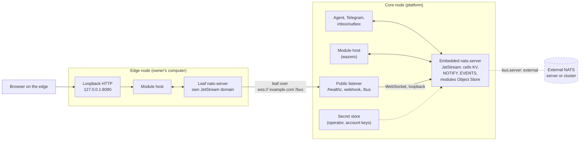
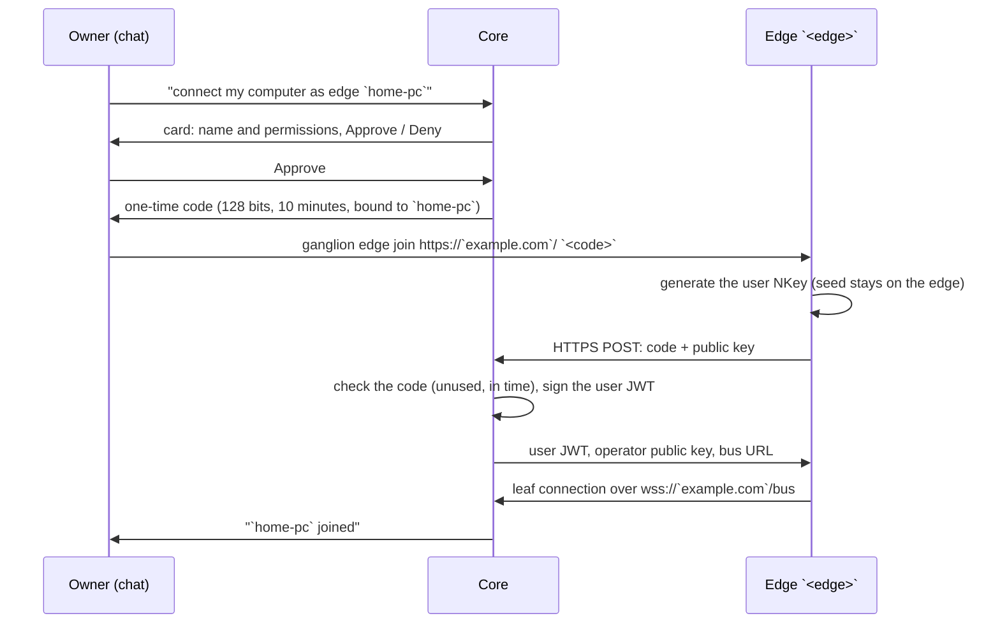

# The bus, ports, edge nodes and HTTP modules: design

Status: approved by the owner on 2026-11-21, section by section in a chat. It feeds the spec
(section 9.9, R-BUS, R-EDGE, R-HTTP), ADRs 0105–0110 and the milestones M8–M11. It is not itself a
plan: the tasks live in GitHub Issues ([ADR-0094](../adr/0094-the-github-project-holds-the-plan-and-the-repository-holds-decisions.md)).

Marks: **(owner)** the owner decided it; **(call)** the author's call, open to correction;
**(builder)** left to whoever implements it.

## 1. Why

The P1 node runs small compiled modules without a model, linked only through cells: a reader writes a
cell, a reflex is started when it changes. The owner wants the system to grow further on its own, by
conversation (owner, 2026-11-21):

- compiled modules that work as services: web pages, APIs, collectors of data;
- modules linked to each other the way Node-RED or n8n link nodes, so that a person can later see the
  links on a graph and change them without a rebuild;
- modules running on other machines (edges), updated over the air like the ones in the core;
- all of it asked for in the chat, with the owner approving each step.

Everything else depends on a bus between modules and nodes. The spec planned NATS for P2; this
design starts P2 with it.

**The first scenario (owner):** the Deye reader keeps running in the core; a web module on the owner's
computer (an edge) shows the battery's charge, the load, a chart of the last day and the latest
notifications; `battery-alerts` keeps sending its notices. One output feeds several inputs, data
crosses from the core to an edge, and a module answers HTTP.

## 2. Goals and non-goals

Goals:

1. A bus inside the core on NATS from the start, not an in-memory stand-in **(owner)**.
2. Cells in NATS KV, the only store of their values **(owner)**.
3. Typed ports declared by a module; links between them kept in the node's file **(owner)**.
4. Events and calls (request/reply) between modules **(owner)**.
5. An edge role: the same binary on another machine, joined by a one-time code, with its key born
   there **(owner)**.
6. Modules delivered to an edge and rolled back there with one command (the P2 gate).
7. A module that answers HTTP on the edge's loopback **(owner)**.
8. The core's NATS server embedded by default, an external server or cluster as an option **(owner)**.

Non-goals here: the visual graph; module pages reachable from the LAN or the internet; live push to
pages; the templates `transform`, `api`, `webhook` and `collector`; a separate NATS service on the
platform and a one-click template; MQTT devices; the claude CLI worker. They stay in the spec's
"Not now" list or in the rest of P2.

## 3. Milestones

| Milestone | What | Done when |
|---|---|---|
| **M8 · The bus in the core** | Embedded `nats-server` with JetStream; `bus` and `bus/natsbus`; cells in KV with a one-time migration; backup exports KV; `notify` published on the bus; metrics and a `/status` line | Everything that works today (the reader, `battery-alerts`, `/cells`, notifications) works through NATS, and a restore from a backup brings the cells back |
| **M9 · Ports and links** | `ports:` in the manifest; `links:` in `ganglion.yaml`; events through JetStream consumers; calls through request/reply and NATS `micro`; cell triggers on the bus; `/why` names the links | One event of one module reaches two modules over two links, and moving a link needs no rebuild |
| **M10 · Security and edges** | Operator, account and user keys in the vault; the `edge` role; one-time join; leaf over WebSocket under `/bus`; revocation; desired state for modules on an edge; telemetry | The P2 gate: link loss loses no data; a module on an edge is updated and rolled back with one command |
| **M11 · HTTP modules** | The `http` trigger; the edge's loopback listener; the `web` template | The owner asks in the chat for a page on their computer, approves it, and it opens with a day's chart and the latest notices |

Memory is the first thing M8 measures: the node uses 61 MB under a 100 MB `GOMEMLIMIT` today, and
the 2026-11-01 note measured the runner with embedded NATS inside 128 MB
([research](../research/2026-11-01-runner-memory.md)). The limit on the platform will likely be
raised **(call)**.

## 4. Architecture



All code reaches NATS through the `nats.go` client, also when the server runs in the same process:
the server is a component beside the node, not a dependency of the code that uses the bus. Narrow
interfaces declared by their consumers hide the client (conventions 2): the cells need a store, the
notices a publisher and a subscriber, the module host a consumer and a responder. Nothing imports
`nats.go` outside `bus/natsbus` **(call)**.

## 5. The bus in the core (M8)

### 5.1. Packages

- `bus`: subject and bucket names, the message headers, the small interfaces, errors.
- `bus/natsbus`: the client-side implementation and the embedded server (start, store directory,
  limits, health). Tests run a real embedded server; there is no fake **(owner)**.

### 5.2. The server

`bus.server: embedded` (default) starts `nats-server` inside the process with JetStream on disk in
`/data/bus` (file store only, no memory store). In M8 it opens no TCP port: the node's client
connects in-process. M10 adds a WebSocket listener on loopback for edges. `bus.server: external`
connects to `bus.urls` (one server or a cluster) with `bus.credentials` (a `store:` or `env:`
reference); the node then starts no server.

### 5.3. Names

The account is the network, so subjects carry no network token (spec 9.1's draft
`a.<network>.<node>.<type>` is replaced) **(call)**:

| What | Where | Kept |
|---|---|---|
| Cells | KV bucket `cells`, key `<module>.<cell>` | history 64 per key; watched by pattern (`deye-reader.>`) |
| Module notices | stream `NOTIFY`, subjects `g.notify.<module>` | 7 days; duplicates dropped by `Nats-Msg-Id` within 2 minutes |
| Module events (M9) | stream `EVENTS`, subjects `g.ev.<node>.<module>.<port>` | 7 days; the same duplicate window |
| Calls (M9) | `g.rpc.<node>.<module>.<port>`, request/reply | not kept |
| Telemetry (M10) | `g.tel.<node>`, plain NATS | not kept (R-OBS-9) |
| Module delivery (M10) | Object Store `modules`; KV `desired.<node>.<module>`, `actual.<node>.<module>` | as long as the module exists |

Every message carries headers: `Nats-Msg-Id` (the idempotency key), `Ganglion-From` (node and
module), `Ganglion-Depth` (the chain depth), `Ganglion-Run` (the producing run), and the trace
context. They carry what spec 9.1's envelope held (`id`, `from`, `corr`, `ttl`), so the body is the
payload alone **(call)**. A tool call between nodes keeps ADR-0013's rule: one NATS request carries
one MCP JSON-RPC request.

### 5.4. Cells in KV

One JSON value per key: `desired`, `reported`, `cause`, `owner`, `kind`, `type`, `about`, `at`. The
cell's version is the key's revision. Every write is a compare-and-set on the last revision read; a
write that loses retries from a fresh read, at most 5 times **(call)**. `cells.Service` keeps its
interface; only the store under it changes, so `/cells`, its History button and the modules see no
difference. History comes from the key's history (64 entries; `/cells` shows 20).

**Migration:** at the first start of the new version, when the SQLite `cells` table has rows and the
bucket is empty, every cell is copied with its current value, in one pass, before modules start. The
table stays read-only for one release and is then dropped **(call)**.

**Backup:** the archive gets an export of the `cells` bucket (current values and history) as JSON
lines; a restore loads it back before the node starts. Streams are delivery, not data, and are not
backed up (R-BAK-1 changes accordingly).

### 5.5. Notices on the bus

A module's `notify` publishes once to `g.notify.<module>` (the key `notify:<module>:<run>:<n>` is
the `Nats-Msg-Id`; the body is the notice: module, version, text, limit, run, time) instead of
putting `module.notify` into the inbox. The count, the daily limit and the limit line stay in the
module host, before the publish. A durable consumer in the core (`core-notify`, explicit acks,
unlimited redelivery with back-off, 30 s ack wait) reads `NOTIFY` and hands each message to the
module host, which resolves the destinations of `notify_to` at that moment and puts one
`module.notify` inbox event per destination, as before (signature, escaping, limits and the
history note unchanged). The inbox event stays as the per-destination delivery step: the history
note is session state that the agent writes in order with its turns, so the consumer must not write
it itself. The stream sits in front of the inbox, not instead of it. A message is acked only after
every copy was put (or its module is gone, or no destination resolves); a crash between the put
and the ack redelivers it, and the inbox keys drop the copies already there. A message whose
module is no longer loaded is acked, logged and counted (`gone`). The module's answer to `notify`
now means "stored", so a name that resolves to nothing is counted when the message is delivered.
In M11 the same stream feeds a page on an edge through a link (section 6.5).

### 5.6. What stays on the inbox in M8

Cell triggers keep the inbox path of ADR-0065 in M8 and move to the bus in M9 together with links,
so M8 changes the store, not behaviour **(owner)**. Telegram's updates and the agent's turns stay on
the SQLite inbox and outbox: they are one node's work, and the spec keeps SQLite inside a node.

### 5.7. Observability

Counters of publishes and consumes by outcome, consumer lag, stream sizes, the connection's state,
and KV writes with their retries, under the `ganglion/bus` scope. `/status` gets a "Bus" line: server
mode, connection, JetStream store use.

## 6. Ports and links (M9)

### 6.1. Ports in the manifest

```yaml
ports:
  emits:   { reading: { soc: number, load: number } }
  accepts: { reading: { soc: number, load: number } }
  serves:  { history: { in: { hours: number }, out: { points: list } } }
  calls:   { history: { in: { hours: number }, out: { points: list } } }
```

Shapes use the manifest's existing shape language (R-RUN-14). Every module with `notify` also has
an implicit output `<module>.notify`, whose payload is the notice's text and time, so a notice can be
wired like any event.

### 6.2. Links in the node's file

```yaml
links:
  - { from: deye-reader.reading, to: battery-alerts.reading }
  - { from: deye-web.history,    to: deye-reader.history }
  - { from: battery-alerts.notify, to: deye-web.notices }
```

A link is configuration (self-modification level 0): the agent proposes it with a card that shows
both ends and the shape, the owner approves, and no module is rebuilt. The visual graph will later
edit these lines.

### 6.3. Checks

At the time a link is written:

- both ends exist and are of matching kinds (`emits` → `accepts`, `calls` → `serves`);
- the shapes are equal;
- a `calls` port has no other link: one port, one served port to ask (reason `taken`, in `/status` in every language);
- the graph of all links and cell triggers has no cycle, events and calls together;
- a chain is at most 4 deep, as today.

The same checks run when a module is installed (plan and install, and rollback): every link that
touches the module is checked against the new build, and a build that makes one of them wrong (a
port gone, of another kind or another shape) or that closes a loop or a chain deeper than 4 through
the links is refused, the detail naming the links. Only what the build makes new counts, so a link
broken beforehand does not block an unrelated build. There is one loop rule: the cell triggers and
the links are one graph. Removing a module removes the links that name it in the same edit of the
file, and the removal's answer lists them. At start the module host checks the links against the
installed modules, running or not, logs each broken one once and shows it in `/status` under Problems; a broken link
gets no consumer.

At run time a published event or a call's request and answer is checked against its shape; one that
does not match is not sent, and the run counts a format error (R-RUN-14).

### 6.4. Events

A module publishes with a new host function `emit(port, payload)`; the capability `event.emit` that
the manifest already lists becomes real. Each link has its own durable JetStream consumer on `EVENTS`,
named `link_<first 20 hex of sha256("<from> <to>")>` with the link in its description, filtered to the
producer's subject (`g.ev.core.<module>.<port>`; `core` is the node token until nodes have names),
deliver policy new, so a link made today does not replay the stream's 7 days. Its ack wait is the
receiver's time limit plus 30 s.

The module host reconciles the consumers: one runs for every link that works and whose receiver runs,
at start, after every reload and after `link.add` or `link.remove`. Each is its own goroutine with its
own cancel; the set sits behind a mutex that is never held while a goroutine is awaited, and `Shutdown`
waits for all of them. A receiver that is off keeps its durable consumer, unread, so its events wait on
the stream within the 7 days; a link that is gone from the file loses its consumer.

A delivered event starts the receiving module with `Trigger: "event:<port>"` and the payload
`{"from": "<module>.<port>", "event": <payload>}`, one level deeper than the producer's run. An event
whose depth header is already the chain limit is acked and runs nothing, and one that does not fit the
receiver's shape is acked and counted bad. An acknowledged run acks the message; a failed one is
redelivered with back-off and counts toward the crash loop, which turns the module off and so stops its
consumers. Delivery is at least once: a run that emitted and then failed may emit again when retried,
and the stream's duplicate window drops only a repeat within two minutes. The run's id is
`event:<link consumer>:<stream sequence>`, with the delivery count added on a retry.

A sent notice is also published as an event on the module's `notify` output, so a link from
`<module>.notify` carries it. A build's check and a trial run `emit` through the same port and shape
check and send nothing.

Cell triggers move onto the bus: a change of a cell is published as an event of its owner, and a
module that listens to cells has a consumer on those keys. The end-of-run fan-out through the inbox
(ADR-0065) goes.

### 6.5. Calls

A new host function `call(port, payload)` (import `ganglion.call`, ABI stays 1) sends a request on a
`calls` port and waits for the answer. The link from the calling port names the served port, and the
request goes to `g.rpc.core.<module>.<port>`; a calling port has one link. A result of zero or more is
the answer's length, taken with `take` as `http_fetch` does; the codes are `-1` denied (no such `calls`
port, or no link that works from it), `-2` format (the request does not fit `in`: not sent, the run
fails as `module.format`, as for `emit`), `-3` not here (`init`, `health`, a check, a trial run), `-4`
failed (the serving run failed or timed out, the answer does not fit `out`, a payload over 64 KiB, the
run's 101st call, a chain too deep, or the node could not send it) and `-5` unavailable (no responder,
or the serving module answered that it is not running). Calls are not stored and not retried.

The caller waits at most the time left in its run less 1 s to settle, and never past the run's own
deadline. The request carries that time as `Ganglion-Deadline` (Unix ms), with `Ganglion-From`,
`Ganglion-Port`, `Ganglion-Run` and `Ganglion-Depth`, so the serving side starts no run for a caller that
has gone. No responder is `-5` at once.

A running module with `serves` ports is a NATS `micro` service named after the module, version
`<manifest version>.0.0`, with one endpoint per served port on its subject and the shapes in the
endpoint metadata; discovery and per-endpoint statistics come with it, and the graph and `/status` can
read them. The service is added when the module loads and stopped when it unloads (reload, off, crash
loop, removal, shutdown). A reload registers the new service before it stops the old one, and both
handlers run whichever module runs by then. Stopping drains and does not wait, so it is done under the
host's lock.

The handler answers a request past its deadline, one whose depth header is already the chain limit (the
chain line as for events) and one outside `in` with an error answer and no run. Otherwise the module
runs with `Trigger: "call:<port>"` and the payload `{"from": "<module>.<port>", "request": <payload>}`
one level deeper than the caller's run. The run is counted and counts toward the crash loop but is not
escalated: the caller sees the failure, as a tool call's turn does. The run's result is the answer,
checked against `out`; a mismatch is a `module.format` failure of the serving run and `-4` for the
caller. Errors travel as micro error headers with a code (`late`, `deep`, `format`, `failed`,
`unavailable`) and the node's fixed words, never module text. The run's id is `call:` and a time-ordered
id; the journal row names the caller and its run.

**The lock.** `Host.call` holds the host's read lock for the whole run, so the serving run of a call made
from inside another run takes a second read lock in another goroutine. A reload that waits for the
write lock holds the serving side back until the caller's wait ends: it is bounded, not a deadlock. Two
things keep it bounded: the caller's wait ends at its deadline less 1 s, and the serving side reads the
deadline header again once it has the lock, so it runs nothing for a caller that has gone.

A build's check and a trial run answer `-3` after the same port and shape checks, and the link is not
needed there. Metrics: `ganglion.modhost.calls` by module and outcome (answered, denied, format,
not_here, failed, unavailable) and `ganglion.modhost.served` by module, port and outcome (ok, failed,
bad, deep, late).

Calls serve three later needs: a module asking another for data; the agent calling a tool of a module
that runs on an edge (spec 9.5); the core relaying an HTTP request to an edge's module (Not now).

### 6.6. The journal

A run's cause gains `event` (the link and the producing run) and `call` (the link and the calling
run); `/why` names the links in the chain. Values and text are still never journaled (R-RUN-20).

## 7. Security and edges (M10)

### 7.1. The chain of trust

NATS's decentralized model:

- **Operator**: the root; its key signs accounts.
- **Account `NET`**: the network, core and edges. A separate signing key issues users, so the
  account's identity key is not used day to day.
- **System account**: for the server's own monitoring and for pushing account JWTs to an external
  server.
- **Users**: the core and each edge, each with its own NKey and a JWT that lists its permissions.

The seeds of the operator, the accounts, the signing key and the core's user live in the node's secret
store (ADR-0077). A restore brings them back with the database, opened by the master key the owner
keeps off the node (R-BAK). Edges keep working after a restore of the core: the operator and the
account are the same.

With `bus.server: embedded` the node builds the server's configuration at start from these keys
(operator JWT, a memory resolver preloaded with the account JWTs). With `external`, the server is
given the operator JWT once and runs `resolver: full`; the node pushes account JWTs through the system
account and keeps issuing user JWTs with its signing key.

### 7.2. Permissions

One account for the network, permissions per edge user **(owner)**. An edge may publish only
`g.ev.<edge>.>`, `g.tel.<edge>`, `g.rpc` answers of its own modules, the KV keys of its own modules'
cells and `actual.<edge>.>`; it may subscribe only to what the links of its modules need, to
`desired.<edge>.>` and to the `modules` objects it is assigned. The node derives the permissions from
the links and re-issues the edge's JWT when they change. The join card shows them.

### 7.3. Reaching the core

Edges dial out; the core opens no new port. The public listener (R-CFG-11) proxies WebSocket upgrades
on `/bus` to the embedded server's WebSocket listener on `127.0.0.1` (`no_tls`: TLS ends at the
platform's proxy). NATS refuses any connection without a valid user JWT and nonce signature. Limits:
connections, payload size, subscriptions per user **(builder: values)**.

### 7.4. Join



The code is stored hashed, used once, and expires after 10 minutes; a wrong code is refused and
counted, with a limit on attempts per minute. The edge keeps its seed and JWT in its data directory,
readable only by its user, and trusts only the operator key it was given.

### 7.5. Revocation

A Revoke button adds the edge's public key to the revocations of the account JWT. The server closes
its connection and refuses it from then on. A lost computer is revoked and a new one joined; nothing
on the core has to be restored.

### 7.6. The edge role

`ganglion --roles edge` runs a leaf `nats-server` with JetStream in its own domain, the module host,
and the loopback HTTP listener; no Telegram, agent or model. The leaf dials the core and reconnects
with back-off. While the link is down, the edge's modules keep running on their triggers, and its
`EVENTS` stream keeps their events; the core's stream sources the edge's stream across domains, so
the events arrive when the link returns, in order and without duplicates.

### 7.7. Modules on an edge (desired state)

`modules:` in the node's file gains `node: <edge>`. After a build and the owner's approval (the
install window gains a line for where it runs), the core puts the `.wasm` and manifest into the
`modules` Object Store and writes `desired.<edge>.<module>` = version and SHA-256. The edge watches
its keys, fetches the object, checks the hash, runs `init` and `health`, switches over, and writes
`actual.<edge>.<module>`. A failed health keeps the old version. Rollback writes the previous version
to `desired`. Only the core may write `desired` and the `modules` objects. Module signing with the
owner's key stays in spec 9.3 for later.

### 7.8. Telemetry

Every `edge.telemetry_every` (default 30s) an edge publishes a snapshot of its metrics to `g.tel.<edge>` over plain NATS: no
JetStream, nothing stored, cumulative counters, so a lost snapshot costs nothing **(owner)**. The
core adds a `node` label and serves them on its own `/metrics` (R-OBS-9). `/status` gets a line per
edge: link, buffered events, module versions.

## 8. HTTP modules (M11)

### 8.1. The trigger

```yaml
triggers:
  - http: { routes: [ { path: /, methods: [GET] }, { path: /api/data, methods: [GET] } ] }
```

Each module gets its own prefix, `http://127.0.0.1:8090/<module>/`; `/` lists the module pages of the
edge. A module cannot claim another's prefix.

### 8.2. Request and answer

The module is started per request with `Trigger: "http"` and a payload: method, the path inside its
prefix, the query, a body up to 1 MiB, and an allowlist of headers (`accept`, `content-type`,
`if-none-match`). It answers with a status, an allowlist of headers (`content-type`, `cache-control`,
`etag`) and a body. At most 4 requests run at once per module; the timeout is the module's limit.

### 8.3. What the node adds and refuses

- The listener binds `127.0.0.1` only (`http.local_addr`, edge role).
- A request whose `Host` is not `127.0.0.1` or `localhost` with the listener's port is refused: the
  defence against DNS rebinding.
- The node sets `Content-Security-Policy` (`default-src 'self'`, no external scripts), and
  `X-Content-Type-Options: nosniff`; a module cannot set `Set-Cookie` or override these.
- A page module reaches the network only with `http.fetch` in its manifest, like any module.

### 8.4. Data for a page

A page takes current values with `cell_get`, and keeps its own history: it `accepts` the reader's
events through a link and stores the last day in its `state` **(owner: no `cell_history`)**. Notices
reach it through a link from `<module>.notify`. A page refreshes by polling its own `/api/data` every
10–30 seconds; live push is Not now.

### 8.5. The `web` template

A third template beside `reader` and `reflex`, in Rust (ADR-0063): routing, embedded HTML, JS and
CSS (`include_str!`), a ring buffer in `state`, escaping on output, a page with cards, an inline-SVG
chart and a notice list, and `examples.yaml`. It is a skeleton, not a module for a case: the agent
copies it for the owner's request and edits the task's part **(owner)**. The edge needs no toolchain:
the core builds, the edge receives a `.wasm`.

## 9. Testing

- Unit and package tests on a real embedded server; an edge in tests is a second embedded server
  joined as a leaf in the same process.
- chatlab scenarios: join an edge by code and revoke it; a link delivers an event; link loss, events
  kept on the edge, delivered after the link returns; a module updated on an edge and rolled back; an
  HTTP module answers only on loopback with the right `Host`.
- Abuse tests: an edge writing another module's cell is refused; a revoked edge cannot connect; a
  join code works once and not after 10 minutes; an event that breaks its port's shape is not sent; a
  request with a foreign `Host` is refused; a module's `Set-Cookie` is dropped.
- A live check on the owner's node and computer at the end of each milestone, recorded without
  addresses or names.

## 10. Trust boundaries and abuse cases

| Boundary | Attacker controls | Abuse | What stops it (code) |
|---|---|---|---|
| Edge → core over `/bus` | the network; a stolen edge | anonymous connection; a stolen credentials file | NATS JWT and nonce check; revocation in the account JWT |
| Edge's permissions | a compromised edge | writing another module's cell, event or `desired` | user JWT permissions derived from links; only the core writes `desired` and `modules` |
| Join endpoint | the network; a leaked code | reusing or guessing a code | 128-bit code, stored hashed, single use, 10-minute life, rate limit; the owner is told of every join |
| Module → module | a module's output | a payload that breaks the receiver; a loop | shape checks on publish and receipt; cycle refusal; depth 4 |
| Bus message → model | a module's string | outside text reaching the agent clean | R-RUN-13 is unchanged: a string from a module taints where it reaches the model |
| Browser → edge HTTP | a web page the owner visits | DNS rebinding; reading or driving the module from another origin | loopback bind; `Host` check; CSP; no cookies |
| Module → browser | a module | script injection into its own page | the template escapes; CSP blocks external scripts; the page is local to the owner |
| Core restore | loss of the volume | losing the trust chain | seeds in the vault, in the backup, opened by the master key kept off the node |

## 11. Moved to "Not now"

- Live push to pages (SSE or WebSocket).
- Module pages reachable from the LAN or the internet, through the core's public listener and calls
  over the bus, with sign-in.
- The templates `transform` (event in, event out), `api` (a JSON endpoint), `webhook` (outside HTTP
  in, an event out) and `collector` (the edge's own state: disks, memory, CPU; needs new rights).
- A separate NATS service on the platform, and a one-click template with the embedded server by
  default and an external one as an option.
- The visual graph of modules, cells and links.
