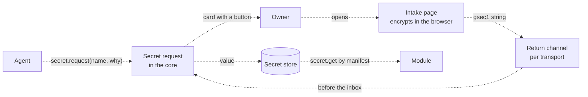
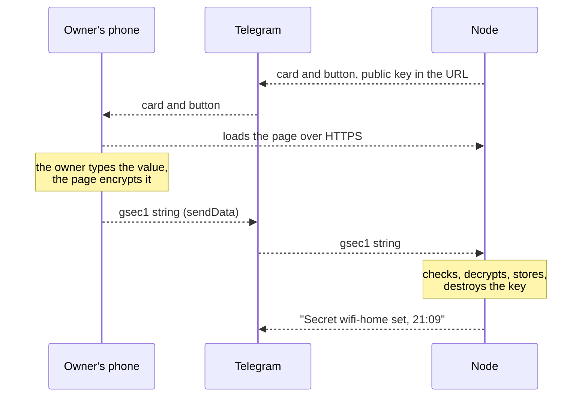

# Design note: a secret store and a way to hand a secret to the node

Notes from the owner's brainstorm of 2026-11-12 (board card G-149). Nothing
here is built or decided as a requirement. It is the input for an ADR and a
plan when the work is taken into a phase; until then the spec lists it under
[Open decisions](../spec.md#11-open-decisions) and
[Not now](../spec.md#14-not-now).

**2026-11-13:** the store (part 1 of section 4) and the command on the host
are decided in [ADR-0077](../adr/0077-encrypted-secret-store-on-the-nodes-key.md)
and taken into M6 (task 6.5). The master key is a file the node makes, and a
secret belongs to a module's scope. The request, the page and the return
channel stay as notes here.

Marks: **owner** means the owner decided it in the brainstorm; **call**
means the author's default, open to the owner's correction.

## 1. Intent

A module's secret is an environment variable today
([R-CFG-2](../spec.md#714-node-configuration)). On Railway every new secret
is a new variable and a redeploy. The owner's example for later: an ESP
board with a camera reads a hot-water temperature panel and needs the home
Wi-Fi password.

The owner wants to hand a secret over from the chat, safely, without it
passing through the agent (owner).

The rules that already hold
([ADR-0031](../adr/0031-agent-security-baseline.md), spec 7.8): the model
never sees a secret, a module gets one only through `secret.get` by its
manifest, secrets are redacted before the journal and the logs, rights
widen only on the owner's press.

## 2. Goals, non-goals

Goals:

- A secret is set and replaced without a restart or a redeploy.
- Its value never enters the model's context, the inbox, the history, the
  journal, the logs, or the chat's history on the transport's servers.
- The design does not depend on Telegram: a new chat transport adds one
  adapter.
- No new trusted party by default.

Non-goals:

- Protection from a compromised host, a compromised phone, or a transport
  that actively rewrites the node's messages (section 8).
- Files and values over 4 KB in the first version.
- Provisioning devices (section 7 records the direction only).

## 3. A secret never goes into a build

The owner's first sketch sent the decrypted value to the builder (owner's
question). It should not go there (call):

- a build runs code the agent wrote (`build.rs`), which nobody vouched for
  beyond [ADR-0068](../adr/0068-vouch-for-module-source-per-file-and-vetted-crates.md);
- an artifact is kept and versioned, so a baked-in secret stays in every
  version and every backup.

A WASM module already follows this: the manifest names the secret and the
runtime answers `secret.get`. Firmware follows the same rule (section 7).

## 4. Three parts

Everything is planned, so everything is dashed.

1. **Secret store.** A second secret source beside `env:NAME`, which
   [ADR-0059](../adr/0059-node-config-file.md) left room for (a scheme such
   as `store:NAME`). Values are encrypted in SQLite; the master key stays
   in the environment or a file. This protects backups and copies of the
   database, not a compromised host.
2. **Secret request.** A core component that knows nothing about a
   transport: the secret's name, a one-time key pair, a lifetime of 10
   minutes, who asked, who may answer. The private key lives in memory
   only: a restart closes open requests and the owner presses again (call).
3. **Return channel.** One per transport, and the only part a new
   transport adds:
   - Telegram: the page calls `sendData` and the string reaches the bot;
   - any chat: the page shows the string with a Copy button and the owner
     pastes it. This is also the fallback everywhere;
   - a public node, later: a direct POST, for files.

The owner chose the Telegram channel first (owner). The string format and
the channel interface are fixed from the start so that another transport is
one adapter (call).

A fourth path needs no browser and no new surface: `ganglion secret set
NAME` reading standard input on the host (call).

## 5. The intake page

- **One static file**, embedded in the binary, the same for every
  transport. No external scripts; a strict Content-Security-Policy that
  lets the page load nothing and send nothing by network.
- **The node serves it by default** (owner agreed). Who serves the
  JavaScript can replace it and take the value, so this is a security
  choice. Served by the node, the page adds no trusted party: Railway
  already runs the process and holds the master key, Telegram already
  carries the owner's presses.
- **Another host is a setting** in `ganglion.yaml`, for a node behind NAT:
  any static hosting with the same file. The operator chooses to trust
  that host. Before it issues a button, the node fetches the page from the
  configured address and compares it with the hash of its embedded copy;
  a mismatch refuses the request and tells the owner. This catches a stale
  or altered file, not a host that serves the node one page and the owner
  another.
- **Generating the page per request adds nothing**: the bytes travel the
  same way, and a template is a place for an injection. What changes per
  request (the public key, the request id) goes in the URL after `#`, which
  a browser does not send to the server.
- **A page cannot prove itself.** A replaced page would report the right
  hash; browsers check hashes of scripts a page includes, not of the page.
  Only the node's outside check above is possible.
- No Cloudflare Worker or other code in the middle (call).

## 6. The process

1. **Request.** The agent calls `secret.request(name, why)`. It never sees
   a value, then or later; no tool reads a secret back.
2. **Card.** The node writes it, not the model: which module asks, the
   secret's name, the lifetime. The agent's reason is quoted as data.
3. **Page.** Shows the secret's name, one field and one button.
4. **Encryption in the browser.** The page makes its own one-time key and
   encrypts to the request's public key (HPKE: a key exchange and AES-GCM).
   The request id and the name are bound into the ciphertext, so it cannot
   answer another request.
5. **Return.** The string `gsec1.<request id>.<ciphertext>` reaches the
   bot. The transport recognises the prefix and takes the message before
   the inbox, the journal and the model.
6. **Check and store.** The sender is the owner; the request is open and
   not expired. The node decrypts, stores, destroys the private key. The
   same string is not accepted twice. A string from a page of another
   format version is refused.
7. **In the chat.** The card folds to "Secret `wifi-home` set, 21:09" like
   an answered question ([R-POL-9](../spec.md#76-action-policies-and-risk-classes));
   the agent gets a node note with the same text.
8. **Afterwards.** The value is never shown again. `/secrets` lists names,
   dates and the modules that read each. A new request replaces a value; a
   command deletes one.

Who may read a secret is still decided at a module's install, where the
card shows its secrets and its network access together.

## 7. Devices

Recorded as a direction for P2, not designed. Firmware carries no secret.
Wi-Fi credentials reach a board when it is provisioned: from the owner's
phone over the board's own access point or Bluetooth (Improv Wi-Fi is one
standard), or as a separate storage partition written when the board is
flashed over USB. A Wi-Fi password may then never pass through the node.
Other device secrets travel encrypted to the node's key, as
[spec 9.3](../spec.md#93-network-security-p2) already says.

## 8. What this does not protect from

- A replaced page on a host other than the node.
- A compromised phone or host.
- A transport that rewrites the button's link. Telegram is already trusted
  with the presses that install modules.
- A request the owner should not answer: a steered agent may ask for "the
  bank password". The card is the defence: the node writes it and names
  the module and where that module may connect.

## 9. Open before an ADR

- **A spike on `sendData`.** From memory, not checked: it works only for a
  page opened from a keyboard button (not an inline button under a
  message), carries up to 4096 bytes, and closes the page. The spike
  decides whether the button's place is acceptable and whether WebCrypto
  with the chosen curve works in Telegram's in-app browsers.
- **The phase.** M6 (the pain on Railway exists now) or P2 with the edge.
  Not decided.
- **An inbound HTTP listener** for the page. The spec's "Not now" has
  Telegram Mini Apps and an HTTP server; taking this in changes that entry
  and needs the ADR.
- **The cipher suite** and whether Go's standard library covers HPKE in the
  project's Go version.
- **A request from a tainted session**: ask as usual, or refuse.
