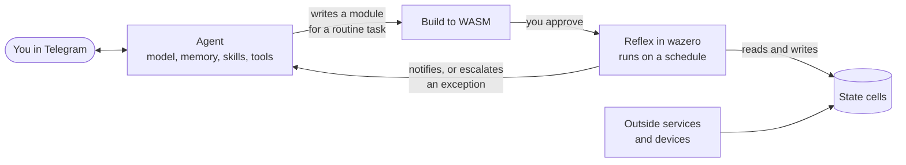

# ganglion user guide

ganglion is a self-hosted agent that you talk to in Telegram. It remembers what you tell it, searches the web, runs commands on your machine inside a sandbox, and asks you to press a button before it changes anything.

When a task repeats, the agent writes a small program for it. That program, a **reflex**, is compiled to WebAssembly and then runs on a schedule **without the model**. The model is called for conversation and for exceptions, not for every tick. This keeps routine work fast, cheap and predictable.

## How it works

A reflex gets only the capabilities its manifest asks for, every build is versioned, and a bad version rolls back.

## What works today

- A Telegram agent for private chats and groups. In a group it answers only when addressed. Strangers get no reply.
- Models chosen per purpose: the `claude` CLI on your own subscription, or any OpenAI-compatible API.
- Memory kept by topic in plain files, sessions you can resume, reminders and scheduled tasks.
- Web search and page reading, and host commands in a sandbox. Every action that changes something is confirmed with a button.
- Reflex modules the agent writes, builds and runs after you approve them, with versions and rollback.
- An encrypted secret store, one configuration file, logs, `/status` and read-only diagnostics.

Not built yet: nodes talking to each other, prebuilt binaries, and updating a node from inside the chat.

## Status: 0.x

ganglion is early software. There are no guarantees. Commands, the configuration file and stored formats can change without notice, and you may need to adjust your setup after an update. Read the release notes in the repository before you update, and keep a [backup](running/operations.md#backups).

## Where to go next

1. [Requirements](getting-started/requirements.md): what you need before you start.
2. [Install](getting-started/install.md): from a container image or from source.
3. [Configure](getting-started/configure.md): the minimum settings and how secrets work.
4. [Your first conversation](getting-started/first-conversation.md): run the node and say hello.

Then read how to [talk to the bot](using/talking.md), the [command list](using/commands.md) and how to [ask for a module](using/modules.md). If something goes wrong, see [Troubleshooting](troubleshooting.md).
