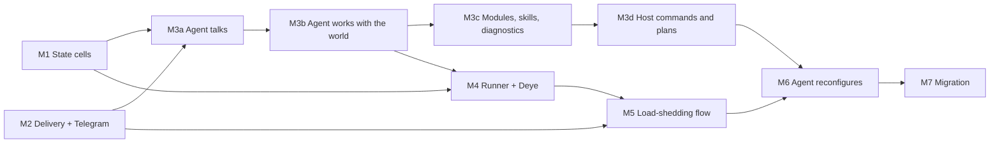

# P1 · All-in-one — phase plan

> This is a phase plan: milestones, tasks, acceptance criteria and order.
> Each milestone gets its own step-by-step implementation plan
> (`docs/plans/p1-mN-<name>.md`, written with tests first) when work on it
> starts, because later milestones depend on what earlier ones settle.

**Goal:** the ganglion agent replaces the family bot: it talks in Telegram
without losing messages, delegates regular work to reflexes that run
without the model (the Deye load-shedding flow), and changes its own
configuration on request with the owner's approval — cheaper than the
current setup.

**Architecture:** core, runner and an API worker in one process
(`--roles core,edge,worker`) on a small container. The agent is the centre:
cells are what it perceives and acts on, modules are its reflexes, the
inbox/outbox is its nervous system. In-process bus; SQLite for inbox/outbox,
history and cells; WASM modules on the runner.

**Tech stack:** Go 1.27 (1.26 until 2026-11-02), wazero 1.12 (own ABI), modernc.org/sqlite (WAL),
Telegram Bot API, an OpenAI-compatible model API, YAML config.

**Spec:** [spec](../spec.md) sections 6–8 and 10.2; ADRs
[0004](../adr/0004-one-binary-with-roles.md),
[0006](../adr/0006-sqlite-inside-nats-between-nodes.md),
[0007](../adr/0007-openai-compatible-first-provider.md),
[0011](../adr/0011-module-abi.md),
[0014](../adr/0014-state-cells.md),
[0015](../adr/0015-agent-first-p1.md).

## Global constraints

- Core and edge fit a container of about 128 MB; the runner sets
  `GOMEMLIMIT` (principle 8, R-RUN-6). Memory is checked with `modbench` or
  the process RSS before each milestone is closed.
- Testing uses a separate Telegram bot with its own token; two processes must
  never poll one token (R-DLV-8).
- Anthropic access only as in ADR-0009: own API key; the claude CLI worker
  is P2.
- New dependencies, formats and runtimes need an ADR (`CLAUDE.md`).
- All documentation and code comments in English.
- Stop criterion: P1 not closed within **4 weekends** (spec 13). The cut list
  below is part of the plan, not an afterthought.

## Review focus

Failure modes the spec implies that are most likely to hurt in use; each is
pinned by a test in the task that owns the code.

1. **The process dies in the delivery windows** — between inbox write and
   Telegram offset, during a turn, between sending and marking sent. Expect
   no lost message and at most one duplicate (task 2.5, 3.8).
2. **Stale or missing Deye data during an outage** — cloud lag, auth error,
   HTTP 429. Expect no switching and one clear notice, not a flood
   (tasks 4.5, 5.1).
3. **Two processes on one bot token during a deploy** — Telegram answers
   `409 Conflict`. Expect the newer process to stop polling and alert, not
   fight (task 2.3).
4. **Time** — Kyiv time in every message, cron across DST changes, catch-up
   after downtime firing each missed job once (task 3.10, moved from 4.2).
5. **An approved configuration change breaks something** — a threshold that
   makes the flow oscillate, an observer pointed at a missing chat. Expect
   validation before applying, and a one-command rollback (task 6.3).

## Milestones

| # | Milestone | Delivers | Estimate |
|---|---|---|---|
| M1 | State cells — **done** ([plan](p1-m1-cells.md)) | Switch, sensor and request cells; `virtual` backend with fault injection; SQLite store | 0.5 weekend |
| M2 | Delivery and Telegram | Inbox/outbox, outbox sender, Telegram transport; crash-tested echo bot | 1 weekend |
| M3 | **The agent**, in three parts: M3a talks — **done** ([plan](p1-m3a-talking-agent.md)); M3b and M3c below ([design](p1-m3b-m3c-design.md)) | History, actors, provider, router, agent loop; a talking agent on the test bot | 1–1.5 weekends (M3a) |
| M3r | Refactoring before M3b — **done** ([plan](p1-refactor.md)) | Go conventions and lint guardrails, the agent as a stage pipeline, `config` with `samber/do`, `ganglion run` on urfave/cli; no behaviour change | 0.25 weekend |
| M3b | **The agent works with the world** — **done** ([plan](p1-m3b-agent-world.md)) | Tools under policies and the security baseline, confirmations and quick actions on buttons, the scheduler with reminders and scheduled agent tasks, memory, web reading, the tool-call journal, tools for the claude CLI over MCP | over 1 weekend |
| M3c | Modules, skills, diagnostics | Module update and rollback, skills, attachments, logs on disk, `ganglion mcp`, the 3.8 acceptance | about 1 weekend |
| M3d | Host commands and plans ([design](p1-m3d-host-commands-design.md)) | `host.exec` under a class table and a sandbox, `host.stats`, plan messages that approve their commands, commands in task grants | about 1 weekend |
| M4 | Reflexes: runner and Deye | Config, modules on cron writing sensor cells, exposed to the agent as tools (the scheduler and the first module-as-tool path come from M3b); deployed next to the current bot | 0.5 weekend |
| M5 | Load-shedding flow | The 8.1 state machine on `virtual` load cells; Telegram notifier; shadow week | 0.5 weekend |
| M6 | **The agent reconfigures the system** | Approved, validated, versioned configuration changes with rollback | 0.25–0.5 weekend |
| M7 | Migration | Memory import and consolidation, remaining skills and crons, backups, cutover, gate | 0.5–1 weekend |

Total 4.25–5.5 weekends against a 4-weekend budget, counted before the M3
split. M3b (over one weekend) and M3c (about one) take more than the
original M3 estimate left for memory, skills and policies
([design](p1-m3b-m3c-design.md#8-size-and-order), section 8). M3d (about
one more) was added on 2026-11-03 at the owner's request
([ADR-0038](../adr/0038-host-commands-as-argv-with-classes-in-code.md)).
The cut list is expected to be used.

M1 and M2 are independent. After M3a the agent talks on the test bot,
after M3b it acts; from M4 on, every reflex is wired to it as a tool. The
"Deye two weeks without the model" clock of the gate starts at M4.

### M1 · State cells (ADR-0014) — done

Measured: 50 cells and 10,000 changes on a SQLite file with a watcher —
peak RSS 17.5 MiB for the whole process, ~4,400 writes/s, no change lost
(15,050 delivered). A binary with cells and SQLite is about 10 MB.

| Task | Done when |
|---|---|
| 1.1 Store: SQLite (WAL) with embedded migrations; `cells` and `cell_history` tables; a `cells.Store` interface with memory and SQLite implementations (decision D-1) | Store tests pass on both implementations; reopening the file keeps state |
| 1.2 Cells: kinds `switch`, `sensor`, `request`; set desired, report, get, watch; version and history; a request expires by its `ttl` | Unit tests per kind, including expiry and version conflicts |
| 1.3 Backends and observers: `virtual` backend with injected delay, failure and manual change; observer interface; a backend conformance suite (`cells/cellstest`) | `virtual` passes the suite; a manual change shows as reported ≠ desired without a command |

### M2 · Delivery and Telegram (spec 7.1, 7.8)

Step-by-step plan: [p1-m2-delivery-telegram.md](p1-m2-delivery-telegram.md).

**Done 2026-11-02.** Crash harness: 500 `kill -9` with every message
answered, in order, at most one duplicate per kill. Echo bot memory: binary
15.4 MB, RSS 14.1 MB idle and 21.0 MB after 1,000 messages. Live run on the
test bot: echo, `409` from a webhook and from a second poller, kill and
restart. Decision on the way:
[ADR-0019](../adr/0019-release-leases-at-core-start.md) (leases released at
core start, database lock).

| Task | Done when |
|---|---|
| 2.1 SQLite `queue.Queue`: inbox with unique `idemKey`, leases, `Complete` writing replies, state and the processed mark in one transaction (R-DLV-1, 3, 4, 7) | Duplicate put is a no-op; an expired lease is redelivered; `Complete` is atomic |
| 2.2 Outbox sender: retries, Telegram `retry_after`, order kept per chat, backoff while Telegram is down for hours (R-DLV-5) | Tests with a fake Bot API: 429 honoured, order kept after an outage, no busy loop |
| 2.3 Telegram transport: own minimal Bot API client ([ADR-0018](../adr/0018-own-telegram-bot-api-client.md)), long polling, offset only after `Put` (R-DLV-2), forum topics, silent messages; `409 Conflict` stops polling and alerts (R-DLV-8) | Tests against a fake Bot API, then a manual run on the test bot; Telegram types stay inside the transport package, and `Outgoing` gains only channel-neutral fields (silent); a forum topic is part of the conversation key ([ADR-0017](../adr/0017-extension-points.md)) |
| 2.4 Access: `allowed` table with roles `admin` and `family`; strangers get no reply (7.8) | Unit tests; a stranger's message is logged and dropped |
| 2.5 Crash harness: an echo turn under `kill -9` at random points, many iterations | No lost message, at most one duplicate per kill (10.2) |

### M3 · The agent (spec 7.2–7.4, 7.6, 7.7)

M3 is split in three; the split comes from the
[M3b and M3c design](p1-m3b-m3c-design.md) of 2026-11-02 (spec 7.10–7.11,
R-OBS-5–7 and R-POL-6–8 were added for it). Step-by-step plans:
- [M3a, the talking agent](p1-m3a-talking-agent.md): 3.1–3.4 and a live
  run that picks the first model;
- [M3b, the agent works with the world](p1-m3b-agent-world.md): 3.5, 3.6
  and 3.9–3.14, design section 5;
- [M3c, modules, skills and diagnostics](p1-m3c-modules-skills-diagnostics.md):
  3.7, 3.15–3.19 and the 3.8 acceptance, design section 6.

Tasks 3.1–3.8 keep their numbers; the tasks the design added are numbered
from 3.9.

**M3a built 2026-11-02**:
- **Providers:** the operator chooses them (ADR-0021): OpenAI-compatible
  APIs and the claude CLI.
- **Router:** a rules router over a YAML catalogue.
- **Agent:** fallback, step and daily limits, compaction and sessions,
  with the turns trace.
- **Turns:** parallel, with a timeout and give-up.
- **First model:** Haiku through the CLI first, DeepSeek V4.1 Flash as the
  fallback (ADR-0022).
- **Memory:** the agent is 24.2 MB after 1,000 turns.

Closed 2026-11-02 after the live run on the test bot.

| Task | Done when |
|---|---|
| 3.1 History store and conversation actors: one turn at a time, timeout, cancel; provider-neutral history; compaction to a summary (R-AGT-1, 2) | Tests; concurrent messages in one chat are serialised |
| 3.2 OpenAI-compatible provider with tool calls (R-PRV-1, 3); the first cloud model chosen on real turns (decision D-6) | Tests against a fake API; live turns compared on cost and quality |
| 3.3 Router: `SKILL.md` frontmatter, hard filters, rules and weights, fallback on error, 429 and timeout (R-RTR-1–3) | Router tests including `privacy: local-only` and fallback |
| 3.4 Agent loop with step, depth and daily limits; `turns` trace with cost (R-AGT-3–5) | Limit tests; a turn's trace is complete |

#### M3b · The agent works with the world

Plan: [p1-m3b-agent-world.md](p1-m3b-agent-world.md); design sections 4
and 5. Security baseline:
[ADR-0031](../adr/0031-agent-security-baseline.md) (Proposed).

| Task | Done when |
|---|---|
| 3.5 Memory: Markdown in the workspace git repo (decision D-7), `memory.*` tools, an index in the system prompt, facts not instructions with their source recorded, episodic search over past turns; every write passes the clean-context check (R-MEM-2–5, R-POL-7; R-MEM-1, the nightly job, stays in M7) | A fact told in one conversation is recalled in a later one; an injected "remember: …" in a test page does not reach memory without the owner and is flagged by the check |
| 3.6 Tools and policies, base: `schedule.*`, `message.send`, `cells.get`/`cells.set`; side-effect tools need a confirmation request cell; external text marked as data; `turn_id` + call number on side effects; tainted sessions and the security baseline (R-POL-1–4, 6, R-DLV-6, ADR-0031) | Tests: an unconfirmed action does not run; an expired request denies; a tainted session cannot write memory or send without a press |
| 3.9 Confirmations and quick actions on buttons: inline keyboards and `callback_query` in the transport; a confirmation asked in the middle of a turn resumes the conversation after the press (design 5.2) | A double press runs once; a late press or one by someone else does nothing; a press after a restart still works |
| 3.10 Scheduler, moved from M4 (4.2): cron in Europe/Kyiv, `cron_runs`, catch-up runs each missed job once, `idemKey` = job + scheduled time; reminders and scheduled agent tasks with grants, listed with buttons (R-SCH-1, 2, R-POL-8) | "Every hour send me the rates": confirmed by a button, listed, each run compares with the previous ones, deleted by a button or in words; tests across a DST change and a simulated downtime |
| 3.11 Reading the web: `web.fetch` with the URL rule and address checks, the `html2md` WASM module embedded in the binary (the minimal module-as-tool path, moved from 4.4), `web.search` behind one backend interface (R-WEB-1–3, R-RUN-7) | A page read with `web.fetch` is summarised; a private address is refused; a URL the model built asks for confirmation |
| 3.12 Tool-call journal: `tool_calls` beside `turns`, secrets redacted, retention by age (R-OBS-5, R-POL-3) | One turn id finds the message, the route, every call with its policy decision, and the reply |
| 3.13 Tools for the claude CLI through an MCP bridge to the core, under the same policies (R-PRV-6) | The 3.5, 3.6 and 3.10 checks pass with Haiku through the CLI and with an API model |
| 3.14 Carried from M3a: the depth limit (R-AGT-4), tool placement (R-RTR-3), the current time in the last user message, the first-run introduction that writes the persona with the owner's approval (R-AGT-7) | Tests; the introduction runs only for an admin, only while `persona/` is empty |

#### M3c · Modules, skills, diagnostics

Plan: [p1-m3c-modules-skills-diagnostics.md](p1-m3c-modules-skills-diagnostics.md);
design section 6. Owner rulings (2026-11-03): the metrics picture is
rendered in process by promtop v0.4.0 (M1); a model-free `/metrics` (M2);
an own log rotator (M3); skill scripts declare `effects: read` or
`change` (M4). Decisions:
[ADR-0041](../adr/0041-module-install-update-and-trust-boundary.md)–[ADR-0045](../adr/0045-metrics-in-the-chat-and-attachments-in-the-outbox.md)
(Proposed), and [ADR-0046](../adr/0046-a-restart-is-not-a-failed-attempt.md)
(Proposed), from the crash harness.

The scripted acceptance and the crash harness pass (2026-11-04). The owner's
manual live run gave way to chatlab, task 3.20 ([design](p1-m3c-chatlab-design.md),
[plan](p1-m3c-chatlab.md), [ADR-0048](../adr/0048-chatlab-over-the-fake-bot-api.md),
Proposed). M3c closes after it, the owner's short look on a phone and the first
`html2md` tag.

| Task | Done when |
|---|---|
| 3.7 Skills level 1 and 2: Markdown skills; scripts as subprocesses with an environment allowlist and timeout (decision D-5); built-in skills cannot be replaced silently; a promtop skill | A skill with a script runs; a variable outside the allowlist is not passed |
| 3.15 Module install, update and rollback: version store, sha256 check, self-test, atomic switch, `/modules rollback`; built-in modules only from the project's releases; a module release workflow in CI (R-RUN-8) | `/modules update html2md` installs a new release without restart; a broken release fails its self-test and stays off; rollback restores |
| 3.16 Attachments: `sendPhoto` and `sendDocument` through the outbox (R-DLV-9) | "Show me the agent's metrics" → a promtop picture in Telegram |
| 3.17 Logs on disk: JSON lines in `<data>/logs/`, synchronous writes, rotation by size, count and age, secrets redacted (R-OBS-6) | The last lines before a `kill -9` are on disk; rotation keeps the limits |
| 3.18 `ganglion mcp`: read-only diagnostics over stdio (R-OBS-7) | Claude Code diagnoses a seeded fault through `ganglion mcp`, locally and in a local container |
| 3.19 A file or picture sent to the agent is noticed: the transport passes its name, type and size beside the caption, and the agent says it cannot open it yet (R-DLV-10) | A PDF with a caption reaches the model as the caption plus a "file came" note; nothing is dropped silently |
| 3.8 End to end on the test bot: message → inbox → model → tools → outbox → reply, under the M2 crash harness | 10.2 acceptance for turns |
| 3.20 Chatlab: the agent tested by talking to it, over the fake Bot API | Section 8 of the [design](p1-m3c-chatlab-design.md) holds: the checks the owner could not run pass through `chatlab run` or report what is wrong; seeded faults turn their scenarios red; the language problem has a baseline, a fix and a result; `TestLabStaysOutOfTheBinary` passes |

#### M3d · Host commands and plans

Design: [p1-m3d-host-commands-design.md](p1-m3d-host-commands-design.md)
(owner's brainstorm of 2026-11-03); spec 7.12. Decisions:
[ADR-0038](../adr/0038-host-commands-as-argv-with-classes-in-code.md),
[ADR-0039](../adr/0039-command-sandbox.md),
[ADR-0040](../adr/0040-plans-as-approvals.md) (Proposed). The
step-by-step plan is written after M3c.

| Task | Done when |
|---|---|
| 3.20 The command sandbox: `no_new_privs`, a clean environment, the node's process hidden, its data and secret files and the owner's secret stores unreadable; off with a reason where it cannot be set up or the node runs as root (R-CMD-3, ADR-0039); a spike on the owner's machine, Railway and a Pi first | From a command, the node's environment, database and `*_FILE` secrets cannot be read and `sudo` gains nothing; in a container without the kernel features the tool is not offered and the reason is reported |
| 3.21 `host.stats` and the node's own files: memory, load, disk, the sizes of the node's folders; the claude CLI work directory cleaned by age (R-CMD-5, R-CMD-8) | Works in a 128 MB container with `host.exec` off; the work directory stops growing |
| 3.22 `host.exec`: argv without a shell, the class table with consequence lines in English, Russian and Ukrainian, output capped, redacted and tainting, journal, kill switch (R-CMD-1, 2, 6) | Read runs by itself; content, change and script ask with the fixed line; forbidden never runs, press or not |
| 3.23 Long commands: past a short wait a command continues in the background and its completion resumes the conversation; time limit, process group, parallel cap (R-CMD-4) | A `du` over a large tree answers in the same conversation after the turn has ended |
| 3.24 Plans: `plan.show` and `plan.step`, the message edited in place and kept with the outcome; one press approves the listed commands exactly; a change outside the plan gets its own press (R-CMD-7, ADR-0040) | "Clean the Go cache and the Docker images" runs after one press; `docker rm` not in the plan does not run without its own press |
| 3.25 Commands in task grants: exact argv with consequence lines in the creation confirmation; a run outside them is denied with one notice (R-POL-8) | A weekly `docker image prune -af` runs without a press; `docker rm` in the same task is denied |
| 3.26 Skill scripts (3.7) move onto the sandbox | A skill script cannot read the node's secrets |
| 3.27 M3d acceptance, scripted and live on the test bot (design section 10) | All ten checks pass; the node's RSS stays in the budget |

### M4 · Reflexes: runner and Deye (spec 7.5, 8)

| Task | Done when |
|---|---|
| 4.1 Node config in YAML (decision D-3): roles, modules with manifests, cells, Telegram chats and topics; secrets through a secret source (environment and `*_FILE` first), never in the YAML; `GOMEMLIMIT` (R-RUN-6); a JSON Schema in `schemas/` kept in sync by a test ([ADR-0023](../adr/0023-json-schemas-for-yaml-files.md)) | Config tests; a bad config fails at start with a clear message |
| 4.2 **Done in M3b (task 3.10).** Scheduler: cron in Europe/Kyiv, `cron_runs` table, catch-up after downtime runs each missed job once; `idemKey` = job + scheduled time; the agent's `schedule.*` uses it. M4 adds module cron triggers on it | Tests across a DST change and a simulated downtime |
| 4.3 Cell host functions for modules (`cell.get`, `cell.report`, `cell.set`), granted per cell in the manifest; `pdk` and `pdk/guest` updated | Runner conformance suite extended and green |
| 4.4 Runner in `node.Run`: modules from config, triggered by the scheduler or called by the agent as tools (`deye.status`; the minimal "module as a tool" path, with an embedded module, **moved to M3b**, task 3.11; M4 extends it to modules from config); optional `init` and `health` exports (spec 7.5); a minimal supervisor — backoff after failures, N failures in M minutes disable the module and emit `module.crashloop`; failures and `auth_failed` reach the agent as events; `cells.Reconcile` at start and periodically, `ExpireDue` on a short tick (M1 review) | `deye-reader` writes the `grid` and `soc` sensor cells on schedule; the agent answers "how is the battery?" through the tool; a failing probe module is disabled |
| 4.5 Deye cadence and limits: 30 min with grid, 5 min without; HTTP 429 backs off honouring `Retry-After`; stale data reported once | Tests with the replay server from `tools/modbench` |
| 4.6 Deploy: container image, a Railway service next to the current bot, test bot token; compare with `deye.py` for a few days (R-LS-4); check that `ganglion mcp` works over `railway ssh` (moved from M3c) | Samples match `deye.py`; RSS within budget; the two-week clock starts |

### M5 · Load-shedding flow (spec 8)

| Task | Done when |
|---|---|
| 5.1 The flow as a WASM module using cell host functions (decision D-4) with the 8.1 states and 8.2 rules: thresholds from config, hysteresis, debounce, freshness, manual override for 2 h (time of the external change from the cell's history), kill switches, staged restore 1 min apart; the flow sets desired only on a decision, never re-asserts it on every poll (each `SetDesired` is a change and a notice) | Unit tests of the state machine |
| 5.2 Telegram notifier as an observer of load cells; kill switches toggled through the agent ("pause the boiler automation") with confirmation | Tests with a fake Bot API |
| 5.3 Tests: R-LS-1 replay of SOC history (the real history stays a local, uncommitted fixture; synthetic outage curves are committed) and R-LS-2 invariants on `virtual` cells with fault injection | Suites green; invariants hold under injected failures |
| 5.4 Shadow week (R-LS-3) to a test topic, reviewed by the owner; then enabled on `virtual` cells with notifications to the real topic | A week without a wrong decision |

### M6 · The agent reconfigures the system (ADR-0015)

| Task | Done when |
|---|---|
| 6.1 Configuration as versioned data: the node config lives in a git repo next to memory; every change is a commit with a reason | History of changes is visible; a restart picks up the latest commit |
| 6.2 `config.propose` tool: the agent turns a request ("send boiler notices to me privately", "shed the big boiler at 45%") into a structured change with a human-readable diff; the owner approves through a request cell | A proposal without approval is never applied; an expired request discards it |
| 6.3 Validation and rollback: a change must parse, pass config checks and, for the flow, keep the R-LS-2 invariants on `virtual` cells before it applies; `config.rollback` restores the previous commit | A change that breaks an invariant is rejected with the reason; rollback restores behaviour |
| 6.4 Risk class on backend changes: moving a cell to a backend of a higher class (e.g. `virtual` → `tuya`) is always a separate, explicitly worded approval (ADR-0014); needs a rebind path in `cells` — today `Define` with another backend is `ErrConflict` | Test: such a change cannot be bundled into a routine approval |

### M7 · Migration (spec 7.7, 7.8, 10.2)

| Task | Done when |
|---|---|
| 7.1 Inventory of the current bot: skills, crons, topics, memory files (read-only) | A written list with a decision per item: port, drop or later |
| 7.2 Memory import into the git memory repo; nightly consolidation cron and dislike handling (R-MEM-1–3); the retention of archived sessions, applied only to sessions consolidation has read (spec 11) | Facts found by `memory.search`; a consolidation run commits; a session past the retention is dropped only after a run read it |
| 7.3 Port the remaining skills and crons from the inventory | Each ported item has a smoke test |
| 7.4 Backups: daily `VACUUM INTO`, git push of the memory and config repos to a private remote or S3 | A restore from backup is tested once |
| 7.5 Cutover runbook: stop the old bot's polling (zero overlap), switch the token, smoke test, rollback by restarting the old bot | Cutover done; rollback rehearsed |
| 7.6 Gate measurement: monthly cost from Railway metrics against the current bot with a heap cap; two weeks of Deye without the model; two weeks without a family complaint left unfixed | Gate passed or a stop criterion fires |

## Decisions to take during P1

Each becomes an ADR when its milestone starts; the recommendation is a
starting point, not a decision.

| # | Question | Recommendation | Milestone |
|---|---|---|---|
| D-1 | SQLite migrations: own small migrator over embedded `.sql` files, or goose | Own: a few dozen lines, no dependency | M1 |
| D-2 | Telegram client: own minimal Bot API client, or a library | Decided: own ([ADR-0018](../adr/0018-own-telegram-bot-api-client.md)) | M2 |
| D-5 | Sandbox for level-2 scripts | M3c: subprocess, environment allowlist, timeout; M3d: the command sandbox of [ADR-0039](../adr/0039-command-sandbox.md) (Proposed), which skill scripts move onto (spec 11) | M3c, M3d |
| D-6 | First cloud model for routine turns | Chosen on cost and quality of real turns (spec 11) | M3 |
| D-7 | Git for memory and config: the `git` binary or go-git | The binary: smaller process (principle 8); measured in [ADR-0033](../adr/0033-memory-in-the-workspace-git-with-the-git-binary.md) (Proposed) | M3b |
| D-3 | Node config and secrets | YAML, like manifests (ADR-0012), for the node config. Requirements: (1) three kinds of data — bootstrap (data directory, roles) from flags or environment; node config (chats, cells, modules, policies) as YAML in a git repo that the agent changes only with approval (M6); secrets never in the YAML; (2) secrets come through one secret-source interface: environment and `*_FILE` files (Docker and Kubernetes secrets) in P1, an encrypted store later; the runner's `secret.get` reads from it; (3) the same binary works on Railway, in Docker or Kubernetes and as a local install | M4 |
| D-4 | The flow as a WASM module with cell host functions, or native Go | WASM module: it is the project's core hypothesis | M5 |

## Cut list

If the budget runs out, cut in this order and record each cut in "Not now":

1. The model price catalogue in the router (R-RTR-1) — fixed weights in config.
2. Compaction summaries — keep the last N turns.
3. Level-2 scripts, if no migrated skill needs them.
4. M6 beyond 6.1–6.3 — keep approved threshold and observer changes, defer
   backend switching.

Within M3b and M3c, cut in the order of
[design section 8](p1-m3b-m3c-design.md#8-size-and-order) (a call the owner
may change):

1. PDF generation (already out, spec 14).
2. `web.search` reduced to keyed backends only.
3. The scheduled memory audit; the check on every write stays.
4. `ganglion mcp` over `railway ssh`; the local form stays.

Never cut: delivery guarantees (M2), the flow's invariants (5.3), backups
(7.4), the cutover rollback (7.5).

Moved out of P1 already: the claude CLI worker, to P2 (ADR-0015); voice
messages and PDF generation, to "Not now" (spec 14, design of M3b and
M3c).
