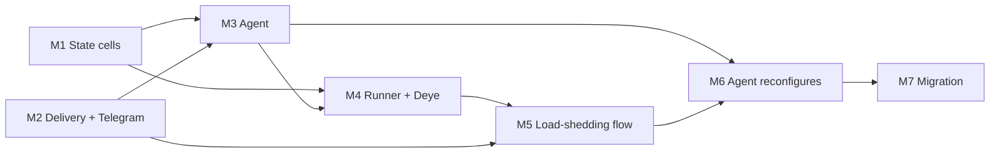

# P1 · All-in-one — phase plan

> This is a phase plan: milestones, tasks, acceptance criteria and order.
> Each milestone gets its own step-by-step implementation plan
> (`docs/plans/p1-mN-<name>.md`, written with tests first) when work on it
> starts, because later milestones depend on what earlier ones settle.

**Goal:** the ganglion agent replaces the family bot: it talks in Telegram
without losing messages, delegates regular work to reflexes that run
without the model (the Deye load-shedding flow), and changes its own
configuration on request with the owner's approval — cheaper than the
current setup.

**Architecture:** core, runner and an API worker in one process
(`--roles core,edge,worker`) on a small container. The agent is the centre:
cells are what it perceives and acts on, modules are its reflexes, the
inbox/outbox is its nervous system. In-process bus; SQLite for inbox/outbox,
history and cells; WASM modules on the runner.

**Tech stack:** Go 1.26, wazero 1.12 (own ABI), modernc.org/sqlite (WAL),
Telegram Bot API, an OpenAI-compatible model API, YAML config.

**Spec:** [spec](../spec.md) sections 6–8 and 10.2; ADRs
[0004](../adr/0004-one-binary-with-roles.md),
[0006](../adr/0006-sqlite-inside-nats-between-nodes.md),
[0007](../adr/0007-openai-compatible-first-provider.md),
[0011](../adr/0011-module-abi.md),
[0014](../adr/0014-state-cells.md),
[0015](../adr/0015-agent-first-p1.md).

## Global constraints

- Core and edge fit a container of about 128 MB; the runner sets
  `GOMEMLIMIT` (principle 8, R-RUN-6). Memory is checked with `modbench` or
  the process RSS before each milestone is closed.
- Testing uses a separate Telegram bot with its own token; two processes must
  never poll one token (R-DLV-8).
- Anthropic access only as in ADR-0009: own API key; the claude CLI worker
  is P2.
- New dependencies, formats and runtimes need an ADR (`CLAUDE.md`).
- All documentation and code comments in English.
- Stop criterion: P1 not closed within **4 weekends** (spec 13). The cut list
  below is part of the plan, not an afterthought.

## Review focus

Failure modes the spec implies that are most likely to hurt in use; each is
pinned by a test in the task that owns the code.

1. **The process dies in the delivery windows** — between inbox write and
   Telegram offset, during a turn, between sending and marking sent. Expect
   no lost message and at most one duplicate (task 2.5, 3.8).
2. **Stale or missing Deye data during an outage** — cloud lag, auth error,
   HTTP 429. Expect no switching and one clear notice, not a flood
   (tasks 4.5, 5.1).
3. **Two processes on one bot token during a deploy** — Telegram answers
   `409 Conflict`. Expect the newer process to stop polling and alert, not
   fight (task 2.3).
4. **Time** — Kyiv time in every message, cron across DST changes, catch-up
   after downtime firing each missed job once (task 4.2).
5. **An approved configuration change breaks something** — a threshold that
   makes the flow oscillate, an observer pointed at a missing chat. Expect
   validation before applying, and a one-command rollback (task 6.3).

## Milestones

| # | Milestone | Delivers | Estimate |
|---|---|---|---|
| M1 | State cells — **done** ([plan](p1-m1-cells.md)) | Switch, sensor and request cells; `virtual` backend with fault injection; SQLite store | 0.5 weekend |
| M2 | Delivery and Telegram | Inbox/outbox, outbox sender, Telegram transport; crash-tested echo bot | 1 weekend |
| M3 | **The agent** | History, actors, provider, router, agent loop, memory, skills, policies; a talking agent on the test bot | 1–1.5 weekends |
| M4 | Reflexes: runner and Deye | Config, scheduler, modules on cron writing sensor cells, exposed to the agent as tools; deployed next to the current bot | 0.5 weekend |
| M5 | Load-shedding flow | The 8.1 state machine on `virtual` load cells; Telegram notifier; shadow week | 0.5 weekend |
| M6 | **The agent reconfigures the system** | Approved, validated, versioned configuration changes with rollback | 0.25–0.5 weekend |
| M7 | Migration | Memory import and consolidation, remaining skills and crons, backups, cutover, gate | 0.5–1 weekend |

Total 4.25–5.5 weekends against a 4-weekend budget: the cut list is
expected to be used.

M1 and M2 are independent. After M3 the agent talks on the test bot; from
M4 on, every reflex is wired to it as a tool. The "Deye two weeks without
the model" clock of the gate starts at M4.

### M1 · State cells (ADR-0014) — done

Measured: 50 cells and 10,000 changes on a SQLite file with a watcher —
peak RSS 17.5 MiB for the whole process, ~4,400 writes/s, no change lost
(15,050 delivered). A binary with cells and SQLite is about 10 MB.

| Task | Done when |
|---|---|
| 1.1 Store: SQLite (WAL) with embedded migrations; `cells` and `cell_history` tables; a `cells.Store` interface with memory and SQLite implementations (decision D-1) | Store tests pass on both implementations; reopening the file keeps state |
| 1.2 Cells: kinds `switch`, `sensor`, `request`; set desired, report, get, watch; version and history; a request expires by its `ttl` | Unit tests per kind, including expiry and version conflicts |
| 1.3 Backends and observers: `virtual` backend with injected delay, failure and manual change; observer interface; a backend conformance suite (`cells/cellstest`) | `virtual` passes the suite; a manual change shows as reported ≠ desired without a command |

### M2 · Delivery and Telegram (spec 7.1, 7.8)

| Task | Done when |
|---|---|
| 2.1 SQLite `queue.Queue`: inbox with unique `idemKey`, leases, `Complete` writing replies, state and the processed mark in one transaction (R-DLV-1, 3, 4, 7) | Duplicate put is a no-op; an expired lease is redelivered; `Complete` is atomic |
| 2.2 Outbox sender: retries, Telegram `retry_after`, order kept per chat, backoff while Telegram is down for hours (R-DLV-5) | Tests with a fake Bot API: 429 honoured, order kept after an outage, no busy loop |
| 2.3 Telegram transport: own minimal Bot API client (decision D-2), long polling, offset only after `Put` (R-DLV-2), forum topics, silent messages; `409 Conflict` stops polling and alerts (R-DLV-8) | Tests against a fake Bot API, then a manual run on the test bot |
| 2.4 Access: `allowed` table with roles `admin` and `family`; strangers get no reply (7.8) | Unit tests; a stranger's message is logged and dropped |
| 2.5 Crash harness: an echo turn under `kill -9` at random points, many iterations | No lost message, at most one duplicate per kill (10.2) |

### M3 · The agent (spec 7.2–7.4, 7.6, 7.7)

| Task | Done when |
|---|---|
| 3.1 History store and conversation actors: one turn at a time, timeout, cancel; provider-neutral history; compaction to a summary (R-AGT-1, 2) | Tests; concurrent messages in one chat are serialised |
| 3.2 OpenAI-compatible provider with tool calls (R-PRV-1, 3); the first cloud model chosen on real turns (decision D-6) | Tests against a fake API; live turns compared on cost and quality |
| 3.3 Router: `SKILL.md` frontmatter, hard filters, rules and weights, fallback on error, 429 and timeout (R-RTR-1–3) | Router tests including `privacy: local-only` and fallback |
| 3.4 Agent loop with step, depth and daily limits; `turns` trace with cost (R-AGT-3–5) | Limit tests; a turn's trace is complete |
| 3.5 Memory: Markdown in a git repo (decision D-7), `memory.*` tools, index in the system prompt (R-MEM-1–3 without the nightly job) | A fact told in one chat is recalled in a later turn |
| 3.6 Tools and policies, base: `schedule.*`, `message.send`, `cells.get`/`cells.set`; side-effect tools need a confirmation request cell; external text marked as data; `turn_id` + call number on side effects (R-POL-1–4, R-DLV-6) | Tests: an unconfirmed action does not run; an expired request denies |
| 3.7 Skills level 1 and 2: Markdown skills; scripts as subprocesses with an environment allowlist and timeout (decision D-5) | A skill with a script runs; a variable outside the allowlist is not passed |
| 3.8 End to end on the test bot: message → inbox → model → tools → outbox → reply, under the M2 crash harness | 10.2 acceptance for turns |

### M4 · Reflexes: runner and Deye (spec 7.5, 8)

| Task | Done when |
|---|---|
| 4.1 Node config in YAML (decision D-3): roles, modules with manifests, cells, Telegram chats and topics; secrets from the environment; `GOMEMLIMIT` (R-RUN-6) | Config tests; a bad config fails at start with a clear message |
| 4.2 Scheduler: cron in Europe/Kyiv, `cron_runs` table, catch-up after downtime runs each missed job once; `idemKey` = job + scheduled time; the agent's `schedule.*` uses it | Tests across a DST change and a simulated downtime |
| 4.3 Cell host functions for modules (`cell.get`, `cell.report`, `cell.set`), granted per cell in the manifest; `pdk` and `pdk/guest` updated | Runner conformance suite extended and green |
| 4.4 Runner in `node.Run`: modules from config, triggered by the scheduler or called by the agent as tools (`deye.status`); optional `init` and `health` exports (spec 7.5); a minimal supervisor — backoff after failures, N failures in M minutes disable the module and emit `module.crashloop`; failures and `auth_failed` reach the agent as events; `cells.Reconcile` at start and periodically, `ExpireDue` on a short tick (M1 review) | `deye-reader` writes the `grid` and `soc` sensor cells on schedule; the agent answers "how is the battery?" through the tool; a failing probe module is disabled |
| 4.5 Deye cadence and limits: 30 min with grid, 5 min without; HTTP 429 backs off honouring `Retry-After`; stale data reported once | Tests with the replay server from `cmd/modbench` |
| 4.6 Deploy: container image, a Railway service next to the current bot, test bot token; compare with `deye.py` for a few days (R-LS-4) | Samples match `deye.py`; RSS within budget; the two-week clock starts |

### M5 · Load-shedding flow (spec 8)

| Task | Done when |
|---|---|
| 5.1 The flow as a WASM module using cell host functions (decision D-4) with the 8.1 states and 8.2 rules: thresholds from config, hysteresis, debounce, freshness, manual override for 2 h (time of the external change from the cell's history), kill switches, staged restore 1 min apart; the flow sets desired only on a decision, never re-asserts it on every poll (each `SetDesired` is a change and a notice) | Unit tests of the state machine |
| 5.2 Telegram notifier as an observer of load cells; kill switches toggled through the agent ("pause the boiler automation") with confirmation | Tests with a fake Bot API |
| 5.3 Tests: R-LS-1 replay of SOC history (the real history stays a local, uncommitted fixture; synthetic outage curves are committed) and R-LS-2 invariants on `virtual` cells with fault injection | Suites green; invariants hold under injected failures |
| 5.4 Shadow week (R-LS-3) to a test topic, reviewed by the owner; then enabled on `virtual` cells with notifications to the real topic | A week without a wrong decision |

### M6 · The agent reconfigures the system (ADR-0015)

| Task | Done when |
|---|---|
| 6.1 Configuration as versioned data: the node config lives in a git repo next to memory; every change is a commit with a reason | History of changes is visible; a restart picks up the latest commit |
| 6.2 `config.propose` tool: the agent turns a request ("send boiler notices to me privately", "shed the big boiler at 45%") into a structured change with a human-readable diff; the owner approves through a request cell | A proposal without approval is never applied; an expired request discards it |
| 6.3 Validation and rollback: a change must parse, pass config checks and, for the flow, keep the R-LS-2 invariants on `virtual` cells before it applies; `config.rollback` restores the previous commit | A change that breaks an invariant is rejected with the reason; rollback restores behaviour |
| 6.4 Risk class on backend changes: moving a cell to a backend of a higher class (e.g. `virtual` → `tuya`) is always a separate, explicitly worded approval (ADR-0014); needs a rebind path in `cells` — today `Define` with another backend is `ErrConflict` | Test: such a change cannot be bundled into a routine approval |

### M7 · Migration (spec 7.7, 7.8, 10.2)

| Task | Done when |
|---|---|
| 7.1 Inventory of the current bot: skills, crons, topics, memory files (read-only) | A written list with a decision per item: port, drop or later |
| 7.2 Memory import into the git memory repo; nightly consolidation cron and dislike handling (R-MEM-1–3) | Facts found by `memory.search`; a consolidation run commits |
| 7.3 Port the remaining skills and crons from the inventory | Each ported item has a smoke test |
| 7.4 Backups: daily `VACUUM INTO`, git push of the memory and config repos to a private remote or S3 | A restore from backup is tested once |
| 7.5 Cutover runbook: stop the old bot's polling (zero overlap), switch the token, smoke test, rollback by restarting the old bot | Cutover done; rollback rehearsed |
| 7.6 Gate measurement: monthly cost from Railway metrics against the current bot with a heap cap; two weeks of Deye without the model; two weeks without a family complaint left unfixed | Gate passed or a stop criterion fires |

## Decisions to take during P1

Each becomes an ADR when its milestone starts; the recommendation is a
starting point, not a decision.

| # | Question | Recommendation | Milestone |
|---|---|---|---|
| D-1 | SQLite migrations: own small migrator over embedded `.sql` files, or goose | Own: a few dozen lines, no dependency | M1 |
| D-2 | Telegram client: own minimal Bot API client, or a library | Own: a handful of methods, full control over 409 and 429 | M2 |
| D-5 | Sandbox for level-2 scripts | P1: subprocess, environment allowlist, timeout; Landlock or bubblewrap later (spec 11) | M3 |
| D-6 | First cloud model for routine turns | Chosen on cost and quality of real turns (spec 11) | M3 |
| D-7 | Git for memory and config: the `git` binary or go-git | The binary: smaller process (principle 8) | M3 |
| D-3 | Node config format | YAML, like manifests (ADR-0012); secrets only from the environment | M4 |
| D-4 | The flow as a WASM module with cell host functions, or native Go | WASM module: it is the project's core hypothesis | M5 |

## Cut list

If the budget runs out, cut in this order and record each cut in "Not now":

1. The model price catalogue in the router (R-RTR-1) — fixed weights in config.
2. Compaction summaries — keep the last N turns.
3. Level-2 scripts, if no migrated skill needs them.
4. M6 beyond 6.1–6.3 — keep approved threshold and observer changes, defer
   backend switching.

Never cut: delivery guarantees (M2), the flow's invariants (5.3), backups
(7.4), the cutover rollback (7.5).

Moved out of P1 already: the claude CLI worker, to P2 (ADR-0015).
