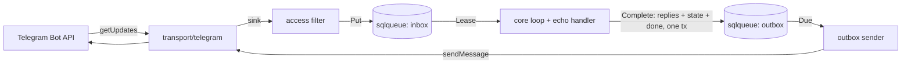

# P1 · M2 Delivery and Telegram — implementation plan

> **For agentic workers:** REQUIRED SUB-SKILL: Use superpowers:subagent-driven-development
> (recommended) or superpowers:executing-plans to implement this plan task
> by task. Steps use checkbox (`- [ ]`) syntax.

**Goal:** an echo bot on Telegram that never loses a message and sends at
most one duplicate per crash: SQLite inbox and outbox, an outbox sender
with retries, our own Bot API client and transport, an access list, and a
crash harness that kills the process with `kill -9` at random points.

**Architecture:** the Telegram transport polls updates and hands each one to
a sink that first checks the access list and then calls `Queue.Put`. The
transport confirms the offset to Telegram only after `Put` returns. A core
loop leases one event at a time, calls a handler (the echo handler now, the
agent in M3) and writes the replies, the conversation state and the
"processed" mark in one transaction. A separate sender delivers the outbox
in order per conversation, honouring `retry_after` and backing off while
Telegram is down. Everything sits in one SQLite file (`sqlitedb`, from M1).



**Tech stack:** Go 1.26, `database/sql`, `modernc.org/sqlite` v1.60.1,
`net/http`, `encoding/json`. No new dependencies.

**Spec:** [7.1](../spec.md#71-guaranteed-delivery) (R-DLV-1–8),
[7.8](../spec.md#78-security-and-operations-mvp), [10.2](../spec.md#102-p1--all-in-one--scope-and-acceptance);
[phase plan M2](p1-all-in-one.md#m2--delivery-and-telegram-spec-71-78);
ADRs [0006](../adr/0006-sqlite-inside-nats-between-nodes.md),
[0016](../adr/0016-sqlite-migrations.md),
[0017](../adr/0017-extension-points.md),
[0018](../adr/0018-own-telegram-bot-api-client.md).

## Global constraints

- Pure Go, no CGO, no new dependencies (ADR-0018); the process stays small
  (principle 8).
- Every timestamp comes from an injected clock (`func() time.Time`); stored
  as Unix milliseconds UTC.
- Telegram types stay inside `transport/telegram`; the rest of the system
  sees only `event.Event` and `event.Outgoing` (ADR-0017).
- The bot token never appears in logs or errors; it is replaced by
  `<token>`.
- Message text is never logged at info level or above (family messages);
  log ids, lengths and principals instead.
- Migrations live next to the package that owns the tables
  (`<pkg>/migrations/NNN_name.sql`), applied per component (ADR-0016).
- Docs and comments in English.

## Key formats

| What | Format | Example |
|---|---|---|
| Conversation key (`Event.Conv`, `Outgoing.Conv`) | `telegram:<chat_id>`, or `telegram:<chat_id>/<thread_id>` for a forum topic | `telegram:-1001234567890/45` |
| Principal (`Message.From`, access list) | `telegram:user:<user_id>` | `telegram:user:123456` |
| Incoming `IdemKey` | `telegram:<bot_id>:<update_id>`; `bot_id` is the token's prefix before `:` | `telegram:7001:883920` |
| Reply `IdemKey` | `<incoming IdemKey>:reply:<n>` | `telegram:7001:883920:reply:0` |
| Part `IdemKey` (a split long message) | `<IdemKey>:p<i>` | `…:reply:0:p1` |

The bot id is in the incoming key because update ids are per bot. When the
family bot replaces the test bot on the same database (M7), its update ids
could collide with old ones and be dropped as duplicates.

## Review focus

1. **The process dies between `Put` and the offset confirmation.** Telegram
   redelivers the update, and `Put` is a no-op for its `IdemKey` (tasks 2,
   5, 7).
2. **The process dies during a turn.** The lease expires and the event is
   processed again. `Complete` is all-or-nothing, so a reply is never
   stored without the "processed" mark (tasks 2, 7).
3. **The process dies between `sendMessage` and the "sent" mark.** One
   duplicate is accepted (R-DLV-5). It must not be more: a split message
   records each part it has sent (tasks 3, 7).
4. **Order in a conversation.** A reply that waits on a retry blocks the
   later replies in the same conversation, and only there (task 3).
   Incoming events are leased in order per conversation, one at a time
   (task 2).
5. **`409 Conflict`.** Polling stops and does not retry; one alert goes to
   the admin, and the sender keeps working (tasks 5, 7).
6. **Token leaks.** `url.Error` from `net/http` contains the full request
   URL, token included. Every error the client returns is redacted (task 4).
7. **A stranger writes to the bot.** The message never reaches the inbox,
   is logged without its text, and gets no reply (task 6).

## File map

| Package | Files | Responsibility |
|---|---|---|
| `event` | `id.go`, `message.go`, `event.go` | ULID ids; the neutral message payload; `Outgoing.Silent` |
| `transport` | `transport.go`, `errors.go` | Error kinds for senders (`ErrPermanent`, `RetryAfterError`), optional `Parter` |
| `queue` | `queue.go` | `Outbox` interface next to `Queue`; `ErrEmpty`, `ErrLeaseLost` |
| `queue/sqlqueue` | `sqlqueue.go`, `inbox.go`, `outbox.go`, `migrations/001_queue.sql` | SQLite inbox, outbox and conversation state |
| `outbox` | `sender.go` | Delivers the outbox: order per conversation, retries, `retry_after`, parts |
| `transport/telegram` | `client.go`, `types.go`, `transport.go`, `conv.go`, `split.go` | Own Bot API client, polling loop, send path |
| `transport/telegram/telegramtest` | `server.go` | Fake Bot API for tests and the crash harness |
| `access` | `access.go`, `migrations/001_allowed.sql` | The `allowed` table; sink filter |
| `core` | `loop.go`, `echo.go` | Lease → handler → `Complete`; the echo handler |
| `node` | `node.go`, `config.go` | Wires the core role from environment variables (until D-3 in M4) |
| `cmd/ganglion` | `crash_test.go` | The crash harness |

---

### Task 1: shared types — ids, message payload, transport errors, outbox interface

**Files:**
- Create: `event/id.go`, `event/id_test.go`, `event/message.go`,
  `transport/errors.go`, `transport/errors_test.go`
- Modify: `event/event.go` (`Outgoing.Silent`), `queue/queue.go`

**Interfaces:**
- Produces:
  ```go
  // event
  func NewID(now time.Time) string // ULID: 48-bit ms time + 80 random bits (crypto/rand), Crockford base32, 26 chars; lexically sortable by time
  type Message struct {               // Payload of Kind "message"
      Text string `json:"text"`
      From string `json:"from"`           // principal, e.g. "telegram:user:123"
      Name string `json:"name,omitempty"` // display name, for the model and logs
  }
  // Outgoing gains:
  Silent bool // deliver without a notification sound

  // transport
  var ErrPermanent = errors.New("transport: permanent failure") // wrap it: the message will never be delivered (blocked, chat gone)
  type RetryAfterError struct{ After time.Duration }           // the channel asks the sender to pause the whole transport
  func (e *RetryAfterError) Error() string
  type Parter interface { Parts(msg event.Outgoing) []event.Outgoing } // optional: a transport with a size limit splits deterministically

  // queue
  var ErrEmpty = errors.New("queue: nothing to lease")
  var ErrLeaseLost = errors.New("queue: lease lost")
  type Pending struct {
      Msg       event.Outgoing
      Attempts  int // failed attempts so far
      PartsSent int // parts already delivered, for a split message
  }
  type Outbox interface {
      // Enqueue stores messages outside a turn (alerts, notifiers). A stored IdemKey is a no-op.
      Enqueue(ctx context.Context, msgs ...event.Outgoing) error
      // Due returns the oldest unsent message of each conversation whose retry time has come,
      // oldest first, and the earliest retry time among heads not due yet (zero if none).
      Due(ctx context.Context, limit int) (due []Pending, next time.Time, err error)
      PartSent(ctx context.Context, id string, parts int) error
      Sent(ctx context.Context, id string) error
      Retry(ctx context.Context, id string, notBefore time.Time, reason string) error
      Fail(ctx context.Context, id string, reason string) error // permanent; the conversation moves on
  }
  ```
- [x] **Step 1: Write failing tests.**
  - `TestNewIDIsSortableAndUnique`: 1,000 ids over increasing times sort in
    time order; there are no duplicates; each id is 26 characters from the
    Crockford alphabet.
  - `TestNewIDSameMillisecondDiffers`.
  - `TestRetryAfterErrorUnwraps`: `errors.As` finds it inside
    `fmt.Errorf("send: %w", err)`.
- [x] **Step 2: Run** `go test ./event/ ./transport/` — FAIL.
- [x] **Step 3: Implement.** Only types and `NewID`; `Queue` itself does
  not change.
- [x] **Step 4: Run** `go test -race ./event/ ./transport/ ./queue/` — PASS.
- [x] **Step 5: Commit** `event, transport, queue: ids, message payload, send errors, outbox interface`.

### Task 2: SQLite inbox — put, lease in order per conversation, complete (2.1)

**Files:**
- Create: `queue/sqlqueue/sqlqueue.go`, `queue/sqlqueue/inbox.go`,
  `queue/sqlqueue/migrations/001_queue.sql`, `queue/sqlqueue/inbox_test.go`

**Interfaces:**
- Consumes: `sqlitedb.Open`, `sqlitedb.Migrate`, `queue.Queue`, `event.NewID`.
- Produces:
  ```go
  func New(ctx context.Context, db *sql.DB, opts ...Option) (*Queue, error) // migrates component "queue"; WithClock(func() time.Time)
  func (q *Queue) Put(ctx context.Context, e event.Event) error
  func (q *Queue) Lease(ctx context.Context, d time.Duration) (queue.Lease, error) // queue.ErrEmpty when nothing is ready
  func (q *Queue) Complete(ctx context.Context, l queue.Lease, out []event.Outgoing, st queue.StateUpdate) error // queue.ErrLeaseLost
  func (q *Queue) State(ctx context.Context, conv string) (json.RawMessage, error) // nil if none
  func (q *Queue) InboxReady() <-chan struct{}  // signalled (buffer 1, never blocks) after a Put that stored a row
  func (q *Queue) OutboxReady() <-chan struct{} // signalled after Complete or Enqueue stored a message
  func (q *Queue) Prune(ctx context.Context, olderThan time.Duration) (int, error) // deletes done/expired inbox rows and sent/failed outbox rows
  ```
- Schema (`001_queue.sql`):
  ```sql
  CREATE TABLE inbox (
      seq            INTEGER PRIMARY KEY AUTOINCREMENT,
      id             TEXT    NOT NULL UNIQUE,
      idem_key       TEXT    NOT NULL UNIQUE,
      source         TEXT    NOT NULL,
      conv           TEXT    NOT NULL,
      kind           TEXT    NOT NULL,
      payload        TEXT,
      ttl_ms         INTEGER NOT NULL DEFAULT 0,
      at_ms          INTEGER NOT NULL,
      status         TEXT    NOT NULL DEFAULT 'pending', -- pending | done | expired
      lease_token    TEXT    NOT NULL DEFAULT '',
      lease_until_ms INTEGER NOT NULL DEFAULT 0,
      attempts       INTEGER NOT NULL DEFAULT 0,
      done_ms        INTEGER NOT NULL DEFAULT 0
  );
  CREATE INDEX inbox_pending ON inbox (status, conv, seq);

  CREATE TABLE outbox (
      seq           INTEGER PRIMARY KEY AUTOINCREMENT,
      id            TEXT    NOT NULL UNIQUE,
      idem_key      TEXT    NOT NULL UNIQUE,
      transport     TEXT    NOT NULL,
      conv          TEXT    NOT NULL,
      body          TEXT    NOT NULL,                     -- JSON of event.Outgoing
      status        TEXT    NOT NULL DEFAULT 'pending',   -- pending | sent | failed
      attempts      INTEGER NOT NULL DEFAULT 0,
      parts_sent    INTEGER NOT NULL DEFAULT 0,
      not_before_ms INTEGER NOT NULL DEFAULT 0,
      last_error    TEXT    NOT NULL DEFAULT '',
      created_ms    INTEGER NOT NULL,
      done_ms       INTEGER NOT NULL DEFAULT 0
  );
  CREATE INDEX outbox_pending ON outbox (status, transport, conv, seq);

  CREATE TABLE conv_state (
      conv       TEXT PRIMARY KEY,
      data       TEXT NOT NULL CHECK (json_valid(data)),
      updated_ms INTEGER NOT NULL
  );
  ```
- Lease picks the oldest pending event that heads its conversation and is
  not leased. Within one transaction: an expired head (`event.Expired`) is
  marked `expired`, then the next head is tried.
  ```sql
  SELECT seq, … FROM inbox i
  WHERE i.status = 'pending' AND i.lease_until_ms <= :now
    AND NOT EXISTS (SELECT 1 FROM inbox j
                    WHERE j.conv = i.conv AND j.status = 'pending' AND j.seq < i.seq)
  ORDER BY i.seq LIMIT 1
  ```
  Then it sets `lease_token` to a fresh `event.NewID`, sets
  `lease_until_ms = now + d` and increments `attempts`.
- `Complete`, in one transaction:
  1. `UPDATE inbox SET status='done' … WHERE seq=? AND lease_token=? AND status='pending'`;
     0 rows means `ErrLeaseLost`, and the transaction rolls back;
  2. `INSERT OR IGNORE` each outgoing message into `outbox`, with
     `id = event.NewID` when it is empty;
  3. upsert `conv_state` when `st.Conv != ""`.

  A lease that expired but was not taken by anyone else still completes:
  the token still matches.
- [x] **Step 1: Write failing tests** (temp-file DB, fake clock):
  - `TestPutDuplicateIsNoOp`: the second `Put` returns nil, and there is
    one row.
  - `TestLeaseEmpty`: returns `ErrEmpty`.
  - `TestLeaseOrderPerConversation`: a1, b1, a2 put in that order; leases
    give a1, then b1; a2 is not leasable until a1 completes.
  - `TestLeaseExpiryRedelivers`: lease, advance the clock past `d`, lease
    again: the same event with a new token; `attempts` is 2.
  - `TestCompleteWithStaleTokenIsLeaseLost`: the first holder's
    `Complete` after a re-lease returns `ErrLeaseLost`; no outbox rows are
    written.
  - `TestCompleteDuplicateReplyIgnored`: an outgoing message whose
    `IdemKey` is already in the outbox is ignored, and the rest commits.
  - `TestCompleteIsAtomic`: a `StateUpdate` with invalid JSON fails the
    `conv_state` check after the outbox insert. `Complete` returns an
    error, the event is still pending under its lease, and there are no
    outbox rows.
  - `TestCompleteWritesState`: `State` returns the stored value.
  - `TestExpiredEventIsSkipped`: an event with a 1 s TTL is leased 2 s
    later: it is skipped and marked expired; the next event is returned.
  - `TestReopenKeepsQueue`: put, lease, close, reopen; once the lease runs
    out, the event is leasable again.
  - `TestInboxReadySignals`.
  - `TestPrune`: only done, expired, sent and failed rows older than the
    cutoff are removed; pending rows stay. Retention is 7 days. Telegram
    keeps unconfirmed updates for 24 hours, so a pruned `IdemKey` cannot
    come back from it.
- [x] **Step 2: Run** `go test ./queue/sqlqueue/` — FAIL.
- [x] **Step 3: Implement.** Use `BEGIN IMMEDIATE` for `Lease` and
  `Complete` (`db.Conn` + `ExecContext("BEGIN IMMEDIATE")`), so two
  leasers cannot pick the same row.
- [x] **Step 4: Run** `go test -race ./queue/sqlqueue/` — PASS.
- [x] **Step 5: Commit** `queue/sqlqueue: SQLite inbox with ordered leases and atomic complete`.

### Task 3: outbox and sender — order, retries, `retry_after`, parts (2.2)

**Files:**
- Create: `queue/sqlqueue/outbox.go`, `queue/sqlqueue/outbox_test.go`,
  `outbox/sender.go`, `outbox/sender_test.go`

**Interfaces:**
- Consumes: `queue.Outbox`, `transport.Transport`, `transport.Parter`,
  `transport.ErrPermanent`, `transport.RetryAfterError`.
- Produces:
  ```go
  // sqlqueue implements queue.Outbox (see Task 1).
  // outbox
  func NewSender(ob queue.Outbox, wake <-chan struct{}, logger *slog.Logger, opts ...Option) *Sender
  // Options: WithClock, WithBackoff(func(attempt int) time.Duration), WithPoll(d) — safety re-check, default 30s
  func (s *Sender) Register(t transport.Transport)          // by t.Name(); a message for an unknown transport is Fail-ed
  func (s *Sender) Run(ctx context.Context) error           // until ctx ends
  func DefaultBackoff(attempt int) time.Duration            // 1s·2^(attempt-1), capped at 5m, ±20% jitter
  ```
- `Due` returns the heads of conversations: the oldest pending row per
  `(transport, conv)` whose `not_before_ms <= now`. A head that is not due
  blocks its conversation. `next` is the minimum `not_before_ms` of the
  heads that are not due.
- One sender pass:
  1. `Due(limit 100)`.
  2. For each message, skip it if its transport is paused.
  3. Split it with `Parts` if the transport is a `Parter`, otherwise use
     the message as one part.
  4. Send parts from `PartsSent` onward, calling `PartSent` after each.
  5. Call `Sent` when all parts are out.
  6. On error:
     - `RetryAfterError`: pause the transport until `now + After` and do
       not count an attempt. As built, the message is not `Retry`-ed:
       `Retry` always counts an attempt, and the in-memory pause already
       holds every message of the transport. After a restart the pause is
       forgotten and Telegram answers 429 once more;
     - `ErrPermanent`: `Fail` the message and log at error level;
     - anything else: `Retry` it at `now + backoff(attempts+1)`.
- Sleep until the earliest of: `next`, the end of a transport pause, the
  `wake` channel, or the poll interval. There is never a busy loop.
- [x] **Step 1: Write failing tests.**
  - Outbox (sqlqueue): `TestDueGivesOneHeadPerConversation`,
    `TestRetryBlocksOnlyItsConversation`, `TestDueNextIsEarliestRetry`,
    `TestFailMovesConversationOn`, `TestEnqueueDuplicateIsNoOp`,
    `TestPartSentSurvivesReopen`.
  - Sender, with a scripted fake transport in the test file:
    - `TestSendsInOrderPerConversation`: 3 messages in conversation A and
      2 in B; A's second message fails twice; A's order is kept; B is not
      delayed.
    - `TestRetryAfterPausesTransport`: one send returns
      `RetryAfterError{3s}`; no send happens before the fake clock passes
      3 s; the attempt is not counted.
    - `TestPermanentErrorFails`.
    - `TestOutageBacksOffWithoutBusyLoop`: the transport fails for a
      simulated 6 hours; the number of `Send` calls stays below 100 and the
      gaps grow to the 5-minute cap; delivery happens after recovery, in
      order.
    - `TestSplitMessageResumesAfterCrash`: a transport splits into 3 parts;
      part 2 fails; a new sender on the same queue sends only parts 2 and 3.
    - `TestWakeTriggersImmediateSend`.
- [x] **Step 2: Run** `go test ./queue/sqlqueue/ ./outbox/` — FAIL.
- [x] **Step 3: Implement.** The sender is one goroutine and sends
  sequentially. That is enough for a family bot and keeps the order
  trivially correct.
- [x] **Step 4: Run** `go test -race ./queue/sqlqueue/ ./outbox/` — PASS.
- [x] **Step 5: Commit** `outbox: sender with per-conversation order, retry_after and resumable parts`.

### Task 4: Bot API client and fake Bot API (2.3, part 1; ADR-0018)

**Files:**
- Create: `transport/telegram/client.go`, `transport/telegram/types.go`,
  `transport/telegram/client_test.go`,
  `transport/telegram/telegramtest/server.go`,
  `transport/telegram/telegramtest/server_test.go`

**Interfaces:**
- Produces (unexported unless noted):
  ```go
  type client struct { base string; token string; hc *http.Client }
  func newClient(base, token string, hc *http.Client) *client       // base default "https://api.telegram.org"
  func (c *client) call(ctx context.Context, method string, params, result any) error // POST JSON to base+"/bot"+token+"/"+method
  func (c *client) getMe(ctx context.Context) (user, error)
  func (c *client) getUpdates(ctx context.Context, offset int64, timeout time.Duration) ([]update, error) // allowed_updates: ["message"]
  func (c *client) sendMessage(ctx context.Context, p sendParams) (message, error)
  type apiError struct { Method string; Code int; Description string; RetryAfter time.Duration } // unexported; the transport maps it to transport errors
  // types.go: update{UpdateID int64; Message *message}, message{MessageID int64; MessageThreadID int64; Chat chat; From *user; Text, Caption string}, chat{ID int64; Type string; IsForum bool}, user{ID int64; IsBot bool; FirstName, LastName, Username string}
  // sendParams{ChatID int64; MessageThreadID int64 `json:",omitempty"`; Text string; DisableNotification bool `json:",omitempty"`}

  // telegramtest (exported, used by tests in other packages)
  func NewServer(t testing.TB, token string) *Server // httptest.Server; closed by t.Cleanup
  func (s *Server) URL() string
  func (s *Server) AddMessage(m Incoming) int64        // returns update_id; Incoming{ChatID, ThreadID, UserID int64; Name, Text string}
  func (s *Server) Sent() []Outgoing                    // Outgoing{ChatID, ThreadID int64; Text string; Silent bool}
  func (s *Server) Confirmed() int64                    // highest update_id confirmed by an offset
  func (s *Server) FailNext(method string, code int, retryAfter int) // next call of method returns this error
  func (s *Server) SetWebhook(on bool)                  // getUpdates returns 409 while on
  ```
- Fake semantics, as Telegram behaves:
  - `getUpdates(offset)` first drops updates below `offset`; that is the
    confirmation.
  - It returns pending updates, or holds the request up to `timeout`
    seconds and returns as soon as a message is added.
  - A second `getUpdates` while one is in flight makes the older one
    return `409 Conflict: terminated by other getUpdates request`.
  - A wrong token returns 401. `sendMessage` to an unknown thread returns
    400 `message thread not found`.
- The client error text is `telegram: <method>: <code> <description>`. For
  transport errors it is `telegram: <method>: <err with the token replaced
  by "<token>">`. The HTTP client timeout is the poll timeout plus 10 s.
- [ ] **Step 1: Write failing tests.**
  - `TestCallDecodesOK`, `TestCallMapsAPIError` (400 with a description),
    `TestCallReadsRetryAfter` (429, `parameters.retry_after: 7` → 7 s).
  - `TestErrorsNeverContainToken`: an unreachable base URL, a 500 and a
    cancelled context; none of the error strings contains the token.
  - Fake: `TestFakeOffsetConfirms`, `TestFakeLongPollWakesOnMessage`,
    `TestFakeSecondPollerConflicts`.
- [ ] **Step 2: Run** `go test ./transport/telegram/...` — FAIL.
- [ ] **Step 3: Implement.**
- [ ] **Step 4: Run** `go test -race ./transport/telegram/...` — PASS.
- [ ] **Step 5: Commit** `transport/telegram: own Bot API client and a fake Bot API`.

### Task 5: Telegram transport — polling, conversation keys, send, split, 409 (2.3, part 2)

**Files:**
- Create: `transport/telegram/transport.go`, `transport/telegram/conv.go`,
  `transport/telegram/split.go`, `transport/telegram/transport_test.go`,
  `transport/telegram/conv_test.go`, `transport/telegram/split_test.go`

**Interfaces:**
- Consumes: `client`, `transport.Sink`, `transport.ErrPermanent`,
  `transport.RetryAfterError`, `event.Message`, `event.NewID`.
- Produces:
  ```go
  var ErrConflict = errors.New("telegram: another poller or a webhook holds this bot (409)")
  func New(token string, opts ...Option) (*Transport, error) // WithBaseURL, WithHTTPClient, WithClock, WithPollTimeout(d) default 50s, WithLogger
  func (t *Transport) Name() string                           // "telegram"
  func (t *Transport) Run(ctx context.Context, sink transport.Sink) error // returns ErrConflict on 409, ctx.Err() on cancel
  func (t *Transport) Send(ctx context.Context, msg event.Outgoing) error
  func (t *Transport) Parts(msg event.Outgoing) []event.Outgoing // implements transport.Parter
  func ConvKey(chatID, threadID int64) string
  func ParseConv(conv string) (chatID, threadID int64, err error)
  func Principal(userID int64) string                          // "telegram:user:<id>"
  ```
- `Run`:
  1. `getMe` once; this checks the token and gives the bot id for the keys.
  2. Loop: `getUpdates(offset)`.
  3. For each update in order: if it is a `message` from a non-bot user
     with text or a caption, build an `Event`:
     - `Kind "message"`, `Source "telegram"`;
     - `Conv ConvKey(chat, thread if is_topic_message)`;
     - `IdemKey telegram:<bot_id>:<update_id>`;
     - `Payload event.Message{Text, From: Principal(from.id), Name}`;
     - `At` = the message date.
     Then call `sink`. Updates of other shapes are skipped with a debug log.
  4. If `sink` fails, stop the batch, keep `offset` at that update, back off
     and poll again. Telegram redelivers it; nothing is lost.
  5. Otherwise `offset = last update_id + 1`; the next poll confirms it.
  6. Errors:
     - 409: return `ErrConflict` at once, with no retry;
     - 429: wait `retry_after`;
     - 401: return the error, because the token is wrong;
     - anything else: back off 1 s → 60 s with jitter, and reset after a
       success.
- `Send`: parse `Conv`; call `sendMessage(chat, thread, text,
  disable_notification=Silent)`. Plain text, no `parse_mode`; formatting is
  decided in M3. Error mapping:
  - 429 → `RetryAfterError`;
  - 400 and 403 → wrap `transport.ErrPermanent`;
  - 5xx and network errors → as is (retried).
- `Parts`: if the text has at most 4096 UTF-16 code units, return `msg`
  unchanged. Otherwise cut it into chunks of at most 4096 units, at the last
  newline in the final quarter of the chunk if there is one, else at the
  last space, else hard. Part `i` gets `IdemKey + ":p" + i`. The function
  is deterministic.
- [ ] **Step 1: Write failing tests** (against `telegramtest`):
  - `TestRunPutsMessagesInOrder`.
  - `TestOffsetConfirmedOnlyAfterSink`: a sink that fails on the 2nd
    update; `Confirmed()` stays below it, and after the sink recovers the
    same update arrives again.
  - `TestTopicMessageGetsTopicConv`.
  - `TestBotAndNonTextUpdatesSkipped`.
  - `TestIdemKeyIncludesBotID`.
  - `TestRunStopsOn409`: `SetWebhook(true)`; `Run` returns `ErrConflict`,
    and the fake saw exactly one `getUpdates`.
  - `TestRunHonours429`.
  - `TestSendSilentToTopic`.
  - `TestSendMapsErrors`: 429 → `RetryAfterError`; 403 → `ErrPermanent`;
    500 → neither.
  - `TestConvRoundTrip`: includes negative supergroup ids.
  - `TestPartsSplit`: 10,000 characters; an emoji at the boundary is not
    cut in half; parts rejoin to the original text; output is stable
    across calls.
- [ ] **Step 2: Run** `go test ./transport/telegram/` — FAIL.
- [ ] **Step 3: Implement.**
- [ ] **Step 4: Run** `go test -race ./transport/telegram/` — PASS.
- [ ] **Step 5: Commit** `transport/telegram: long polling with offset after Put, topics, silent, 409 stop`.

### Task 6: access list (2.4)

**Files:**
- Create: `access/access.go`, `access/migrations/001_allowed.sql`,
  `access/access_test.go`

**Interfaces:**
- Consumes: `sqlitedb.Migrate`, `transport.Sink`, `event.Message`.
- Produces:
  ```go
  type Role string // RoleAdmin "admin", RoleFamily "family"
  var ErrUnknownRole error
  func New(ctx context.Context, db *sql.DB, opts ...Option) (*List, error) // migrates component "access"; WithClock
  func (l *List) Allow(ctx context.Context, principal string, role Role, name string) error // upsert
  func (l *List) Remove(ctx context.Context, principal string) error
  func (l *List) Role(ctx context.Context, principal string) (Role, bool, error)
  func (l *List) Admins(ctx context.Context) ([]string, error)
  func (l *List) Filter(next transport.Sink, logger *slog.Logger) transport.Sink
  ```
  Table: `allowed(principal TEXT PRIMARY KEY, role TEXT NOT NULL, name TEXT
  NOT NULL DEFAULT '', added_ms INTEGER NOT NULL)`.
- `Filter` acts only on events of kind `message`; other events pass
  through. A message from an unknown principal:
  - is logged at warn level with `principal`, `name`, `conv` and
    `text_len`, but not the text;
  - is not passed on: `Filter` returns nil, so the transport advances the
    offset and the stranger gets no reply.

  A malformed payload is dropped the same way.
- [ ] **Step 1: Write failing tests.**
  - `TestAllowAndRole`.
  - `TestUnknownRoleRejected`.
  - `TestFilterPassesKnown`.
  - `TestFilterDropsStranger`: `next` is not called; nil is returned; the
    log record has no text field.
  - `TestFilterPassesNonMessages`.
- [ ] **Step 2: Run** `go test ./access/` — FAIL.
- [ ] **Step 3: Implement.**
- [ ] **Step 4: Run** `go test -race ./access/` — PASS.
- [ ] **Step 5: Commit** `access: allowed table with roles and a sink filter for strangers`.

### Task 7: core loop, echo bot wiring and the crash harness (2.5)

**Files:**
- Create: `core/loop.go`, `core/echo.go`, `core/loop_test.go`,
  `node/config.go`, `node/config_test.go`, `cmd/ganglion/crash_test.go`
- Modify: `node/node.go`

**Interfaces:**
- Consumes: everything above.
- Produces:
  ```go
  // core
  type Handler func(ctx context.Context, e event.Event) ([]event.Outgoing, queue.StateUpdate, error)
  func Echo(e event.Event) ([]event.Outgoing, queue.StateUpdate, error) // reply "echo: <text>" to e.Conv, IdemKey e.IdemKey+":reply:0"; non-messages → no reply
  func NewLoop(q queue.Queue, ready <-chan struct{}, h Handler, logger *slog.Logger, opts ...Option) *Loop // WithLease(d) default 10m, WithPoll(d) default 30s
  func (l *Loop) Run(ctx context.Context) error // Lease → h → Complete; ErrEmpty → wait on ready/poll; handler error → log, leave the lease to expire

  // node
  type Config struct {
      DB         string // GANGLION_DB, default "ganglion.db"
      BotToken   string // TELEGRAM_BOT_TOKEN, or read from the file named by TELEGRAM_BOT_TOKEN_FILE; empty → no Telegram transport
      BotAPIURL  string // TELEGRAM_API_URL, default "https://api.telegram.org"
      Admin      string // GANGLION_ADMIN, e.g. "telegram:user:123"; seeded as admin at start
  }
  func ConfigFromEnv(getenv func(string) string, readFile func(string) ([]byte, error)) (Config, error) // Admin must look like a principal
  func Run(ctx context.Context, roles []Role, cfg Config, logger *slog.Logger) error
  ```
- `node.Run` with the core role:
  1. Open the DB.
  2. Create `sqlqueue`, `access` (seeding the admin), the Telegram
     transport, the sender and the loop with `core.Echo`, and run them
     until `ctx` ends.
  3. If `Run` of the transport returns `telegram.ErrConflict`: log at
     error level and `Enqueue` one alert to each admin's private chat
     ("Polling stopped: another process or a webhook uses this bot token.
     Stop it and restart ganglion."), with `IdemKey
     alert:telegram-conflict:<process start ms>`. Keep the sender and the
     loop running. The process does not exit, so a supervisor does not
     restart it into the same fight.
  4. Any other error from a component ends `node.Run` with that error (for
     example a wrong token: 401), so the process exits with a clear
     message.
  5. Once a day, `Prune(7 * 24h)`.

  This environment-based config lasts until D-3 (YAML node config) in M4.
  A secret can come from the variable itself, or from a file named by
  `<NAME>_FILE` (Docker and Kubernetes mount secrets as files under
  `/run/secrets`). A trailing newline is trimmed, and setting both forms is
  an error. Today this covers only `TELEGRAM_BOT_TOKEN`; the same helper
  serves every later secret until D-3 replaces it with a secret source.
- Crash harness (`cmd/ganglion/crash_test.go`, `//go:build unix`; skipped
  with `-short`):
  1. Build `cmd/ganglion` into a temp dir once.
  2. Start `telegramtest.NewServer` and a temp DB path.
  3. Add 200 messages from the admin, `m000`…`m199`, in two chats,
     sending them gradually.
  4. Loop K times (default 40; `GANGLION_CRASH_ITERS` overrides it):
     start the binary with the env pointing at the fake, wait a random
     0–400 ms, then `kill -9`.
  5. Start it a final time without killing, and wait until every message
     has a reply, with a 60 s deadline.
  6. Assert:
     - every `mNNN` got at least one `echo: mNNN`;
     - the total number of duplicate replies is at most K;
     - replies in each chat are in the same order as the messages;
     - `Confirmed()` reached the last update.
- [ ] **Step 1: Write failing tests.**
  - `core`: `TestLoopEchoes` (in-memory sqlqueue on `:memory:`);
    `TestHandlerErrorLeavesLeaseToExpire`;
    `TestLoopWaitsOnReadyNotBusy` (counts `Lease` calls over a fake
    second).
  - `node`: `TestConfigFromEnv` (defaults; a bad `GANGLION_ADMIN` is
    rejected with a clear message); `TestConfigTokenFromFile` (the
    trailing newline is trimmed; a missing file is an error naming the
    variable, not the file content); `TestConfigTokenBothFormsRejected`; `TestConflictSendsOneAlert` (the fake
    has a webhook set; the admin gets exactly one alert and polling stops).
  - The crash harness as above.
- [ ] **Step 2: Run** `go test ./core/ ./node/ ./cmd/ganglion/` — FAIL.
- [ ] **Step 3: Implement**; `cmd/ganglion/main.go` passes
  `node.ConfigFromEnv(os.Getenv, os.ReadFile)`.
- [ ] **Step 4: Run** `go test -race ./...` — PASS, including the harness
  with 40 kills. Run it once locally with `GANGLION_CRASH_ITERS=500`.
- [ ] **Step 5: Commit** `core, node: echo bot on the queue and a kill -9 crash harness`.

### Task 8: live run on the test bot, memory, docs (2.3 manual run; closes M2)

**Files:**
- Modify: `Makefile` (target `live-echo`), `docs/architecture/05-code-map.md`,
  `docs/architecture/03-components.md` (if transports or the queue are
  wired differently from the diagram), `docs/README.md`,
  `docs/plans/p1-all-in-one.md` (mark M2 done)

- [ ] **Step 1: `make live-echo`.** It loads `.env` and runs
  `TELEGRAM_BOT_TOKEN=$TELEGRAM_TEST_BOT_TOKEN GANGLION_DB=bin/live.db ./bin/ganglion --roles core`.
  It needs the [owner setup](../README.md#owner-setup-for-live-checks);
  without it, the step is reported as blocked, not faked.
- [ ] **Step 2: Manual checks on the test bot.**
  1. The admin's message is echoed.
  2. A message in a forum topic is echoed into the same topic.
  3. A message from a second, unlisted account gets no reply and leaves a
     warn log without the text.
  4. Start a second instance: the newer poll wins, and the instance that
     got 409 stops polling and sends one alert.
  5. Kill and restart during a burst of 20 messages: none is lost.
- [ ] **Step 3: Measure memory.** Record the RSS of the echo bot when idle
  and after 1,000 messages through the fake, plus the binary size. It must
  stay well inside 128 MB (principle 8).
- [ ] **Step 4: Run** `make check`.
- [ ] **Step 5: Update the docs.**
  - Code map: `queue/sqlqueue`, `outbox`, `transport/telegram`,
    `transport/telegram/telegramtest`, `access`, `core`; update the
    dependency diagram.
  - Phase plan: mark M2 done with the measured numbers.
  - `docs/README.md`: "Where we are".
- [ ] **Step 6: Commit** `docs: M2 delivery and Telegram done`.
