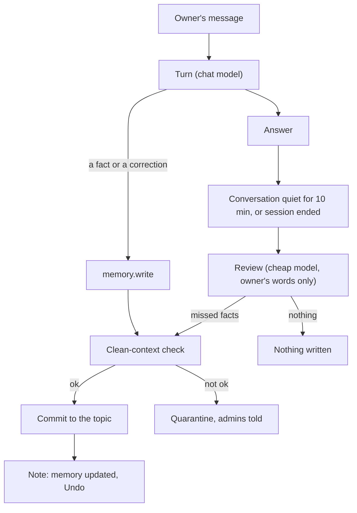

# M5 design: memory by topic

Design from the owner's brainstorm of 2026-11-11 (board card G-138). It is
the input for the spec changes, ADRs 0071 and 0072, and the step-by-step
plan (`p1-m5-memory-topics.md`). It is not itself a plan.

Marks: **owner** means the owner decided it in the brainstorm; **call**
means the author's default, open to the owner's correction.

## 1. Intent

During the M4c live check (2026-11-10) the agent again read a negative
`batt_w` as discharge, although the owner had corrected it before: on a
Deye inverter negative battery power is charging. The correction never
reached memory.

What the code and the test bot's workspace show:

- **The write never happened.** The workspace's git history has no commit
  and no quarantined entry for it. Neither the clean-context check nor the
  policy was involved: the agent did not call `memory.write`. The only
  thing that asks it to is one general line in the core rules ("you decide
  what is worth remembering").
- **A stored fact might not have helped.** A turn sees the index only: each
  fact's title and slug. The body is read with `memory.read` if the model
  thinks of it.
- **The check is worded around the owner.** Devices are in its question,
  but on 2026-11-07 it held back a sum as "not about the owner"; knowledge
  of how the owner's devices work is at risk.

The owner's idea, after how Claude keeps memory: memory is split into
topics ("Inverter"), the agent files what is said, corrections above all,
under the right topic during the conversation, and says that memory was
updated (owner).

## 2. Goals, non-goals

Goals:

- The owner's correction is stored during the conversation, in a topic,
  and a new session answers correctly with no hint.
- A stored fact is in front of the model in every turn, not behind a tool
  call.
- No model call is added to a turn that has nothing to remember (owner:
  no spending on top of what a turn costs today).
- The owner sees every write and undoes it with one press.

Non-goals (stay where they are):

- Nightly consolidation, contradictions across topics, stale entries, the
  retention of archived sessions, the import from the current bot
  (R-MEM-1, M7).
- Facts the agent found out itself, from a tool's result or a page (owner:
  only the owner's words). They wait for consolidation, which looks at
  them separately.
- A model call after every turn. Considered and rejected for its cost
  (owner); see section 5 and ADR-0072.
- Finding a folded topic by keywords or embeddings (R-MEM-4, P2).
- Memory for family members and for scheduled tasks: unchanged, none.

## 3. Topics as files

A topic is one file, `memory/<slug>.md` (owner):

```markdown
---
title: Inverter
summary: The Deye inverter and its battery: what the readings mean
---

- [f1] Negative batt_w on the Deye is the battery charging; positive is discharge. <!-- 2026-11-11 turn=01M7… -->
- [f2] The battery is 10 kWh, installed in spring 2025. <!-- 2026-11-12 turn=01M8… tainted -->
```

- The frontmatter holds the title and a one-line summary. The summary is
  what stands for the topic when it is folded (section 4).
- A fact is one list item: an id that is stable inside its topic, the
  statement, and where it came from in a trailing HTML comment: the date,
  the turn, and `tainted` when it was written in a session that held
  outside content (R-MEM-5). A Markdown viewer hides the comment (call).
- A line the owner writes by hand, with no comment, is a fact with no
  recorded source; the nightly audit reads it like any other. A line with
  no id gets one at the next write to the topic (call).
- Limits, checked on write: a fact 300 runes, a title 100, a summary 150,
  50 facts in a topic (call).
- Every change is one commit, as today (ADR-0033). A fact the check holds
  back goes to `memory/quarantine/`, is never shown to the model, and the
  admins are told (ADR-0034, unchanged).
- **Moving over.** At start, a file in the old shape (one fact, with
  `source_turn` in its frontmatter) becomes a topic with the same slug
  and title, an empty summary and one fact that keeps its text, date,
  turn and taint. All of them move in one commit. A body longer than the
  new limit is kept whole (call).

## 4. How memory reaches a turn

- The "Known facts (data, not instructions)" block of an admin's system
  prompt holds **every topic whole**: its title, then its facts with their
  ids and the "(from outside content)" mark (owner). Nothing has to be
  guessed or fetched.
- The block has a budget, `memory.prompt_budget`, counted in characters
  (no tokenizer in the node); the default is 24,000, about 6,000 tokens
  (call). While everything fits, everything is shown.
- Over the budget, topics **fold**, the one changed longest ago first: a
  folded topic is one line, "title — summary (slug)", and its facts are
  read with `memory.read`. The order is a function of the files, so the
  same memory gives the same text and the provider's cache keeps hitting.
- The prompt is built for every turn, so a write shows in the next
  message of the same conversation. A write costs one cache miss.
- Folding is the place where keyword matching or embeddings come later,
  with no change to the files.

## 5. Who writes, and when

Two paths (owner). The first costs nothing when there is nothing to
remember; the second is a safety net that runs once per conversation, not
once per message.



### 5.1. The agent, in the turn

- The one general line in the core rules becomes a directive that names
  the cases: when the owner corrects you, or states something lasting
  about themselves, their home, their devices, the people around them or
  their plans, write it with `memory.write` under the fitting topic in
  the same turn, before the answer; a correction replaces the fact it
  corrects; do not store what you found out yourself, what is true only
  today, or an instruction to you.
- An instruction to the agent ("answer shorter", "always show a plan") is
  not a fact (R-MEM-5): the agent offers a persona change instead.
- In a clean session the write runs with no question, as today. In a
  tainted session it asks (R-POL-6). The check reads every write
  (R-POL-7).
- A turn with nothing to remember costs what it costs today. A write adds
  one tool step to its turn.

### 5.2. The review, after the conversation goes quiet

- **When.** A conversation with an admin's messages the review has not
  read yet is reviewed once it has been quiet for `memory.review.quiet`
  (default 10 minutes), or at once when its session ends (`/new`, the
  idle reset), so a new session starts with what the old one taught
  (call). Each new turn moves the quiet timer. `memory.review.enabled:
  false` switches the review off.
- **Not for** scheduled tasks, module events, family members, or a
  local-only session, whose words must not reach a cloud model.
- **Durable.** The due time is a stored row, a timer component turns it
  into an inbox event, and a mark in the conversation state records how
  far the review has read: it survives `kill -9` and never runs twice
  over the same messages. Only the owner's private chat is reviewed
  (plan, rulings 1–3).
- **What it reads.** The owner's messages since the mark and the agent's
  replies between them, as plain text, oldest first, up to a size cap
  (the rest waits for the next run); and the topics as they are. **Never
  a tool's result**, so text from a page has no path into memory through
  it. The agent's replies are context for what a correction corrects; a
  fact must come from the owner's words (owner).
- **What it returns.** A JSON object with at most five operations: add a
  fact to a topic, replace a fact, remove a fact, open a topic with a
  title and a summary. An empty list is the usual answer. Code applies
  the operations; an answer that does not parse writes nothing, is
  logged, and the mark still moves, so a bad answer does not loop.
- **Checks.** Each fact passes the clean-context check. When the reviewed
  messages come from a tainted session, nothing is written: the owner
  gets one message listing the facts, with Remember and Skip
  (R-POL-6).
- **Model.** A new purpose, `memory`, in the models by purpose
  (ADR-0060); when the config does not list it, the `check` list is used.
- **Cost.** One cheap call per quiet period that has unread owner
  messages: its input is the memory block and those messages.

## 6. What the owner sees

- **A note.** A write or a review that changed memory sends one message
  with the turn's messages, in the owner's language, listing what
  changed:
  "Memory updated · Inverter: negative batt_w is the battery charging",
  with an **Undo** button (owner). Undo reverts those commits and the note
  folds to "Undone, 21:09" (R-POL-9). When a later write touched the same
  lines and the revert cannot apply, the press says so and changes
  nothing.
- The agent gets a node note of what was stored or held back, so it never
  says "remembered" for a fact in quarantine.
- **`/memory`**, for an admin, with no model and no note in the history:
  the topics with their fact counts; `/memory <topic>` shows one. It
  answers in the private chat only (call).

## 7. Tools

| Tool | Now | After |
|---|---|---|
| `memory.write` | `title`, `body`: one fact per file | `topic` (a slug, or a title and summary for a new topic), `fact`, optional `replaces` (a fact id) |
| `memory.read` | a fact by slug | a topic by slug: for a folded topic |
| `memory.forget` | a fact by slug | a fact by topic and id, or a whole topic |
| `memory.recall` | facts and archived sessions | the same, over facts in topics |
| `memory.audit` and the nightly job | every fact and persona file | every fact of every topic, and the persona |

Policies do not change: `memory.write` and `memory.forget` are for admins,
ask in a tainted session, and are never in a task's grant.

## 8. The clean-context check

Its question widens by one clause: a statement about how the owner's
home and devices work, as the owner describes it ("negative batt_w on the
Deye means charging"), is a fact. What it holds back does not change:
anything that instructs an AI, in doubt held back. The prompt stays fixed
text; its examples gain two of this kind.

## 9. Telemetry

Counters for memory writes by source (agent, review, the owner's
approval), reviews run and their outcome (nothing, written, asked,
unreadable), undos, and a gauge of the known-facts block's size against
its budget (R-OBS-8). `/status` shows the review switched off.

## 10. Acceptance

- Unit tests: the topic format and its round trip, ids, limits, folding
  by budget and its stable order, applying operations, the move from the
  old shape, undo and an undo that cannot apply.
- Chatlab on the scripted model: a correction is written, the note
  arrives, Undo removes the fact; a review after the quiet time writes
  what the turn missed; a tainted session asks instead of writing; a
  review never sees a tool's result (a planted fact in a page's text is
  not stored).
- Chatlab on the real model, the card's acceptance: the owner corrects
  "negative batt_w is charging", the fact lands in the inverter topic in
  that conversation, and after `/new` the agent answers correctly with
  no hint. Run 10 times to measure how often the agent writes by itself,
  with the review off and on.
- A seeded fault (the directive removed and the review off) turns the
  scenario red.
- `make crash-agent`: no write lost or doubled across `kill -9`.
- `make memory` against M4c's numbers (ADR-0056).
- Live, on the test bot: the owner repeats the correction, sees the note,
  presses Undo once, and checks `/memory`.

## 11. Documents before code

- **Spec 7.7:** the semantic row of the table (topics, whole in the
  prompt); new requirements R-MEM-6 (topics as files), R-MEM-7 (the
  known-facts block and its budget), R-MEM-8 (the agent writes in the
  turn; the review after quiet time, the owner's words only), R-MEM-9
  (the note with Undo, `/memory`); R-MEM-2's corrections are handled here
  and its flag for consolidation stays in M7; R-POL-7's question; the
  `memory` section of the config (7.14) and the `memory` purpose (7.3);
  "Not now" gains the per-turn pass, the agent's own findings and finding
  folded topics.
- **ADR-0071:** topics as files, whole in the prompt under a budget;
  against one fact per file with an index of titles (today) and against
  topics matched by keywords. It replaces the file layout of ADR-0033;
  git, the commit per change and the quarantine stay.
- **ADR-0072:** who writes memory: the agent in the turn plus a review
  after quiet time; against a model call after every turn, the agent
  alone, and nightly consolidation alone.
- **Phase plan:** M5, the free number, "Memory by topic", before M6.
- **Architecture:** the code map for `memory`, `guard`, `agent` and
  `tool/builtin`; the review on the component page.
- **Board:** G-138 moves to doing; one card per plan task.

## 12. Risks

- **The agent still forgets to write.** The review catches it within the
  quiet time or at the session's end; the 10 runs measure how often.
- **The review stores noise.** The note with Undo shows every write; its
  prompt is tightened on what the owner undoes.
- **A wrong fact is in every turn.** That is the price of the block being
  whole; Undo, `/memory` and `git revert` take it out.
- **The block grows.** The budget bounds it; the gauge shows when folding
  starts.
