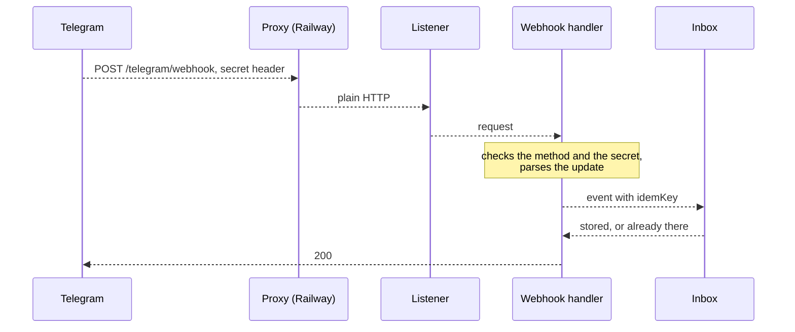

# Design note: a webhook mode for the Telegram transport

Notes from a conversation with the owner on 2026-11-13 (board card G-152).
Nothing here is built. The owner accepted the decision on 2026-11-13
([ADR-0078](../adr/0078-telegram-updates-by-polling-or-webhook.md)); the
requirements are R-DLV-16, R-DLV-17 and R-CFG-11 in the spec and the work is
task 6.6 of the [phase plan](p1-all-in-one.md). The spike of section 12
comes before the code.

Marks: **owner** means the owner said it; **call** means the author's
default, open to the owner's correction.

## 1. Intent

The node receives Telegram updates by long polling (`getUpdates`) and
listens on no public port. The owner wants the second way Telegram offers:

- the transport has a setting: it polls, or Telegram calls it (owner);
- the agent can change that setting, and both modes work (owner);
- on Railway a service has, or can have, a public domain, so the node
  registers its webhook on that domain itself (owner).

The owner asked for a transport option, not for a fix. That matters for the
scope: polling loses nothing today (section 8), so the webhook mode must be
no worse than polling, and polling stays for a node that has no public
address.

## 2. Goals, non-goals

Goals:

- One field in `ganglion.yaml` chooses how updates arrive. Polling stays the
  default and keeps working behind NAT.
- In webhook mode the node registers and looks after the webhook itself: no
  `curl` to the Bot API by hand.
- The delivery guarantee does not change: an update is confirmed to Telegram
  only after it is in the inbox (R-DLV-1, R-DLV-2).
- A wrong address cannot lock the owner out of the chat (section 9).
- The public HTTP listener is one component that the secret intake page
  (G-149) can use later without a second decision.

Non-goals:

- Both modes at once. Telegram does not allow it: `getUpdates` does not work
  while a webhook is set.
- TLS in the node, certificates, ACME. A platform or a reverse proxy in
  front ends TLS.
- Letting the Railway service sleep. The node has timers and modules that
  send traffic, and Railway sleeps a service only after minutes with no
  outbound packets.
- Answering a webhook with a Bot API call in the response body. Telegram
  gives no result for such a call, and the outbox is the only sender
  (R-DLV-5).
- Telegram Mini Apps, an HTTP API, a web UI. They stay in "Not now".

## 3. Facts checked on 2026-11-13

Telegram, from <https://core.telegram.org/bots/api> (Bot API 10.4 of
2026-11-09) and <https://core.telegram.org/bots/webhooks>:

- A bot gets updates by `getUpdates` or by a webhook, never both.
  `getUpdates` does not work while a webhook is set (today's 409).
- Undelivered updates are kept for at most 24 hours, in either mode.
- `setWebhook` takes `url` (HTTPS), `secret_token` (1–256 characters of
  `A-Z a-z 0-9 _ -`), `allowed_updates`, `max_connections` (1–100, default
  40), `drop_pending_updates`, `ip_address`, `certificate`.
- Every webhook request carries the header
  `X-Telegram-Bot-Api-Secret-Token` with the secret.
- A response outside 2xx makes Telegram repeat the request and "give up
  after a reasonable amount of attempts". The schedule is not documented.
- Ports 443, 80, 88 and 8443 only; IPv4 only; TLS 1.2 or later; the
  certificate must match the domain.
- `deleteWebhook` returns the bot to `getUpdates`; it drops pending updates
  only when asked to.
- `getWebhookInfo` returns `url` (empty when the bot polls),
  `pending_update_count`, `last_error_date`, `last_error_message`.
- `update_id` identifies an update and exists so that a receiver can ignore
  repeats.
- Telegram sends webhooks from `149.154.160.0/20` and `91.108.4.0/22` and
  says the ranges may change.

Railway, from <https://docs.railway.com>:

- A generated domain has the form `<name>.up.railway.app`, with a
  certificate Railway issues and renews; the service variable
  `RAILWAY_PUBLIC_DOMAIN` holds it.
- A service with a volume has a short downtime on every redeploy, and
  Railway never keeps two deployments active on one volume.
- A sleeping service wakes on inbound traffic; the first request may get
  `502`.

Not checked, left for the spike (section 12): how fast Telegram redelivers
after an outage, whether the node reaches its own public domain from inside
Railway, and which port a generated domain targets when the image exposes
none.

## 4. The setting

```yaml
http:
  # The public listener, host:port; off runs none.
  addr: off
  # The address the outside world reaches this listener at.
  # public_url: https://ganglion.up.railway.app

telegram:
  # How updates arrive: polling or webhook.
  updates: polling
```

- `telegram.updates` is `polling` or `webhook`; the default is `polling`
  (call). No `auto`: a mode that chooses by itself hides which one runs.
- The listener and its public address belong to the node, not to Telegram
  (call): the intake page of G-149 needs the same two values.
- `telegram.updates: webhook` with `http.addr: off` or without
  `http.public_url` fails the start with the path and the reason, as R-CFG-3
  asks.
- `public_url` must be `https://` with no port or one of Telegram's four.
  The webhook path is fixed, `/telegram/webhook` (call): nothing secret goes
  into a path, because proxies log paths.
- The section applies at the next start, like every section but `modules`
  (R-CFG-6). There is no switch inside a running process (call): `/restart`
  costs seconds and the start is where the checks of section 7 run.
- Open, for the owner: whether `public_url` may be taken from
  `RAILWAY_PUBLIC_DOMAIN` when the file names none. It helps a template
  install, where nobody has written the file yet, and it bends R-CFG-1, which
  keeps only paths, roles and secrets outside the file. The call is to keep
  the file as the one source and let the template's first-run step write it.

## 5. The public listener

A new component of the node, in its own package, outside
`transport/telegram` (call):

- It listens on `http.addr`, serves plain HTTP and expects a proxy that
  ends TLS in front.
- Components register routes when the node is built. The first is the
  Telegram webhook; `GET /healthz` answers a platform's health check and the
  node's own check of its address (section 7).
- Anything else is `404`. No file serving, no listing, no redirect.
- Limits: header and body read timeouts, a body cap of 1 MiB (the spike
  confirms the size of the largest update), a cap on requests in flight.
- It is not the metrics listener. `metrics.addr` stays on `127.0.0.1:9464`:
  the Prometheus endpoint has no authentication and must never share a
  public port.
- Shutdown lets requests in flight finish, then closes.

This moves "an HTTP server" out of the Mini Apps entry of "Not now" in a
narrow form: a listener that carries a transport's webhook. `initData`
validation, pages and a web UI stay there. The G-149 intake page becomes one
more route on this listener when its own ADR is written; nothing here
decides that page.

## 6. A webhook request



Everything is planned, so everything is dashed.

1. `POST` only; anything else is `405`.
2. The secret header is compared in constant time. A wrong or missing one is
   `403` and one log line without the body; the request goes no further.
3. The body is parsed as one update. A body that does not parse is `200`
   with a warning (call): Telegram would only repeat the same bytes.
4. The update goes the way a polled one goes: the same `toEvent`, the same
   `idemKey` (`telegram:<bot>:<update_id>`), the same sink.
5. `200` is sent only after the sink returned: this is the webhook's form of
   R-DLV-2. A failed sink is `500`, and Telegram sends the update again.
6. A duplicate is rejected by the inbox's unique index (R-DLV-1) and is
   `200`: Telegram repeats an update whose `200` it did not see.
7. A callback press that becomes no event is answered as today.

**The secret** is derived, not configured (call):
`hex(HMAC-SHA256(bot token, "ganglion telegram webhook v1"))`. It needs no
new variable and no storage, it is the same after a restart, and it changes
with the token. The token cannot be computed back from it. The other option
is a `store:` secret in the node's scope once
[the secret store](secrets-intake-design.md) exists; it adds a thing to lose
and nothing else.

**Order.** `setWebhook` is called with `max_connections: 1` (call), so
Telegram sends one update at a time, as polling hands them in order. The
handler only writes to the inbox, so one connection is enough for a
family's bot.

**The source address is not checked** (call). Behind a proxy the node sees
the proxy's address and a header a client can set, and Telegram says its
ranges may change. The secret header is the check.

## 7. Registering, removing, switching

At a start in **webhook** mode:

1. `getMe`, as today.
2. The listener starts. The node requests `GET <public_url>/healthz` and
   expects a value it made for this start. This proves the address reaches
   this process.
3. The check fails: the node does not call `setWebhook`. It polls for this
   run and alerts the admins with the reason (section 9).
4. The check passes: `setWebhook` with the URL, the secret,
   `allowed_updates: ["message", "callback_query"]` and
   `max_connections: 1`, without `drop_pending_updates`. The call is made at
   every start; it is idempotent. The node records in its database that it
   set a webhook, and the URL.
5. Once a minute `getWebhookInfo` feeds `/status`: the mode, the last update
   received, `pending_update_count`, the last error and its time.

At a stop in webhook mode the node does **not** call `deleteWebhook` (call).
Updates wait at Telegram for the next start either way, and a call on the
way down is one more thing to fail.

At a start in **polling** mode:

- The record says this node set a webhook: `deleteWebhook`, without dropping
  pending updates, then the record is cleared and polling starts. Updates
  that waited for the webhook come through `getUpdates`.
- No record, and `getUpdates` answers 409: today's behaviour. Another
  process holds the bot; the node alerts the admins, stops receiving and
  keeps sending (R-DLV-8). It never deletes a webhook it did not set.

Somebody else takes the bot while the node is in webhook mode
(`getWebhookInfo` shows another URL, or an empty one): the node alerts the
admins once and does not set its webhook again. This mirrors the 409 rule: a
node that fights for a token makes both sides lose updates.

`setWebhook` itself replaces any webhook that was there. That is the
operator's word in the file, the same as starting a poller on a token.

## 8. A deploy, a restart, a crash

What happens to an update sent while the node is down:

| | Polling (today) | Webhook |
|---|---|---|
| Where it waits | At Telegram, up to 24 h | At Telegram, up to 24 h |
| How it arrives after the start | The first `getUpdates`, at once | Telegram's next retry; the schedule is not documented |
| An update half-handled at the stop | Not confirmed; polled again | No `200`; sent again |
| The same update twice | Rejected by `idemKey` | Rejected by `idemKey` |
| Two processes on one token | 409; one stops and alerts | Not possible: nobody polls |

- **Railway today.** The service has a volume, so Railway stops the old
  deployment before the new one runs, and the database lock
  ([ADR-0019](../adr/0019-release-leases-at-core-start.md)) stops a second
  core. Two pollers do not overlap on a deploy there; R-DLV-8 is already
  met. The webhook does not fix a loss, because there is none.
- **During the downtime** Telegram's request fails; Telegram keeps the
  update and retries.
- **The risk the webhook adds** is delay: after a restart the node waits for
  Telegram's retry. If the spike shows that delay to be long, the start
  drains first: `deleteWebhook`, `getUpdates` until empty, `setWebhook`
  (call, only if measured).
- **A switch of mode** can deliver one update by both ways. The `idemKey` is
  the same in both, so the second copy is rejected.

## 9. No lock-out

In polling mode a broken setting cannot cut the owner off: the node reaches
out. In webhook mode a wrong domain, a removed domain or a wrong target port
means no update arrives, and the owner cannot say `/restart` or ask the
agent to switch back. Two guards (call):

1. **Before registering:** the check of the node's own address in section 7.
   A node whose address does not reach it never leaves polling.
2. **While running:** three `getWebhookInfo` readings in a row with pending
   updates and a fresh delivery error make the node call `deleteWebhook`,
   poll for the rest of the run, and alert the admins. The next start tries
   the webhook again.

The alternative to the second guard is an alert only. It is simpler, and it
leaves a node that only the host's shell can repair. The operator of a
template install may have no shell (owner, in the
[login note](model-login-from-chat-design.md)).

Outside these two cases the node never changes mode by itself.

## 10. The agent changes the setting

The agent gets no tool of its own for this (call). The mode is a field of
`ganglion.yaml`, and the agent changes the file by M6's way: `config.propose`
with a diff the owner approves, then a restart
([phase plan](p1-all-in-one.md), tasks 6.1–6.3). Until M6 the owner edits
the file.

What the webhook adds to M6:

- A change to `http.addr`, `http.public_url` or `telegram.updates` opens or
  moves a public entry to the node. It is approved on its own card, worded
  as that, and never bundled with a routine change, the way task 6.4 treats
  a backend of a higher class.
- A tainted session cannot propose it.
- The agent may know the node's public address only from the file or from
  the operator. It never takes one from a page or a message.

## 11. Security

The listener is the node's first public entry. What an attacker can do and
what stops it:

- **Forge an update** ("from the admin"): the secret header, compared in
  constant time. The secret is known to the node and to Telegram only, and
  travels inside TLS.
- **Learn the secret:** it is in no file, no log and no URL. Whoever has the
  bot token can already read every update and needs no secret.
- **Send large or slow requests:** the body cap, the timeouts, the cap on
  requests in flight; the secret is checked before the body is parsed.
- **Replay a real update:** the unique index on `idemKey`.
- **Probe for other pages:** there are none; everything else is `404`.
- **Reach the metrics:** a separate listener on the loopback address.
- **Trick the agent into opening the listener:** section 10.

Not protected: a proxy or a platform that reads or rewrites requests (it
already runs the process), and Telegram itself.

## 12. Before the code

The owner accepted the ADR as proposed (2026-11-13), so the calls above
stand: the file is the one source of `public_url`, and failed deliveries
return the node to polling for the run. The task is 6.6 in M6 (call: the
owner did not name the phase).

- **A spike on Railway with the test bot**, half a day:
  - the delay between a restart and Telegram's first redelivery, after a
    stop of one, five and thirty minutes;
  - whether the node reaches its own `up.railway.app` address from inside
    the container;
  - the target port of a generated domain for an image that exposes none,
    and whether `RAILWAY_PUBLIC_DOMAIN` is set before a domain is generated;
  - the size of the largest update the bot gets (a long rich message).
- **With the code:** the schema and `ganglion.example.yaml`, the paragraph of
  [deploy-railway.md](../deploy-railway.md) that says a webhook is not
  needed, the code map and the container diagram.
